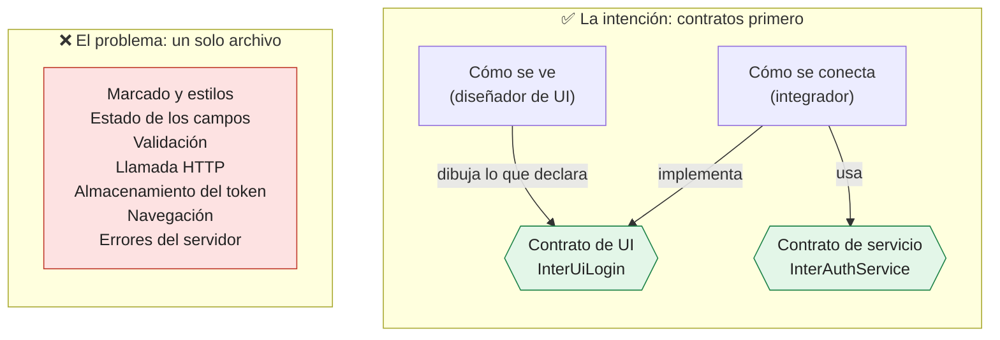
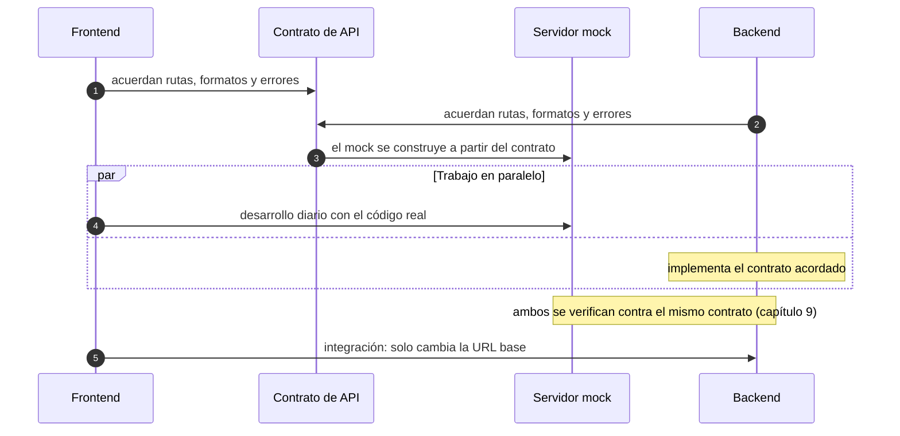
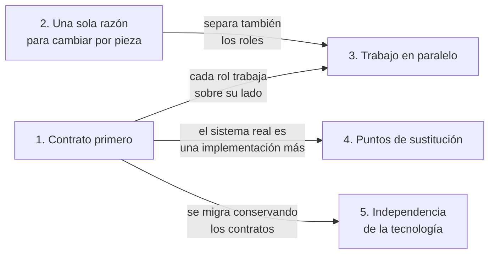
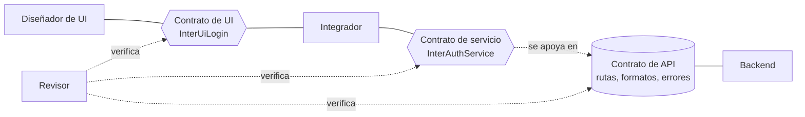
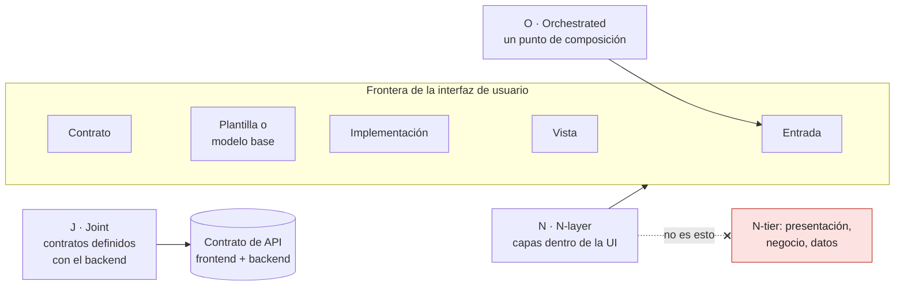
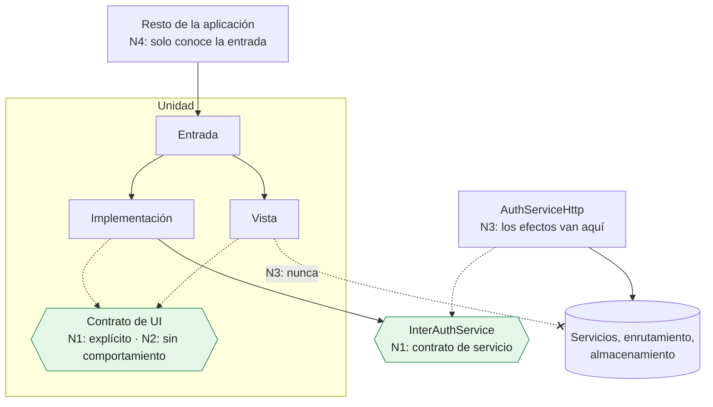

# Capítulo 1. Qué busca JONA

Antes de hablar de archivos, capas o tecnologías, hay que responder una sola pregunta: **¿qué problema intenta resolver JONA?** Un patrón de diseño se define por su intención, no por su forma. La forma cambia de una tecnología a otra; la intención, no.

Este capítulo describe el origen del patrón, su intención y la posición que adopta frente al backend. Los capítulos siguientes muestran cómo se materializa en cada plataforma.

> [!IMPORTANT]
> **Idea del capítulo.** La intención de JONA es fija; la forma varía. Cada interfaz se define primero por sus contratos, la presentación y la integración evolucionan por separado, y una implementación es JONA si cumple las cuatro reglas N1–N4 (sección 1.8), tenga tres archivos o seis.

---

## 1.1 Origen

JONA se publicó por primera vez en el artículo **"El Patrón de Diseño JONA para el Desarrollo Frontend"**, de Jonathan Franchesco Torres Baca, fechado el 22 de mayo de 2024 y disponible en ResearchGate:

<https://www.researchgate.net/publication/380760595_El_Patron_de_Diseno_JONA_para_el_Desarrollo_Frontend_-_jofrantoba>

Ese artículo es la **definición fundacional** del patrón. Describe tres componentes:

| Componente | Responsabilidad según el artículo |
|---|---|
| **Interfaz** | Define un conjunto de métodos que representan las funcionalidades de la interfaz gráfica; actúa como contrato |
| **Clase Plantilla** | Implementa la interfaz y da una implementación básica de sus métodos, con la lógica común de la pantalla |
| **Clase de Implementación** | Extiende la Plantilla y concreta los métodos según los requisitos de la aplicación |

El ejemplo del artículo es un módulo de inicio de sesión escrito con **clases TypeScript que construyen el DOM**: la Plantilla crea los campos y los botones, y registra los eventos; la Implementación reemplaza `login` con una llamada `fetch` real. El diagrama ubica las tres piezas en el paquete `views/uiiniciarsesion` y, debajo, una capa `controllers` (RPC, RequestFactory, REST) a la que **solo llama la Implementación**.

El artículo enumera cuatro beneficios: modularidad, mantenibilidad, reutilización y flexibilidad. Este libro conserva esa base y la desarrolla.

### Las implementaciones que siguieron

La primera implementación es la del artículo: clases TypeScript sobre el DOM. A partir de ella, el repositorio del patrón acumula dos familias de implementaciones:

- **Por herencia**: TypeScript sin framework (`appjona_ts_puro`), Java Swing (`softcommerce-desktop`), Angular (`appjona_angular`) y componentes de clase de React (`appjona_react_refs`, `appjona_react_state_props`). En todas, una Implementación extiende una Plantilla.
- **Por composición**: React con hooks (`appjona_react_hooks`) y Vue con *composables* (`appjona_vuejs`). Más tarde, la librería de componentes `uijona` y la aplicación `softcommerce` consolidaron una forma más compacta, que este libro llama **forma mínima**.

### Qué cambió desde 2024

La intención del artículo se mantiene. Lo que cambió es cómo se expresa:

1. **Entrada u orquestador.** Aparece un punto de composición explícito que une las piezas y es lo único que conoce el resto de la aplicación. La documentación del repositorio lo llama "View / Orquestador".
2. **Vista pura.** El render se separa en una pieza que solo dibuja. En el artículo, la Plantilla construía el DOM y además daba el comportamiento base.
3. **Formas por composición.** Además de la herencia, el patrón se expresa con hooks y *composables*, y con la forma mínima de `uijona` y `softcommerce`.
4. **Contratos como modelo de vista.** Junto al contrato de capacidades del artículo, aparece un segundo estilo: propiedades, *callbacks* que reciben primero el valor de negocio, y valores por defecto declarativos (`DEFAULTS`).
5. **Contrato primero también hacia el backend.** El contrato de la API se define junto con el backend, y los servidores mock se construyen a partir de ese mismo contrato.

### Un derivado externo

En 2026, Harol Rodriguez publicó el **patrón THC / THC-C** (*Types · Hooks · Components*, con un *Composer* opcional), que se declara basado en JONA y lo adapta a librerías reactivas de JavaScript:

<https://medium.com/@elbugdepajarito/patr%C3%B3n-thc-thc-c-2e7887a03921>

Es el primer derivado externo conocido del patrón. El capítulo 12 lo analiza en detalle.

---

## 1.2 El problema

Considere una pantalla de inicio de sesión escrita sin ninguna separación de responsabilidades. En un mismo archivo conviven:

- el marcado y los estilos de la pantalla;
- el estado de los campos (correo, contraseña, errores);
- las reglas de validación;
- la llamada HTTP al servicio de autenticación;
- el almacenamiento del token;
- la navegación a la pantalla siguiente;
- el manejo de errores del servidor.

Mientras la pantalla es pequeña, esto funciona. Cuando el producto crece, aparecen síntomas conocidos:

| Síntoma | Causa |
|---|---|
| Un cambio en el backend obliga a tocar el marcado | La integración y la presentación están en el mismo lugar |
| El diseñador y el integrador editan el mismo archivo y se generan conflictos | No existe una frontera entre sus responsabilidades |
| El frontend se detiene hasta que el backend publica sus servicios | No existe un contrato de API acordado de antemano |
| Las pruebas de la UI necesitan simular la red, el router y el almacenamiento | Los efectos externos están mezclados con el render |
| Migrar a otra tecnología implica reescribir todo | El comportamiento está atado a la sintaxis del framework |
| Nadie puede decir con precisión qué hace la pantalla sin leer su código | No hay un contrato explícito de sus capacidades |

Ninguno de estos problemas es exclusivo de una tecnología. Aparecen igual en React, en Angular, en una aplicación de escritorio Swing o en una app móvil. Por eso la respuesta tampoco puede depender de una tecnología.

---

## 1.3 La intención

> **JONA busca que una interfaz de usuario se defina primero por sus contratos —lo que puede hacer y lo que necesita del sistema—, y que la manera en que se ve y la manera en que se conecta con el resto del sistema evolucionen por separado, cada una a cargo de un rol distinto, en cualquier tecnología.**

La figura 1.1 contrasta el problema de la sección anterior con esta intención.



*Figura 1.1. A la izquierda, todas las responsabilidades de la pantalla en el mismo lugar; a la derecha, los contratos en el centro, y la presentación y la integración a cada lado, a cargo de roles distintos.*

---

## 1.4 La posición frente al backend: el frontend no espera

JONA adopta una posición explícita sobre la relación entre frontend y backend: **el frontend nunca espera al backend**.

1. **Ambos lados definen primero los contratos, juntos.** Las rutas, los formatos de datos y el formato de error se acuerdan antes de implementar cualquiera de los dos lados.
2. **Los servidores mock se construyen a partir de esos mismos contratos.** Un servidor mock no es una aproximación improvisada: sirve el contrato acordado.
3. **Trabajar contra el servidor mock es el modo normal de desarrollo**, no un recurso de emergencia. La interfaz ejecuta su código real; solo cambia la dirección a la que se conecta.
4. **El servidor mock y el backend real se verifican contra el mismo contrato.** Así, lo que funciona contra el mock funciona contra el backend. El capítulo 9 explica cómo.

La figura 1.2 muestra el orden de estos pasos.



*Figura 1.2. El frontend no espera: el contrato se acuerda primero, el servidor mock sale de él y cada lado trabaja en paralelo. Pasar al backend real es cambiar la dirección a la que se conecta la interfaz.*

Un ejemplo del repositorio: el servidor mock de `softcommerce` es un servidor Node sin dependencias que sirve el contrato de la API de la aplicación. La aplicación se conecta a él cambiando solo la URL base.

Ejemplo ejecutable: `ejemplos/contrato-api/login.openapi.yaml` (el contrato) y `ejemplos/mock-server/src/server.mjs` (el servidor mock que lo sirve).

---

## 1.5 Los cinco objetivos

La intención se descompone en cinco objetivos concretos. Cada decisión de diseño de JONA, en cualquier plataforma, responde a uno o más de ellos.



*Figura 1.3. Cómo se apoyan los objetivos entre sí, según los describe esta sección: el contrato primero habilita el paralelismo, la sustitución y la migración; la separación por razones de cambio separa también los roles.*

### 1. Contrato primero

Una unidad de interfaz se describe primero por sus contratos, y esos contratos se escriben antes que el marcado y antes que la integración. Hay dos:

- **El contrato de UI** declara lo que la pantalla ofrece y lo que necesita para dibujarse. Es el acuerdo entre quien diseña la interfaz y quien la integra.
- **El contrato de servicio** declara lo que la pantalla necesita del sistema. Es el puerto del lado del frontend, y se apoya en el **contrato de API** (rutas, formatos y errores) que frontend y backend definen juntos.

Con los dos contratos acordados, cada rol sabe qué le corresponde: el diseñador sabe qué debe representar, el integrador sabe qué debe conectar, el backend sabe qué debe servir y el revisor sabe qué debe verificar.



*Figura 1.4. Cada contrato tiene dos lados y cada rol sabe cuál le toca: el contrato de UI une diseño e integración; el contrato de servicio, apoyado en el contrato de API, une integración y backend.*

### 2. Una sola razón para cambiar por pieza

Cada pieza del patrón cambia por un motivo distinto:

- la presentación cambia cuando cambia el diseño;
- la integración cambia cuando cambia el backend, el enrutamiento o el almacenamiento;
- los contratos cambian solo cuando cambian las capacidades de la pantalla o el acuerdo con el backend.

Si un cambio de diseño obliga a tocar la integración, o al revés, la separación falló.

Hay una objeción razonable: en la forma mínima (capítulo 2), la Implementación concentra el estado de la UI, la validación y la llamada a los servicios. ¿No tiene entonces varias razones para cambiar? La respuesta tiene dos partes:

- **Los cambios del backend no llegan a la Implementación** mientras el contrato de servicio se mantenga. Un cambio de ruta, de formato o de protocolo se resuelve en el adaptador (por ejemplo, `AuthServiceHttp`), no en la pantalla.
- **La validación puede salir a funciones puras.** Así se prueba sin la interfaz y sin servicios, y la Implementación solo la invoca.

### 3. Trabajo en paralelo

Al separar las responsabilidades, se separan también los roles. Quien diseña la interfaz no escribe llamadas al backend; quien integra no toca el marcado ni los estilos; quien construye el backend implementa el contrato de API acordado. Todos trabajan al mismo tiempo, cada uno sobre su lado de un contrato, sin interferir con el trabajo de los demás. El paralelismo no depende de que el backend esté listo. Depende de que los contratos estén acordados y de que exista un servidor mock que los sirva.

### 4. Puntos de sustitución

La conexión con el sistema real es **una** implementación de los contratos, no la única. JONA ofrece tres puntos donde se puede sustituir una pieza sin tocar las demás:

| Punto | Qué se sustituye | Para qué sirve |
|---|---|---|
| 1. Plantilla o modelo base | La integración completa | Ver y revisar la interfaz con su comportamiento por defecto, sin integración |
| 2. Inyección del servicio a través de la entrada | El servicio que recibe la Implementación | Pruebas unitarias y demostraciones con un servicio falso |
| 3. Servidor mock que implementa el contrato de API | El servidor al que se conecta el adaptador | El desarrollo diario: la Implementación ejecuta su código real y solo cambia la URL base |

El tercer punto es el modo de desarrollo por defecto. Cuando no existe un servidor mock, una alternativa es el *Composer* de THC-C: un interruptor dentro de la aplicación que elige entre el servicio real y datos de prueba.

Ejemplo ejecutable: `ejemplos/java-swing/src/main/java/com/example/App.java` (los tres puntos, elegidos por argumento) y `ejemplos/web-react/src/main.tsx` (el punto 3).

### 5. Independencia de la tecnología

Los principios de JONA son conceptuales, no sintácticos. Cualquier lenguaje que permita expresar un contrato y una abstracción puede aplicarlo: TypeScript, Java, Kotlin, Swift, C#, Dart u otros.

Esto permite además algo poco común: **migrar una aplicación de una tecnología a otra conservando sus contratos**. Si las capacidades de cada pantalla están escritas como contratos, la migración se reduce a reimplementar la presentación y la integración en la nueva plataforma, sin redescubrir qué hacía cada pantalla. El capítulo 11 trata este caso.

---

## 1.6 Lo que dice el nombre

JONA significa **Joint Orchestrated N-layer Architecture**. Cada palabra resume una parte de la intención:

| Palabra | Lectura |
|---|---|
| **Joint** (conjunta) | Los contratos se definen de forma conjunta entre frontend y backend |
| **Orchestrated** (orquestada) | Existe un punto de composición, la **entrada**; el resto de la aplicación solo conoce ese punto |
| **N-layer** (N capas) | El número de capas **no está fijado**: depende de la tecnología y de la complejidad de la unidad |

> [!WARNING]
> Una advertencia sobre la última palabra. En arquitectura de software, "N capas" suele designar la división de una aplicación en niveles de despliegue o de responsabilidad (presentación, negocio, datos), lo que en inglés se llama *N-tier*. **JONA no usa el término en ese sentido.** Sus capas están todas dentro de la frontera de la interfaz de usuario: contrato, plantilla o modelo base, implementación, vista y entrada.



*Figura 1.5. Lo que dice cada letra. Las N capas están todas dentro de la frontera de la interfaz de usuario y su número no está fijado; no son los niveles N-tier de una aplicación.*

JONA es un **patrón de diseño**: resuelve un problema recurrente dentro de cada unidad de interfaz. Aplicado de forma sistemática a todas las unidades de una aplicación, define la **arquitectura de la capa de presentación**. Para un arquitecto, esto significa que JONA no prescribe tres, cinco ni seis archivos. Prescribe **fronteras**. Cuántas piezas hacen falta para respetarlas es una decisión de implementación.

---

## 1.7 La intención es fija; la implementación varía

Cada tecnología ofrece mecanismos distintos para expresar un contrato y separar responsabilidades. JONA usa el mecanismo natural de cada una:

| Plataforma | Lenguaje | Contrato | Mecanismo de separación | Implementación de referencia |
|---|---|---|---|---|
| Web sin framework | TypeScript | `interface` | Clase Plantilla que construye el DOM y subclase de Implementación | `appjona_ts_puro` |
| Web, React con clases | TypeScript | `interface` | Componente de clase base y subclase | `appjona_react_refs`, `appjona_react_state_props` |
| Web, React con hooks | TypeScript | `interface` o `type` | Composición de hooks: Implementación, vista y entrada | `appjona_react_hooks`, `uijona`, `softcommerce` |
| Web, Angular | TypeScript | `interface` | `@Component` base y componente de Implementación que la extiende | `appjona_angular` |
| Web, Vue 3 | TypeScript | `interface` | *Composables* | `appjona_vuejs` |
| Escritorio, Swing | Java | `interface` | Ventana Plantilla (`JDialog`, `JFrame`) y subclase | `softcommerce-desktop` |
| Escritorio, JavaFX | Java | `interface` | Controlador base y subclase | Sin implementación de referencia todavía |
| Escritorio, WPF o .NET MAUI | C# | `interface` | `UserControl` o `ContentPage` base y subclase | Sin implementación de referencia todavía |
| Escritorio, Electron | TypeScript | `interface` | Los mismos mecanismos que en web | Sin implementación de referencia todavía |
| Android | Kotlin | `interface` | `abstract class` o `Fragment` base y subclase, o composición con Jetpack Compose | Sin implementación de referencia todavía |
| iOS | Swift | `protocol` | Subclase de `UIViewController`, o composición con SwiftUI | Sin implementación de referencia todavía |
| Multiplataforma móvil | Dart (Flutter) | `abstract class` | Subclase de `StatefulWidget` | Sin implementación de referencia todavía |
| Motor de juego, Unity | C# | `interface` | `MonoBehaviour` base y subclase | Sin implementación de referencia todavía |

El mismo contrato, en cinco lenguajes, escrito en el estilo del artículo de 2024 (**capacidades como funciones**):

```ts
// TypeScript
export interface InterUiLogin {
  login: (email: string, password: string) => void;
  goToCreateAccount: () => void;
  goToRecoverPassword: () => void;
  isValidData: (email: string, password: string) => boolean;
}
```

```java
// Java
public interface InterUiLogin {
    void login(String email, String password);
    void goToCreateAccount();
    void goToRecoverPassword();
    boolean isValidData(String email, String password);
}
```

```kotlin
// Kotlin
interface InterUiLogin {
    fun login(email: String, password: String)
    fun goToCreateAccount()
    fun goToRecoverPassword()
    fun isValidData(email: String, password: String): Boolean
}
```

```swift
// Swift
protocol InterUiLogin {
    func login(email: String, password: String)
    func goToCreateAccount()
    func goToRecoverPassword()
    func isValidData(email: String, password: String) -> Bool
}
```

> La versión en Swift es ilustrativa: no se compila ni se ejecuta en `ejemplos/`.

```csharp
// C#
public interface InterUiLogin
{
    void Login(string email, string password);
    void GoToCreateAccount();
    void GoToRecoverPassword();
    bool IsValidData(string email, string password);
}
```

Ejemplos ejecutables: `ejemplos/contratos-multilenguaje/` (TypeScript, Kotlin y C#, cada uno con una implementación mínima y su prueba) y `ejemplos/java-swing/src/main/java/com/example/view/ui/uilogin/InterUiLogin.java` (Java).

Una nota sobre C#. La convención del lenguaje es nombrar las interfaces con el prefijo `I` (`IUiLogin`). Este libro conserva el prefijo `Inter` en todas las plataformas, para que un mismo contrato tenga el mismo nombre en cualquier tecnología. Un equipo cuya guía de estilo exija `I` puede adoptarlo, siempre que lo aplique de forma uniforme y documente la equivalencia.

La sintaxis cambia; las capacidades declaradas son idénticas. Las tecnologías de composición usan además un segundo estilo de contrato, el **modelo de vista**, que el capítulo 2 presenta junto a este.

---

## 1.8 Cómo se reconoce JONA

Si la forma varía, ¿cómo saber si una implementación es JONA? Por cuatro reglas que se cumplen en todas sus variantes. El capítulo 2 las desarrolla con los identificadores N1 a N4.

1. **N1. Los contratos son explícitos.** La unidad tiene un contrato de UI propio, separado de su implementación, y sus dependencias externas están declaradas como contratos de servicio.
2. **N2. Los contratos no contienen comportamiento.** Declaran capacidades y, como mucho, valores por defecto declarativos. No contienen lógica, ni render, ni efectos.
3. **N3. Los efectos externos viven solo en el lado de la integración.** Las llamadas a servicios, el enrutamiento y el almacenamiento nunca aparecen en la presentación.
4. **N4. El resto de la aplicación solo conoce la entrada.** El enrutador, la ventana principal o el contenedor registran la unidad por su entrada, nunca por sus piezas internas.



*Figura 1.6. Las cuatro reglas sobre una unidad con vista separada; el capítulo 2 muestra las demás formas. La flecha cruzada es la dependencia que ninguna forma admite: la presentación nunca llega al sistema.*

> [!CAUTION]
> Una implementación que respeta estas cuatro reglas es JONA, tenga tres archivos o seis. Una que viola alguna no lo es, aunque use los nombres del patrón.

---

## 1.9 Lo que JONA no busca

Para delimitar la intención, también conviene decir qué queda fuera de ella:

- **No busca un número de archivos.** Multiplicar archivos sin separar responsabilidades no aporta nada. La medida del patrón son las fronteras, no la cantidad de piezas.
- **No es un framework ni una biblioteca.** No se instala. Es una forma de organizar el código que se aplica con las herramientas que ya ofrece cada tecnología.
- **No reemplaza la arquitectura del dominio ni del backend.** JONA organiza el borde de la interfaz de usuario y convive con arquitecturas como Clean o Hexagonal. En términos de puertos y adaptadores, el contrato de servicio (por ejemplo, `InterAuthService`) es el **puerto**, y `AuthServiceHttp` es el **adaptador** que lo implementa. La vista y la implementación forman el **lado que conduce** (*driving side*): inician las interacciones y consumen el puerto. El contrato de UI no es un puerto; es el acuerdo interno de la unidad. El capítulo 6 desarrolla esta relación.
- **No elimina la complejidad; la reparte.** Separar responsabilidades agrega piezas e indirección. Ese costo es real, y el capítulo 10 explica cuándo se justifica y cuándo no.

---

## 1.10 Resumen

- JONA nace en 2024 con un artículo que define tres componentes: Interfaz, Clase Plantilla y Clase de Implementación, sobre clases TypeScript que construyen el DOM.
- Desde entonces se agregaron la entrada, la vista pura, las formas por composición, los contratos como modelo de vista y el contrato de API definido junto con el backend.
- Su intención es definir cada interfaz por sus contratos y separar la presentación de la integración, con un rol a cargo de cada una.
- Su posición es que el frontend no espera al backend: los contratos se acuerdan primero y el desarrollo diario se hace contra un servidor mock que sirve ese mismo contrato.
- La intención se descompone en cinco objetivos: contrato primero, una sola razón para cambiar, trabajo en paralelo, puntos de sustitución e independencia de la tecnología.
- El nombre lo anticipa: los contratos son conjuntos, hay un punto de composición y el número de capas es **N**, siempre dentro de la frontera de la interfaz.
- Una implementación es JONA si cumple cuatro reglas: contratos explícitos, contratos sin comportamiento, efectos solo en la integración y acceso solo por la entrada.
