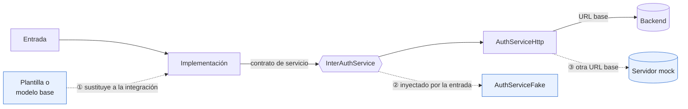
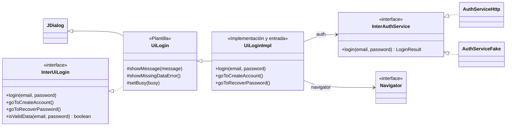
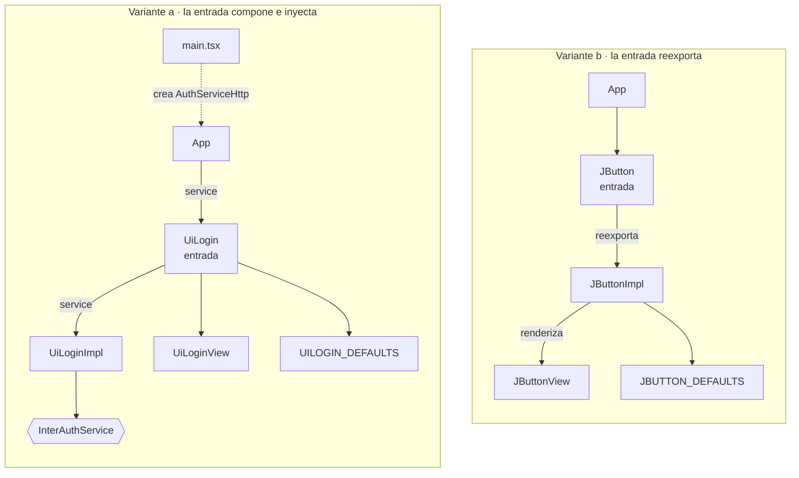
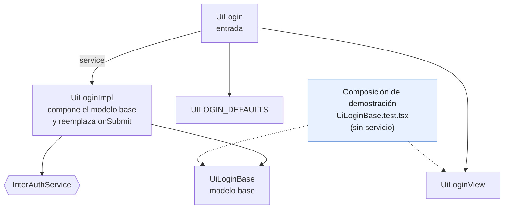
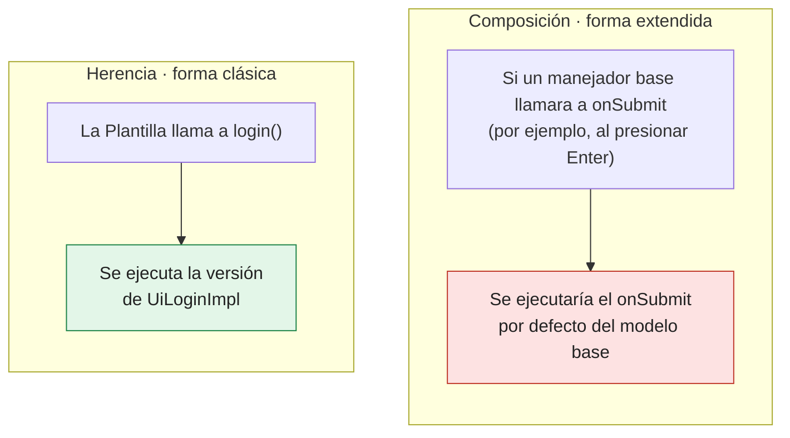
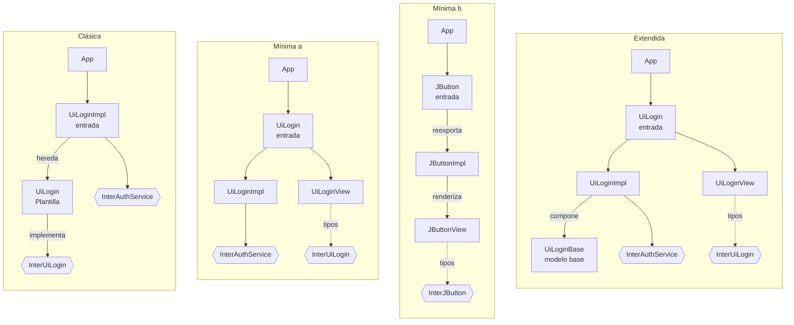
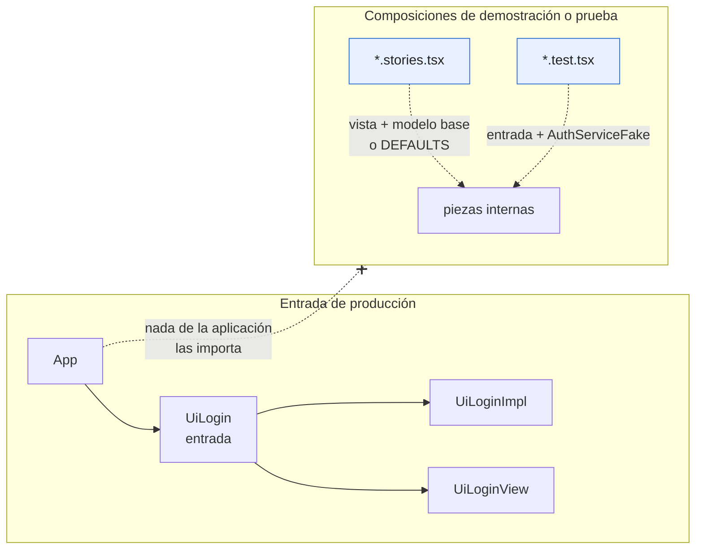
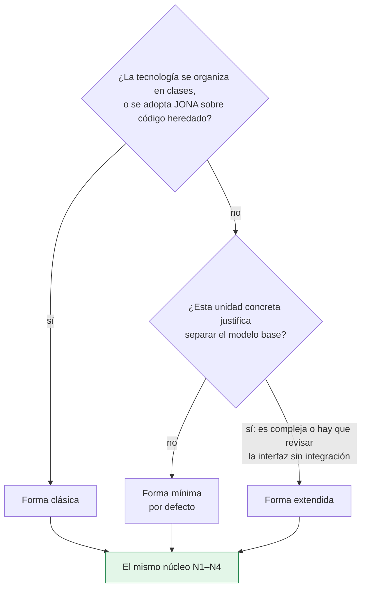
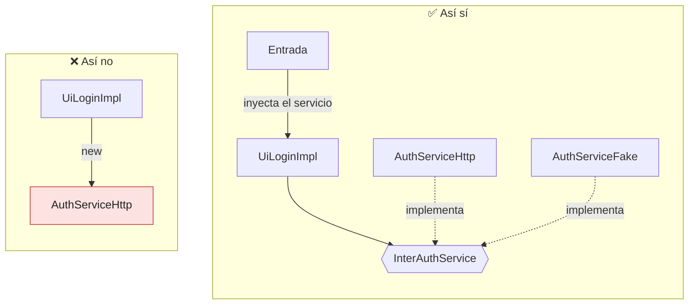

# Capítulo 2. Anatomía: el núcleo invariante, las formas del patrón y su glosario

El capítulo 1 describió la intención de JONA y cerró con cuatro reglas que permiten reconocerlo. Este capítulo describe su **anatomía**: qué piezas existen, qué responsabilidad tiene cada una, cómo dependen entre sí y en qué combinaciones se usan.

La idea central es simple: JONA tiene un **núcleo** que nunca cambia y **tres formas** que lo implementan. Elegir una forma es una decisión de diseño; respetar el núcleo no es opcional.

> [!IMPORTANT]
> **Regla del capítulo.** La forma se elige por unidad; el núcleo no se elige. Una unidad puede usar cualquiera de las tres formas, pero solo es JONA si cumple N1–N4. La sección 2.11 reúne las maneras más comunes de romper esas reglas.

> **Sobre los fragmentos de código.** Los fragmentos de este capítulo son extractos, a veces abreviados, de los ejemplos ejecutables de la carpeta `ejemplos/` (apéndice B). Omiten detalles que no aportan a la explicación; al final de cada sección se indica el archivo completo, que compila y tiene pruebas.

---

## 2.1 El núcleo invariante

| # | Regla | Qué protege |
|---|---|---|
| N1 | Los **contratos son explícitos** | Un acuerdo compartido entre roles, y entre frontend y backend |
| N2 | Los contratos **no contienen comportamiento** | Que los contratos no cambien cuando cambia la implementación |
| N3 | Los **efectos externos** (servicios, enrutamiento, almacenamiento) viven **solo en el lado de la integración** | Que la presentación no dependa del sistema |
| N4 | El resto de la aplicación **solo conoce la entrada** | Que las piezas internas puedan cambiar sin afectar a nadie más |

**N1. Contratos explícitos.** Toda unidad JONA tiene un contrato de UI. Si además depende del sistema (autenticación, datos, almacenamiento), tiene también un contrato de servicio por cada dependencia. Los dos tienen audiencias distintas:

| Contrato | Ejemplo | Lo comparten | Qué declara |
|---|---|---|---|
| **Contrato de UI** | `InterUiLogin` | Diseñador de UI e integrador | Lo que la unidad ofrece y lo que la vista necesita para dibujarse |
| **Contrato de servicio** | `InterAuthService` | Integrador y backend | Lo que la unidad necesita del sistema; es el puerto del lado del frontend |

Un componente puramente visual, como un botón del sistema de diseño, no depende del sistema y solo tiene contrato de UI. Agregarle un servicio artificial para "cumplir N1" sería un error: N1 exige que las dependencias que existen sean explícitas, no que existan.

El contrato de servicio se apoya en el **contrato de API**: rutas, formatos de petición y respuesta, y formato de error, definidos junto con el backend. De él se construyen el adaptador real y el servidor mock. Por ejemplo, el servidor mock de `softcommerce` documenta que sus errores tienen la forma `{ code, message, details, traceId }` y que `POST /auth/login` responde 200, 401 `INVALID_CREDENTIALS` o 403 (`USER_DISABLED`, `NO_DESKTOP_ACCESS`).

**N2. Contratos sin comportamiento.** Un contrato declara tipos, firmas y, como mucho, **valores por defecto declarativos** (`UILOGIN_DEFAULTS`, `JBUTTON_DEFAULTS`). No contiene lógica, ni render, ni efectos.

> [!WARNING]
> Un contrato que usa tipos de un framework, como `React.ReactNode`, es portable **en intención, pero no en código**. Sus capacidades se pueden reescribir en otra tecnología; el archivo no se puede reutilizar tal cual.

**N3. Efectos solo en la integración.** La **Implementación** decide cuándo llamar a un servicio y qué hacer con la respuesta, siempre a través de un contrato de servicio. El **adaptador** (por ejemplo, `AuthServiceHttp`) realiza la entrada y salida: HTTP, almacenamiento, sockets. La vista, la Plantilla y el modelo base nunca llaman a servicios.

**N4. Solo la entrada es pública.** La **entrada** es un **rol**, no un sufijo de archivo:

| Forma | Quién es la entrada |
|---|---|
| Clásica | La propia clase de Implementación: la aplicación instancia `UiLoginImpl` |
| Mínima, variante a (`softcommerce`) | Un componente que compone Implementación y vista, e inyecta el servicio |
| Mínima, variante b (`uijona`) | Un archivo que reexporta la Implementación con el nombre público de la unidad |
| Extendida | Un componente que compone Implementación y vista |

---

## 2.2 Dos estilos de contrato de UI

El contrato de UI admite dos estilos. Este libro los nombra de forma explícita porque cambian la manera en que se leen las demás piezas. El capítulo 3 los compara en detalle.

**Capacidades como funciones.** Es el estilo del artículo de 2024 y de la forma clásica. El contrato enumera **lo que la pantalla puede hacer**, y la Plantilla y la Implementación implementan esas funciones:

```ts
// InterUiLogin.ts — estilo capacidades
export interface InterUiLogin {
  login: (email: string, password: string) => void;
  goToCreateAccount: () => void;
  goToRecoverPassword: () => void;
  isValidData: (email: string, password: string) => boolean;
}
```

Ejemplo ejecutable: `ejemplos/contratos-multilenguaje/typescript/src/InterUiLogin.ts`.

**Modelo de vista.** Es el estilo de las tecnologías de composición. El contrato declara **lo que la vista recibe**: datos ya resueltos, *callbacks* y valores por defecto de presentación.

```ts
// InterUiLogin.ts — estilo modelo de vista
export interface InterUiLogin {
  title?: string;
  submitLabel?: string;
  email: string;
  password: string;
  error?: string;
  isSubmitting?: boolean;
  /** Los callbacks reciben primero el valor de negocio, no el evento del DOM. */
  onEmailChange?: (email: string) => void;
  onPasswordChange?: (password: string) => void;
  onSubmit?: () => void;
}

/** Solo valores de presentación; los valores de los campos son estado y no tienen default. */
export const UILOGIN_DEFAULTS: Required<Pick<InterUiLogin, 'title' | 'submitLabel'>> = {
  title: 'Iniciar sesión',
  submitLabel: 'Ingresar',
};
```

Sus tres convenciones aparecen en `softcommerce/src/views/uilogin/InterUiLogin.ts`: **propiedades** para lo que la vista dibuja, **callbacks con el valor primero** (`onEmailChange(email)`) y **`DEFAULTS` declarativos** solo para presentación. En este capítulo, la forma clásica usa capacidades y las formas mínima y extendida usan modelo de vista.

Ejemplo ejecutable: `ejemplos/web-react/src/uilogin/InterUiLogin.ts`.

---

## 2.3 Glosario

JONA ha usado distintos nombres para las mismas ideas a lo largo de su evolución. Este libro fija un vocabulario único.

| Término | Definición | Aparece en |
|---|---|---|
| **Unidad** | Una pantalla o un componente construido con JONA. Es el alcance del patrón | Todas las formas |
| **Contrato de UI** | Tipo que declara las capacidades de la unidad o su modelo de vista. Prefijo `Inter` (`InterUiLogin`) | Todas las formas |
| **Contrato de servicio** | Tipo que declara lo que la unidad necesita del sistema; es el puerto del frontend. Nombre `Inter*Service` | Todas las formas |
| **Contrato de API** | Rutas, formatos y errores que frontend y backend definen juntos | Todas las formas |
| **Adaptador** | Implementa un contrato de servicio y hace la entrada y salida real (`AuthServiceHttp`) | Todas las formas |
| **Implementación** (Impl) | Da comportamiento real al contrato de UI: estado, adaptación de eventos e integración a través de contratos de servicio. Sufijo `Impl` | Todas las formas |
| **Vista** | Render puro. Recibe datos y funciones, y solo dibuja. Sufijo `View` | Mínima y extendida |
| **Entrada** | Punto de composición: lo único que el resto de la aplicación importa o instancia. Es un rol, no un sufijo | Todas las formas |
| **Plantilla** | La "Clase Plantilla" del artículo: implementa el contrato, construye la interfaz y da un comportamiento por defecto sin integración | Solo la clásica |
| **Modelo base** | Estado y comportamiento por defecto, sin integración, que la Implementación compone y reemplaza en parte | Solo la extendida |
| **Props** | Tipo de datos de la vista, separado del contrato cuando la unidad es grande | Opcional en la extendida |
| **`DEFAULTS`** | Constante declarativa con los valores de presentación por defecto | Contratos de modelo de vista |

Dos aclaraciones sobre nombres anteriores:

- En la documentación previa del patrón, **"View"** designaba al orquestador y el render puro se llamaba **"Visual"**. En este libro, **Vista es siempre el render puro**, y el orquestador cumple el rol de **Entrada**.
- La documentación previa llama **"TemplateModel"** a lo que este libro llama **modelo base**. **Plantilla** se reserva para la clase heredable de la forma clásica.

---

## 2.4 Puntos de sustitución

Cada forma ofrece una combinación de los tres puntos de sustitución del capítulo 1:

| Punto | Clásica | Mínima | Extendida |
|---|---|---|---|
| 1. Plantilla o modelo base: interfaz sin integración | Instanciar la Plantilla | No existe | Componer la vista con el modelo base |
| 2. Inyección del servicio por la entrada: pruebas y demostraciones | Constructor de la Impl | Propiedad de la entrada | Propiedad de la entrada |
| 3. Servidor mock del contrato de API: desarrollo diario | Cambiar la URL base | Cambiar la URL base | Cambiar la URL base |



*Figura 2.1. Los tres puntos de sustitución, en azul. ① reemplaza la integración completa (no existe en la forma mínima); ② cambia el servicio que recibe la Implementación; ③, el modo por defecto, deja todo el código real y cambia solo la URL base.*

El tercer punto es el modo de desarrollo por defecto: la Implementación y el adaptador ejecutan su código real y solo cambia la dirección del servidor. En `softcommerce`, la aplicación se conecta al servidor mock con `VITE_API_MODE=http` y `VITE_API_URL=http://localhost:4020`. En `ejemplos/web-react`, `npm run dev` se conecta al servidor mock por defecto, con `VITE_API_URL=http://127.0.0.1:4010` en su archivo `.env`.

`softcommerce` ofrece además un modo `mock` dentro del navegador. Su compositor de servicios (`serviceComposer.ts`) declara `API_MODES = ['mock', 'http']`, con `mock` como valor por defecto, y las reglas de negocio de ese modo (`core/`) son las mismas que usa el servidor mock. Es un interruptor del mismo tipo que el *Composer* de THC-C: la alternativa cuando no hay un servidor mock disponible.

Ejemplo ejecutable: `ejemplos/java-swing/src/main/java/com/example/App.java` elige cualquiera de los tres puntos con un argumento (`--plantilla`, `--fake` o una URL).

---

## 2.5 Forma clásica

**Piezas:** Contrato de UI + Plantilla + Implementación, que es también la **entrada**. **Mecanismo:** herencia. **Estilo de contrato:** capacidades.

Es la forma original del artículo de 2024. La Plantilla implementa el contrato, construye la interfaz y da un comportamiento por defecto que no depende del sistema. La Implementación la extiende y reemplaza los métodos que necesitan integración.

```
uilogin/
├── InterUiLogin.java    # contrato de UI (el de la sección 2.2, en Java)
├── UiLogin.java         # Plantilla: interfaz y comportamiento por defecto
└── UiLoginImpl.java     # Implementación y entrada
```

La figura 2.2 muestra cómo se relacionan las piezas.



*Figura 2.2. Forma clásica: la Plantilla implementa el contrato y la Implementación la hereda. La Implementación depende de contratos (`InterAuthService`, `Navigator`), no de adaptadores: los recibe por constructor.*

El contrato de servicio declara la excepción que la Implementación maneja:

```java
// com.example.services: InterAuthService.java y AuthException.java
public interface InterAuthService {
    LoginResult login(String email, String password) throws AuthException;   // token y usuario
}
public class AuthException extends Exception {
    // El estado HTTP más el cuerpo de error del contrato de API: code, message, details, traceId.
    public AuthException(int status, String code, String message, List<Detail> details, String traceId) { /* ... */ }
}
```

La Plantilla construye la ventana, conecta los controles con las capacidades del contrato y expone **operaciones de presentación** para la Implementación:

```java
// UiLogin.java — Plantilla
package com.example.view.ui.uilogin;

import javax.swing.*;

public class UiLogin extends JDialog implements InterUiLogin {
    private final JTextField txtEmail = new JTextField(20);
    private final JPasswordField txtPassword = new JPasswordField(20);
    private final JLabel lblMessage = new JLabel(" ");
    private final JButton btnLogin = new JButton("Ingresar");
    private final JButton btnCreateAccount = new JButton("Crear cuenta");
    private final JButton btnRecoverPassword = new JButton("Recuperar contraseña");

    public UiLogin() {
        setTitle("Iniciar sesión");
        buildLayout();
        btnLogin.addActionListener(e ->
            login(txtEmail.getText(), new String(txtPassword.getPassword())));
        btnCreateAccount.addActionListener(e -> goToCreateAccount());
        btnRecoverPassword.addActionListener(e -> goToRecoverPassword());
    }

    // Comportamiento por defecto: valida y no llama a ningún sistema.
    @Override public void login(String email, String password) {
        if (!isValidData(email, password)) { showMissingDataError(); return; }
        showMessage("Datos completos (sin integración).");
    }
    @Override public void goToCreateAccount() { showMessage("Crear cuenta (sin integración)."); }
    @Override public void goToRecoverPassword() { showMessage("Recuperar contraseña (sin integración)."); }
    @Override public boolean isValidData(String email, String password) {
        return hasRequiredData(email, password);
    }

    /** Regla pura: se prueba sin crear la ventana. */
    static boolean hasRequiredData(String email, String password) {
        return !email.isEmpty() && !password.isEmpty();
    }

    // Operaciones de presentación que la Implementación invoca.
    protected void showMessage(String message) { lblMessage.setText(message); }
    protected void showMissingDataError() { showMessage("Ingrese su correo y su contraseña."); }
    protected void setBusy(boolean busy) {
        txtEmail.setEnabled(!busy);
        txtPassword.setEnabled(!busy);
        btnLogin.setEnabled(!busy);
    }

    private void buildLayout() { /* agrega los controles a un JPanel y llama a pack() */ }
}
```

La Implementación reemplaza las capacidades que necesitan integración. La llamada al servicio se ejecuta fuera del hilo de eventos de Swing (EDT) con `SwingWorker`, y el resultado se procesa de vuelta en el EDT:

```java
// UiLoginImpl.java — Implementación y entrada
package com.example.view.ui.uilogin;

import com.example.navigation.Navigator;
import com.example.services.AuthException;
import com.example.services.InterAuthService;
import com.example.services.LoginResult;
import java.util.concurrent.ExecutionException;
import javax.swing.SwingWorker;

public class UiLoginImpl extends UiLogin {
    private final InterAuthService auth;
    private final Navigator navigator;

    public UiLoginImpl(InterAuthService auth, Navigator navigator) {
        this.auth = auth;
        this.navigator = navigator;
    }

    @Override
    public void login(String email, String password) {
        if (!isValidData(email, password)) {
            showMissingDataError();   // reutiliza la operación de la Plantilla
            return;
        }
        setBusy(true);                // el botón deshabilitado impide el doble envío
        showMessage(" ");             // limpia el error del intento anterior
        new SwingWorker<LoginResult, Void>() {
            @Override protected LoginResult doInBackground() throws AuthException {
                return auth.login(email, password);   // fuera del EDT
            }

            @Override protected void done() {         // de vuelta en el EDT
                setBusy(false);
                LoginResult session;
                try {
                    session = get();
                } catch (ExecutionException ex) {
                    showMessage(messageFor(ex.getCause()));
                    return;
                } catch (InterruptedException ex) {
                    Thread.currentThread().interrupt();
                    return;
                }
                navigator.openHome(session);
                dispose();
            }
        }.execute();
    }

    @Override public void goToCreateAccount() { navigator.openCreateAccount(); }
    @Override public void goToRecoverPassword() { navigator.openRecoverPassword(); }

    /** Traduce el error del servicio a un mensaje para el usuario. Regla pura. */
    static String messageFor(Throwable error) {
        String code = error instanceof AuthException authError ? authError.getCode() : "";
        return switch (code) {
            case "INVALID_CREDENTIALS" -> "Correo o contraseña incorrectos.";
            case "USER_DISABLED" -> "Su usuario está bloqueado. Contacte al administrador.";
            default -> "No se pudo iniciar sesión. Intente de nuevo.";
        };
    }
}
```

La aplicación conoce solo la Implementación: `new UiLoginImpl(auth, navigator).setVisible(true)`. Así lo hace también la aplicación de escritorio de referencia, cuyo `Main.java` instancia `UiLoginImpl`.

Ejemplo ejecutable: `ejemplos/java-swing/src/main/java/com/example/view/ui/uilogin/` (las tres piezas), `.../com/example/services/` (contrato de servicio, `AuthException`, adaptador y servicio falso) y `.../com/example/App.java` (la aplicación).

**Una prescripción de esta forma: la Implementación no manipula los controles.** La Plantilla expone operaciones de presentación (`showMessage`, `showMissingDataError`, `setBusy`) y la Implementación las invoca. Si la Implementación accediera a `lblMessage` o a `txtEmail`, el integrador estaría tocando la interfaz. Es una prescripción, no una descripción del código existente: en `softcommerce-desktop`, la Plantilla declara sus controles como `protected` y `UiLoginImpl` escribe directamente en ellos y accede a la capa de datos. El capítulo 12 trata estos casos como antipatrones.

**Cuándo conviene:** en tecnologías orientadas a clases (Swing, JavaFX, WinForms, TypeScript con clases, Angular, componentes de clase de React) y al adoptar JONA sobre código heredado organizado en clases de ventana.

**Costo:** la Plantilla no es una vista pura, porque combina interfaz y comportamiento por defecto; la separación descansa en la disciplina de los roles más que en la estructura. Además, la herencia acopla la Implementación a los detalles internos de la Plantilla. Las pruebas lo hacen visible: una Plantilla que extiende `JDialog` no se puede crear en modo *headless*, así que el ejemplo prueba sus reglas puras (`hasRequiredData`, `messageFor`) y su estructura, pero no la ventana.

---

## 2.6 Forma mínima

**Piezas:** Contrato de UI + Implementación + Vista + Entrada. **Mecanismo:** composición. **Estilo de contrato:** modelo de vista.

No hay Plantilla ni modelo base. La Implementación contiene el estado y la integración; la vista solo dibuja; la entrada las une. Existen dos variantes reales en el repositorio, que la figura 2.3 compara.



*Figura 2.3. Las dos variantes de la forma mínima, con los nombres de `ejemplos/web-react`. En la a, la entrada compone la Implementación, la vista y los `DEFAULTS`, y pasa el servicio que crea la raíz de composición; en la b no hay servicios: la entrada reexporta la Implementación, que dibuja la vista.*

### Variante a: la entrada compone e inyecta (`softcommerce`)

```
uilogin/
├── InterUiLogin.ts      # contrato de UI (modelo de vista + DEFAULTS, sección 2.2)
├── UiLoginImpl.ts       # Implementación
├── UiLoginView.tsx      # vista
├── UiLogin.tsx          # entrada
└── index.ts             # exporta solo la entrada
```

El contrato de servicio vive fuera de la unidad. Su adaptador, `createAuthServiceHttp({ baseUrl })`, lo implementa con `fetch` contra `POST {baseUrl}/auth/login` y rechaza la promesa con un `ApiError` cuando el servidor responde con error:

```ts
// services/InterAuthService.ts — contrato de servicio (puerto)
export interface LoginResult {
  token: string;
  user: LoginUser;   // { id, usuario, nombre }
}

/** Contrato de servicio (puerto). Toda falla rechaza con `ApiError`. */
export interface InterAuthService {
  /** Devuelve el token y el usuario. Rechaza si el servidor responde con error. */
  login: (email: string, password: string) => Promise<LoginResult>;
}
```

**Implementación.** Recibe el servicio como parámetro; no sabe si detrás hay el backend, el servidor mock o un servicio falso de prueba. La validación y la traducción de errores son funciones puras exportadas:

```ts
// UiLoginImpl.ts
import { useRef, useState } from 'react';
import { ApiError } from '../services/ApiError';
import type { InterAuthService, LoginResult } from '../services/InterAuthService';
import type { InterUiLogin } from './InterUiLogin';

export const MISSING_DATA_ERROR = 'Ingrese su correo y su contraseña.';

const ERROR_MESSAGES: Record<string, string> = {
  INVALID_CREDENTIALS: 'Correo o contraseña incorrectos.',
  USER_DISABLED: 'Su usuario está bloqueado. Contacte al administrador.',
};

/** Regla pura: se prueba sin React y sin servicios. */
export function isValidData(email: string, password: string): boolean {
  return email !== '' && password !== '';
}

/** Traduce el error del servicio a un mensaje; la vista nunca ve un ApiError. */
export function loginErrorMessage(error: unknown): string {
  return (error instanceof ApiError && ERROR_MESSAGES[error.code]) || 'No se pudo iniciar sesión. Intente de nuevo.';
}

export function useUiLoginImpl(
  service: InterAuthService,
  onAuthenticated: (result: LoginResult) => void,
): InterUiLogin {
  const [email, setEmail] = useState('');
  const [password, setPassword] = useState('');
  const [error, setError] = useState<string | undefined>();
  const [isSubmitting, setIsSubmitting] = useState(false);
  const inFlight = useRef(false);

  async function submit(): Promise<void> {
    if (inFlight.current) return;               // evita el doble envío
    if (!isValidData(email, password)) {
      setError(MISSING_DATA_ERROR);
      return;
    }
    inFlight.current = true;
    setError(undefined);                        // limpia el error del intento anterior
    setIsSubmitting(true);
    let result: LoginResult | undefined;
    try {
      result = await service.login(email, password);
    } catch (e) {
      setError(loginErrorMessage(e));
    } finally {
      inFlight.current = false;
      setIsSubmitting(false);
    }
    // Fuera del try: un error de onAuthenticated no se informa como fallo de inicio de sesión.
    if (result !== undefined) onAuthenticated(result);
  }

  return {
    email, password, error, isSubmitting,
    onEmailChange: setEmail,
    onPasswordChange: setPassword,
    onSubmit: () => { void submit(); },
  };
}
```

**Vista.** Recibe todo por parámetros. No importa servicios ni la Implementación:

```tsx
// UiLoginView.tsx
import type { InterUiLogin } from './InterUiLogin';

export function UiLoginView({
  title, submitLabel, email, password, error, isSubmitting,
  onEmailChange, onPasswordChange, onSubmit,
}: InterUiLogin) {
  return (
    <form aria-label={title} onSubmit={(event) => { event.preventDefault(); onSubmit?.(); }}>
      <h1>{title}</h1>
      {error ? <p role="alert">{error}</p> : null}
      <input type="email" aria-label="Correo" value={email} disabled={isSubmitting}
             onChange={(event) => onEmailChange?.(event.target.value)} />
      <input type="password" aria-label="Contraseña" value={password} disabled={isSubmitting}
             onChange={(event) => onPasswordChange?.(event.target.value)} />
      <button type="submit" disabled={isSubmitting}>{submitLabel}</button>
    </form>
  );
}
```

**Entrada.** Recibe el servicio, lo pasa a la Implementación y aplica los valores por defecto de presentación:

```tsx
// UiLogin.tsx — entrada
import type { InterAuthService, LoginResult } from '../services/InterAuthService';
import { UILOGIN_DEFAULTS } from './InterUiLogin';
import { useUiLoginImpl } from './UiLoginImpl';
import { UiLoginView } from './UiLoginView';

export interface UiLoginProps {
  service: InterAuthService;
  onAuthenticated: (result: LoginResult) => void;
}

export function UiLogin({ service, onAuthenticated }: UiLoginProps) {
  const impl = useUiLoginImpl(service, onAuthenticated);
  return <UiLoginView {...UILOGIN_DEFAULTS} {...impl} />;
}
```

El adaptador se crea en la raíz de composición de la aplicación, la única que decide hacia qué servidor apunta. En el ejemplo es `main.tsx`; en `softcommerce` esa decisión la toma `serviceComposer.ts`, la entrada real tiene la firma `UiLogin({ service })` y la navegación se resuelve dentro de la Implementación.

Ejemplo ejecutable: `ejemplos/web-react/src/uilogin/` (la unidad), `ejemplos/web-react/src/services/` (contrato de servicio, `ApiError`, adaptador y servicio falso) y `ejemplos/web-react/src/loginScreen.test.tsx` (las pruebas de la pantalla).

### Variante b: la Implementación dibuja la vista y la entrada reexporta (`uijona`)

En un componente de un sistema de diseño no hay servicios que inyectar. La Implementación aplica los valores por defecto y renderiza la vista; la entrada solo reexporta la Implementación con el nombre público. Este es el `JButton` de los ejemplos, una versión reducida del de `uijona`:

```tsx
// InterJButton.ts — contrato (usa tipos de React: portable en intención, no en código)
import type { MouseEvent, ReactNode } from 'react';
export interface InterJButton {
  children?: ReactNode;
  variant?: 'default' | 'outline' | 'ghost';
  loading?: boolean;
  // ...size, icon, iconPosition, fullWidth, type y disabled
  onClick?: (event: MouseEvent<HTMLButtonElement>) => void;
}
export const JBUTTON_DEFAULTS = {
  variant: 'default', size: 'md', iconPosition: 'left', loading: false, fullWidth: false, type: 'button',
} as const satisfies Required<Pick<InterJButton,
  'variant' | 'size' | 'iconPosition' | 'loading' | 'fullWidth' | 'type'>>;

// JButtonImpl.tsx — Implementación
import { JBUTTON_DEFAULTS, type InterJButton } from './InterJButton';
import { JButtonView } from './JButtonView';
export const JButtonImpl = (props: InterJButton) => <JButtonView {...JBUTTON_DEFAULTS} {...props} />;

// JButton.tsx — entrada
export { JButtonImpl as JButton } from './JButtonImpl';
export { JBUTTON_DEFAULTS, type InterJButton } from './InterJButton';
```

La versión de `uijona` (`uijona/src/atoms/JButton`) usa además `React.forwardRef`, y su vista resuelve variantes, tamaños, densidad e icono.

Ejemplo ejecutable: `ejemplos/web-react/src/jbutton/` (incluye la vista, `JButtonView.tsx`, y sus pruebas).

### La objeción de "una sola razón para cambiar"

La forma mínima concentra en la Implementación el estado de la UI, la validación y la llamada al servicio. Como explica la sección 1.5, los cambios del backend se resuelven en el adaptador mientras el contrato de servicio se mantenga, y la validación sale a funciones puras (`isValidData` aquí, `validateLoginForm` en `softcommerce`). Lo que queda en la Implementación es la coordinación de la pantalla; si esa coordinación crece demasiado, la respuesta es la forma extendida.

**Cuándo conviene:** en tecnologías donde la composición es el mecanismo natural (React, Vue, SwiftUI, Jetpack Compose), en sistemas de diseño y en la mayoría de las pantallas de una aplicación.

**Costo:** el comportamiento por defecto no existe como pieza propia. Para ver la interfaz sin integración hay que inyectar un servicio falso o conectar el adaptador al servidor mock.

---

## 2.7 Forma extendida

**Piezas:** Contrato de UI + Modelo base + Implementación + Vista + Entrada, y opcionalmente Props. **Mecanismo:** composición con un modelo base explícito. **Estilo de contrato:** modelo de vista.

Separa en piezas distintas lo que la forma mínima reúne en la Implementación: el estado y el comportamiento por defecto viven en el modelo base, y la Implementación agrega la integración.

```
uilogin/
├── InterUiLogin.ts      # contrato de UI
├── UiLoginProps.ts      # props de la vista (opcional; el ejemplo no lo usa)
├── UiLoginBase.ts       # modelo base: estado y comportamiento por defecto
├── UiLoginImpl.ts       # Implementación: compone el modelo base y agrega integración
├── UiLoginView.tsx      # vista
├── UiLogin.tsx          # entrada
└── index.ts             # exporta solo la entrada
```



*Figura 2.4. Forma extendida: la Implementación compone el modelo base y le agrega la integración. Una composición de demostración (en azul) une la vista con el modelo base, sin servicio.*

```ts
// UiLoginBase.ts — modelo base
import { useState } from 'react';
import type { InterUiLogin } from './InterUiLogin';

export const MISSING_DATA_ERROR = 'Ingrese su correo y su contraseña.';

export function isValidData(email: string, password: string): boolean {
  return email !== '' && password !== '';
}

export interface UiLoginBaseModel extends InterUiLogin {
  setError: (error: string | undefined) => void;
  setIsSubmitting: (isSubmitting: boolean) => void;
}

export function useUiLoginBase(): UiLoginBaseModel {
  const [email, setEmail] = useState('');
  const [password, setPassword] = useState('');
  const [error, setError] = useState<string | undefined>();
  const [isSubmitting, setIsSubmitting] = useState(false);

  // Comportamiento por defecto: valida y no llama a ningún sistema.
  const onSubmit = () => setError(isValidData(email, password) ? undefined : MISSING_DATA_ERROR);

  return { email, password, error, isSubmitting, onSubmit, setError, setIsSubmitting,
           onEmailChange: setEmail, onPasswordChange: setPassword };
}
```

```ts
// UiLoginImpl.ts — compone el modelo base y reemplaza onSubmit
import { useRef } from 'react';
import { ApiError } from '../services/ApiError';
import type { InterAuthService, LoginResult } from '../services/InterAuthService';
import type { InterUiLogin } from './InterUiLogin';
import { isValidData, MISSING_DATA_ERROR, useUiLoginBase } from './UiLoginBase';

// loginErrorMessage(error): la misma traducción de ApiError a mensaje que en la forma mínima.

export function useUiLoginImpl(
  service: InterAuthService,
  onAuthenticated: (result: LoginResult) => void,
): InterUiLogin {
  const base = useUiLoginBase();
  const inFlight = useRef(false);

  // Reemplazo completo: no delega en base.onSubmit (ver "Costo").
  async function submit(): Promise<void> {
    if (inFlight.current) return;
    if (!isValidData(base.email, base.password)) { base.setError(MISSING_DATA_ERROR); return; }
    inFlight.current = true;
    base.setError(undefined);
    base.setIsSubmitting(true);
    let result: LoginResult | undefined;
    try {
      result = await service.login(base.email, base.password);
    } catch (e) {
      base.setError(loginErrorMessage(e));
    } finally {
      inFlight.current = false;
      base.setIsSubmitting(false);
    }
    if (result !== undefined) onAuthenticated(result);
  }

  const { setError, setIsSubmitting, ...viewModel } = base;
  return { ...viewModel, onSubmit: () => { void submit(); } };
}
```

La vista y la entrada son iguales a las de la forma mínima, variante a; el ejemplo las repite dentro de la unidad para que sea autónoma. Para ver la interfaz sin integración basta con una composición de demostración, por ejemplo una historia de Storybook, que componga la vista con `useUiLoginBase()`. No es una segunda entrada: la sección 2.8 explica la diferencia.

Ejemplo ejecutable: `ejemplos/web-react/src/uiloginextendida/`. `UiLoginBase.test.tsx` compone la vista con el modelo base, sin servicio, y `loginScreen.test.tsx` ejecuta las mismas pruebas de pantalla sobre la forma mínima y la extendida.

**Cuándo conviene:** en pantallas complejas, con mucho estado propio, o cuando el equipo necesita revisar la interfaz completa con su comportamiento por defecto mientras la integración se construye.

**Costo:** es la forma con más piezas, y la composición **no tiene enlace tardío**. En la herencia, cuando la Plantilla llama a `login`, se ejecuta la versión de la Implementación. En la composición, los manejadores del modelo base solo ven las funciones del modelo base: si un manejador base invocara `onSubmit` (por ejemplo, al presionar Enter), ejecutaría la versión por defecto. Por eso, todo manejador que la Implementación reemplaza debe estar **completo**, y todo manejador base que dependa de uno reemplazado también debe reemplazarse. La figura 2.5 compara los dos mecanismos.



*Figura 2.5. La composición no tiene enlace tardío: un manejador del modelo base solo ve las funciones del modelo base, nunca los reemplazos de la Implementación.*

---

## 2.8 Reglas de dependencia por forma

Las dependencias no son las mismas en todas las formas. Una regla universal como "la Implementación nunca conoce la vista" sería falsa: en la forma clásica la Implementación hereda la interfaz que dibuja, y en `uijona` la Implementación renderiza la vista.

| Relación | Clásica | Mínima a | Mínima b | Extendida |
|---|---|---|---|---|
| La Implementación conoce la pieza de presentación | Sí: hereda la Plantilla | No | Sí: renderiza la vista | No; compone el modelo base |
| La vista (o Plantilla) conoce la Implementación | No | No | No | No |
| La Implementación usa contratos de servicio | Sí | Sí | No los necesita | Sí |
| La Implementación importa adaptadores concretos | No: los recibe por constructor | No: los recibe por la entrada | — | No: los recibe por la entrada |
| La Plantilla, el modelo base o la vista importan servicios | Nunca (N3) | Nunca (N3) | Nunca (N3) | Nunca (N3) |
| La entrada compone | — (la Impl es la entrada) | Impl + vista + `DEFAULTS` | Reexporta la Impl | Impl + vista + `DEFAULTS` |
| El resto de la aplicación importa | `UiLoginImpl` | `UiLogin` | `JButton` | `UiLogin` |
| Composiciones de demostración o prueba (`*.stories`, `*.test`; nada de la aplicación las importa) | Instancian la Plantilla, sin integración | Vista con `DEFAULTS` o estado fijo; entrada con servicio falso | Vista con `DEFAULTS` | Vista con el modelo base o con `DEFAULTS`; entrada con servicio falso |



*Figura 2.6. Las dependencias permitidas en cada forma, según la tabla. Las punteadas son dependencias solo de tipos. En ninguna forma sale una flecha de la vista, la Plantilla o el modelo base hacia un servicio (N3), ni de la aplicación hacia algo que no sea la entrada (N4).*

En todas las formas, el contrato de UI no depende de ninguna otra pieza, y la vista depende del contrato solo por sus tipos. Si un consumidor llega a una pieza interna por su ruta en lugar de hacerlo por la entrada, se viola N4. Importar `UiLoginImpl` en la forma clásica no viola N4: allí la Implementación **es** la entrada. En la variante b (`uijona`), la entrada `JButton` reexporta la Implementación con el nombre público de la unidad: se importa `JButton`, nunca `JButtonImpl` por su ruta.

La tabla describe la **entrada de producción**. Las historias de Storybook y las pruebas son **composiciones de demostración o prueba**, y tienen otra regla: pueden componer la vista con el modelo base, con `DEFAULTS` o con un servicio falso, porque su propósito es ver o ejercitar piezas internas. A cambio, viven en archivos propios (`*.stories.tsx`, `*.test.tsx`) junto a la unidad, y nada de la aplicación las importa. Una regla automática de N4 las reconoce por ese nombre y las excluye.



*Figura 2.7. Dos tipos de composición. La de producción sigue la tabla de esta sección; las de demostración o prueba (en azul) pueden tocar piezas internas, pero viven en archivos propios junto a la unidad y nada de la aplicación las importa.*

---

## 2.9 Cómo elegir una forma

| Criterio | Clásica | Mínima | Extendida |
|---|---|---|---|
| Mecanismo natural de la tecnología | Herencia | Composición | Composición |
| Estilo de contrato habitual | Capacidades | Modelo de vista | Modelo de vista |
| Complejidad de la unidad | Baja a media | Baja a media | Alta |
| Interfaz sin integración | Sí, con la Plantilla | Con un servicio falso o el servidor mock | Sí, con el modelo base |
| Cantidad de piezas de la unidad | 3 | 4 | 5 a 6 |
| Pureza de la vista | Mezclada con el comportamiento por defecto | Pura | Pura |
| Contratos (N1, N2) | Interfaz de capacidades; si la unidad depende del sistema, + un contrato de servicio por dependencia (`InterAuthService`) | Modelo de vista con `DEFAULTS`; si depende del sistema, + contrato de servicio (en los ejemplos, la variante a lo tiene y la b no lo necesita) | Modelo de vista con `DEFAULTS`; si depende del sistema, + contrato de servicio (`InterAuthService`) |

La estructura de cualquiera de las tres formas se puede verificar de forma automática, con reglas sobre las dependencias entre archivos. El capítulo 9 muestra cómo.

Tres recomendaciones:

1. **Use la forma mínima por defecto** en tecnologías de composición. Es la más simple que cumple el núcleo.
2. **Use la forma clásica** cuando la tecnología se organiza en clases o cuando adopta JONA sobre código heredado.
3. **Pase a la forma extendida** solo cuando una unidad concreta lo justifique. No es necesario que toda la aplicación use la misma forma: el núcleo es lo que debe ser uniforme.



*Figura 2.8. Las tres recomendaciones como un árbol de decisión. La forma se decide por unidad; el núcleo es el mismo en todas.*

---

## 2.10 Nota sobre implementaciones anteriores

Algunas implementaciones de referencia anteriores a este libro usan la nomenclatura previa: `UiIniciarSesionView.tsx` como orquestador, `UiIniciarSesion.tsx` como render y `UiIniciarSesionTemplateModel.ts` como modelo base. Respetan la intención del núcleo, pero no el glosario. El capítulo 12 trata estas diferencias, junto con los antipatrones observados en la evolución del patrón.

---

## 2.11 Antipatrones del núcleo

Cada regla del núcleo tiene una manera típica de romperse. Las secciones anteriores ya las describen; aquí se reúnen en un solo lugar.

> [!CAUTION]
> Estos antipatrones no impiden que la pantalla funcione: rompen **las fronteras** que el patrón promete. El código puede seguir usando los nombres de JONA, pero una unidad que viola una regla del núcleo no es JONA (sección 1.8).

**Referencia rápida**

| | Antipatrón | Se reconoce porque… | Qué lo evita |
|:-:|---|---|---|
| 🔴 | [La vista llama al servicio](#ap-2-1) | La vista importa un adaptador o usa `fetch` | N3 · prueba JONA-N3 |
| 🔴 | [Importar una pieza interna](#ap-2-2) | La aplicación importa la Implementación o la vista por su ruta | N4 · prueba JONA-N4 |
| 🔴 | [Implementación atada al adaptador](#ap-2-3) | La Implementación crea `AuthServiceHttp` o lo usa como tipo | N1 · el servicio llega por la entrada |
| 🟠 | [Contrato con comportamiento](#ap-2-4) | El archivo `Inter*.ts` exporta una función o una clase | N2 · prueba JONA-N2 |
| 🟠 | [`DEFAULTS` con estado](#ap-2-5) | `DEFAULTS` trae el valor de un campo | N2 · tipo de `DEFAULTS` y revisión |
| 🟡 | [Un servicio artificial para «cumplir N1»](#ap-2-6) | Un componente visual recibe un contrato de servicio que no usa | N1 bien leída |

🔴 la presentación o el resto de la aplicación quedan atados a lo que el núcleo separa · 🟠 el contrato deja de ser un acuerdo estable · 🟡 se cumple la letra de una regla y no su intención

---

<a id="ap-2-1"></a>
### 🔴 La vista llama al servicio

**Síntoma.** La vista importa un adaptador, llama a `fetch` o lee el almacenamiento. Para verla o probarla hace falta un servicio falso o la red.

❌ **Así no:** el caso de violación `n3-vista-importa-adaptador`, completo.

```ts
// uilogin/UiLoginView.ts
import { AuthServiceHttp } from '../servicios/AuthServiceHttp';
import type { InterUiLogin } from './InterUiLogin';

export const UiLoginView = (modelo: InterUiLogin) => {
  void new AuthServiceHttp().login(modelo.correo);
  return `<form>${modelo.correo}</form>`;
};
```

✅ **Así sí:** la vista recibe todo por parámetros y solo avisa con un *callback*; la Implementación decide cuándo llamar al servicio (sección 2.6).

```tsx
// UiLoginView.tsx (extracto)
<form aria-label={title} onSubmit={(event) => { event.preventDefault(); onSubmit?.(); }}>
```

**Por qué duele.** La presentación pasa a depender del sistema: un cambio del backend obliga a tocar el marcado, y la vista ya no se puede dibujar con `DEFAULTS` o con un estado fijo. **Cómo no caer:** N3. La prueba JONA-N3 del capítulo 9 lo detecta; los casos `n3-vista-importa-adaptador` y `n3-vista-con-fetch` de `ejemplos/gobierno/ts/fixtures/` demuestran que falla con un adaptador importado y con `fetch` dentro de la vista.

---

<a id="ap-2-2"></a>
### 🔴 Importar una pieza interna

**Síntoma.** Desde fuera de la unidad se importa la Implementación, la vista o, en la forma clásica, la Plantilla, por su ruta.

❌ **Así no:** el caso de violación `n4-importa-impl`.

```ts
// App.ts
import { crearUiLoginImpl } from './uilogin/UiLoginImpl';
```

```text
$ npm run check -- fixtures/n4-importa-impl
JONA: 1 violaciones en fixtures/n4-importa-impl (0 toleradas por la deuda)
  NUEVA    JONA-N4 App.ts:1 importa uilogin/UiLoginImpl.ts, interno de la unidad uilogin; use su entrada: uilogin/UiLogin.ts o uilogin/index.ts
```

✅ **Así sí:** la aplicación importa la entrada de cada unidad.

```tsx
// App.tsx
import { UiLogin as UiLoginMinimal } from './uilogin';
import { UiLogin as UiLoginExtended } from './uiloginextendida';
```

**Por qué duele.** N4 protege que las piezas internas puedan cambiar sin afectar a nadie más; con una importación por ruta, renombrar o dividir la Implementación rompe a un consumidor que no debía conocerla. **Cómo no caer:** N4. JONA-N4 falla con los casos `n4-importa-impl`, `n4-importa-vista` y, para la forma clásica, `n4-importa-base-de-plantilla`, donde la aplicación instancia la Plantilla en lugar de `UiLoginImpl`. Recuerde que en la forma clásica importar `UiLoginImpl` no viola N4: allí la Implementación **es** la entrada (sección 2.8).

---

<a id="ap-2-3"></a>
### 🔴 Implementación atada al adaptador

**Síntoma.** La Implementación crea su adaptador o tipa el servicio con la clase concreta. No hay forma de pasarle un servicio falso.



❌ **Así no:** el caso de violación `n1-impl-importa-adaptador` (extracto).

```ts
// uilogin/UiLoginImpl.ts
import { AuthServiceHttp } from '../servicios/AuthServiceHttp';

export function crearUiLoginImpl(): InterUiLogin {
  const servicio = new AuthServiceHttp();
  // ...
}
```

✅ **Así sí:** la Implementación recibe el contrato de servicio, como en las secciones 2.5 y 2.6.

```ts
export function useUiLoginImpl(
  service: InterAuthService,
  onAuthenticated: (result: LoginResult) => void,
): InterUiLogin {
```

**Por qué duele.** Se pierde el punto de sustitución 2: ni pruebas ni demostraciones con un servicio falso. Y los cambios del adaptador, que el contrato de servicio debía contener, llegan a la pantalla. **Cómo no caer:** N1: la Implementación depende de un contrato de servicio, no de un adaptador. JONA-N1 falla con el caso `n1-impl-importa-adaptador` e informa «la Implementación depende del adaptador AuthServiceHttp; tipe el servicio con su contrato».

---

<a id="ap-2-4"></a>
### 🟠 Contrato con comportamiento

**Síntoma.** El archivo del contrato exporta, además de tipos, una función, una clase o un valor calculado.

❌ **Así no:** el caso de violación `n2-contrato-con-funcion`, completo.

```ts
// uilogin/InterUiLogin.ts
export interface InterUiLogin {
  correo: string;
  onEnviar?: () => void;
}

export function esCorreoValido(correo: string): boolean {
  return correo.includes('@');
}
```

✅ **Así sí:** la regla pura vive junto a la Implementación, y el contrato solo declara (sección 2.6).

```ts
// UiLoginImpl.ts
/** Regla pura: se prueba sin React y sin servicios. */
export function isValidData(email: string, password: string): boolean {
  return email !== '' && password !== '';
}
```

**Por qué duele.** N2 protege que los contratos no cambien cuando cambia la implementación. Con lógica adentro, cada ajuste de una regla modifica el acuerdo entre diseño e integración. **Cómo no caer:** N2. JONA-N2 falla con los casos `n2-contrato-con-funcion`, `n2-contrato-con-clase`, `n2-contrato-importa-modulo` y `n2-defaults-con-funcion` (un `DEFAULTS` con una función adentro).

---

<a id="ap-2-5"></a>
### 🟠 `DEFAULTS` con estado

**Síntoma.** `DEFAULTS` contiene el valor de un campo o un estado inicial, no solo valores de presentación.

❌ **Así no** (ilustrativo):

```ts
// InterUiLogin.ts
export const UILOGIN_DEFAULTS = {
  title: 'Iniciar sesión',
  submitLabel: 'Ingresar',
  email: '',        // estado de la pantalla, no presentación
};
```

✅ **Así sí:** el `DEFAULTS` del ejemplo, tipado para que solo admita las propiedades de presentación.

```ts
/** Solo valores de presentación; los valores de los campos son estado y no tienen default. */
export const UILOGIN_DEFAULTS: Required<Pick<InterUiLogin, 'title' | 'submitLabel'>> = {
  title: 'Iniciar sesión',
  submitLabel: 'Ingresar',
};
```

**Por qué duele.** El contrato deja de ser declarativo: guarda parte del estado, que es responsabilidad de la Implementación, y un cambio de comportamiento termina tocando el contrato. **Cómo no caer:** N2. La prueba automática no basta: JONA-N2 comprueba que `DEFAULTS` es un literal (el caso `n2-defaults-con-funcion` falla porque trae una función), pero no distingue un valor neutro de un estado. Tipar `DEFAULTS` con `Pick` de las propiedades de presentación, como el ejemplo, hace que el compilador rechace una clave de estado; lo demás queda para la revisión (capítulo 9, sección 9.3).

---

<a id="ap-2-6"></a>
### 🟡 Un servicio artificial para «cumplir N1»

**Síntoma.** Un componente puramente visual, como un botón del sistema de diseño, recibe un contrato de servicio que no necesita.

❌ **Así no** (ilustrativo):

```tsx
// Un contrato de servicio inventado para «tener» uno
export interface InterJButtonService { track: (label: string) => void; }
export const JButtonImpl = ({ service, ...props }: InterJButton & { service: InterJButtonService }) =>
  <JButtonView {...JBUTTON_DEFAULTS} {...props} />;
```

✅ **Así sí:** la Implementación de `ejemplos/web-react/src/jbutton/`, sin servicios.

```tsx
/** Implementación: aplica los DEFAULTS y dibuja la vista. No hay servicios que inyectar. */
export const JButtonImpl = (props: InterJButton) => <JButtonView {...JBUTTON_DEFAULTS} {...props} />;
```

**Por qué duele.** Agrega una pieza, una inyección y un doble de prueba que no protegen ninguna frontera; multiplicar piezas sin separar responsabilidades no aporta nada (sección 1.9). **Cómo no caer:** N1 bien leída: exige que las dependencias que existen sean explícitas, no que existan (sección 2.1). La tabla de la sección 2.8 lo recoge: en la variante b, la Implementación no necesita contratos de servicio. Ninguna prueba automática lo exige: JONA-N1 pide el contrato de UI (el caso `n1-unidad-sin-contrato` falla cuando falta), no un contrato de servicio.

---

## 2.12 Resumen

- JONA tiene un núcleo de cuatro reglas (N1 a N4) que no cambia y tres formas que lo implementan.
- Toda unidad tiene contrato de UI, entre diseño e integración. Si depende del sistema, tiene además contrato de servicio: el puerto del frontend, respaldado por el contrato de API que se define con el backend.
- El contrato de UI admite dos estilos: capacidades como funciones (forma clásica) y modelo de vista con `DEFAULTS` (formas por composición).
- **Vista** es siempre render puro, **Entrada** es un rol y no un sufijo, **Plantilla** pertenece solo a la forma clásica y **modelo base** solo a la extendida.
- Hay tres puntos de sustitución; el servidor mock que implementa el contrato de API es el modo de desarrollo por defecto.
- La forma **clásica** hereda; la **mínima** compone, con dos variantes reales; la **extendida** separa además el modelo base.
- Las reglas de dependencia se definen por forma y variante; la forma se elige por unidad y el núcleo se respeta en todas.
