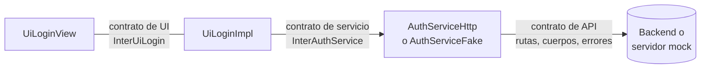
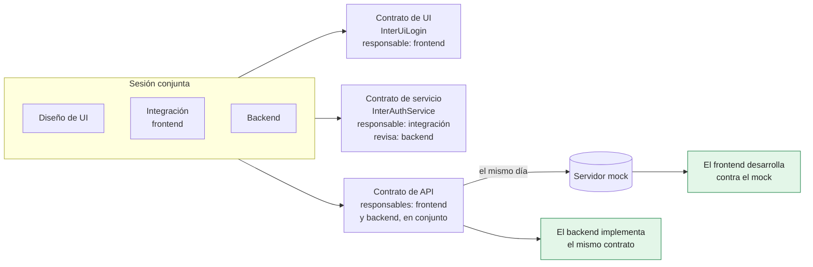
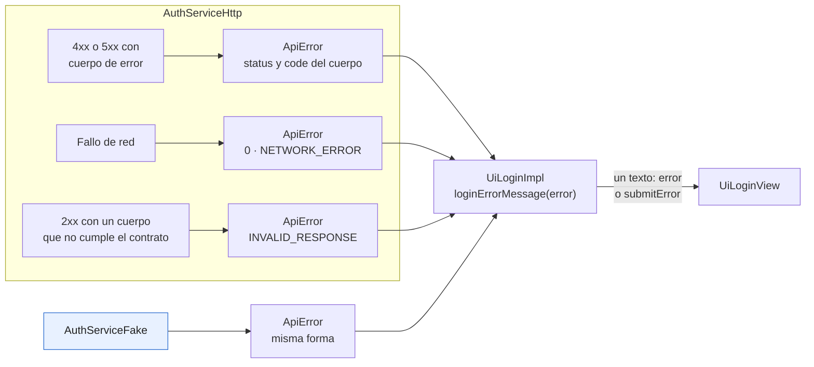
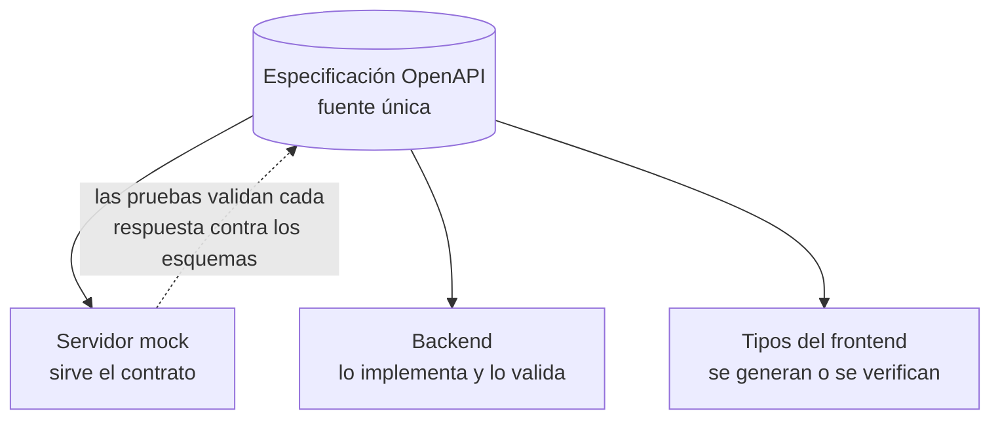
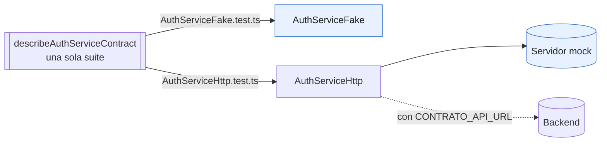
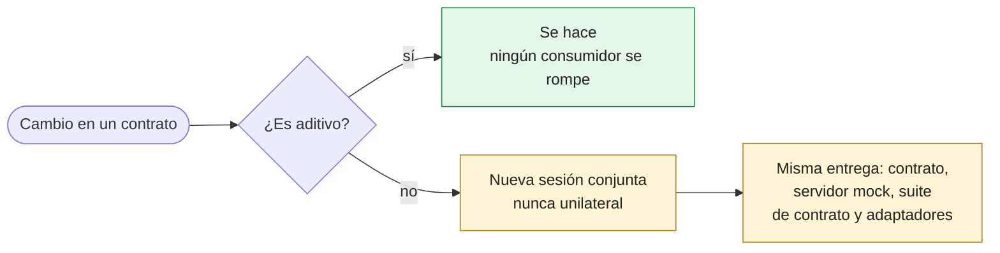
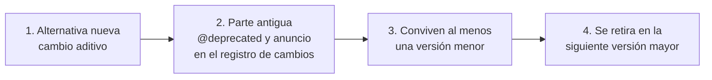
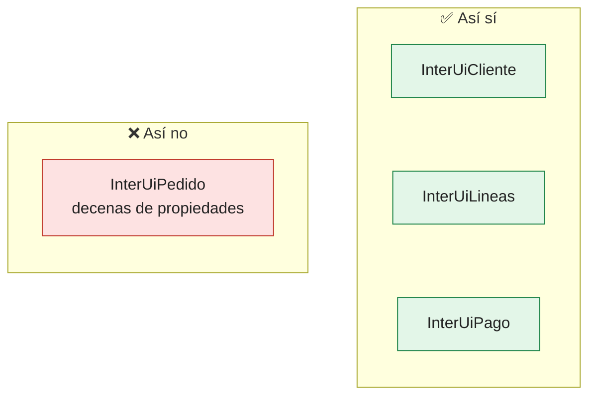

# Capítulo 3. Contratos: capacidades, datos, eventos y valores por defecto

El capítulo 2 mostró que una unidad JONA se apoya en dos contratos, el de UI y el de servicio, y que el contrato de servicio se respalda en un contrato de API definido con el backend. Este capítulo trata los tres en detalle: cómo se acuerdan, qué contienen, cómo se mantienen honestos y cómo evolucionan.



*Figura 3.1. Los tres contratos y las piezas que cada uno separa.*

Los contratos son la parte más estable de una aplicación JONA. Las vistas se rediseñan y los adaptadores se reescriben; los contratos, si están bien hechos, cambian poco y siempre de forma negociada.

> [!IMPORTANT]
> **Regla del capítulo.** Los tres contratos se escriben **antes** que cualquier implementación, en una sesión **conjunta**, y cada uno tiene un responsable. Desde ese momento se cambian primero de forma aditiva; lo que rompe se negocia.

> Los fragmentos de este capítulo son extractos, a veces abreviados, de los ejemplos ejecutables de la carpeta `ejemplos/` (apéndice B). Cuando el texto se refiere a otro proyecto del repositorio, como `softcommerce` o `uijona`, se indica el archivo.

---

## 3.1 Por qué los contratos van primero

La regla N1 exige contratos explícitos. La posición del capítulo 1 agrega cuándo se escriben: **antes que cualquier implementación**, y de forma **conjunta** entre frontend y backend. Esa es la "J" de JONA.

### La sesión conjunta

Antes de implementar una funcionalidad, frontend y backend se reúnen en una sesión corta con un objetivo concreto: salir con los contratos escritos. No se discute la implementación de ninguno de los dos lados.

| Participante | Qué aporta |
|---|---|
| Diseño de UI | Las pantallas y los flujos, y los estados que cada pantalla debe representar: carga, vacío, error, éxito |
| Integración (frontend) | Los datos que cada pantalla necesita, las acciones que dispara y el formato en que le conviene recibirlos |
| Backend | El modelo de dominio, las reglas de negocio, las restricciones de seguridad y los servicios que ya existen |

### Lo que sale de la sesión

| Artefacto | Contenido | Responsable | Lo revisa |
|---|---|---|---|
| **Contrato de UI** (`InterUiLogin`) | Capacidades o modelo de vista, eventos y `DEFAULTS` | Frontend (diseño e integración) | Revisión de UI |
| **Contrato de servicio** (`InterAuthService`) | Operaciones asíncronas con tipos de dominio y un modelo de error | Integración (frontend) | Backend |
| **Contrato de API** | Rutas, cuerpos, códigos de estado, cuerpo de error y cabeceras | Frontend y backend, en conjunto | Ambos |

Antes de cerrar la sesión, conviene comprobar que cada contrato responde estas preguntas:

- ¿Qué estados debe representar cada pantalla, incluidos vacío, error y carga?
- ¿Qué operaciones necesita la pantalla y qué tipos de dominio devuelve cada una?
- ¿Qué códigos de error puede recibir cada operación y qué debe ver el usuario en cada caso?
- ¿Qué cabeceras de contexto (*tenant*, correlación, usuario) exige cada ruta?
- ¿Qué datos de prueba necesita el servidor mock para cubrir esos casos?

El mismo día, el **servidor mock se construye a partir del contrato de API**. Desde ese momento, el frontend desarrolla contra el mock con su código real (punto de sustitución 3) y el backend implementa el mismo contrato. Ninguno espera al otro.



*Figura 3.2. De una sola sesión salen los tres contratos, cada uno con su responsable; el servidor mock nace del contrato de API, y desde ahí ninguno de los dos lados espera al otro.*

---

## 3.2 Anatomía del contrato de UI

Un contrato de UI declara cuatro tipos de elementos:

| Elemento | Qué es | Ejemplo |
|---|---|---|
| **Capacidades** | Acciones que la unidad ofrece | `login`, `goToCreateAccount`, `onSubmit` |
| **Datos de entrada** | Lo que la unidad recibe para dibujarse | `email`, `tenantOptions`, `isSubmitting` |
| **Eventos de salida** | Lo que la unidad informa hacia afuera | `onEmailChange`, `onTenantChange` |
| **Valores por defecto declarativos** | Configuración de presentación cuando nadie la indica | `UILOGIN_DEFAULTS`, `JBUTTON_DEFAULTS` |

### Los dos estilos y cuándo usar cada uno

| | Capacidades como funciones | Modelo de vista |
|---|---|---|
| Qué declara | Lo que la pantalla **puede hacer** | Lo que la vista **recibe** |
| Quién lo implementa | La Plantilla y la Implementación | La Implementación lo produce; la vista lo consume |
| Forma habitual | Clásica | Mínima y extendida |
| Conviene cuando | La pieza que dibuja también implementa el contrato (herencia) | La vista es una función pura de sus datos (composición) |
| Riesgo | Mezclar presentación y comportamiento en la misma clase | Contratos grandes con muchos indicadores booleanos |

Los dos estilos pueden convivir en una misma aplicación, pero no en una misma unidad. El estilo se decide con la forma.

Un contrato de capacidades (el del artículo de 2024, con firmas de propiedad), de `ejemplos/contratos-multilenguaje/typescript/src/InterUiLogin.ts`:

```ts
export interface InterUiLogin {
  login: (email: string, password: string) => void;
  goToCreateAccount: () => void;
  goToRecoverPassword: () => void;
  isValidData: (email: string, password: string) => boolean;
}
```

Un contrato de modelo de vista, de `ejemplos/web-react/src/uilogin/InterUiLogin.ts`:

```ts
export interface InterUiLogin {
  title?: string;
  submitLabel?: string;
  email: string;
  password: string;
  error?: string;
  isSubmitting?: boolean;
  /** Los callbacks reciben primero el valor de negocio, no el evento del DOM. */
  onEmailChange?: (email: string) => void;
  onPasswordChange?: (password: string) => void;
  onSubmit?: () => void;
}

/** Solo valores de presentación; los valores de los campos son estado y no tienen default. */
export const UILOGIN_DEFAULTS: Required<Pick<InterUiLogin, 'title' | 'submitLabel'>> = {
  title: 'Iniciar sesión',
  submitLabel: 'Ingresar',
};
```

El contrato real de `softcommerce` (`src/views/uilogin/InterUiLogin.ts`) sigue las mismas convenciones con más datos: `tenantOptions`, `tenantId`, `usuarioError`, `submitError` y el evento `onTenantChange`.

### Reglas del contrato de modelo de vista

Las reglas siguientes se observan en el código de referencia. Este libro las presenta como **prescripciones**.

**1. Los eventos entregan primero el valor.** Un evento de salida recibe el valor de negocio, no el evento crudo de la plataforma: `onEmailChange(email)`, no `onChange(event)`. Así, el contrato no depende del DOM, la Implementación no extrae valores de eventos y la misma firma sirve en web, escritorio o móvil. La excepción razonable son los componentes de bajo nivel de un sistema de diseño, como `JButton`, cuyo `onClick` entrega el evento del navegador porque su consumidor puede necesitarlo.

**2. `DEFAULTS` lleva solo configuración, nunca estado.** La constante `<NOMBRE>_DEFAULTS` contiene valores de presentación: variante, tamaño, posición del icono, textos por defecto. Nunca contiene el valor de un campo, si un panel está abierto o qué elemento está seleccionado. Un estado con valor por defecto en el contrato oculta quién es su dueño. La especificación de estructura de componentes del proyecto (escenario S-FND-22 en `openspec/`) lo formaliza: los `DEFAULTS` de un componente nuevo no pueden tener claves `value`, `open`, `selected*` ni `checked*`. Un ejemplo es `JBUTTON_DEFAULTS`, en `ejemplos/web-react/src/jbutton/InterJButton.ts`, con los mismos valores que el de `uijona/src/atoms/JButton/InterJButton.ts`:

```ts
export const JBUTTON_DEFAULTS = {
  variant: 'default',
  size: 'md',
  iconPosition: 'left',
  loading: false,
  fullWidth: false,
  type: 'button',
} as const satisfies Required<Pick<InterJButton,
  'variant' | 'size' | 'iconPosition' | 'loading' | 'fullWidth' | 'type'>>;
```

`satisfies` garantiza en compilación que cada valor por defecto es válido para su propiedad, sin perder los tipos literales.

**3. Un `undefined` explícito resuelve al valor por defecto.** `<JButton variant={undefined} />` debe comportarse como `<JButton />`. La propagación simple (`{...DEFAULTS, ...props}`) no lo garantiza: un `undefined` explícito sobrescribe el valor por defecto. `JButton` lo resuelve porque su vista declara también los valores por defecto en la desestructuración (`variant = JBUTTON_DEFAULTS.variant`), que se aplican cuando el valor es `undefined`. Otra opción es una función de mezcla que ignore las claves `undefined`. Lo que importa es que la regla se cumpla y se pruebe.

Ejemplo ejecutable: `ejemplos/web-react/src/jbutton/JButtonView.tsx`; la prueba "un undefined explícito resuelve al valor por defecto" está en `JButton.test.tsx`.

> [!WARNING]
> `{...DEFAULTS, ...props}` **no basta**: un `undefined` explícito en `props` borra el valor por defecto. La regla se cumple en la vista o en una función de mezcla, y se prueba.

**4. Nombres.** El contrato de UI usa el prefijo `Inter` (`InterUiLogin`, `InterJButton`); el de servicio, `Inter*Service`. Los eventos de salida empiezan con `on` (`onSubmit`, `onTenantChange`). La constante de valores por defecto es `<NOMBRE>_DEFAULTS` en mayúsculas (`UILOGIN_DEFAULTS`).

**5. Controlado o no controlado es una decisión del contrato.** Si el contrato declara `value` y `onChange`, la unidad es **controlada**: su dueño guarda el valor. Si la unidad guarda su propio estado, el contrato lo dice de forma explícita, por ejemplo con un valor inicial y un evento de cambio. Lo que no debe ocurrir es que la decisión quede implícita en la Implementación, porque cambia quién es responsable del estado.

```ts
// Controlado: el dueño del valor es quien usa la unidad.
export interface InterJSearchBox {
  value: string;
  onValueChange?: (value: string) => void;
}

// No controlado: la unidad guarda su estado; el contrato lo declara.
export interface InterJSearchBoxUncontrolled {
  initialValue?: string;
  onValueChange?: (value: string) => void;
}
```

En ninguno de los dos casos el valor va en `DEFAULTS`: `initialValue` es un dato de entrada que decide quien usa la unidad, no una configuración de presentación.

Ejemplo ejecutable: `ejemplos/web-react/src/jsearchbox/InterJSearchBox.ts` (solo los contratos; los verifica el compilador).

---

## 3.3 El contrato de servicio: el puerto del frontend

El contrato de servicio declara lo que la unidad necesita del sistema. Tres reglas lo definen:

- **Devuelve tipos de dominio**, no respuestas de transporte. `login` devuelve un `LoginResult` con token y usuario, no un `Response` de HTTP.
- **No bloquea la interfaz.** En plataformas con asincronía en el lenguaje (TypeScript, C#, Kotlin, Swift), toda operación devuelve una promesa o su equivalente, aunque la implementación de prueba responda de inmediato. En plataformas cuyo modelo idiomático es una llamada síncrona ejecutada en un hilo de trabajo (Swing con `SwingWorker`, JavaFX con `Task`), el contrato puede ser síncrono, y la regla pasa a la Implementación: nunca lo invoca desde el hilo de la interfaz. El contrato Java de los ejemplos es de este tipo.
- **Tiene un solo modelo de error.** Todas las implementaciones rechazan con el mismo tipo de error, con la misma forma.

El contrato de los ejemplos (`ejemplos/web-react/src/services/InterAuthService.ts`):

```ts
export interface LoginUser {
  id: number;
  usuario: string;
  nombre: string;
}

/** Tipo de dominio que devuelve el inicio de sesión (no una respuesta HTTP). */
export interface LoginResult {
  token: string;
  user: LoginUser;
}

/** Contrato de servicio (puerto). Toda falla rechaza con `ApiError`. */
export interface InterAuthService {
  /** Devuelve el token y el usuario. Rechaza si el servidor responde con error. */
  login: (email: string, password: string) => Promise<LoginResult>;
}
```

El contrato real de `softcommerce` (`src/services/InterAuthService.ts`) muestra lo que un contrato de servicio suele llegar a declarar en una aplicación completa: varias operaciones (`sessionOptions`, `login`, `empresas`, `puntosVenta`, `params`), tipos de dominio propios y una nota sobre el contexto (el *tenant*) que cada operación necesita.

### Un solo modelo de error

El modelo de error de los ejemplos vive en `ejemplos/web-react/src/services/ApiError.ts` y tiene la misma forma que el de `softcommerce` (`src/services/ApiError.ts`):

```ts
/** Forma de todo cuerpo de error del contrato de API: `{ code, message, details, traceId }`. */
export interface ApiErrorBody {
  code: string;
  message: string;
  details: ApiErrorDetail[];
  traceId: string;
}

/** Único modelo de error: lo producen el adaptador HTTP y el servicio falso por igual. */
export class ApiError extends Error {
  readonly status: number;
  readonly code: string;
  readonly details: ApiErrorDetail[];
  readonly traceId: string;
  // constructor(status: number, body: ApiErrorBody) asigna cada campo
}
```

El mismo `ApiError` lo produce el adaptador HTTP, a partir del cuerpo de error del servidor, y lo produce el servicio falso (en `softcommerce`, también los servicios mock del navegador). Incluso un fallo de red se traduce a un `ApiError` con estado 0 y código `NETWORK_ERROR`, y una respuesta 2xx cuyo cuerpo no cumple el contrato de API (vacío, sin token, con un usuario incompleto) se traduce a un `ApiError` con código `INVALID_RESPONSE`, en lugar de entregarse como si fuera un resultado. Sin esa validación, un adaptador tipado en TypeScript devuelve `undefined` con apariencia de `LoginResult`, y uno en Java o C# deja escapar la excepción del analizador JSON. Para la Implementación, por lo tanto, no hay diferencia entre el backend real, el servidor mock y el servicio falso: en los tres casos recibe un tipo de dominio o un `ApiError`. En Java, el mismo papel lo cumple `AuthException` (`ejemplos/java-swing/src/main/java/com/example/services/AuthException.java`).



*Figura 3.3. Cuatro orígenes, un solo tipo: la Implementación solo conoce `ApiError`, y la vista solo recibe un mensaje.*

---

## 3.4 El contrato de API: lo que viaja por la red

El contrato de API describe la comunicación entre frontend y backend en el nivel del transporte:

| Elemento | Ejemplo en `softcommerce` |
|---|---|
| Rutas | `GET /auth/session-options`, `POST /auth/login`, `GET /v1/{catalog}` |
| Cuerpos | `POST /auth/login` recibe `{usuario, clave}` y devuelve `{token, user}` |
| Códigos de estado | 401 `INVALID_CREDENTIALS`; 403 `USER_DISABLED` o `NO_DESKTOP_ACCESS`; 422 con `details` en errores de validación |
| Cuerpo de error | `{ code, message, details, traceId }` en todas las respuestas de error |
| Cabeceras | `X-Tenant-Id` obligatoria salvo en rutas públicas (400 `TENANT_REQUIRED`, 404 `TENANT_NOT_FOUND`); `X-Correlation-Id` en toda respuesta, reenviada o generada |

Los ejemplos provienen de `web_ts/softcommerce/mock-server/README.md`, que documenta las rutas del servidor mock.

### Una especificación legible por máquinas

La recomendación de este libro es escribir el contrato de API en un formato legible por máquinas, como **OpenAPI** o **JSON Schema**, y usarlo como **fuente única** de tres cosas:

- el servidor mock, que sirve el contrato;
- el backend, que lo implementa y lo valida;
- los tipos del frontend, que se generan o se verifican a partir de él.

Con una fuente única, una discrepancia entre los tres lados se detecta en la construcción, no en producción.



*Figura 3.4. Una especificación, tres consumidores; en los ejemplos, las pruebas del servidor mock comprueban cada respuesta contra ella.*

Los ejemplos de este libro siguen esa recomendación. `ejemplos/contrato-api/login.openapi.yaml` es la fuente única del inicio de sesión, y las pruebas del servidor mock validan cada respuesta contra sus esquemas:

```js
// mock-server/test/server.test.mjs
function assertCumpleContrato({ status, headers, body }) {
  assert.deepEqual(erroresDeRespuesta('/auth/login', 'post', status, body), []);
  assert.ok(headers.get('x-correlation-id'), 'falta X-Correlation-Id');
}
```

Ejemplo ejecutable: `ejemplos/contrato-api/login.openapi.yaml` y `ejemplos/mock-server/test/contrato.mjs` (la validación con JSON Schema).

Conviene ser preciso sobre el proyecto de referencia: `softcommerce` **no usa OpenAPI**. Documenta su contrato de API en el README del servidor mock y lo hace cumplir con pruebas: pruebas HTTP del servidor mock y suites de contrato que se ejecutan contra cada implementación (sección 3.5). Es una solución válida para un proyecto de este tamaño; con varios equipos de backend, una especificación formal es más segura.

---

## 3.5 Un contrato, dos implementaciones, una suite de pruebas

Un servidor mock solo es útil si se comporta como el backend. El mecanismo que lo garantiza, en `softcommerce` y en los ejemplos, es una **suite de contrato**: un conjunto de casos de prueba escrito una sola vez y ejecutado contra cada implementación del contrato de servicio.

En los ejemplos, la suite vive en `ejemplos/web-react/src/services/authServiceContract.ts` (resumida):

```ts
/** Construye la implementación bajo prueba. */
export type AuthServiceFactory = () => InterAuthService;

/**
 * Casos que toda implementación de InterAuthService debe cumplir (paridad de doble fuente):
 * el servicio falso y el adaptador HTTP contra el servidor mock (o un backend real)
 * ejecutan exactamente estos casos, con los datos de prueba del contrato de API.
 */
export function describeAuthServiceContract(label: string, make: AuthServiceFactory): void {
  describe(`Contrato de InterAuthService: ${label}`, () => {
    it.each([
      ['una clave incorrecta', 'ana@ejemplo.com', 'otra', 401, 'INVALID_CREDENTIALS'],
      ['un usuario desconocido', 'nadie@ejemplo.com', 'secreta123', 401, 'INVALID_CREDENTIALS'],
      ['un usuario bloqueado', 'bloqueado@ejemplo.com', 'secreta123', 403, 'USER_DISABLED'],
    ])('rechaza %s con ApiError y un traceId', async (_name, email, password, status, code) => {
      const error = await rejection(make().login(email, password));

      expect(error).toMatchObject({ status, code, details: [] });
      expect(error.message).not.toBe('');
      expect(error.traceId).not.toBe('');
    });
    // ...inicio correcto y campos vacíos (422 con un detalle por campo)
  });
}
```

La misma suite se invoca dos veces, con dos fábricas distintas:

```ts
// AuthServiceHttp.test.ts — el adaptador HTTP contra el servidor mock en ejecución
describeAuthServiceContract(`AuthServiceHttp contra ${baseUrl}`, () => createAuthServiceHttp({ baseUrl }));

// AuthServiceFake.test.ts — el servicio falso
describeAuthServiceContract('AuthServiceFake', () => createAuthServiceFake());
```

`softcommerce` llama a esto **paridad de doble fuente** (*dual-source parity*). Si el servicio falso y el servidor mock divergen, una de las dos ejecuciones falla. En `softcommerce` existen suites equivalentes para otros contratos de servicio (`catalogServiceContract.ts`, `lookupServiceContract.ts`, `shellServiceContract.ts`), y en los ejemplos la de Java tiene los mismos casos en JUnit (`ejemplos/java-swing/src/test/java/com/example/services/AuthServiceContract.java`).

El paso que completa el mecanismo es que **el backend ejecute la misma suite** contra su implementación. Así, el servidor mock y el backend real quedan verificados contra el mismo contrato, que es la posición del capítulo 1. En los ejemplos basta con una variable: con `CONTRATO_API_URL=<url>`, las suites de `web-react` y de `java-swing` corren contra ese servidor en lugar de arrancar el mock, y el ejecutor general (`ejemplos/run-all.mjs`) lo comprueba con el servidor mock en el papel del backend. El capítulo 9 explica cómo organizarlo.



*Figura 3.5. Paridad de doble fuente: los mismos casos corren contra el servicio falso y contra el adaptador HTTP; si el falso y el mock divergen, una de las dos ejecuciones falla. Con `CONTRATO_API_URL`, el mismo adaptador corre esos casos contra el backend.*

Una brecha que conviene conocer en `softcommerce`: los escenarios de la aplicación (`exitoso`, `vacio`, `errorServidor`) existen solo en el mock del navegador, seleccionados con `VITE_API_SCENARIO`. Su servidor mock sirve siempre la semilla completa. Para probar una pantalla vacía o un error del servidor contra ese servidor mock, hoy hay que cambiar sus datos (`MOCK_DATA_DIR`) o usar el modo del navegador.

El servidor mock de los ejemplos cierra esa brecha. Cada petición elige un escenario con la cabecera `X-Mock-Scenario` (`exitoso`, el valor por defecto, `credencialesInvalidas`, `usuarioBloqueado` o `errorServidor`); `POST /__mock/scenario` cambia el escenario por defecto y `POST /__mock/reset` lo restaura. El escenario `exitoso` responde según los datos de prueba, como lo haría el backend real, y por eso la suite de contrato solo usa ese escenario.

Ejemplo ejecutable: `ejemplos/mock-server/src/server.mjs` y sus pruebas, `ejemplos/mock-server/test/server.test.mjs`.

---

## 3.6 Evolución de los contratos

Un contrato cambia cuando cambian las capacidades de la unidad o el acuerdo con el backend. La forma de cambiarlo importa tanto como el cambio.

### Primero, cambios aditivos

Un cambio aditivo no rompe a ningún consumidor existente:

| Contrato | Cambio aditivo | Cambio que rompe |
|---|---|---|
| De UI | Nueva propiedad opcional, nuevo evento opcional, nuevo valor en `DEFAULTS` | Quitar o renombrar una propiedad, volverla obligatoria, cambiar el significado de un valor por defecto |
| De servicio | Nueva operación, nuevo campo opcional en un tipo de dominio | Cambiar la firma de una operación, quitar un campo |
| De API | Nueva ruta, nuevo campo en la respuesta, nuevo código de error documentado | Quitar una ruta, cambiar un cuerpo, cambiar el significado de un código de estado |

La regla práctica es agotar los cambios aditivos antes de considerar uno que rompa.

### Los cambios que rompen se negocian

Un cambio que rompe el contrato de API o el de servicio se decide en una nueva sesión conjunta, no de forma unilateral. En la misma entrega se actualizan el contrato, el servidor mock, la suite de contrato y los adaptadores. Si la suite no cambia, el cambio no está completo.



*Figura 3.6. El camino corto es el aditivo; el que rompe pasa por los dos equipos y arrastra la suite de contrato.*

### Versionado semántico en las librerías

Una librería de componentes publica sus contratos de UI, y su versión debe comunicar el tipo de cambio: una versión de parche corrige errores, una versión menor agrega sin quitar y una versión mayor puede romper. El `CHANGELOG.md` de `uijona` sigue Keep a Changelog y Semantic Versioning, y declara de forma explícita el alcance de cada versión. La entrada de 1.5.2, por ejemplo, afirma: *"No export, prop or default behavior was removed or changed in its meaning, and the 1.5.1 test suite passes unchanged."* Esa frase es, en la práctica, una garantía de compatibilidad del contrato.

### Ruta de obsolescencia

Para retirar una parte de un contrato sin romper a los consumidores:

1. Se agrega la alternativa nueva, como cambio aditivo.
2. Se marca la parte antigua como obsoleta (`@deprecated` en TypeScript, `@Deprecated` en Java) y se anuncia en el registro de cambios.
3. Se mantienen ambas durante al menos una versión menor.
4. Se retira la parte antigua en la siguiente versión mayor.



*Figura 3.7. La ruta de obsolescencia: el único paso que rompe llega al final y con una versión mayor.*

---

## 3.7 Lo que no pertenece a un contrato

Un contrato que acumula lo que no le corresponde pierde su valor como acuerdo. Lo siguiente queda fuera.

> [!CAUTION]
> Ninguno de estos errores impide compilar, y la mayoría pasa las pruebas de arquitectura: el verificador del capítulo 9 detecta el comportamiento en el contrato (`JONA-N2`) y un contrato que importa un adaptador (`JONA-N3`); el resto depende de la revisión. Por eso conviene reconocerlos a simple vista.

**Referencia rápida**

| | Antipatrón | Se reconoce porque… | Qué lo evita |
|:-:|---|---|---|
| 🔴 | [Comportamiento en el contrato](#ap-3-1) | El archivo del contrato tiene funciones, clases o cálculos | N2: el contrato solo declara; la regla vive en la Implementación |
| 🟠 | [Tipos de transporte en el contrato de UI](#ap-3-2) | La vista recibe una respuesta HTTP, un código de estado o una cabecera | La Implementación traduce el `ApiError` a un mensaje |
| 🟠 | [Estado en `DEFAULTS`](#ap-3-3) | `DEFAULTS` tiene el valor de un campo, un `open` o un `selected` | `DEFAULTS` solo con configuración de presentación |
| 🟠 | [Detalles de implementación](#ap-3-4) | El contrato nombra *hooks*, controles, claves de almacenamiento o adaptadores | Contrato con datos de negocio y eventos |
| 🟡 | [Tipos del framework en una pantalla portable](#ap-3-5) | `React.ReactNode` en el contrato de una pantalla que se quiere migrar | Tipos propios del contrato |
| 🟡 | [Contratos gigantes](#ap-3-6) | Decenas de propiedades en un solo contrato | Dividir la unidad |
| 🟡 | [Explosión de indicadores booleanos](#ap-3-7) | `isLoading`, `isEmpty`, `isError`, `isSuccess` a la vez | Un campo de estado con valores enumerados |

🔴 el contrato deja de ser una declaración (rompe una regla del núcleo) · 🟠 el contrato se acopla a un lado o esconde a su dueño · 🟡 el contrato funciona, pero es menos portable o más ambiguo

---

<a id="ap-3-1"></a>
### 🔴 Comportamiento en el contrato

**Síntoma.** Lógica, validaciones, cálculos o efectos en el archivo del contrato.

❌ **Así no:** un contrato con una regla de validación (caso de violación `fixtures/n2-contrato-con-funcion/` del capítulo 9).

```ts
// uilogin/InterUiLogin.ts
export interface InterUiLogin {
  correo: string;
  onEnviar?: () => void;
}

export function esCorreoValido(correo: string): boolean {
  return correo.includes('@');
}
```

✅ **Así sí:** el contrato solo declara; la regla es una función pura de la Implementación (`ejemplos/web-react/src/uilogin/UiLoginImpl.ts`).

```ts
/** Regla pura: se prueba sin React y sin servicios. */
export function isValidData(email: string, password: string): boolean {
  return email !== '' && password !== '';
}
```

**Por qué duele.** Lógica, validaciones, cálculos o efectos en el contrato violan N2. Una regla de validación es una función pura de la Implementación o del modelo base, no un método con cuerpo en el contrato. **Cómo no caer:** N2, y la regla `JONA-N2` del verificador, que rechaza el caso anterior:

```text
$ npm run check -- fixtures/n2-contrato-con-funcion
JONA: 1 violaciones en fixtures/n2-contrato-con-funcion (0 toleradas por la deuda)
  NUEVA    JONA-N2 uilogin/InterUiLogin.ts:6 el contrato contiene comportamiento: export function esCorreoValido(correo: string): boolean {
```

---

<a id="ap-3-2"></a>
### 🟠 Tipos de transporte en el contrato de UI

**Síntoma.** Una respuesta HTTP, un código de estado o una cabecera llegan a la vista.

❌ **Así no** (ilustrativo)

```ts
export interface InterUiLogin {
  email: string;
  password: string;
  response?: Response;     // respuesta HTTP
  errorStatus?: number;    // código de estado
}
```

✅ **Así sí:** la Implementación traduce el `ApiError` a un mensaje (`submitError`) y, si hace falta, a una referencia de soporte (`submitErrorTraceId`). Así lo declara `softcommerce` (`src/views/uilogin/InterUiLogin.ts`):

```ts
/** Server or account-rejection message. */
submitError?: string;
/** Support reference of a server error. */
submitErrorTraceId?: string;
```

**Por qué duele.** La vista termina interpretando el transporte, y el contrato de UI deja de servir para otro adaptador o para el servicio falso. **Cómo no caer:** un solo modelo de error en el contrato de servicio y su traducción en la Implementación (figura 3.3).

---

<a id="ap-3-3"></a>
### 🟠 Estado en `DEFAULTS`

**Síntoma.** La constante `<NOMBRE>_DEFAULTS` contiene el valor de un campo, si un panel está abierto o qué elemento está seleccionado.

❌ **Así no** (ilustrativo)

```ts
export const UILOGIN_DEFAULTS = {
  title: 'Iniciar sesión',
  submitLabel: 'Ingresar',
  email: '',               // estado: el valor de un campo
  isSubmitting: false,     // estado
};
```

✅ **Así sí:** solo valores de presentación (`ejemplos/web-react/src/uilogin/InterUiLogin.ts`).

```ts
/** Solo valores de presentación; los valores de los campos son estado y no tienen default. */
export const UILOGIN_DEFAULTS: Required<Pick<InterUiLogin, 'title' | 'submitLabel'>> = {
  title: 'Iniciar sesión',
  submitLabel: 'Ingresar',
};
```

**Por qué duele.** Un estado con valor por defecto en el contrato oculta quién es su dueño. **Cómo no caer:** la regla 2 de la sección 3.2 y el escenario S-FND-22, que prohíbe las claves `value`, `open`, `selected*` y `checked*` en los `DEFAULTS` de un componente nuevo. `JONA-N2` comprueba que `DEFAULTS` sea un literal, pero no distingue un valor neutro de un estado: eso queda para la revisión (capítulo 9).

---

<a id="ap-3-4"></a>
### 🟠 Detalles de implementación

**Síntoma.** El contrato nombra *hooks*, referencias a controles, claves de almacenamiento, rutas internas o el adaptador concreto.

❌ **Así no:** el contrato de UI conoce el adaptador HTTP (caso de violación `fixtures/n3-contrato-importa-adaptador/` del capítulo 9).

```ts
// uilogin/InterUiLogin.ts
import type { AuthServiceHttp } from '../servicios/AuthServiceHttp';

export interface InterUiLogin {
  correo: string;
  servicio?: AuthServiceHttp;
  onEnviar?: () => void;
}
```

✅ **Así sí:** el contrato declara datos de negocio y eventos con el valor primero (`ejemplos/web-react/src/uilogin/InterUiLogin.ts`, extracto).

```ts
export interface InterUiLogin {
  email: string;
  password: string;
  error?: string;
  isSubmitting?: boolean;
  onEmailChange?: (email: string) => void;
  onSubmit?: () => void;
}
```

**Por qué duele.** Cada detalle de un lado que entra en el contrato obliga a cambiar el contrato cuando ese lado cambia. **Cómo no caer:** `JONA-N3` rechaza el caso anterior (`el contrato importa servicios/AuthServiceHttp.ts, un servicio`); los nombres de *hooks*, las referencias a controles y las claves de almacenamiento quedan para la revisión.

---

<a id="ap-3-5"></a>
### 🟡 Tipos del framework en una pantalla portable

**Síntoma.** El contrato de una pantalla que se quiere migrar usa tipos del framework, como `React.ReactNode`.

❌ **Así no** (ilustrativo)

```ts
export interface InterUiLogin {
  header?: React.ReactNode;
  email: string;
}
```

✅ **Así sí:** el contrato de la pantalla usa tipos propios; el framework queda en la vista.

```ts
export interface InterUiLogin {
  title?: string;
  email: string;
}
```

**Por qué duele.** Un contrato con `React.ReactNode` es portable en intención, no en código (capítulo 2). **Cómo no caer:** decidir según el contrato. En una librería de componentes es aceptable; en el contrato de una pantalla que se quiere migrar, conviene evitarlo.

---

<a id="ap-3-6"></a>
### 🟡 Contratos gigantes

**Síntoma.** Un contrato con decenas de propiedades.



**Por qué duele.** Un contrato con decenas de propiedades suele esconder varias unidades. **Cómo no caer:** la respuesta es dividir la unidad, no agrandar el contrato. Los nombres de la figura son ilustrativos.

---

<a id="ap-3-7"></a>
### 🟡 Explosión de indicadores booleanos

**Síntoma.** `isLoading`, `isEmpty`, `isError` e `isSuccess` como cuatro booleanos independientes.

❌ **Así no** (ilustrativo)

```ts
isLoading?: boolean;
isEmpty?: boolean;
isError?: boolean;
isSuccess?: boolean;   // ¿qué dibuja la vista si isLoading e isError son verdaderos?
```

✅ **Así sí:** un único campo de estado con valores enumerados.

```ts
status: 'loading' | 'empty' | 'error' | 'ready';
```

**Por qué duele.** Cuatro booleanos independientes admiten combinaciones imposibles. **Cómo no caer:** un único campo de estado con valores enumerados expresa lo mismo sin ambigüedad, y el compilador impide las combinaciones que no existen.

---

El capítulo 12 trata estos casos, junto con otros antipatrones observados en la evolución del patrón.

---

## 3.8 Resumen

- Los contratos se escriben antes que cualquier implementación, en una sesión conjunta entre frontend y backend. De ella salen el contrato de UI, el contrato de servicio y el contrato de API, cada uno con un responsable.
- El servidor mock se construye a partir del contrato de API el mismo día, y el desarrollo continúa contra él.
- El contrato de UI declara capacidades, datos de entrada, eventos de salida y valores por defecto. Admite dos estilos: capacidades como funciones (forma clásica) y modelo de vista (formas por composición).
- En el estilo de modelo de vista, los eventos entregan primero el valor, `DEFAULTS` lleva solo configuración, un `undefined` explícito resuelve al valor por defecto y la decisión entre controlado y no controlado es parte del contrato.
- El contrato de servicio es el puerto del frontend: devuelve tipos de dominio, es asíncrono y tiene un solo modelo de error, como `ApiError` en `softcommerce`.
- El contrato de API describe rutas, cuerpos, códigos, errores y cabeceras. Lo ideal es una especificación legible por máquinas: los ejemplos usan OpenAPI; el proyecto de referencia, un README y pruebas.
- Una suite de contrato ejecutada contra cada implementación mantiene honestos al mock y al backend.
- Los contratos evolucionan primero con cambios aditivos; los cambios que rompen se negocian y se versionan.
