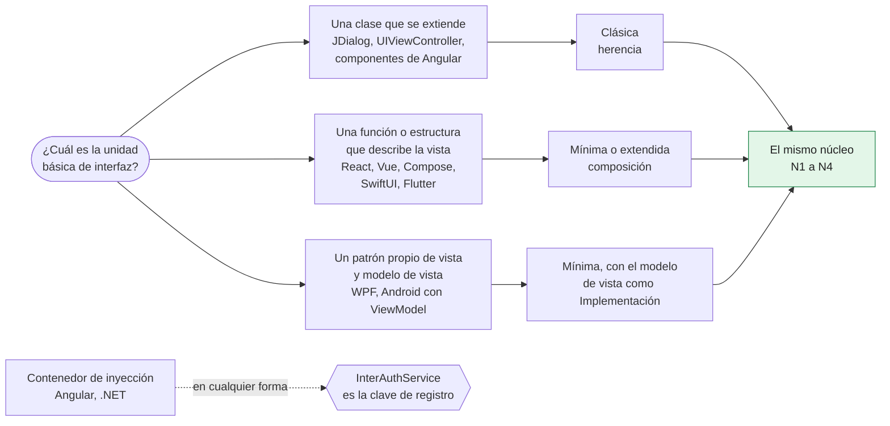
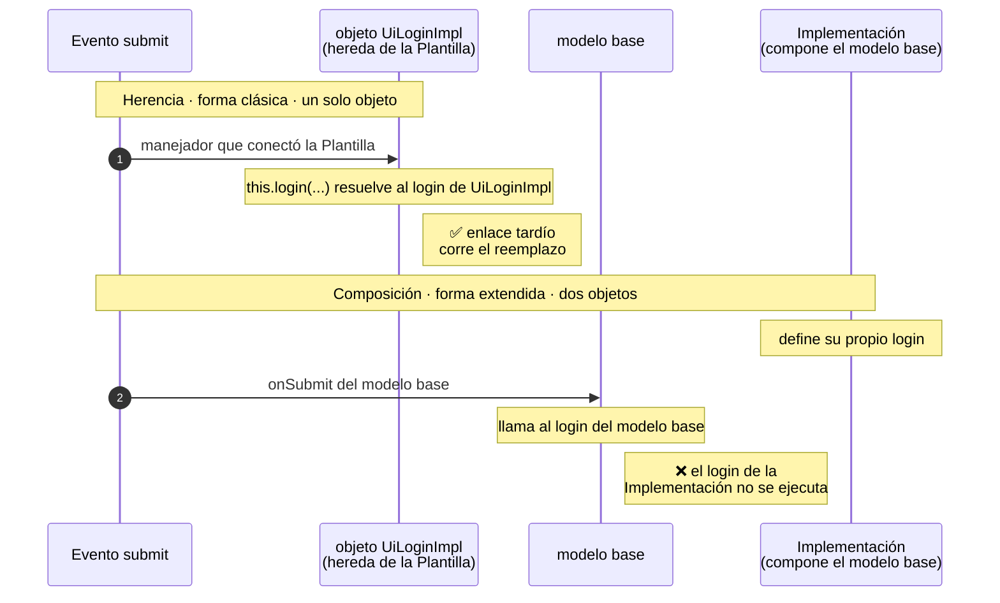
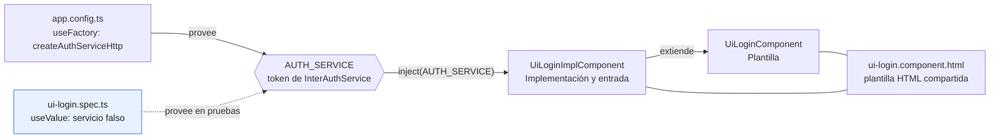
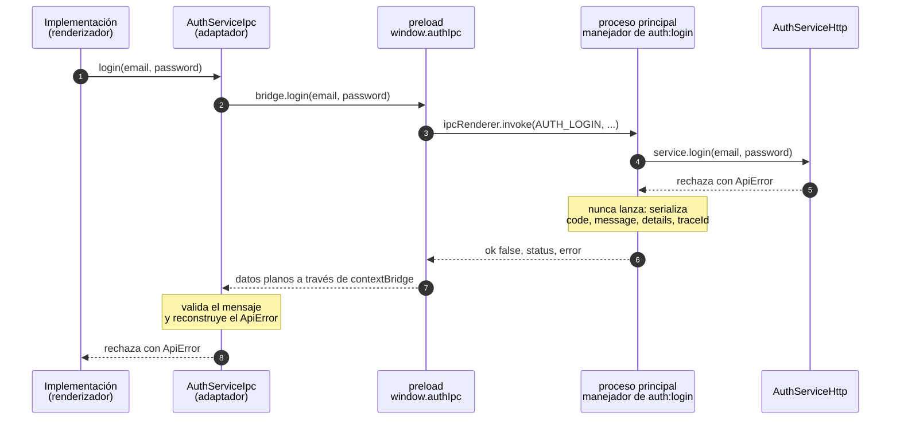
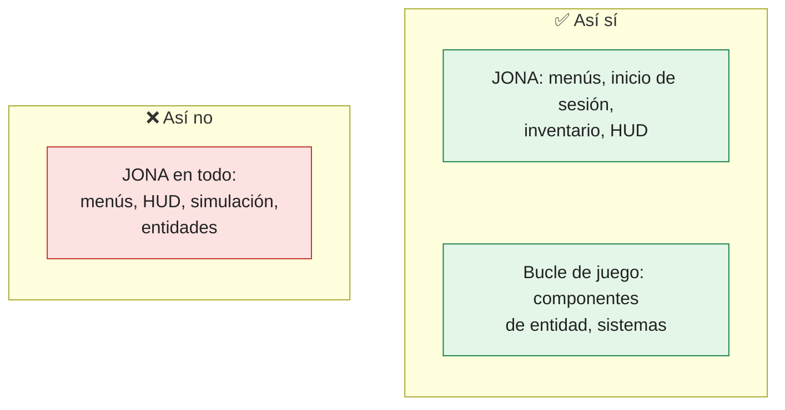

# Capítulo 4. Herencia y composición: el patrón en web, escritorio, móvil y motores de juego

El capítulo 2 presentó tres formas del patrón y recomendó elegir la que coincide con el mecanismo natural de cada tecnología. Este capítulo recorre ese mapa plataforma por plataforma: qué forma conviene, dónde queda cada pieza, cómo se inyecta el contrato de servicio y qué particularidades obligan a adaptar el patrón.

Los nombres son los de los capítulos anteriores: el contrato de UI `InterUiLogin`, el contrato de servicio `InterAuthService`, la Implementación `UiLoginImpl`, la vista `UiLoginView` y la entrada `UiLogin` (o la propia Implementación, en la forma clásica).

> **Sobre los ejemplos de este capítulo.** Cada sección indica su estado. *Ejecutable* significa que el código está en `ejemplos/` y se prueba con el comando del apéndice B. *Previsto* significa que el ejemplo está planificado para `ejemplos/` en una tecnología disponible en el entorno de verificación. *Ilustrativo* significa que no existe una implementación de referencia ni un entorno donde ejecutarla todavía; el código muestra la idea, pero nadie lo ha compilado.

> [!IMPORTANT]
> **Regla del capítulo.** La forma se elige por el mecanismo natural de la tecnología: herencia donde la unidad de interfaz es una clase que se extiende, composición donde la vista se describe a partir del estado. Lo que no cambia con la forma es el núcleo: N1 a N4, los contratos y sus nombres.

---

## 4.1 La decisión: herencia o composición

Toda tecnología de interfaz ofrece una unidad básica: una clase de ventana, un componente, una función que devuelve una vista, un objeto de escena. La forma de JONA se elige mirando esa unidad.

| Pregunta | Si la respuesta es sí | Forma habitual |
|---|---|---|
| ¿La unidad de interfaz es una clase que se extiende? (`JDialog`, `UIViewController`, componentes de Angular) | La herencia es natural | Clásica |
| ¿La unidad es una función o una estructura que describe la vista a partir del estado? (React, Vue, Jetpack Compose, SwiftUI, Flutter) | La composición es natural | Mínima o extendida |
| ¿La plataforma trae un patrón propio de vista y modelo de vista? (WPF, Android con `ViewModel`) | JONA se superpone a ese patrón | Mínima, con el modelo de vista como Implementación |
| ¿La plataforma tiene un contenedor de inyección de dependencias? (Angular, .NET) | El contrato de servicio es la clave de registro | Cualquiera |



*Figura 4.1. La forma sale de la unidad básica de la plataforma; el núcleo y la clave de inyección no dependen de ella. Es un punto de partida, no una regla rígida.*

No es una regla rígida. Angular admite las dos formas, y un proyecto React con componentes de clase puede usar la clásica. Lo que no cambia es el núcleo: N1 a N4 se cumplen en cualquier caso.

---

## 4.2 Lo que cada mecanismo da y lo que cuesta

La elección entre herencia y composición tiene consecuencias concretas para un arquitecto.

| Aspecto | Herencia (forma clásica) | Composición (formas mínima y extendida) |
|---|---|---|
| Comportamiento por defecto | Viene en la Plantilla y se reemplaza con `override` | Viene del modelo base o de un servicio falso |
| Enlace tardío | **Sí.** Los manejadores que conecta la Plantilla llaman al método reemplazado por la Implementación | **No.** Los manejadores del modelo base no ven las funciones que la Implementación reemplaza; hay que reescribirlos completos |
| Acoplamiento | La Implementación depende de los detalles internos de la Plantilla (clase base frágil) | La Implementación solo conoce contratos |
| Pureza de la vista | La Plantilla mezcla interfaz y comportamiento por defecto | La vista es pura |
| Pruebas | Las reglas puras se prueban aparte; la ventana necesita el entorno gráfico | La Implementación se prueba sin interfaz; la vista, con datos fijos |
| Modelo mental | Cercano al artículo de 2024 y a la programación orientada a objetos clásica | Cercano a la programación declarativa |

El enlace tardío es la ventaja menos visible de la herencia. En la Plantilla Swing del capítulo 2, el botón llama a `login(...)`; cuando el objeto es un `UiLoginImpl`, esa llamada ejecuta el `login` de la Implementación sin que la Plantilla lo sepa. En la forma extendida no ocurre lo mismo: si el modelo base expone un `onSubmit` que usa su propio `login`, reemplazar `login` en la Implementación no cambia ese `onSubmit`.



*Figura 4.2. En la herencia, `this` resuelve el método en tiempo de ejecución; en la composición, el manejador del modelo base quedó ligado a su propia función. Por eso la Implementación reemplaza `onSubmit` completo.*

> [!WARNING]
> En la forma extendida, reemplazar una función no cambia los manejadores del modelo base que la usan. Todo manejador que la Implementación reemplaza debe estar **completo**, y todo manejador base que dependa de uno reemplazado también debe reemplazarse (capítulo 2, sección 2.7).

---

## 4.3 Web

### TypeScript sin framework

Es la tecnología del artículo de 2024: la Plantilla es una clase que construye el DOM y conecta los eventos; la Implementación la extiende. La forma es la clásica, sin cambios respecto al capítulo 2. El enlace tardío se ve en el constructor de la Plantilla: el evento `submit` llama a `this.login`, que en un `UiLoginImpl` es el de la Implementación.

```ts
// UiLogin.ts — Plantilla (extracto)
export class UiLogin implements InterUiLogin {
  readonly element = document.createElement('form');
  private readonly txtEmail = document.createElement('input');
  private readonly txtPassword = document.createElement('input');
  // ...lblMessage, btnLogin, btnCreateAccount y btnRecoverPassword

  constructor() {
    this.buildLayout();
    this.element.addEventListener('submit', (event) => {
      event.preventDefault();
      this.login(this.txtEmail.value, this.txtPassword.value);   // enlace tardío: puede ser el login de la Impl
    });
    // ...goToCreateAccount y goToRecoverPassword
  }
  // login, goToCreateAccount, goToRecoverPassword e isValidData: comportamiento por defecto.
  // showMessage, showMissingDataError y setBusy: operaciones de presentación.
}
```

```ts
// UiLoginImpl.ts — Implementación y entrada (extracto)
export class UiLoginImpl extends UiLogin {
  private busy = false;

  constructor(
    private readonly auth: InterAuthService,
    private readonly navigator: Navigator,
  ) {
    super();
  }

  override login(email: string, password: string): void {
    if (!this.isValidData(email, password)) { this.showMissingDataError(); return; }
    if (this.busy) return;                        // evita el doble envío
    void this.submit(email, password);
  }
  // submit llama a this.auth.login, muestra loginErrorMessage(error) o navega con openHome.
}
```

Estado: *Ejecutable* (`ejemplos/web-ts-puro/`): reproduce el ejemplo del artículo con el contrato de servicio actual (`InterAuthService`, `ApiError`, `AuthServiceHttp`).

Ejemplo ejecutable: `ejemplos/web-ts-puro/src/views/uilogin/` (contrato, Plantilla, Implementación y sus pruebas con Vitest y jsdom) y `ejemplos/web-ts-puro/src/main.ts` (la raíz de composición).

### React

React usa las formas mínima y extendida, que el capítulo 2 desarrolla completas. La forma mínima tiene dos variantes en el repositorio: la entrada compone la Implementación con la vista e inyecta el servicio (`softcommerce`), o la Implementación dibuja la vista y la entrada la reexporta (`uijona`).

Estado: *Ejecutable* (`ejemplos/web-react/`).

### Angular

Angular admite las dos formas, y su contenedor de inyección de dependencias cambia el modo de entregar el contrato de servicio: **el contrato de servicio se registra como un token de inyección.**

```ts
// services/auth.token.ts
import { InjectionToken } from '@angular/core';
import type { InterAuthService } from './InterAuthService';

export const AUTH_SERVICE = new InjectionToken<InterAuthService>('AUTH_SERVICE');
```

En la forma clásica, la Plantilla es un componente que implementa el contrato de UI, y la Implementación es otro componente que la extiende y **reutiliza la misma plantilla HTML**. Así lo hace la implementación de referencia en Angular del repositorio, y así lo hace el ejemplo ejecutable, escrito para Angular 21. En esa versión los componentes son independientes (*standalone*) por defecto y la detección de cambios no usa `zone.js`; por eso el estado que la vista dibuja son *signals*, que avisan a Angular cuando cambian, incluso después de un `await`:

```ts
// ui-login.component.ts — Plantilla
@Component({
  selector: 'app-ui-login',
  imports: [FormsModule],
  templateUrl: './ui-login.component.html',
})
export class UiLoginComponent implements InterUiLogin {
  // Signals: Angular 21 no usa zone.js; la vista se actualiza cuando cambian.
  readonly email = signal('');
  readonly password = signal('');
  readonly message = signal('');
  readonly busy = signal(false);

  login(email: string, password: string): void {
    this.message.set(this.isValidData(email, password)
      ? 'Datos completos (sin integración).'
      : 'Ingrese su correo y su contraseña.');
  }
  goToCreateAccount(): void { this.message.set('Crear cuenta (sin integración).'); }
  goToRecoverPassword(): void { this.message.set('Recuperar contraseña (sin integración).'); }
  isValidData(email: string, password: string): boolean {
    return email !== '' && password !== '';
  }
}
```

```ts
// ui-login-impl.component.ts — Implementación y entrada
@Component({
  selector: 'app-ui-login-impl',
  imports: [FormsModule],
  templateUrl: './ui-login.component.html',   // la misma plantilla HTML
})
export class UiLoginImplComponent extends UiLoginComponent {
  private readonly auth = inject(AUTH_SERVICE);
  private readonly router = inject(Router);

  override async login(email: string, password: string): Promise<void> {
    if (!this.isValidData(email, password)) return super.login(email, password);
    if (this.busy()) return;                     // evita el doble envío
    this.busy.set(true);
    this.message.set('');                        // limpia el error del intento anterior
    try {
      await this.auth.login(email, password);
    } catch (error) {
      this.message.set(loginErrorMessage(error));
      return;
    } finally {
      this.busy.set(false);
    }
    await this.router.navigate(['/inicio']);
  }
  override goToCreateAccount(): void { void this.router.navigate(['/crear-cuenta']); }
  override goToRecoverPassword(): void { void this.router.navigate(['/recuperar-clave']); }
}
```

La entrada es `UiLoginImplComponent`: es el componente que se registra en las rutas (N4). El modo de conexión se decide en un solo lugar, al registrar el proveedor del token:

```ts
// app.config.ts
providers: [
  { provide: AUTH_SERVICE, useFactory: () => createAuthServiceHttp({ baseUrl: environment.apiUrl }) },
]
```

Con `environment.apiUrl` apuntando al servidor mock, la aplicación trabaja contra el contrato sin esperar al backend. En las pruebas, el mismo token recibe un servicio falso:

```ts
// ui-login.spec.ts (extracto)
TestBed.configureTestingModule({
  imports: [component],
  providers: [provideRouter([]), { provide: AUTH_SERVICE, useValue: service }],
});
```

Las pruebas corren con `ng test`, que en Angular 21 usa Vitest sobre jsdom: no hace falta instalar ni abrir un navegador.



*Figura 4.3. En Angular, el contrato de servicio es un token: producción y pruebas solo cambian el proveedor, y la Implementación no sabe cuál recibió.*

Angular también admite la forma mínima: un servicio o una función con `signal()` como Implementación, y un componente sin lógica como vista. Conviene cuando el equipo ya trabaja con *signals* y componentes de presentación.

Estado: *Ejecutable* (`ejemplos/web-angular/`), en la forma clásica. La forma mínima con *signals* está *Prevista*: todavía no tiene ejemplo ejecutable.

Ejemplo ejecutable: `ejemplos/web-angular/src/app/uilogin/` (contrato, Plantilla, Implementación, plantilla HTML compartida y pruebas), `ejemplos/web-angular/src/app/services/auth.token.ts` y `ejemplos/web-angular/src/app/app.config.ts`.

### Vue

Vue usa la forma mínima con *composables*. La Implementación es una función que devuelve el modelo de vista; la entrada la crea con el servicio y la pasa a la vista.

```ts
// useUiLoginImpl.ts — Implementación
export function useUiLoginImpl(
  service: InterAuthService,
  onAuthenticated: (result: LoginResult) => void,
) {
  const email = ref('');
  const password = ref('');
  const error = ref<string | undefined>();
  const isSubmitting = ref(false);

  async function onSubmit(): Promise<void> {
    if (isSubmitting.value) return;               // evita el doble envío
    if (!isValidData(email.value, password.value)) {
      error.value = MISSING_DATA_ERROR;
      return;
    }
    error.value = undefined;                      // limpia el error del intento anterior
    isSubmitting.value = true;
    let result: LoginResult | undefined;
    try {
      result = await service.login(email.value, password.value);
    } catch (e) {
      error.value = loginErrorMessage(e);
    } finally {
      isSubmitting.value = false;
    }
    if (result !== undefined) onAuthenticated(result);
  }

  return {
    email, password, error, isSubmitting,
    onEmailChange: (value: string) => { email.value = value; },
    onPasswordChange: (value: string) => { password.value = value; },
    onSubmit,
  };
}
```

```vue
<!-- UiLogin.vue — entrada -->
<script setup lang="ts">
import { reactive } from 'vue';
import type { InterAuthService, LoginResult } from '../services/InterAuthService';
import { UILOGIN_DEFAULTS } from './InterUiLogin';
import UiLoginView from './UiLoginView.vue';
import { useUiLoginImpl } from './useUiLoginImpl';

const props = defineProps<{ service: InterAuthService }>();
const emit = defineEmits<{ authenticated: [result: LoginResult] }>();

// reactive() desenvuelve las referencias, de modo que la vista recibe valores y no objetos ref.
const impl = reactive({
  ...UILOGIN_DEFAULTS,
  ...useUiLoginImpl(props.service, (result) => emit('authenticated', result)),
});
</script>

<template>
  <UiLoginView v-bind="impl" />
</template>
```

La entrada aplica `UILOGIN_DEFAULTS`, como en React. La vista declara como *props* exactamente los campos del contrato de UI `InterUiLogin`, de modo que el mismo contrato sirve en React y en Vue:

```vue
<!-- UiLoginView.vue — vista (extracto) -->
<script setup lang="ts">
import type { InterUiLogin } from './InterUiLogin';

defineProps<InterUiLogin>();
</script>
```

Como las *props* se llaman `onEmailChange`, `onPasswordChange` y `onSubmit`, la vista las invoca con el valor (`onEmailChange?.(valueOf($event))`), no emite eventos de Vue. El servicio llega por *props* o mediante `provide`/`inject`, que cumple el mismo papel que el token de Angular.

Estado: *Ejecutable* (`ejemplos/web-vue/`).

Ejemplo ejecutable: `ejemplos/web-vue/src/uilogin/` (contrato, `useUiLoginImpl.ts`, `UiLoginView.vue`, `UiLogin.vue` y pruebas con `@vue/test-utils`).

---

## 4.4 Escritorio

### Java Swing

Es la forma clásica del capítulo 2: `UiLogin` extiende `JDialog`, expone operaciones de presentación (`showMessage`, `showMissingDataError`, `setBusy`), y `UiLoginImpl` la extiende, llama al servicio con `SwingWorker` y es la entrada.

Estado: *Ejecutable* (`ejemplos/java-swing/`).

### JavaFX

JavaFX conserva la forma clásica. Cambian dos detalles: la Plantilla extiende un contenedor (`VBox`, `GridPane`) en lugar de una ventana, y el trabajo fuera del hilo de la interfaz se hace con `javafx.concurrent.Task`.

```java
// UiLogin.java — Plantilla
public class UiLogin extends VBox implements InterUiLogin {
    private final TextField txtEmail = new TextField();
    private final PasswordField txtPassword = new PasswordField();
    private final Label lblMessage = new Label();
    private final Button btnLogin = new Button("Ingresar");
    // ...btnCreateAccount y btnRecoverPassword

    public UiLogin() {
        super(8);
        buildLayout();   // agrega los controles con getChildren().addAll(...)
        btnLogin.setOnAction(e -> login(txtEmail.getText(), txtPassword.getText()));
        // ...goToCreateAccount y goToRecoverPassword
    }

    @Override public void login(String email, String password) {
        if (!isValidData(email, password)) { showMissingDataError(); return; }
        showMessage("Datos completos (sin integración).");
    }
    @Override public boolean isValidData(String email, String password) {
        return !email.isEmpty() && !password.isEmpty();
    }
    // goToCreateAccount y goToRecoverPassword: igual que en Swing.

    protected void showMessage(String message) { lblMessage.setText(message); }
    protected void showMissingDataError() { showMessage("Ingrese su correo y su contraseña."); }
    protected void setBusy(boolean busy) {
        txtEmail.setDisable(busy);
        txtPassword.setDisable(busy);
        btnLogin.setDisable(busy);
    }
}
```

```java
// UiLoginImpl.java — Implementación y entrada
public class UiLoginImpl extends UiLogin {
    private final InterAuthService auth;
    private final Navigator navigator;
    private boolean busy;

    public UiLoginImpl(InterAuthService auth, Navigator navigator) {
        this.auth = auth;
        this.navigator = navigator;
    }

    @Override public void login(String email, String password) {
        if (!isValidData(email, password)) { showMissingDataError(); return; }
        if (busy) return;                                    // evita el doble envío
        busy = true;
        setBusy(true);
        showMessage("");                                     // limpia el error del intento anterior
        Task<LoginResult> task = new Task<>() {
            @Override protected LoginResult call() throws AuthException {
                return auth.login(email, password);          // fuera del hilo de JavaFX
            }
        };
        task.setOnSucceeded(e -> { done(); navigator.openHome(task.getValue()); });
        task.setOnFailed(e -> { done(); showMessage(messageFor(task.getException())); });
        Thread worker = new Thread(task);
        worker.setDaemon(true);
        worker.start();
    }
    // done() vuelve busy a false y llama a setBusy(false); messageFor es la misma regla pura que en Swing.
}
```

El contrato de servicio (`InterAuthService`, `AuthException`, `LoginResult`) es el mismo que en Swing. Las dos aplicaciones de escritorio comparten contratos y adaptador; solo cambian la Plantilla y el mecanismo de hilos. Es un caso práctico del objetivo 5 del capítulo 1. En `ejemplos/` los dos proyectos tienen una copia de esos archivos, no una dependencia compartida, para que cada ejemplo sea autónomo.

A diferencia de Swing, JavaFX sí puede arrancar sin pantalla: con la plataforma *Headless* de Monocle (`org.testfx:openjfx-monocle`, solo en pruebas), las pruebas crean la Plantilla y la Implementación, pulsan sus botones y esperan al `Task`, sin mostrar ninguna ventana.

Estado: *Ejecutable* (`ejemplos/java-javafx/`).

Ejemplo ejecutable: `ejemplos/java-javafx/src/main/java/com/example/view/ui/uilogin/` y su prueba `ejemplos/java-javafx/src/test/java/com/example/view/ui/uilogin/UiLoginTest.java`.

### WPF (C#)

WPF ya trae su propio patrón, MVVM: una vista en XAML enlazada a un modelo de vista. JONA no lo reemplaza; le asigna roles:

| Pieza de JONA | Pieza de WPF |
|---|---|
| Contrato de UI | Una interfaz que declara las propiedades y comandos del modelo de vista |
| Implementación | El modelo de vista (`INotifyPropertyChanged`), que recibe `InterAuthService` |
| Vista | El XAML y su *code-behind*, sin lógica |
| Entrada | La ventana o el control que crea la Implementación y la asigna como `DataContext` |

```csharp
// InterUiLogin.cs — contrato de UI (modelo de vista)
public interface InterUiLogin : INotifyPropertyChanged
{
    string Email { get; set; }
    string Password { get; set; }
    string? Error { get; }
    bool IsSubmitting { get; }
    ICommand SubmitCommand { get; }
}
```

```csharp
// UiLoginImpl.cs — Implementación
public sealed class UiLoginImpl : InterUiLogin
{
    private readonly InterAuthService _auth;
    private readonly Action<LoginResult> _onAuthenticated;

    public UiLoginImpl(InterAuthService auth, Action<LoginResult> onAuthenticated)
    {
        _auth = auth;
        _onAuthenticated = onAuthenticated;
        SubmitCommand = new AsyncCommand(SubmitAsync, () => !IsSubmitting);
    }

    // Email, Password, Error e IsSubmitting notifican sus cambios con PropertyChanged.

    public ICommand SubmitCommand { get; }

    private async Task SubmitAsync()
    {
        if (!LoginRules.IsValidData(Email, Password)) { Error = LoginRules.MissingDataError; return; }
        Error = null;                                  // limpia el error del intento anterior
        IsSubmitting = true;
        LoginResult? result = null;
        try { result = await _auth.LoginAsync(Email, Password); }
        catch (ApiException ex) { Error = LoginRules.MessageFor(ex.Code); }
        finally { IsSubmitting = false; }
        if (result is not null) _onAuthenticated(result);
    }
}
```

El comando se deshabilita mientras `IsSubmitting` es verdadero (`() => !IsSubmitting`), y eso evita el doble envío: al cambiar `IsSubmitting`, la Implementación avisa a WPF con `CanExecuteChanged`.

Una particularidad de WPF: `PasswordBox` no permite enlazar su contraseña por seguridad. La vista necesita una línea de *code-behind* que reenvía el valor al modelo de vista:

```csharp
// UiLoginView.xaml.cs — vista
private void OnPasswordChanged(object sender, RoutedEventArgs e) =>
    ((InterUiLogin)DataContext).Password = passwordBox.Password;
```

Es la única excepción aceptable a una vista sin código, y se limita a reenviar un valor, como los *callbacks* de las demás plataformas.

Sobre nombres: C# usa por convención el prefijo `I` para las interfaces. Este libro conserva `Inter` para que los contratos se llamen igual en todas las plataformas, lo que facilita la migración (capítulo 11). Los analizadores que exigen el prefijo `I` se configuran para aceptar `Inter`.

En el ejemplo, los contratos, la Implementación y el adaptador viven en un proyecto `net10.0` sin WPF (`JonaLogin.Core`), de modo que sus pruebas con xUnit corren en cualquier sistema operativo; solo la vista y la entrada (`JonaLogin.Wpf`, `net10.0-windows`) necesitan Windows.

Estado: *Ejecutable* (`ejemplos/dotnet-wpf/`).

Ejemplo ejecutable: `ejemplos/dotnet-wpf/JonaLogin.Core/UiLogin/` (contrato, Implementación, reglas y comando), `ejemplos/dotnet-wpf/JonaLogin.Wpf/` (vista y entrada) y `ejemplos/dotnet-wpf/JonaLogin.Tests/`.

### Electron

En Electron la interfaz es una aplicación web, así que dentro del proceso de renderizado vale todo lo dicho para React, Angular o Vue. Lo nuevo es la frontera entre procesos: **el proceso principal es el backend del renderizador**, y los canales de IPC forman un contrato de API.

| Pieza | En Electron |
|---|---|
| Contrato de servicio | `InterAuthService`, el mismo de la versión web |
| Contrato de API | Los canales de IPC (`auth:login`), sus argumentos y su formato de error |
| Puente | El *preload*, que expone el canal sobre `ipcRenderer.invoke` (`window.authIpc`) |
| Adaptador | `createAuthServiceIpc`, en el renderizador, que implementa `InterAuthService` sobre ese puente |
| Backend | El proceso principal, que atiende el canal con `ipcMain.handle` |

Hay un detalle que el contrato debe resolver, y que el ejemplo comprobó con Electron 37: los errores no cruzan las fronteras con sus campos.

- Un error lanzado en `ipcMain.handle` llega al renderizador como un `Error` genérico, con un mensaje del tipo `Error invoking remote method 'auth:login'`, sin su clase ni sus campos.
- Un `ApiError` creado en el *preload* tampoco sirve: al cruzar `contextBridge` hacia el renderizador, llega como un `Error` sin `code` ni `traceId`, y `instanceof ApiError` es falso.

> [!WARNING]
> En Electron, **un error no cruza un límite de proceso con sus campos**. Si se lanza, la Implementación pierde `code` y `traceId`, y con ellos el modelo de error del contrato de servicio.

Por eso el contrato de IPC transporta el error como datos, con el mismo formato del contrato de API (`code`, `message`, `details`, `traceId`); el proceso principal nunca lanza, y el `ApiError` se reconstruye en el renderizador, del lado de la Implementación:

```ts
// shared/ipcContract.ts — contrato de IPC
export const AUTH_LOGIN = 'auth:login';

/** El error viaja serializado con el formato del contrato de API; nunca como una excepción. */
export type IpcResult<T> =
  | { ok: true; value: T }
  | { ok: false; status: number; error: ApiErrorBody };
```

```ts
// main/loginHandler.ts — el proceso principal serializa el ApiError (extracto)
try {
  return { ok: true, value: await service.login(email, password) };
} catch (error) {
  if (error instanceof ApiError) {
    const { status, code, message, details, traceId } = error;
    return { ok: false, status, error: { code, message, details, traceId } };
  }
  // ...cualquier otra falla: { ok: false, status: 500, error: { code: 'INTERNAL_ERROR', ... } }
}
```

```ts
// preload/preload.ts — expone el canal; solo datos planos cruzan contextBridge
const authIpc: AuthIpcBridge = {
  login: (email, password) => ipcRenderer.invoke(AUTH_LOGIN, email, password),
};

contextBridge.exposeInMainWorld('authIpc', authIpc);
```

```ts
// renderer/services/AuthServiceIpc.ts — adaptador: reconstruye el ApiError (extracto)
export function createAuthServiceIpc(bridge: AuthIpcBridge): InterAuthService {
  return {
    async login(email, password) {
      let result;
      // ...result = await bridge.login(email, password); una falla del propio IPC es un ApiError IPC_ERROR
      // El mensaje cruza un límite de proceso: se valida antes de entregarlo como tipo de dominio.
      if (typeof result !== 'object' || result === null) throw invalidResponse();
      if (result.ok) {
        if (!isLoginResult(result.value)) throw invalidResponse();
        return result.value;
      }
      const { error } = result;
      if (typeof error?.code !== 'string' || typeof error.message !== 'string') throw invalidResponse();
      // Reconstruye el ApiError con code, message, details y traceId.
      throw new ApiError(result.status, { code: error.code, message: error.message, /* details y traceId */ });
    },
  };
}
```

La entrada del renderizador recibe `createAuthServiceIpc(window.authIpc)` como servicio, igual que en la web recibe el adaptador HTTP. Para desarrollar la interfaz en un navegador, sin Electron, se le inyecta el adaptador HTTP apuntando al servidor mock. El proceso principal, a su vez, usa `AuthServiceHttp` contra el servidor mock por defecto.



*Figura 4.4. El error cruza los dos límites como datos, con el formato del contrato de API; el `ApiError` se crea a cada lado, nunca viaja como excepción.*

Las pruebas no arrancan Electron: prueban el manejador del proceso principal y el adaptador con dobles, y ejecutan la suite de contrato sobre la cadena completa (adaptador, manejador y `AuthServiceHttp` contra el servidor mock).

Estado: *Ejecutable* (`ejemplos/electron/`), con la forma mínima de React en el renderizador.

Ejemplo ejecutable: `ejemplos/electron/src/` (`shared/ipcContract.ts`, `main/`, `preload/` y `renderer/`); la suite sobre la cadena está en `src/ipcChain.test.ts`.

---

## 4.5 Móvil

Las tres plataformas de esta sección no tienen implementación de referencia en el repositorio ni un entorno de verificación disponible. Su código es *ilustrativo*.

### Android con Jetpack Compose (Kotlin)

Compose es declarativo, así que la forma natural es la mínima. El `ViewModel` de Android es la Implementación, y una función `@Composable` sin estado es la vista.

```kotlin
// InterUiLogin.kt — contrato de UI (modelo de vista)
data class UiLoginState(
    val email: String = "",
    val password: String = "",
    val error: String? = null,
    val isSubmitting: Boolean = false,
)

interface InterUiLogin {
    val state: StateFlow<UiLoginState>
    fun onEmailChange(value: String)
    fun onPasswordChange(value: String)
    fun onSubmit()
}
```

```kotlin
// UiLoginImpl.kt — Implementación
class UiLoginImpl(private val auth: InterAuthService) : ViewModel(), InterUiLogin {
    private val _state = MutableStateFlow(UiLoginState())
    override val state: StateFlow<UiLoginState> = _state

    override fun onEmailChange(value: String) = _state.update { it.copy(email = value) }
    override fun onPasswordChange(value: String) = _state.update { it.copy(password = value) }

    override fun onSubmit() {
        val current = _state.value
        if (current.isSubmitting) return
        if (!isValidData(current.email, current.password)) {
            _state.update { it.copy(error = MISSING_DATA_ERROR) }
            return
        }
        _state.update { it.copy(error = null, isSubmitting = true) }
        viewModelScope.launch {
            val error = runCatching { auth.login(current.email, current.password) }
                .exceptionOrNull()?.let(::loginErrorMessage)
            _state.update { it.copy(error = error, isSubmitting = false) }
        }
    }
}
```

```kotlin
// UiLogin.kt — vista y entrada
@Composable
fun UiLoginView(state: UiLoginState, onEmailChange: (String) -> Unit,
                onPasswordChange: (String) -> Unit, onSubmit: () -> Unit) {
    Column {
        TextField(value = state.email, onValueChange = onEmailChange)
        TextField(value = state.password, onValueChange = onPasswordChange,
                  visualTransformation = PasswordVisualTransformation())
        state.error?.let { Text(it) }
        Button(onClick = onSubmit, enabled = !state.isSubmitting) { Text("Ingresar") }
    }
}

@Composable
fun UiLogin(impl: UiLoginImpl) {
    val state by impl.state.collectAsState()
    UiLoginView(state, impl::onEmailChange, impl::onPasswordChange, impl::onSubmit)
}
```

Con el sistema de vistas clásico de Android (`Fragment`, XML), la forma clásica vuelve a ser natural: un `Fragment` como Plantilla y una subclase como Implementación. El servidor mock funciona igual: el adaptador HTTP del dispositivo apunta a él (en el emulador, la máquina anfitriona es `10.0.2.2`).

Estado: *Ilustrativo*.

### iOS y macOS con SwiftUI (Swift)

SwiftUI también es declarativo. Un `ObservableObject` es la Implementación y una `View` sin estado propio es la vista.

```swift
// UiLoginImpl.swift — Implementación
@MainActor
final class UiLoginImpl: ObservableObject {
    @Published var email = ""
    @Published var password = ""
    @Published private(set) var error: String?
    @Published private(set) var isSubmitting = false

    private let auth: InterAuthService

    init(auth: InterAuthService) { self.auth = auth }

    func submit() async {
        guard !isSubmitting else { return }
        guard isValidData(email: email, password: password) else {
            error = missingDataError
            return
        }
        error = nil
        isSubmitting = true
        defer { isSubmitting = false }
        do { _ = try await auth.login(email: email, password: password) }
        catch { self.error = loginErrorMessage(error) }
    }
}
```

```swift
// UiLogin.swift — vista y entrada
struct UiLoginView: View {
    @Binding var email: String
    @Binding var password: String
    let error: String?
    let isSubmitting: Bool
    let onSubmit: () -> Void

    var body: some View {
        Form {
            TextField("Correo", text: $email)
            SecureField("Contraseña", text: $password)
            if let error { Text(error) }
            Button("Ingresar", action: onSubmit).disabled(isSubmitting)
        }
    }
}

struct UiLogin: View {
    @StateObject private var impl: UiLoginImpl

    init(auth: InterAuthService) { _impl = StateObject(wrappedValue: UiLoginImpl(auth: auth)) }

    var body: some View {
        UiLoginView(email: $impl.email, password: $impl.password, error: impl.error,
                    isSubmitting: impl.isSubmitting, onSubmit: { Task { await impl.submit() } })
    }
}
```

Con UIKit, la forma clásica es la natural: un `UIViewController` como Plantilla y una subclase como Implementación, como muestra el README del repositorio.

Estado: *Ilustrativo*.

### Flutter (Dart)

Flutter sigue la misma lógica que Compose y SwiftUI: un `ChangeNotifier` o un controlador como Implementación, que recibe el contrato de servicio, y un `StatelessWidget` como vista pura. La entrada es el *widget* que crea el controlador y lo conecta con la vista.

Estado: *Ilustrativo* (sin código en este capítulo).

---

## 4.6 Motores de juego: Unity

En un motor de juego, JONA se aplica a la **interfaz** (menús, inicio de sesión, inventario, HUD), no al bucle de juego ni a la simulación. La lógica de juego tiene otros patrones (componentes de entidad, sistemas), y forzar JONA sobre ella no aporta nada.

En Unity la unidad básica es el `MonoBehaviour`, una clase que se extiende y se adjunta a un objeto de la escena. Eso hace natural la forma clásica:

```csharp
// UiLogin.cs — Plantilla
public class UiLogin : MonoBehaviour, InterUiLogin
{
    [SerializeField] private UIDocument document;
    private TextField emailField;
    private TextField passwordField;
    private Label messageLabel;
    private Button loginButton;

    protected virtual void OnEnable()
    {
        var root = document.rootVisualElement;
        emailField = root.Q<TextField>("email");
        passwordField = root.Q<TextField>("password");
        messageLabel = root.Q<Label>("message");
        loginButton = root.Q<Button>("login");
        loginButton.clicked += () => Login(emailField.value, passwordField.value);
    }

    public virtual void Login(string email, string password)
    {
        if (!IsValidData(email, password)) { ShowMissingDataError(); return; }
        ShowMessage("Datos completos (sin integración).");
    }

    public bool IsValidData(string email, string password) =>
        email.Length > 0 && password.Length > 0;

    protected void ShowMessage(string message) => messageLabel.text = message;
    protected void ShowMissingDataError() => ShowMessage("Ingrese su correo y su contraseña.");
    protected void SetBusy(bool busy) => loginButton.SetEnabled(!busy);
}
```

```csharp
// UiLoginImpl.cs — Implementación y entrada
public class UiLoginImpl : UiLogin
{
    private InterAuthService auth;

    public void Init(InterAuthService service) => auth = service;

    public override async void Login(string email, string password)
    {
        if (!IsValidData(email, password)) { ShowMissingDataError(); return; }
        SetBusy(true);
        ShowMessage("");
        try { await auth.LoginAsync(email, password); }
        catch (ApiException ex) { ShowMessage(LoginRules.MessageFor(ex.Code)); }
        finally { SetBusy(false); }
    }
}
```

Tres particularidades:

- **La entrada es el componente adjunto a la escena.** En el *prefab* de la pantalla se adjunta `UiLoginImpl`, no `UiLogin`. Un instalador de la escena (o un contenedor de inyección como VContainer o Zenject) llama a `Init` con el servicio.
- **El ciclo de vida lo controla el motor.** No hay constructor: las referencias a los controles se obtienen en `OnEnable`, y la Implementación no puede recibir el servicio por constructor.
- **El servidor mock es especialmente valioso.** El backend de un juego (cuentas, inventario, tienda) suele estar en otro equipo; el cliente puede probar todos los escenarios del contrato sin depender de él.

Estado: *Ilustrativo*.

---

## 4.7 Cuando la plataforma trae su propio patrón

WPF trae MVVM; Android, su `ViewModel`; UIKit, su variante de MVC. JONA no compite con esos patrones: les asigna roles y agrega lo que no traen.

| Lo que la plataforma ya trae | Lo que JONA agrega |
|---|---|
| Un lugar para el estado de la pantalla (modelo de vista) | Un **contrato de UI explícito** para ese estado (N1) |
| Enlace de datos entre vista y estado | La regla de que la vista no llama a servicios (N3) |
| Inyección de dependencias, a veces | Un **contrato de servicio** como puerto, y un **contrato de API** acordado con el backend |
| Herramientas de prueba de la plataforma | Un servidor mock construido desde el contrato de API, como modo normal de desarrollo |

El capítulo 7 compara JONA con MVC, MVP y MVVM en detalle.

---

## 4.8 Nomenclatura por plataforma

El mismo nombre de contrato en todas las plataformas facilita la migración y las conversaciones entre equipos. Este libro recomienda conservar los nombres de JONA y adaptar solo el formato del archivo:

| Plataforma | Contrato de UI | Implementación | Vista | Entrada |
|---|---|---|---|---|
| React, Vue | `InterUiLogin.ts` | `UiLoginImpl.ts` / `useUiLoginImpl.ts` | `UiLoginView.tsx` / `.vue` | `UiLogin.tsx` / `.vue` |
| Angular | `inter-ui-login.ts` | `ui-login-impl.component.ts` | `ui-login.component.html` | `UiLoginImplComponent` |
| Java (Swing, JavaFX) | `InterUiLogin.java` | `UiLoginImpl.java` | `UiLogin.java` (Plantilla) | `UiLoginImpl` |
| C# (WPF, Unity) | `InterUiLogin.cs` | `UiLoginImpl.cs` | `UiLoginView.xaml` / `UiLogin.cs` (Plantilla) | ventana o componente de escena |
| Kotlin | `InterUiLogin.kt` | `UiLoginImpl.kt` | `UiLoginView` (`@Composable`) | `UiLogin` |
| Swift | `InterUiLogin.swift` | `UiLoginImpl.swift` | `UiLoginView` | `UiLogin` |

Angular usa nombres de archivo en *kebab-case* por convención; los nombres de clase se mantienen.

---

## 4.9 Estado de verificación

| Tecnología | Forma | Estado |
|---|---|---|
| React | Mínima (a y b), extendida | Ejecutable |
| Java Swing | Clásica | Ejecutable |
| TypeScript sin framework | Clásica | Ejecutable |
| Angular | Clásica | Ejecutable |
| Angular | Mínima con *signals* | Previsto |
| Vue | Mínima | Ejecutable |
| JavaFX | Clásica | Ejecutable |
| WPF (C#) | Mínima sobre MVVM | Ejecutable |
| Electron | Mínima de React en el renderizador, con contrato de IPC | Ejecutable |
| Android (Compose) | Mínima | Ilustrativo |
| iOS (SwiftUI) | Mínima | Ilustrativo |
| Flutter | Mínima | Ilustrativo |
| Unity | Clásica | Ilustrativo |

---

## 4.10 Antipatrones

> [!CAUTION]
> Estos antipatrones aparecen al llevar el patrón a una plataforma concreta. Los dos primeros compilan y parecen funcionar, pero la pantalla hace otra cosa que la que el código aparenta.

**Referencia rápida**

| | Antipatrón | Se reconoce porque… | Qué lo evita |
|:-:|---|---|---|
| 🔴 | [Esperar enlace tardío en la forma extendida](#ap-4-1) | La Implementación reemplaza una función y el manejador base sigue llamando a la original | Reemplazar el manejador completo |
| 🔴 | [Lanzar el error a través del IPC](#ap-4-2) | El renderizador recibe `Error invoking remote method…` sin `code` ni `traceId` | El error viaja como datos y se reconstruye |
| 🟠 | [Clase base frágil](#ap-4-3) | La Implementación toca los controles de la Plantilla | Controles privados y operaciones de presentación protegidas |
| 🟠 | [El patrón de la plataforma en lugar de los contratos](#ap-4-4) | El `ViewModel` llama a HTTP y no implementa un contrato de UI | El `ViewModel` es la Implementación y recibe `InterAuthService` |
| 🟠 | [Lógica en el *code-behind*](#ap-4-5) | El *code-behind* de WPF valida o llama a servicios | Solo reenviar un valor al modelo de vista |
| 🟡 | [JONA en el bucle de juego](#ap-4-6) | Contratos de UI para la simulación o las entidades | JONA solo en la interfaz del juego |

🔴 la pantalla deja de hacer lo que el código aparenta · 🟠 el patrón se degrada al apoyarse en la plataforma · 🟡 el patrón se aplica donde no aporta

---

<a id="ap-4-1"></a>
### 🔴 Esperar enlace tardío en la forma extendida

**Síntoma.** La Implementación reemplaza `login` y espera que el `onSubmit` del modelo base lo use, como haría la Plantilla de la forma clásica (figura 4.2).

❌ **Así no** (ilustrativo)

```ts
// modelo base: onSubmit queda ligado a su propio login
const login = () => setError(isValidData(email, password) ? undefined : MISSING_DATA_ERROR);
const onSubmit = () => login();

// Implementación: reemplaza login, pero reutiliza el onSubmit del modelo base
return { ...base, login: () => { void service.login(base.email, base.password); } };
```

✅ **Así sí:** la Implementación reemplaza el manejador completo (`ejemplos/web-react/src/uiloginextendida/UiLoginImpl.ts`).

```ts
// Reemplazo completo: no delega en base.onSubmit (ver "Costo" en el capítulo 2).
async function submit(): Promise<void> { /* valida, llama al servicio y traduce el error */ }

const { setError, setIsSubmitting, ...viewModel } = base;
return { ...viewModel, onSubmit: () => { void submit(); } };
```

**Por qué duele.** La composición no tiene enlace tardío: con datos válidos, el formulario solo valida y nunca llama al servicio. **Cómo no caer:** la regla de la sección 2.7, y pruebas de pantalla que recorren la forma extendida con las mismas expectativas que la mínima (`ejemplos/web-react/src/loginScreen.test.tsx`, «inicia sesión con credenciales válidas»).

---

<a id="ap-4-2"></a>
### 🔴 Lanzar el error a través del IPC

**Síntoma.** El proceso principal deja escapar el `ApiError`, o el *preload* lo crea, y el renderizador muestra siempre el mismo mensaje genérico.

❌ **Así no** (ilustrativo)

```ts
// main.ts: el ApiError de AuthServiceHttp se lanza tal cual a través del IPC
ipcMain.handle(AUTH_LOGIN, (_event, email: string, password: string) => service.login(email, password));
```

✅ **Así sí:** el manejador nunca lanza y devuelve el error con el formato del contrato de API (`ejemplos/electron/src/main/loginHandler.ts`); el adaptador del renderizador reconstruye el `ApiError`.

```ts
if (error instanceof ApiError) {
  const { status, code, message, details, traceId } = error;
  return { ok: false, status, error: { code, message, details, traceId } };
}
```

**Por qué duele.** El error llega como un `Error` genérico, sin su clase ni sus campos: la Implementación ya no distingue credenciales inválidas de un usuario bloqueado, y se pierde el modelo único de error. **Cómo no caer:** el contrato de IPC (`IpcResult<T>`), las pruebas de `loginHandler.test.ts` («convierte una falla inesperada en INTERNAL_ERROR, sin lanzar a través del IPC») y la suite de contrato sobre la cadena completa (`src/ipcChain.test.ts`).

---

<a id="ap-4-3"></a>
### 🟠 Clase base frágil

**Síntoma.** La Implementación depende de los detalles internos de la Plantilla: sus controles, su disposición, el orden en que los crea.

❌ **Así no** (ilustrativo)

```java
public class UiLogin extends VBox implements InterUiLogin {
    protected final TextField txtEmail = new TextField();   // control expuesto a la subclase
    // ...
}

public class UiLoginImpl extends UiLogin {
    @Override public void login(String email, String password) {
        txtEmail.setDisable(true);                           // la Implementación toca el control
        // ...
    }
}
```

✅ **Así sí:** los controles son privados y la Plantilla expone operaciones de presentación (`ejemplos/java-javafx/src/main/java/com/example/view/ui/uilogin/UiLogin.java`).

```java
private final TextField txtEmail = new TextField();
// ...
protected void showMessage(String message) { lblMessage.setText(message); }
protected void showMissingDataError() { showMessage("Ingrese su correo y su contraseña."); }
protected void setBusy(boolean busy) { /* deshabilita correo, contraseña y botón */ }
```

**Por qué duele.** Es el costo de acoplamiento de la herencia (sección 4.2): cada cambio interno de la Plantilla puede romper la Implementación. **Cómo no caer:** reducir la superficie heredable a las operaciones de presentación. La visibilidad del lenguaje (nivel 0 del capítulo 9) lo sostiene sin pruebas adicionales.

---

<a id="ap-4-4"></a>
### 🟠 El patrón de la plataforma en lugar de los contratos

**Síntoma.** El modelo de vista de la plataforma (`ViewModel`, MVVM) existe, pero no implementa un contrato de UI y llama al sistema sin contrato de servicio.

❌ **Así no** (ilustrativo)

```kotlin
class LoginViewModel(private val http: HttpClient) : ViewModel() {
    fun onSubmit(email: String, password: String) {
        viewModelScope.launch { http.post("/auth/login") { /* ... */ } }
    }
}
```

✅ **Así sí:** el `ViewModel` es la Implementación, implementa `InterUiLogin` y recibe `InterAuthService` (sección 4.5).

```kotlin
class UiLoginImpl(private val auth: InterAuthService) : ViewModel(), InterUiLogin {
    // ...
}
```

**Por qué duele.** La plataforma trae un lugar para el estado, pero no el contrato de UI explícito, el contrato de servicio como puerto ni el servidor mock como modo normal de desarrollo (sección 4.7). Sin ellos, la pantalla no se puede desarrollar ni probar contra el contrato. **Cómo no caer:** asignar roles al patrón de la plataforma en lugar de reemplazar los contratos con él; N1 lo exige, y en las tecnologías con verificador lo comprueba `JONA-N1` (caso `n1-impl-importa-adaptador`).

---

<a id="ap-4-5"></a>
### 🟠 Lógica en el *code-behind*

**Síntoma.** El *code-behind* de una vista WPF valida, decide mensajes o llama al servicio.

❌ **Así no** (ilustrativo)

```csharp
private async void OnLoginClick(object sender, RoutedEventArgs e)
{
    if (passwordBox.Password.Length == 0) { errorText.Text = "Ingrese su contraseña."; return; }
    await _auth.LoginAsync(emailBox.Text, passwordBox.Password);
}
```

✅ **Así sí:** la única línea de *code-behind* reenvía un valor al modelo de vista (`ejemplos/dotnet-wpf/JonaLogin.Wpf/UiLoginView.xaml.cs`).

```csharp
private void OnPasswordChanged(object sender, RoutedEventArgs e) =>
    ((InterUiLogin)DataContext).Password = passwordBox.Password;
```

**Por qué duele.** La vista deja de ser pura y la decisión sale de la Implementación, que es la pieza que se prueba sin interfaz. **Cómo no caer:** N3. La excepción de `PasswordBox` es la única aceptable, y se limita a reenviar un valor, como los *callbacks* de las demás plataformas.

---

<a id="ap-4-6"></a>
### 🟡 JONA en el bucle de juego

**Síntoma.** Contratos de UI, Implementaciones y vistas para la simulación o las entidades del juego.



**Por qué duele.** La lógica de juego tiene otros patrones (componentes de entidad, sistemas), y forzar JONA sobre ella no aporta nada. **Cómo no caer:** aplicar JONA a la **interfaz** del juego (sección 4.6).

---

## 4.11 Resumen

- La forma se elige por el mecanismo natural de la tecnología: herencia donde la unidad de interfaz es una clase que se extiende, composición donde la vista se describe a partir del estado.
- La herencia aporta enlace tardío y comportamiento por defecto con `override`, a cambio de acoplamiento con la Plantilla. La composición aporta vistas puras y bajo acoplamiento, a cambio de reescribir los manejadores que se reemplazan.
- Donde hay inyección de dependencias, el contrato de servicio es la clave de registro (el token en Angular, la interfaz en .NET).
- Donde la plataforma trae su propio patrón, JONA le asigna roles y agrega los contratos explícitos y el servidor mock.
- En Electron, los canales de IPC son un contrato de API más: el *preload* expone el canal, el error viaja como datos y el adaptador del renderizador reconstruye el `ApiError`.
- En un motor de juego, JONA organiza la interfaz, no el bucle de juego.
- Los contratos y los nombres se mantienen iguales en todas las plataformas; solo cambian la Plantilla, la vista y el mecanismo de hilos.
