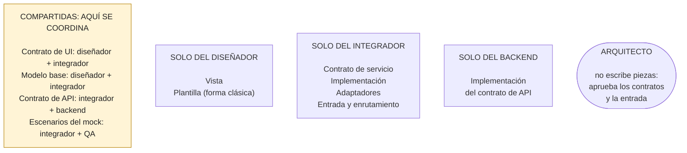
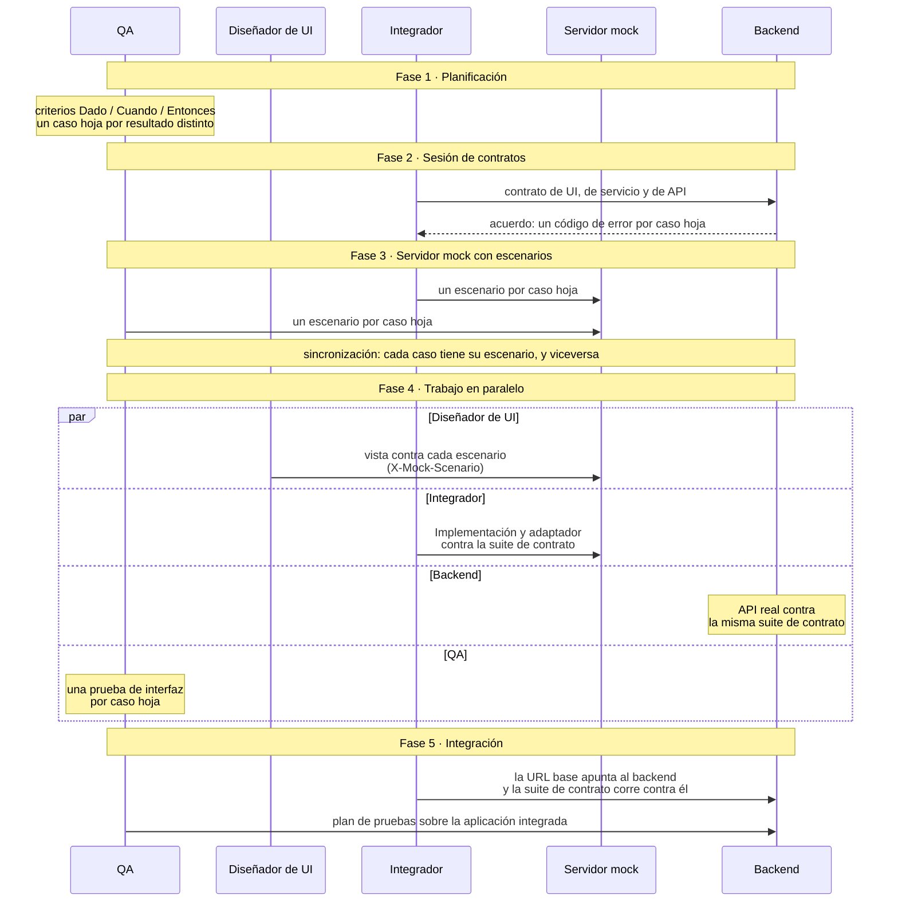
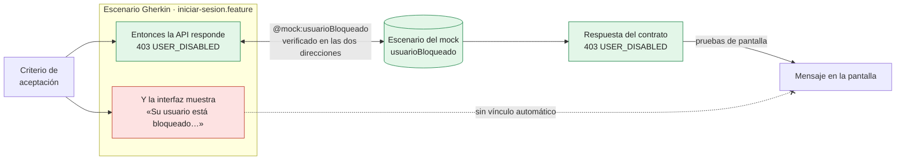
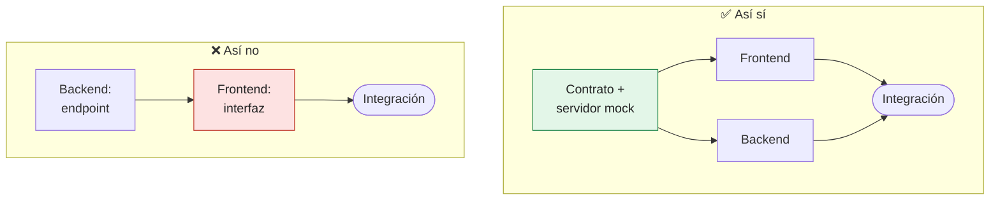

# Capítulo 5. Roles y flujo de trabajo: diseño, frontend e integración en paralelo

Los capítulos anteriores describieron las piezas de JONA. Este capítulo describe a las personas que las construyen y el orden en que trabajan. Es la parte del patrón que más depende de la organización del equipo, y también la que más valor produce: si los roles no respetan las fronteras, las piezas pierden su separación aunque los archivos sigan existiendo.

La tesis del capítulo es la del capítulo 1: **nadie espera a nadie**. El único punto de sincronización obligatorio es el acuerdo de contratos y la existencia de un servidor mock que los sirva con todos sus escenarios.

> [!IMPORTANT]
> **Regla del capítulo.** Cada pieza tiene un rol que la escribe, y **nadie espera a nadie**. El único punto de sincronización es que cada caso hoja del plan de pruebas tenga su escenario en el servidor mock, y que cada escenario corresponda a un caso del plan.

---

## 5.1 Por qué JONA habla de roles

Un patrón de diseño suele describir clases y relaciones. JONA describe además **quién** escribe cada pieza, porque la separación de responsabilidades solo se sostiene si coincide con una separación de tareas:

- si quien diseña la interfaz también escribe las llamadas al backend, nada impide que la vista importe un servicio (N3);
- si quien integra también edita el marcado, nada impide que la Implementación manipule los controles;
- si el backend define solo el contrato de API, el frontend vuelve a esperar.

La primera palabra del nombre, *Joint*, se refiere a esto último: los contratos se definen **en conjunto** entre frontend y backend. Dentro del frontend, la misma idea se aplica entre quien diseña y quien integra.

---

## 5.2 Los roles

Las fuentes del patrón no coinciden del todo. El README del repositorio asigna la Plantilla al diseñador de UI; la documentación en `web_ts/docs/patron/` asigna el estado al desarrollador frontend y agrega un rol de arquitecto; el patrón derivado THC-C nombra los roles *Front GUI*, *Front IMP*, *Back*, *Back Apoyo* y *QA*. Este libro adopta los siguientes roles, con su equivalente en THC-C:

| Rol | Equivalente en THC-C | Responsabilidad |
|---|---|---|
| **Diseñador de UI** | Front GUI | Construye la vista (y la Plantilla, en la forma clásica) contra el contrato de UI y el servidor mock. Nunca escribe llamadas al sistema |
| **Integrador** | Front IMP | Construye la Implementación y los adaptadores contra el contrato de servicio. Nunca toca el marcado ni los estilos |
| **Backend** | Back | Implementa el contrato de API. Lo define en conjunto con el frontend; no lo dicta |
| **QA** | QA | Escribe los criterios de aceptación y el plan de pruebas. Cada caso del plan se convierte en un escenario del servidor mock |
| **Arquitecto** | — | Gobierna los contratos y su evolución, decide la forma de cada unidad, define las entradas y el enrutamiento, y mantiene las reglas de verificación automática (capítulo 9) |

THC-C tiene además un rol de *Back Apoyo*: una persona del backend que acompaña al frontend con dudas sobre el contrato. En JONA esa necesidad disminuye, porque el contrato se escribe en conjunto, pero sigue siendo útil en equipos grandes.

### Quién es dueño de cada pieza

| Pieza | Diseñador de UI | Integrador | Backend | QA | Arquitecto |
|---|---|---|---|---|---|
| Contrato de UI | Coautor | Coautor | — | Revisa | Aprueba |
| Contrato de servicio | — | Autor | Revisa | — | Aprueba |
| Contrato de API | — | Coautor | Coautor | Revisa | Aprueba |
| Escenarios del servidor mock | — | Coautor | Revisa | Coautor | — |
| Vista | Autor | — | — | — | — |
| Plantilla (forma clásica) | Autor | — | — | — | — |
| Modelo base (forma extendida) | Coautor | Coautor | — | — | — |
| Implementación | — | Autor | — | — | — |
| Adaptadores | — | Autor | — | — | — |
| Entrada y enrutamiento | — | Autor | — | — | Aprueba |
| Implementación del contrato de API | — | — | Autor | — | — |

La figura 5.1 agrupa la misma tabla por autoría: casi todas las piezas tienen un solo autor, y las compartidas son los puntos donde los roles se coordinan.



*Figura 5.1. La tabla anterior, agrupada por autoría. La caja amarilla reúne las piezas con más de un autor: son los puntos donde los roles se coordinan.*

Dos decisiones de esta tabla merecen explicación:

- **La Plantilla pertenece al diseñador**, como dice el README. Contiene la interfaz y el comportamiento por defecto sin integración, que es exactamente lo que el diseñador necesita para trabajar solo.
- **El modelo base es compartido.** Contiene el estado de la pantalla, que el diseñador necesita para ver la interfaz funcionando y que el integrador extiende con la integración. Por eso la forma extendida exige más coordinación que las otras dos.

### Equipos pequeños

En un equipo de dos o tres personas, una persona suele cumplir varios roles. Eso no elimina las fronteras: las convierte en **sombreros**. Quien diseña la vista por la mañana e integra por la tarde sigue escribiendo la vista sin llamadas al sistema y la Implementación sin marcado. Las reglas de verificación automática del capítulo 9 son las que sostienen esa disciplina cuando no hay otra persona que revise.

> [!TIP]
> Antes de revisar un cambio, conviene preguntar con qué **sombrero** se escribió. Un cambio de vista no importa servicios; un cambio de integración no toca el marcado ni los estilos.

---

## 5.3 El flujo de trabajo

El flujo tiene cinco fases. Las fases 1 a 3 son secuenciales y cortas; la fase 4 es donde el equipo trabaja en paralelo, y ocupa casi todo el tiempo.

```
1. Planificación          QA y producto escriben historias con criterios Dado / Cuando / Entonces.
        │                 QA deriva el plan de pruebas: un caso hoja por resultado distinto.
        ▼
2. Sesión de contratos    Frontend y backend acuerdan el contrato de UI, el de servicio
        │                 y el de API (rutas, formatos, un código de error por caso hoja).
        ▼
3. Servidor mock          Integrador y QA agregan un escenario por caso hoja.
        │                 ── punto de sincronización: todos los casos tienen su escenario ──
        ▼
4. Trabajo en paralelo    Diseñador de UI: vista contra el servidor mock, escenario por escenario.
        │                 Integrador: Implementación y adaptadores contra la suite de contrato.
        │                 Backend: API real contra la misma suite de contrato.
        ▼
5. Integración            La URL base apunta al backend; la suite de contrato corre contra él;
                          QA ejecuta el plan de pruebas sobre la aplicación integrada.
```

La figura 5.2 muestra el mismo flujo como una secuencia entre roles. Lo importante está en la fase 4: los cuatro carriles corren a la vez, y ninguno espera a otro.



*Figura 5.2. Las fases 1 a 3 son cortas y secuenciales; en la fase 4, diseño, integración, backend y QA trabajan a la vez contra el servidor mock y la misma suite de contrato.*

### Fase 1: planificación

QA escribe los criterios de aceptación en formato *Dado / Cuando / Entonces* y los organiza en un plan de pruebas de tres niveles: la pantalla, los servicios que consume y los casos de cada servicio. Un **caso hoja** es el nivel más específico: un resultado observable distinto. Para el inicio de sesión hay cuatro.

```gherkin
# language: es
Característica: Iniciar sesión

  @mock:exitoso
  Escenario: Credenciales válidas
    Dado un usuario activo "ana@ejemplo.com" con la clave "secreta123"
    Cuando envía el formulario de inicio de sesión
    Entonces la API responde 200 con un token
    Y la interfaz abre la pantalla de inicio

  @mock:credencialesInvalidas
  Escenario: Credenciales incorrectas
    Dado un usuario que escribe una clave incorrecta
    Cuando envía el formulario de inicio de sesión
    Entonces la API responde 401 con el código INVALID_CREDENTIALS
    Y la interfaz muestra "Correo o contraseña incorrectos."

  @mock:usuarioBloqueado
  Escenario: Usuario bloqueado
    Dado un usuario bloqueado por el administrador
    Cuando envía el formulario de inicio de sesión
    Entonces la API responde 403 con el código USER_DISABLED
    Y la interfaz muestra "Su usuario está bloqueado. Contacte al administrador."

  @mock:errorServidor
  Escenario: Falla del servidor
    Dado que el servicio de autenticación no está disponible
    Cuando envía el formulario de inicio de sesión
    Entonces la API responde 500 con el código INTERNAL_ERROR
    Y la interfaz muestra "No se pudo iniciar sesión. Intente de nuevo."
```

La etiqueta `@mock:<escenario>` es el enlace entre el plan de pruebas y el servidor mock. El caso de datos incompletos no aparece aquí: lo resuelve la regla `isValidData` de la Implementación antes de llamar al servicio, y se prueba como regla pura.

### Fase 2: sesión de contratos

Es la sesión conjunta que describe el capítulo 3. Su entrada es el plan de pruebas: cada caso hoja debe tener una respuesta definida en el contrato de API (estado HTTP, código de error y cuerpo). Si un caso no tiene respuesta en el contrato, el contrato está incompleto.

### Fase 3: servidor mock con escenarios

El integrador y QA agregan al servidor mock un escenario por caso hoja. Un cliente elige el escenario con la cabecera `X-Mock-Scenario`; el diseñador puede fijar uno para toda la sesión con `POST /__mock/scenario`.

Esta fase termina con la **condición de sincronización** del flujo: **todos los casos hoja del plan tienen su escenario en el servidor mock, y todos los escenarios del servidor mock corresponden a un caso del plan.** A partir de ahí nadie espera a nadie.

### Fase 4: trabajo en paralelo

| Rol | Trabaja contra | Sabe que terminó cuando |
|---|---|---|
| Diseñador de UI | El contrato de UI y el servidor mock, recorriendo los escenarios | La vista muestra correctamente cada escenario del plan |
| Integrador | El contrato de servicio y la suite de contrato sobre el servidor mock | La Implementación pasa sus pruebas y el adaptador pasa la suite de contrato |
| Backend | El contrato de API y la misma suite de contrato | La API real pasa la suite de contrato |
| QA | El plan de pruebas | Cada caso hoja tiene su escenario y su prueba de interfaz |

El diseñador no necesita al integrador para ver los cuatro escenarios: basta con la forma clásica (la Plantilla) o con la vista alimentada por datos fijos. Cuando la Implementación existe, la vista se conecta a ella sin cambios, porque ambas cumplen el mismo contrato de UI.

### Fase 5: integración

La integración se reduce a cambiar la URL base del adaptador para que apunte al backend real y a ejecutar la suite de contrato contra él. Si la suite pasa contra el servidor mock y contra el backend, la integración no debería producir sorpresas de formato ni de errores; lo que quede por descubrir son reglas de negocio que el plan no contemplaba, y esas vuelven a la fase 1.

Un límite práctico: algunos escenarios no se pueden provocar a voluntad en un backend real, como una falla del servidor. La suite de contrato los marca como omitidos contra el backend y los prueba solo contra el servidor mock.

---

## 5.4 Trazabilidad: del criterio de aceptación a la prueba

El flujo deja una cadena verificable para cada caso hoja:

| Caso hoja | Escenario del servidor mock | Respuesta del contrato de API | Mensaje de la interfaz |
|---|---|---|---|
| Credenciales válidas | `exitoso` | 200 con token | Abre la pantalla de inicio |
| Credenciales incorrectas | `credencialesInvalidas` | 401 `INVALID_CREDENTIALS` | "Correo o contraseña incorrectos." |
| Usuario bloqueado | `usuarioBloqueado` | 403 `USER_DISABLED` | "Su usuario está bloqueado. Contacte al administrador." |
| Falla del servidor | `errorServidor` | 500 `INTERNAL_ERROR` | "No se pudo iniciar sesión. Intente de nuevo." |

Los tres primeros eslabones (caso, escenario y respuesta) se comprueban automáticamente en las dos direcciones:

1. **Del plan al servidor mock:** para cada escenario del plan, enviar la petición con su etiqueta `@mock` y verificar que el estado y el código coinciden con la línea *Entonces*.
2. **Del servidor mock al plan:** cada escenario que el servidor mock declara debe aparecer en el plan. Un escenario sin caso es una prueba que nadie pidió; un caso sin escenario es un resultado que la interfaz nunca vio.

El último eslabón, el mensaje de la interfaz, no lo comprueba esa verificación: lo comprueban las pruebas de pantalla de cada tecnología, que muestran el texto esperado para cada código de error. Unir los dos lados exige que el plan y la Implementación compartan una fuente de mensajes (por ejemplo, un catálogo que ambos lean), y los ejemplos todavía no la tienen. Hasta entonces, un cambio de redacción en el plan no rompe ninguna prueba de pantalla: es una brecha conocida, no una garantía.



*Figura 5.3. La cadena de un caso hoja. Lo verde lo comprueba `ejemplos/flujo-bdd/` en las dos direcciones; el mensaje lo comprueban las pruebas de pantalla, pero nada une la línea «Y la interfaz muestra» con lo que la pantalla muestra.*

> [!WARNING]
> La verificación automática llega hasta la respuesta del contrato de API. Cambiar la redacción de un mensaje en el plan no rompe ninguna prueba de pantalla: mientras el plan y la Implementación no compartan una fuente de mensajes, esa coincidencia no está garantizada.

Ejemplo ejecutable: `ejemplos/flujo-bdd/` (el plan de pruebas de esta sección y la verificación en las dos direcciones contra el servidor mock).

---

## 5.5 Comparación con el flujo de THC-C

El patrón derivado THC-C describe un flujo muy parecido, con un plan de pruebas en tres niveles y un *fixture* por caso hoja. Las diferencias son de enfoque:

| Aspecto | THC-C | JONA |
|---|---|---|
| Origen del contrato de API | El backend lo publica en Swagger; "los tipos vienen del Swagger, no se inventan" | Frontend y backend lo definen en conjunto antes de implementar |
| Dónde viven los escenarios | *Fixtures* dentro de la aplicación, elegidos por el *Composer* | Escenarios del servidor mock, elegidos por cabecera |
| Qué código se ejecuta en desarrollo | El servicio sustituto, no el adaptador real | El adaptador real, contra el servidor mock |
| Punto de sincronización | Los *fixtures* listos | Los escenarios listos en el servidor mock |

Las dos aproximaciones comparten la idea central: los casos de aceptación se convierten en escenarios ejecutables antes de que la interfaz se construya. La diferencia principal es que en JONA el adaptador real se ejercita desde el primer día, y el contrato no lo dicta ninguno de los dos lados.

---

## 5.6 Antipatrones del flujo

> [!CAUTION]
> Estos antipatrones no rompen ninguna pieza: rompen **el orden del trabajo**. El código compila y las pruebas pasan, pero el equipo vuelve a esperar, el contrato deja de ser conjunto o la frontera entre roles se borra sin que nadie lo note.

**Referencia rápida**

| | Antipatrón | Se reconoce porque… | Qué lo evita |
|:-:|---|---|---|
| 🔴 | [El frontend espera al backend](#ap-5-1) | Tareas de interfaz bloqueadas «hasta que esté el endpoint» | Acordar el contrato y levantar el servidor mock antes de empezar |
| 🔴 | [El backend dicta el contrato](#ap-5-2) | El frontend adapta su modelo a lo que el backend expuso | Sesión conjunta de contratos; los cambios se negocian |
| 🔴 | [Mock inventado](#ap-5-3) | El servidor mock responde formatos que no están en el contrato | Servidor mock construido desde el contrato y validado contra él |
| 🟠 | [El integrador edita la vista](#ap-5-4) | Cambios de marcado en commits de integración | Revisión por rol y reglas de dependencia automáticas |
| 🟠 | [Una persona «hace todo» sin sombreros](#ap-5-5) | La vista importa servicios porque «era más rápido» | Las mismas reglas automáticas, sin importar cuántas personas haya |
| 🟡 | [Escenarios huérfanos](#ap-5-6) | Escenarios que ningún caso pide, o casos sin escenario | Verificación en las dos direcciones |

🔴 se pierde la promesa del flujo: alguien espera, o la integración trae sorpresas · 🟠 se borra la frontera entre roles · 🟡 la trazabilidad queda incompleta

---

<a id="ap-5-1"></a>
### 🔴 El frontend espera al backend

**Síntoma.** Tareas de interfaz bloqueadas «hasta que esté el endpoint».



✅ **Así sí:** el diseñador ve cualquier escenario sin esperar al backend ni a la Implementación.

```bash
curl -X POST http://127.0.0.1:4010/__mock/scenario \
  -H 'Content-Type: application/json' -d '{"escenario": "usuarioBloqueado"}'
```

**Por qué duele.** Es exactamente lo que JONA promete evitar: el trabajo del frontend vuelve a ser una cola detrás del backend. **Cómo no caer:** la fase 3 termina con la condición de sincronización (sección 5.3), y a partir de ahí nadie espera a nadie.

---

<a id="ap-5-2"></a>
### 🔴 El backend dicta el contrato

**Síntoma.** El frontend adapta su modelo a lo que el backend expuso.

❌ **Así no** (ilustrativo): un cambio del backend modifica el contrato de API por su cuenta.

```diff
 # contrato-api/login.openapi.yaml, en un cambio solo del backend
-          description: Usuario bloqueado (code USER_DISABLED).
+          description: Usuario bloqueado (code ACCOUNT_LOCKED).
```

✅ **Así sí:** el contrato se acuerda en la sesión conjunta de la fase 2; después, los cambios aditivos se hacen y los que rompen se negocian entre ambos equipos (capítulo 3).

**Por qué duele.** Si el backend define solo el contrato de API, el frontend vuelve a esperar (sección 5.1), y la primera palabra del nombre, *Joint*, pierde su sentido. **Cómo no caer:** sesión conjunta de contratos; el capítulo 9 bloquea los cambios incompatibles del contrato de API hasta que ambos equipos los aprueben.

---

<a id="ap-5-3"></a>
### 🔴 Mock inventado

**Síntoma.** El servidor mock responde formatos que no están en el contrato de API.

❌ **Así no** (ilustrativo): un escenario escrito a mano, sin mirar el contrato.

```js
if (escenario === 'usuarioBloqueado') return responder(403, { error: 'blocked' });
```

✅ **Así sí:** cada respuesta del servidor mock se valida contra el OpenAPI en sus pruebas (`ejemplos/mock-server/test/server.test.mjs`).

```js
function assertCumpleContrato({ status, headers, body }) {
  assert.deepEqual(erroresDeRespuesta('/auth/login', 'post', status, body), []);
  assert.ok(headers.get('x-correlation-id'), 'falta X-Correlation-Id');
}
```

**Por qué duele.** El adaptador y el servicio falso pasan la suite contra un servidor que no se parece al backend, y la integración trae las sorpresas que el flujo debía eliminar. **Cómo no caer:** el servidor mock se construye desde el contrato y pasa la suite de contrato; `ejemplos/mock-server/test/contrato.mjs` valida cada respuesta contra el OpenAPI.

---

<a id="ap-5-4"></a>
### 🟠 El integrador edita la vista

**Síntoma.** Cambios de marcado en commits de integración.

❌ **Así no** (ilustrativo)

```text
feat: integra el inicio de sesión con la API
  M  uilogin/UiLoginImpl.ts
  M  services/AuthServiceHttp.ts
  M  uilogin/UiLoginView.tsx      ← marcado y estilos en un cambio de integración
```

✅ **Así sí:** el cambio de integración toca solo la Implementación y los adaptadores.

```text
feat: integra el inicio de sesión con la API
  M  uilogin/UiLoginImpl.ts
  M  services/AuthServiceHttp.ts
```

**Por qué duele.** Si quien integra también edita el marcado, nada impide que la Implementación manipule los controles (sección 5.1). **Cómo no caer:** revisión por rol y reglas de dependencia automáticas (capítulo 9).

---

<a id="ap-5-5"></a>
### 🟠 Una persona «hace todo» sin sombreros

**Síntoma.** La vista importa servicios porque «era más rápido».

❌ **Así no:** un caso de violación real del capítulo 9 (`ejemplos/gobierno/ts/fixtures/n3-vista-importa-adaptador/uilogin/UiLoginView.ts`).

```ts
import { AuthServiceHttp } from '../servicios/AuthServiceHttp';
import type { InterUiLogin } from './InterUiLogin';

export const UiLoginView = (modelo: InterUiLogin) => {
  void new AuthServiceHttp().login(modelo.correo);
  return `<form>${modelo.correo}</form>`;
};
```

✅ **Así sí:** la regla lo detecta aunque no haya otra persona que revise.

```text
$ npm run check -- fixtures/n3-vista-importa-adaptador
JONA: 1 violaciones en fixtures/n3-vista-importa-adaptador (0 toleradas por la deuda)
  NUEVA    JONA-N3 uilogin/UiLoginView.ts:1 la vista importa servicios/AuthServiceHttp.ts, un servicio
```

**Por qué duele.** Si quien diseña la interfaz también escribe las llamadas al backend, nada impide que la vista importe un servicio (N3), y en un equipo pequeño no hay otra persona que lo vea en la revisión. **Cómo no caer:** las reglas automáticas del capítulo 9 (JONA-N3) sostienen la disciplina; los sombreros no dependen de la cantidad de personas.

---

<a id="ap-5-6"></a>
### 🟡 Escenarios huérfanos

**Síntoma.** El servidor mock declara escenarios que ningún caso del plan pide, o el plan tiene casos sin escenario.

❌ **Así no** (ilustrativo): un escenario que el plan no menciona.

```js
export const ESCENARIOS = ['exitoso', 'credencialesInvalidas', 'usuarioBloqueado', 'errorServidor', 'tiempoAgotado'];
```

✅ **Así sí:** la verificación del mock al plan (`ejemplos/flujo-bdd/test/trazabilidad.test.mjs`) lo rechaza.

```js
it('cada escenario del servidor mock tiene su caso en el plan', () => {
  assert.deepEqual(ESCENARIOS.filter((e) => !planned.includes(e)), [], 'escenarios que nadie pidió');
});

it('cada etiqueta @mock del plan existe en el servidor mock', () => {
  assert.deepEqual(planned.filter((p) => !ESCENARIOS.includes(p)), [], 'casos que la interfaz nunca vería');
});
```

**Por qué duele.** Un escenario sin caso es una prueba que nadie pidió; un caso sin escenario es un resultado que la interfaz nunca vio. **Cómo no caer:** verificación en las dos direcciones (sección 5.4, figura 5.3).

---

## 5.7 Resumen

- JONA define roles porque la separación de piezas solo se sostiene si coincide con una separación de tareas.
- Los roles son diseñador de UI, integrador, backend, QA y arquitecto; equivalen a los de THC-C, con el arquitecto como rol propio.
- La Plantilla pertenece al diseñador; el modelo base de la forma extendida es compartido.
- El flujo tiene cinco fases: planificación, sesión de contratos, servidor mock con escenarios, trabajo en paralelo e integración.
- El único punto de sincronización es que cada caso hoja del plan tenga su escenario en el servidor mock, y viceversa.
- La cadena criterio → escenario → respuesta del contrato se verifica automáticamente en las dos direcciones; el mensaje de la interfaz lo verifican las pruebas de pantalla, sin un vínculo automático con el plan.
- En equipos pequeños, los roles se convierten en sombreros; las reglas automáticas sostienen la disciplina.
