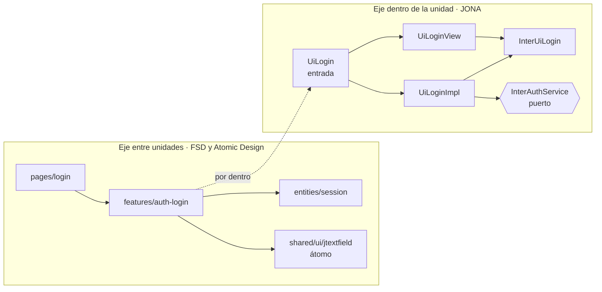
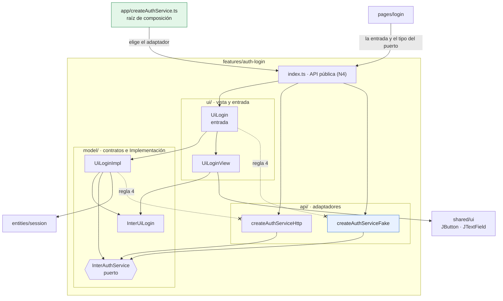
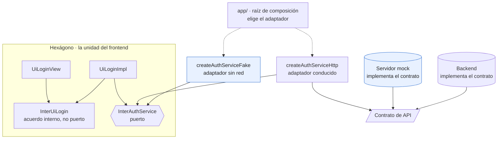

# Capítulo 6. JONA junto a Atomic Design, FSD y Clean/Hexagonal

Un arquitecto que evalúa JONA casi nunca parte de cero. Su equipo ya organiza los componentes con Atomic Design, estructura el proyecto con Feature-Sliced Design (FSD), o separa el dominio con Clean Architecture o con puertos y adaptadores. La pregunta razonable es si JONA compite con esas metodologías o se suma a ellas.

La respuesta de este capítulo es que **se suma**, porque cada metodología responde una pregunta distinta. JONA ordena el **interior** de una unidad de interfaz; las otras ordenan las unidades **entre sí** o fijan la **dirección** de las dependencias. Combinarlas no exige elegir una; exige decidir qué metodología gobierna cada decisión.

> [!IMPORTANT]
> **Regla del capítulo.** JONA ordena el **interior** de una unidad; Atomic Design y FSD ordenan las unidades **entre sí**; Clean/Hexagonal fija la **dirección** de las flechas. Cuando FSD y JONA difieren, se aplica la regla más estricta.

---

## 6.1 Cuatro preguntas distintas

| Metodología | Pregunta que responde | Unidad que organiza | Lo que no dice |
|---|---|---|---|
| **Atomic Design** | ¿De qué tamaño es este componente y con qué se compone? | Componentes por granularidad: átomos, moléculas, organismos, plantillas, páginas | Dónde va la lógica ni cómo se conecta con el sistema |
| **Feature-Sliced Design** | ¿A qué parte del negocio pertenece este código y qué puede importar? | Módulos por alcance: capas, *slices* y segmentos | Cómo se reparten las responsabilidades dentro de un segmento |
| **Clean / Hexagonal** | ¿Hacia dónde apuntan las dependencias? | Dominio, puertos y adaptadores | Cómo se construye una pantalla |
| **JONA** | ¿Qué rol cumple cada pieza de una unidad y quién la escribe? | Una unidad de interfaz: contratos, Implementación, vista, entrada | Cómo se agrupan las unidades en el proyecto |

Las dos primeras son **ejes entre unidades**: deciden dónde vive cada unidad y con cuáles puede hablar. JONA es un **eje dentro de la unidad**. Clean/Hexagonal es transversal: no organiza carpetas, sino la dirección de las flechas, y JONA ya la respeta en su núcleo.



*Figura 6.1. Los dos ejes. FSD y Atomic Design deciden las flechas entre cajas; JONA, las flechas dentro de una caja. En los dos ejes las flechas bajan o apuntan a contratos, que es lo que pide Clean/Hexagonal.*

El patrón derivado THC declara la misma posición sobre sí mismo: "THC no organiza proyectos, organiza features". Es un patrón para el interior de una funcionalidad, pensado para convivir con FSD o con una arquitectura hexagonal. JONA comparte esa escala.

---

## 6.2 JONA y Atomic Design: el sistema de diseño

Atomic Design, propuesto por Brad Frost, clasifica los componentes en cinco niveles: **átomos** (un botón, un campo), **moléculas** (un campo con su etiqueta y su error), **organismos** (un formulario de inicio de sesión), **plantillas** (la disposición de una pantalla sin datos) y **páginas** (la plantilla con contenido real).

Esa clasificación es ortogonal a JONA. Cualquier nivel puede ser una unidad JONA, y la biblioteca `uijona` lo hace de forma sistemática: según su README, es "una librería de componentes basada en Atomic Design y el patrón JONA". En su código fuente hay 21 carpetas de átomos, 43 de moléculas y 19 de organismos, más un nivel de páginas (`JHomeLogin`, `JHomeError` y otras). Cada carpeta contiene la misma unidad: contrato con `DEFAULTS`, Implementación, vista, entrada e historia de Storybook. El tamaño cambia; la anatomía no.

```
uijona/src/organisms/JLogin/
├── InterJLogin.ts      contrato de UI + JLOGIN_DEFAULTS
├── JLoginImpl.tsx      aplica los valores por defecto y renderiza la vista
├── JLoginView.tsx      render puro
├── JLogin.tsx          entrada: reexporta la Implementación
├── JLogin.stories.tsx  composición de demostración
└── index.ts            exportación pública
```

Tres decisiones se desprenden de esta combinación.

**1. En un sistema de diseño, las unidades no tienen contrato de servicio.** `JLogin` es un organismo de inicio de sesión, pero no autentica a nadie. Su contrato recibe el estado (`email`, `password`, `alertMessage`, `isLoading`) y los manejadores (`setEmail`, `onSubmit`, `onGoToCreateAccount`). Quién llama al servidor lo decide la aplicación, en su propia unidad, que usa `JLogin` como pieza de su vista. Es la variante b de la forma mínima del capítulo 2, y es lo que N1 pide cuando no hay dependencias del sistema: un contrato de UI y ninguno de servicio. Un organismo que llama a un servicio deja de ser reutilizable entre aplicaciones, porque arrastra la API de una de ellas.

**2. El nivel atómico no decide la forma.** Un organismo complejo puede justificar la forma extendida y una página simple puede quedarse en la mínima. La forma se elige por unidad, con los criterios del capítulo 2; el nivel atómico solo dice con qué piezas se compone la vista.

**3. La exportación pública de un sistema de diseño es más ancha a propósito.** El `index.ts` de `JLogin` exporta el contrato, la vista, la Implementación y la entrada. En una aplicación, eso sería una violación de N4. En un sistema de diseño es una decisión deliberada: publicar la vista permite que una aplicación la recombine con su propia Implementación. El costo es que la vista pasa a formar parte del contrato público, y cambiar sus propiedades exige una versión mayor. El capítulo 8 trata ese versionado.

Una advertencia de vocabulario: la **plantilla** de Atomic Design (una disposición de pantalla sin datos) no es la **Plantilla** de la forma clásica de JONA (la clase con el comportamiento por defecto que la Implementación hereda). En un equipo que usa las dos metodologías, conviene reservar una de las palabras. `uijona` no tiene un nivel de plantillas; su carpeta `layouts/` contiene administradores de disposición al estilo de Swing (`JBorderLayout`, `JGridBagLayout`), que tampoco son plantillas en el sentido de Atomic Design.

---

## 6.3 JONA y Feature-Sliced Design: dónde vive cada pieza

FSD organiza el código en **capas** con una dirección fija de dependencias. De arriba abajo: `app`, `pages`, `widgets`, `features`, `entities` y `shared`. Cada capa, salvo `app` y `shared`, se divide en ***slices*** por funcionalidad de negocio (`features/auth-login`, `entities/session`), y cada *slice* en **segmentos** por propósito técnico: `ui`, `model`, `api`, `lib` y `config`. Tres reglas sostienen el método:

1. Un módulo solo importa de capas **inferiores** a la suya.
2. Dos *slices* de la misma capa **no se importan entre sí**.
3. Desde fuera, un *slice* solo se usa a través de su **API pública**, normalmente un `index.ts`.

La tercera regla es N4 con otro nombre. "El resto de la aplicación solo conoce la entrada" y "el resto del proyecto solo importa desde el `index.ts` del *slice*" expresan lo mismo; la diferencia es que JONA lo exige por unidad y FSD por *slice*. Cuando un *slice* contiene una sola unidad JONA, que es el caso más frecuente, las dos fronteras coinciden.

### Correspondencia entre segmentos y piezas

| Segmento de FSD | Piezas de JONA | Observación |
|---|---|---|
| `model/` | Contrato de UI, contrato de servicio (puerto), Implementación | El estado y las reglas de la unidad; ningún efecto directo (N3) |
| `ui/` | Vista y entrada | FSD no distingue entre las dos; JONA sí, y la diferencia se verifica por nombre de archivo |
| `api/` | Adaptadores (`createAuthServiceHttp`, el servicio falso) | Implementan el puerto; la unidad no los importa |
| `index.ts` | La exportación pública (N4) | La entrada, el tipo del puerto y las fábricas de adaptadores; nada más |

Y por capa:

| Capa | Qué unidades JONA contiene |
|---|---|
| `app` | Ninguna. Es la **raíz de composición**: elige el adaptador (HTTP o falso) y lo entrega a las entradas |
| `pages` | Unidades de pantalla, o páginas que solo componen entradas de capas inferiores |
| `widgets` | Unidades que combinan varias funcionalidades en un bloque de pantalla |
| `features` | La mayoría de las unidades con contrato de servicio: iniciar sesión, buscar, guardar |
| `entities` | Tipos de dominio (`LoginResult`, `LoginUser`) y unidades que muestran una entidad sin acciones de negocio |
| `shared/ui` | El sistema de diseño: unidades JONA de Atomic Design, sin contrato de servicio |

`shared/ui` es el punto de encuentro de las tres metodologías: FSD lo coloca en la capa más baja, Atomic Design lo organiza por granularidad y JONA da a cada componente su anatomía. Si el sistema de diseño es un paquete aparte, como `uijona`, ese papel lo cumple la dependencia externa.

La figura 6.2 junta las dos tablas con los archivos del ejemplo del capítulo.



*Figura 6.2. Capas de arriba abajo y, dentro del slice, los segmentos: `model/` lleva los contratos y la Implementación, `ui/` la vista y la entrada, `api/` los adaptadores. Las flechas con cruz son las que la regla 4 prohíbe: solo `app` importa un adaptador.*

### Fricciones

**El acoplamiento entre *slices* de la misma capa.** JONA permite que una unidad use la entrada de otra; FSD lo prohíbe si las dos están en la misma capa. Una funcionalidad de "cerrar sesión" no puede importar la entrada de "iniciar sesión". Prevalece FSD, por una razón práctica: la regla impide el grafo de dependencias en el que todas las funcionalidades se conocen entre sí. Las salidas son tres: componer las dos entradas en una capa superior (un *widget* o una página), bajar lo compartido a `entities`, o, para referencias cruzadas entre entidades, usar la notación `@x` que la documentación de FSD define como excepción explícita.

**Dónde vive el puerto.** Si una sola funcionalidad usa `InterAuthService`, el puerto vive en su `model/`. Si lo usan varias (iniciar sesión, cerrar sesión, renovar el token), pasa a la entidad (`entities/session/model`) y las funcionalidades lo importan desde allí, hacia abajo. El criterio es de negocio, no técnico: el puerto vive en la capa del concepto que representa.

> [!TIP]
> Para decidir dónde vive un puerto, la pregunta no es «¿quién lo implementa?», sino **«¿qué concepto del negocio representa?»**. Si lo usan varias funcionalidades, baja a la entidad de ese concepto.

**Quién importa el adaptador.** FSD permite que el segmento `ui/` de una funcionalidad llame directamente a su `api/`. JONA no: la entrada recibe el servicio y la Implementación solo conoce el puerto. Por eso, en un proyecto FSD con JONA, el único lugar que importa un adaptador concreto es `app`. La regla es más estricta que la de FSD y se verifica igual, con una prueba sobre los imports (sección 6.6).

> [!WARNING]
> FSD permite que `ui/` llame a `api/` dentro del mismo *slice*; JONA no. En un proyecto que combina las dos, **solo `app` importa un adaptador concreto**, y la entrada lo recibe como puerto.

**Vista y entrada en el mismo segmento.** `ui/` mezcla dos roles. Basta con una convención de nombres (`*View.tsx` para la vista; el nombre de la unidad para la entrada) para que una regla automática distinga cuál de los dos archivos puede importar la Implementación.

---

## 6.4 JONA y Clean/Hexagonal: la dirección de las flechas

El capítulo 1 adelantó la correspondencia con puertos y adaptadores. En detalle:

| Concepto hexagonal | Pieza de JONA | En el ejemplo |
|---|---|---|
| Lado que conduce (*driving side*) | Vista e Implementación | `UiLoginView`, `UiLoginImpl` |
| Puerto | Contrato de servicio | `InterAuthService` |
| Adaptador conducido (*driven adapter*) | Adaptador | `createAuthServiceHttp`, el servicio falso |
| Raíz de composición | Entrada, o la raíz de la aplicación que le entrega el adaptador | `app/` |
| Acuerdo interno, no un puerto | Contrato de UI | `InterUiLogin` |



*Figura 6.3. Las flechas continuas son dependencias, y todas apuntan a un contrato. El único puerto es `InterAuthService`; `InterUiLogin` queda dentro del hexágono. El servidor mock está fuera, junto al backend: es otra implementación del contrato de API, no un adaptador del frontend. El servicio falso sí es un adaptador.*

Tres precisiones evitan errores frecuentes.

**El contrato de UI no es un puerto.** Un puerto separa la aplicación de un actor externo. El contrato de UI separa dos piezas de la misma unidad, la vista y la Implementación, que escriben dos roles distintos. Tratarlo como puerto lleva a "adaptadores de vista" que no adaptan nada.

**El servidor mock queda fuera del hexágono.** El adaptador HTTP es el mismo en desarrollo y en producción; lo que cambia es la dirección del servidor. El servidor mock no es un adaptador del frontend: es otra implementación del contrato de API, del lado del backend. El servicio falso de las pruebas, en cambio, **sí** es un adaptador: implementa el puerto sin red.

**Los casos de uso no son obligatorios.** Clean Architecture coloca casos de uso entre la interfaz y los puertos. En la mayoría de las pantallas, la Implementación ya cumple ese papel: decide cuándo llamar al servicio y qué hacer con la respuesta. Agregar una clase `IniciarSesionUseCase` que solo reenvía la llamada suma una capa sin responsabilidad. Cuando sí existe lógica de aplicación que no pertenece a una pantalla (un flujo de varios pasos, una regla compartida por varias unidades), se agrega como una capa entre la Implementación y el puerto. Esa es la **N** de JONA: la cantidad de capas no está fija; se agrega una cuando tiene una responsabilidad propia.

En todas estas combinaciones las dependencias apuntan hacia los contratos. La vista depende del contrato de UI; la Implementación, de los dos contratos; el adaptador, del contrato de servicio y del contrato de API. Ningún contrato depende de una pieza concreta. Esa es la regla de dependencia de Clean Architecture aplicada al borde de la interfaz.

---

## 6.5 Las cuatro a la vez: un archivo, cuatro nombres

En un proyecto que combina las cuatro metodologías, cada archivo tiene un nombre en cada una. La tabla siguiente usa el ejemplo de este capítulo:

| Archivo | FSD | Atomic Design | Hexagonal | JONA |
|---|---|---|---|---|
| `app/createAuthService.ts` | Capa `app` | — | Raíz de composición | Elige el adaptador; no es una unidad |
| `app/App.tsx` | Capa `app` | — | — | Guarda la sesión y elige la página; no es una unidad |
| `pages/login/` | Capa `pages` | Página | Lado que conduce | Compone la entrada de la funcionalidad |
| `features/auth-login/model/InterUiLogin.ts` | Segmento `model` | — | Acuerdo interno | Contrato de UI |
| `features/auth-login/model/InterAuthService.ts` | Segmento `model` | — | Puerto | Contrato de servicio |
| `features/auth-login/model/UiLoginImpl.ts` | Segmento `model` | — | Lado que conduce | Implementación |
| `features/auth-login/ui/UiLoginView.tsx` | Segmento `ui` | Organismo | Lado que conduce | Vista |
| `features/auth-login/ui/UiLogin.tsx` | Segmento `ui` | — | Composición | Entrada |
| `features/auth-login/api/createAuthServiceHttp.ts` | Segmento `api` | — | Adaptador conducido | Adaptador |
| `features/auth-login/index.ts` | API pública | — | — | Exportación pública (N4) |
| `entities/session/` | Capa `entities` | — | Tipos de dominio | Tipos que usan los contratos |
| `shared/ui/jbutton/` | Capa `shared` | Átomo | — | Unidad mínima, variante b |

Para que la combinación no se convierta en una negociación permanente, conviene fijar qué metodología gobierna cada decisión:

| Decisión | La gobierna |
|---|---|
| En qué carpeta vive una unidad y qué puede importar | FSD |
| De qué piezas visuales se compone una vista y en qué nivel se publican | Atomic Design |
| Qué piezas tiene una unidad, qué rol escribe cada una y por dónde entra el sistema | JONA |
| Qué depende de qué entre la interfaz, la lógica y la infraestructura | Clean/Hexagonal, que JONA ya cumple dentro de la unidad |

---

## 6.6 Verificación automática de la combinación

Una combinación que solo existe en un documento se degrada en semanas. El ejemplo del capítulo verifica cinco reglas con pruebas sobre los imports del código fuente:

1. **Dirección de capas (FSD).** Un módulo solo importa de capas inferiores.
2. **Aislamiento entre *slices* (FSD).** Dos *slices* de la misma capa no se importan.
3. **API pública (FSD y N4).** Desde fuera, un *slice* solo se importa por su `index.ts`.
4. **Roles dentro de la unidad (JONA y hexagonal).** `model/` no importa `ui/` ni `api/`: la Implementación depende del puerto, no del adaptador. `ui/` y `api/` no se importan entre sí.
5. **Contratos sin comportamiento (N2).** Los archivos `Inter*.ts` solo exportan tipos y objetos `*_DEFAULTS`.

Cada regla se ejecuta además contra un árbol de prueba que contiene una violación, para demostrar que la regla detecta lo que dice detectar. Una regla que nunca falla no prueba nada.

Para las reglas 1 a 3 existe un verificador oficial de FSD, Steiger. El ejemplo usa una prueba propia, con la API del compilador de TypeScript, porque las reglas 4 y 5 son de JONA y ningún verificador de FSD las conoce. El capítulo 9 generaliza esta verificación a las demás tecnologías.

La API pública de la funcionalidad es la exportación pública de la unidad:

```ts
// ejemplos/web-fsd/src/features/auth-login/index.ts
// API pública del slice (FSD) = exportación pública de la unidad (N4).
// La entrada, el tipo del puerto y las fábricas de adaptadores; nada más.
export { UiLogin, type UiLoginProps } from './ui/UiLogin';
export type { InterAuthService } from './model/InterAuthService';
// Solo app las importa: es la raíz de composición (regla 4 de test/architecture).
export { createAuthServiceHttp, type AuthServiceHttpOptions } from './api/createAuthServiceHttp';
export { createAuthServiceFake, type Escenario } from './api/createAuthServiceFake';
```

La entrada vive en `ui/` y recibe el puerto; no sabe qué adaptador lo implementa:

```tsx
// ejemplos/web-fsd/src/features/auth-login/ui/UiLogin.tsx (extracto)
export interface UiLoginProps {
  /** El puerto: la entrada recibe el servicio; quién lo implementa lo decide app. */
  service: InterAuthService;
  onAuthenticated: (result: LoginResult) => void;
}

/** Entrada: compone la Implementación y la vista, y aplica los DEFAULTS. */
export function UiLogin({ service, onAuthenticated }: UiLoginProps) {
  const impl = useUiLoginImpl(service, onAuthenticated);
  return <UiLoginView {...UILOGIN_DEFAULTS} {...impl} />;
}
```

El adaptador se elige en un solo lugar, la raíz de composición:

```ts
// ejemplos/web-fsd/src/app/createAuthService.ts (extracto)
/** Raíz de composición: el único lugar de la aplicación que elige un adaptador del puerto. */
export function createAuthService(env: AuthServiceEnv): InterAuthService {
  if (env.VITE_AUTH_SERVICE === 'fake') return createAuthServiceFake();
  return createAuthServiceHttp({ baseUrl: env.VITE_API_URL ?? 'http://127.0.0.1:4010' });
}
```

En `shared/ui`, cada átomo es una unidad mínima, variante b, sin contrato de servicio. Su valor es estado, y por eso no tiene valor por defecto:

```ts
// ejemplos/web-fsd/src/shared/ui/jtextfield/InterJTextField.ts
/** Contrato de UI de un campo de texto. Sin contrato de servicio: es un átomo del sistema de diseño. */
export interface InterJTextField {
  /** Nombre accesible del campo. */
  label: string;
  value: string;
  type?: 'text' | 'email' | 'password';
  disabled?: boolean;
  /** Recibe el valor, no el evento del DOM. */
  onChange?: (value: string) => void;
}

/** Solo configuración de presentación; el valor es estado y no tiene default. */
export const JTEXTFIELD_DEFAULTS = {
  type: 'text',
  disabled: false,
} as const satisfies Required<Pick<InterJTextField, 'type' | 'disabled'>>;
```

La vista de inicio de sesión (`features/auth-login/ui/UiLoginView.tsx`) es un organismo compuesto con esos átomos: Atomic Design dentro de una funcionalidad de FSD.

Las reglas se implementan como funciones que reciben el origen y el destino de cada import. La regla 4, por ejemplo, prohíbe ciertos segmentos dentro de la propia unidad y restringe lo que puede importar una vista:

```ts
// ejemplos/web-fsd/test/architecture/rules.ts (extracto)
/** Segmentos que cada segmento NO puede importar dentro de su propia unidad. */
const FORBIDDEN_SEGMENTS: Record<string, string[]> = {
  model: ['ui', 'api'], // la Implementación depende del puerto, no del adaptador ni de la vista
  api: ['ui'],
  ui: ['api'], // la entrada recibe el servicio; no crea su adaptador
};

function unitRoles(from: Location, to: Location): string | undefined {
  if (from.unit === undefined || from.unit !== to.unit) return undefined;
  if (from.segment && to.segment && FORBIDDEN_SEGMENTS[from.segment]?.includes(to.segment)) {
    return `el segmento ${from.segment}/ importa ${to.path}, del segmento ${to.segment}/`;
  }
  // La vista solo conoce el contrato de UI (Inter*) y otras vistas; nunca la Implementación ni la entrada.
  if (from.name.endsWith('View') && !to.name.startsWith('Inter') && !to.name.endsWith('View')) {
    return `la vista ${from.name} importa ${to.path}; solo puede importar contratos (Inter*)`;
  }
  return undefined;
}
```

Cada regla tiene al menos un árbol de prueba con exactamente una violación. Por ejemplo, una página que elige el adaptador por su cuenta:

```tsx
// ejemplos/web-fsd/test/fixtures/adapter-outside-app/src/pages/login/ui/LoginPage.tsx
// Violación: la página elige el adaptador; solo la raíz de composición (app) puede hacerlo.
import { createAuthServiceHttp, UiLogin } from '../../../features/auth-login';

export const LoginPage = () => <UiLogin service={createAuthServiceHttp({ baseUrl: '' })} />;
```

La prueba (`test/architecture/architecture.test.ts`) recorre once árboles como ese, uno por violación, y exige que cada uno produzca una sola violación, de la regla y en el archivo esperados. Además, verifica que el código real de `src/` no tenga ninguna. Las pruebas propias (`*.test.tsx`) quedan fuera del análisis: cada una es su propia raíz de composición.

Dos límites conocidos: las reglas no analizan `import()` dinámicos ni alias de rutas. El ejemplo usa solo imports relativos y estáticos; un proyecto con alias debe resolverlos antes de aplicar las reglas.

Ejemplo ejecutable: `ejemplos/web-fsd/` (comportamiento de la unidad, suite de contrato del puerto contra el servicio falso y el servidor mock, y las reglas de arquitectura).

---

## 6.7 Antipatrones de la combinación

> [!CAUTION]
> Estos antipatrones aparecen justo en las costuras entre metodologías: cada uno se justifica con la regla de **otra** metodología («FSD lo permite», «Clean lo pide»). Por eso conviene saber qué metodología gobierna cada decisión (sección 6.5).

**Referencia rápida**

| | Antipatrón | Se reconoce porque… | Qué lo evita |
|:-:|---|---|---|
| 🔴 | [Organismo con negocio](#ap-6-1) | Un componente de `shared/ui` o del sistema de diseño llama a un servicio | El componente expone manejadores; la funcionalidad los conecta |
| 🔴 | [Efecto en `model/`](#ap-6-2) | La Implementación importa `fetch` o un cliente HTTP | La Implementación recibe el puerto; solo `app` elige el adaptador |
| 🟠 | [API pública ancha en una aplicación](#ap-6-3) | El `index.ts` de una funcionalidad exporta la vista y la Implementación | Exportar solo la entrada, el tipo del puerto y las fábricas de adaptadores |
| 🟡 | [Caso de uso de reenvío](#ap-6-4) | Una clase por acción que solo llama al servicio | Dejar la decisión en la Implementación hasta que exista lógica compartida |
| 🟡 | [Adaptador de vista](#ap-6-5) | Un «puerto» entre la vista y la Implementación | El contrato de UI es un acuerdo interno, no un puerto |
| 🟡 | [Colisión de «plantilla»](#ap-6-6) | La palabra designa a la vez un nivel de Atomic Design y una pieza de JONA | Reservar una de las dos en el glosario del equipo |

🔴 un efecto queda fuera de su lugar: se pierde la sustitución del sistema o la reutilización · 🟠 se ensancha una frontera (N4) · 🟡 sobra una capa o una palabra

---

<a id="ap-6-1"></a>
### 🔴 Organismo con negocio

**Síntoma.** Un componente de `shared/ui` o del sistema de diseño llama a un servicio.

❌ **Así no** (ilustrativo)

```tsx
// shared/ui/jlogin/JLoginImpl.tsx
import { createAuthServiceHttp } from '../../../features/auth-login';

export const service = createAuthServiceHttp({ baseUrl: 'http://127.0.0.1:4010' });
```

✅ **Así sí:** el contrato del organismo recibe el estado y los manejadores; quién llama al servidor lo decide la aplicación (`uijona/src/organisms/JLogin/InterJLogin.ts`, extracto).

```ts
export interface InterJLogin {
  // state
  email: string;
  password: string;
  emailError?: string;
  passwordError?: string;
  alertMessage?: string;
  isLoading?: boolean;
  // setters
  setEmail: (v: string) => void;
  setPassword: (v: string) => void;
  // handlers
  onSubmit: (e: React.FormEvent) => void;
  onGoToCreateAccount?: () => void;
  onGoToRecoverPassword?: () => void;
}
```

**Por qué duele.** Un organismo que llama a un servicio deja de ser reutilizable entre aplicaciones, porque arrastra la API de una de ellas. **Cómo no caer:** el componente expone manejadores y la unidad de la funcionalidad los conecta (sección 6.2). Si el componente importa el adaptador de una funcionalidad, como en el ejemplo de arriba, las reglas del ejemplo lo señalan dos veces: la 1, porque `shared` importa de una capa superior, y la 4, porque elige un adaptador fuera de `app`.

---

<a id="ap-6-2"></a>
### 🔴 Efecto en `model/`

**Síntoma.** La Implementación importa `fetch` o un cliente HTTP «porque FSD permite `api/` en el mismo *slice*».

❌ **Así no:** el árbol de prueba `ejemplos/web-fsd/test/fixtures/model-imports-api/` (archivo `model/UiLoginImpl.ts`).

```ts
// Violación: la Implementación importa el adaptador en lugar de recibir el puerto.
import { createAuthServiceHttp } from '../api/createAuthServiceHttp';

export const service = createAuthServiceHttp({ baseUrl: 'http://127.0.0.1:4010' });
```

✅ **Así sí:** la Implementación solo conoce el puerto (`ejemplos/web-fsd/src/features/auth-login/model/UiLoginImpl.ts`, extracto); el adaptador lo elige `app` (sección 6.6).

```ts
// La Implementación depende del puerto, nunca de un adaptador de api/.
import type { InterAuthService } from './InterAuthService';
```

**Por qué duele.** La Implementación queda atada a la red: ya no se prueba con el servicio falso ni se apunta a otro servidor sin tocarla. **Cómo no caer:** la regla 4 de `ejemplos/web-fsd/test/architecture/rules.ts` (`FORBIDDEN_SEGMENTS`: `model/` no importa `api/`) señala este árbol con «el segmento model/ importa features/auth-login/api/createAuthServiceHttp, del segmento api/». El árbol `adapter-outside-app` cubre la variante en que otra capa, distinta de `app`, elige el adaptador.

---

<a id="ap-6-3"></a>
### 🟠 API pública ancha en una aplicación

**Síntoma.** El `index.ts` de una funcionalidad exporta la vista y la Implementación.

❌ **Así no:** el árbol de prueba `ejemplos/web-fsd/test/fixtures/wide-public-api/` (archivo `features/auth-login/index.ts`).

```ts
export { UiLogin } from './ui/UiLogin';
// Violación: la API pública de una aplicación expone la vista de la unidad.
export { UiLoginView } from './ui/UiLoginView';
```

✅ **Así sí:** la entrada, el tipo del puerto y las fábricas de adaptadores; nada más (`ejemplos/web-fsd/src/features/auth-login/index.ts` sin sus comentarios; completo en la sección 6.6).

```ts
export { UiLogin, type UiLoginProps } from './ui/UiLogin';
export type { InterAuthService } from './model/InterAuthService';
export { createAuthServiceHttp, type AuthServiceHttpOptions } from './api/createAuthServiceHttp';
export { createAuthServiceFake, type Escenario } from './api/createAuthServiceFake';
```

**Por qué duele.** En una aplicación, eso es una violación de N4: el resto del proyecto puede saltarse la entrada y recombinar las piezas por su cuenta. La excepción es un sistema de diseño, que publica la vista a propósito y la versiona (sección 6.2). **Cómo no caer:** la regla 3 del ejemplo señala el árbol con «la API pública reexporta features/auth-login/ui/UiLoginView; solo exporta la entrada, el puerto y los adaptadores».

---

<a id="ap-6-4"></a>
### 🟡 Caso de uso de reenvío

**Síntoma.** Una clase por acción que solo llama al servicio.

❌ **Así no** (ilustrativo)

```ts
export class IniciarSesionUseCase {
  constructor(private readonly service: InterAuthService) {}
  execute(email: string, password: string) {
    return this.service.login(email, password); // solo reenvía
  }
}
```

✅ **Así sí:** la Implementación ya decide cuándo llamar al servicio y qué hacer con la respuesta (`ejemplos/web-fsd/src/features/auth-login/model/UiLoginImpl.ts`, extracto).

```ts
try {
  result = await service.login(email, password);
} catch (e) {
  setError(loginErrorMessage(e));
}
```

**Por qué duele.** Suma una capa sin responsabilidad (sección 6.4). **Cómo no caer:** la capa se agrega cuando existe lógica de aplicación que no pertenece a una pantalla (un flujo de varios pasos, una regla compartida por varias unidades). Esa es la **N** de JONA (sección 6.4). Ninguna regla automática lo detecta: es una decisión de revisión.

---

<a id="ap-6-5"></a>
### 🟡 Adaptador de vista

**Síntoma.** Un «puerto» entre la vista y la Implementación, con su «adaptador».

❌ **Así no** (ilustrativo)

```ts
// «puerto» de la vista y un adaptador que no adapta nada
export interface UiLoginViewPort { render(model: InterUiLogin): void; }
export class UiLoginViewAdapter implements UiLoginViewPort { /* reenvía a UiLoginView */ }
```

✅ **Así sí:** la vista recibe el contrato de UI directamente (`ejemplos/web-fsd/src/features/auth-login/ui/UiLoginView.tsx`, extracto).

```tsx
import type { InterUiLogin } from '../model/InterUiLogin';

export function UiLoginView({
  title, submitLabel, email, password, error, isSubmitting,
  onEmailChange, onPasswordChange, onSubmit,
}: InterUiLogin) {
```

**Por qué duele.** Un puerto separa la aplicación de un actor externo; el contrato de UI separa dos piezas de la misma unidad. Tratarlo como puerto lleva a «adaptadores de vista» que no adaptan nada (sección 6.4, figura 6.3). **Cómo no caer:** el contrato de UI es un acuerdo interno, no un puerto; en la tabla de 6.4 el único puerto es el contrato de servicio.

---

<a id="ap-6-6"></a>
### 🟡 Colisión de «plantilla»

**Síntoma.** La palabra designa a la vez un nivel de Atomic Design y la pieza de la forma clásica de JONA.

❌ **Así no** (ilustrativo)

```text
— Falta la plantilla del inicio de sesión.
— ¿La disposición de la pantalla sin datos, o la clase con el comportamiento por defecto?
```

✅ **Así sí** (por ejemplo): el glosario del equipo reserva una de las dos palabras.

| Término | Significado en el equipo |
|---|---|
| Plantilla | La pieza de la forma clásica de JONA, que la Implementación hereda |
| Disposición | El nivel de Atomic Design: una pantalla sin datos |

**Por qué duele.** En un equipo que usa las dos metodologías, la misma palabra produce dos conversaciones distintas. **Cómo no caer:** reservar una de las dos en el glosario del equipo (sección 6.2).

---

## 6.8 Resumen

- Atomic Design, FSD y Clean/Hexagonal responden preguntas distintas a la de JONA; se combinan, no compiten.
- JONA ordena el interior de una unidad; Atomic Design y FSD ordenan las unidades entre sí; Clean/Hexagonal fija la dirección de las dependencias, que JONA ya respeta.
- En un sistema de diseño, cada nivel atómico puede ser una unidad JONA, sin contrato de servicio. El nivel no decide la forma.
- La API pública de un *slice* de FSD es N4. Los segmentos se corresponden con las piezas: `model/` con contratos e Implementación, `ui/` con vista y entrada, `api/` con adaptadores.
- Cuando FSD y JONA difieren, se aplica la regla más estricta: FSD prohíbe el acoplamiento entre *slices* de la misma capa; JONA prohíbe que algo distinto de la raíz de composición importe un adaptador.
- El contrato de servicio es el puerto; el contrato de UI no lo es. El servidor mock queda fuera del hexágono; el servicio falso es un adaptador.
- Las capas se agregan cuando tienen responsabilidad propia: esa es la N de JONA.
- La combinación se sostiene con reglas automáticas sobre los imports, cada una probada contra una violación.
