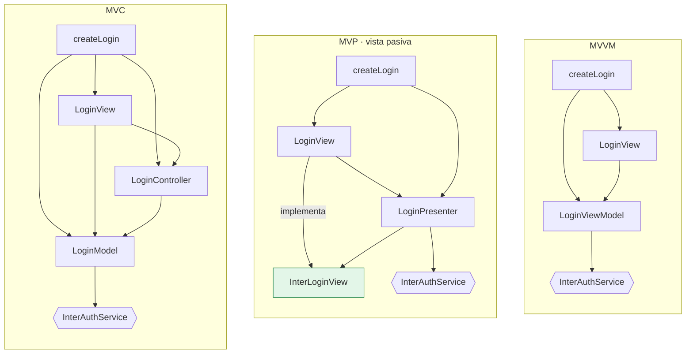
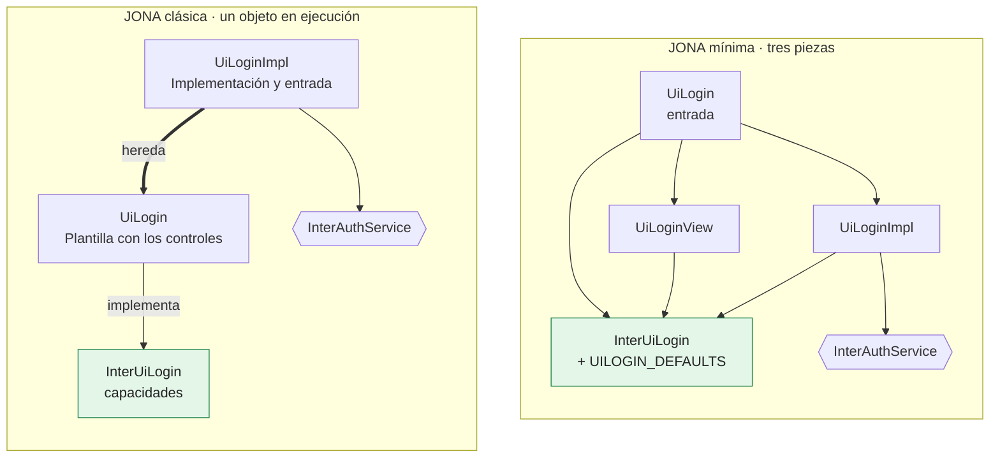
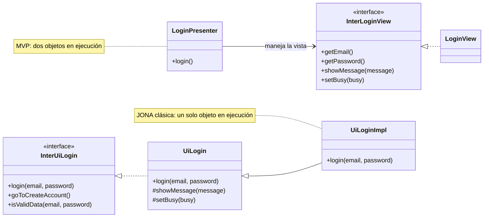
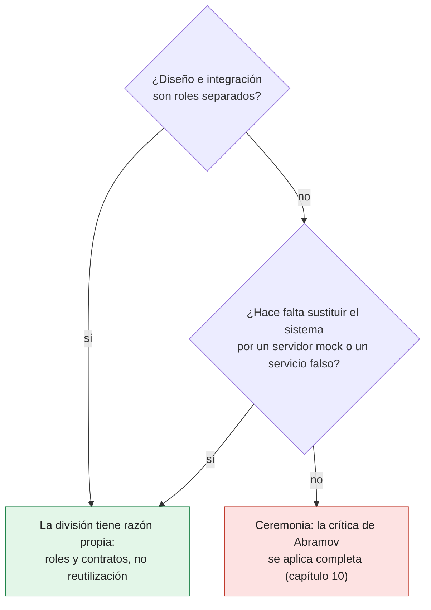

# Capítulo 7. JONA frente a MVC, MVP, MVVM y contenedor-presentacional

Separar la presentación de la lógica no es una idea nueva. MVC tiene más de cuarenta años, y MVP, MVVM y el patrón contenedor-presentacional son variaciones sobre el mismo problema. Un arquitecto que evalúa JONA tiene derecho a preguntar qué agrega, y la pregunta merece una respuesta precisa: JONA **no** inventa una nueva forma de separar la presentación. Lo que agrega está en otra parte, y este capítulo lo delimita.

El método del capítulo es empírico. El ejemplo `ejemplos/patrones-comparados/` implementa la misma pantalla de inicio de sesión cinco veces (MVC, MVP, MVVM, JONA clásica y JONA mínima) y somete las cinco a la **misma** suite de pruebas de comportamiento. Las cinco la pasan. Lo que cambia entre ellas no es lo que hace la pantalla, sino dónde se toma cada decisión, y una prueba estructural lo mide.

> [!IMPORTANT]
> **Regla del capítulo.** JONA no aporta una separación nueva entre presentación y lógica. Lo que agrega son contratos con audiencias distintas, una vista que funciona sin integración, una entrada única, el contrato de API con servidor mock, los roles y un vocabulario común entre plataformas (sección 7.6).

---

## 7.1 Cinco respuestas al mismo problema

| Patrón | Origen | Idea central |
|---|---|---|
| **MVC** | Trygve Reenskaug, Smalltalk, Xerox PARC, 1979 | El modelo notifica a las vistas que lo observan; el controlador traduce la entrada del usuario en operaciones sobre el modelo |
| **MVP** | Taligent, 1996; Martin Fowler lo divide en 2006 en *Passive View* y *Supervising Controller* | El presentador contiene la lógica y maneja la vista a través de una interfaz; la vista pasiva solo muestra y reenvía eventos |
| **MVVM** | John Gossman, Microsoft, 2005, para WPF; deriva del *Presentation Model* de Fowler (2004) | Un modelo de vista expone estado y comandos; la vista se enlaza a él por *data binding* |
| **Contenedor-presentacional** | Dan Abramov, 2015, para React | Un componente contenedor obtiene datos y maneja estado; uno presentacional solo recibe propiedades y dibuja |
| **Plantilla con método** (*Template Method*) | Gamma, Helm, Johnson y Vlissides, 1994 | Una clase base define el esqueleto de un algoritmo; las subclases redefinen los pasos |

El último no es un patrón de presentación, pero aparece en la lista porque es el pariente más cercano de la forma clásica de JONA, como muestra la sección 7.3.

---

## 7.2 Dónde vive cada decisión

La suite común verifica seis comportamientos: inicio exitoso, credenciales incorrectas, usuario bloqueado, datos faltantes sin llamar al servicio, ningún envío doble mientras hay una petición en curso, y la limpieza del error anterior en un nuevo intento. Las cinco implementaciones los cumplen. La diferencia está en la siguiente tabla:

| | MVC | MVP (vista pasiva) | MVVM | JONA clásica | JONA mínima |
|---|---|---|---|---|---|
| Dónde vive el estado de la pantalla | Modelo | Presentador y widgets | Modelo de vista | Plantilla (widgets) | Implementación |
| Quién llama al servicio | Modelo | Presentador | Modelo de vista | Implementación | Implementación |
| Cómo llega un evento a la lógica | Vista → controlador → modelo | Vista → presentador | Comando enlazado | Llamada a una capacidad del contrato | Manejador del modelo de vista |
| Cómo llega un resultado a la vista | El modelo notifica; la vista lee | El presentador llama a la interfaz de la vista | Enlace de datos | Métodos protegidos heredados de la Plantilla | La vista recibe un nuevo modelo de vista |
| ¿Existe un contrato explícito entre vista y lógica? | No | Sí: la interfaz de la vista | Habitualmente, la clase del modelo de vista | Sí: la interfaz de capacidades | Sí: el modelo de vista con `DEFAULTS` |
| ¿Existe un contrato explícito con el sistema? | No lo exige | No lo exige | No lo exige | Sí: el puerto | Sí: el puerto |
| ¿Funciona la vista sin integración? | No | Con un presentador falso | Con un modelo de vista falso | Sí: la Plantilla tiene comportamiento por defecto | Sí, con `DEFAULTS` y un servicio falso |

Las filas de dependencias no son una opinión: la prueba estructural del ejemplo (`test/estructura.test.ts`) analiza los imports de cada archivo y verifica esta matriz:

| Patrón | Quién importa el servicio | Quién importa los controles | Quién conoce la vista concreta | Quién decide el mensaje |
|---|---|---|---|---|
| MVC | `LoginModel` | `LoginView` | `createLogin` | `LoginModel` |
| MVP | `LoginPresenter` (conoce `InterLoginView`, nunca `LoginView`) | `LoginView` | `createLogin` | `LoginPresenter` |
| MVVM | `LoginViewModel` | `LoginView` | `createLogin` | `LoginViewModel` |
| JONA clásica | `UiLoginImpl` | `UiLogin` (Plantilla) | `UiLoginImpl`, por herencia | `UiLogin` (datos faltantes) y `UiLoginImpl` (errores del servicio) |
| JONA mínima | `UiLoginImpl` | `UiLoginView` (solo importa `InterUiLogin` y los controles) | `UiLogin` (entrada) | `UiLoginImpl` |

Las figuras 7.1 y 7.2 dibujan la misma matriz. Cada flecha es un import real de `src/` (los controles y los mensajes compartidos quedan fuera para simplificar); las relaciones de la matriz las comprueba la prueba estructural. `InterAuthService` es el servicio que comparten las cinco implementaciones.



*Figura 7.1. MVC, MVP y MVVM en el ejemplo: quién importa a quién. Solo MVP tiene un contrato explícito entre vista y lógica (en verde), y apunta hacia la vista: el presentador conoce `InterLoginView`, nunca `LoginView`. En los tres, una función de ensamblado (`createLogin`) arma las piezas.*



*Figura 7.2. Las dos formas de JONA. En la clásica, la Implementación conoce la vista por herencia y es la entrada; en la mínima, la entrada es la única pieza que conoce a las demás, y la vista solo importa el contrato de UI (y los controles).*

En ningún patrón una vista importa el servicio. Esa regla, la más importante, la cumplen los cinco: no es lo que distingue a JONA.

> [!TIP]
> Si alguien defiende JONA porque «la vista no llama al servicio», la respuesta es que los cinco patrones del ejemplo lo cumplen. Las filas que distinguen a JONA son las de **contrato con el sistema** y **vista sin integración**.

Dos filas explican casi todo el capítulo. La fila de **contrato con el sistema** muestra que ninguno de los patrones clásicos exige un puerto: lo permiten, pero no lo piden. La fila de **vista sin integración** muestra que JONA es el único que la convierte en un requisito de diseño y no en una consecuencia de las pruebas.

---

## 7.3 JONA clásica no es MVP: es una plantilla con método

A primera vista, la forma clásica se parece a MVP: hay una interfaz, una pieza que dibuja y una pieza con la lógica. Pero las flechas apuntan al revés.

En **MVP**, la interfaz es **de la vista**: declara lo que el presentador puede pedirle (`getEmail`, `showMessage`, `setBusy`). La vista y el presentador son dos objetos en ejecución, y el presentador habla con la vista solo a través de esa interfaz.

En la **forma clásica de JONA**, la interfaz es **de la unidad**: declara lo que la unidad ofrece (`login`, `goToCreateAccount`, `isValidData`). La Plantilla la implementa con un comportamiento por defecto y la Implementación la hereda y redefine `login`. En ejecución hay **un solo objeto**. Las operaciones de presentación (`showMessage`, `setBusy`) no están en ninguna interfaz: son métodos protegidos de la Plantilla que la Implementación hereda.

```java
// ejemplos/java-swing — la Plantilla (extracto)
public class UiLogin extends JDialog implements InterUiLogin {
    @Override public void login(String email, String password) { ... }   // comportamiento por defecto
    protected void showMessage(String message) { lblMessage.setText(message); }
    protected void setBusy(boolean busy) { ... }
}

// la Implementación redefine un paso
public class UiLoginImpl extends UiLogin {
    @Override public void login(String email, String password) { ... }   // integración real
}
```

Eso es una plantilla con método: la clase base define el esqueleto (construir la ventana, conectar eventos, mostrar resultados) y la subclase redefine el paso que necesita el sistema.



*Figura 7.3. Las flechas al revés. En MVP, la interfaz es de la vista y el presentador la usa para manejarla. En la forma clásica, la interfaz es de la unidad: la Plantilla la implementa con un comportamiento por defecto, la Implementación hereda y redefine `login`, y `showMessage` y `setBusy` son protegidos (`#`), fuera de toda interfaz.*

La diferencia tiene consecuencias:

- **A favor de la forma clásica:** la Plantilla es una interfaz funcional por sí sola. El diseñador la ejecuta sin servidor, sin presentador y sin servicio falso.
- **A favor de MVP:** la lógica del presentador se prueba con una vista falsa, sin ningún toolkit gráfico. En la forma clásica, la lógica vive en una subclase de la ventana; probarla exige crear la ventana. En el ejemplo de Swing, eso es imposible sin pantalla, y por eso sus pruebas cubren solo las reglas y los contratos (capítulo 4).

La forma clásica cambia testabilidad por simplicidad. Es un buen intercambio en código heredado o en equipos pequeños; deja de serlo cuando la lógica de la pantalla crece. En ese punto, la forma mínima o la extendida recuperan lo que MVP ofrece.

> [!WARNING]
> No conviene esperar de la forma clásica la testabilidad de MVP. Su lógica vive en una subclase de la ventana, y probarla exige crear la ventana; cuando la lógica de la pantalla crece, el cambio es a la forma mínima o a la extendida.

---

## 7.4 JONA mínima es MVVM con contratos

La forma mínima y MVVM son casi la misma idea: un objeto con el estado y las acciones de la pantalla, y una vista que lo dibuja. El capítulo 4 lo mostró en WPF, donde JONA no reemplaza a MVVM sino que le asigna roles: el modelo de vista **es** la Implementación, el XAML **es** la vista.

Lo que la forma mínima agrega sobre MVVM son cuatro reglas que MVVM no exige:

1. **El modelo de vista tiene un contrato separado de su implementación** (`InterUiLogin`). En muchos proyectos MVVM, el contrato es la clase misma; la vista y el diseñador dependen de la implementación.
2. **El contrato trae valores por defecto declarativos** (`UILOGIN_DEFAULTS`). La vista se puede dibujar sin ninguna implementación.
3. **El servicio entra por un puerto** (`InterAuthService`), inyectado por la entrada. MVVM permite inyectarlo; JONA lo exige (N1, N3).
4. **El resto de la aplicación solo conoce la entrada** (N4). En MVVM es habitual que la navegación cree el modelo de vista y la vista por separado.

Si una plataforma ya trae MVVM, adoptar JONA no significa reescribir los modelos de vista. Significa extraer su contrato, mover las llamadas al sistema detrás de un puerto y definir una entrada.

---

## 7.5 Contenedor-presentacional y su retractación

La variante a de la forma mínima, en React, tiene la misma estructura que el patrón contenedor-presentacional: la entrada con la Implementación hace de contenedor, y la vista es el componente presentacional.

Ese patrón tiene una historia que un arquitecto debe conocer. Su autor, Dan Abramov, agregó en 2019 una nota a su artículo original: ya no recomendaba dividir los componentes de esa manera. Los *hooks* permitían reutilizar la lógica con estado sin crear componentes contenedores, y la división se estaba aplicando como dogma, incluso donde no aportaba nada.

La crítica se aplica a JONA en la misma medida en que JONA justifique la división por las mismas razones. No lo hace. El patrón contenedor-presentacional dividía para **reutilizar** componentes sin estado. JONA divide por **roles y contratos**: la vista la escribe el diseñador de UI, la Implementación el integrador, y el contrato de UI es el acuerdo entre los dos (capítulo 5). Además, el contrato de servicio permite sustituir el sistema completo por un servidor mock o un servicio falso.

La consecuencia es una advertencia, no una defensa: **si un equipo no tiene esa separación de roles ni necesita sustituir el sistema, la división de JONA es ceremonia**, y la crítica de Abramov se le aplica completa. El capítulo 10 trata esos casos. Por otra parte, no toda unidad JONA divide en dos componentes: en la variante b, la Implementación renderiza la vista y la entrada solo la reexporta.



*Figura 7.4. La retractación de Abramov apunta a dividir para reutilizar. JONA divide por roles y por la sustitución del sistema; sin ninguna de las dos razones, la división es ceremonia.*

---

## 7.6 Lo que JONA agrega y lo que no

| JONA no agrega | JONA agrega |
|---|---|
| Una forma nueva de separar la presentación de la lógica | Dos contratos con audiencias distintas: el de UI (diseño ↔ integración) y el de servicio (integración ↔ sistema) |
| Un mecanismo de reactividad o de enlace de datos | Una vista que funciona sin integración como requisito de diseño |
| Un reemplazo de los patrones que trae cada plataforma | Una entrada única por unidad (N4) |
| | Un contrato de API definido con el backend y un servidor mock como modo normal de desarrollo |
| | Roles que coinciden con las piezas, y un flujo en el que nadie espera |
| | **Un vocabulario común entre plataformas** |

La última fila es la más subestimada. Un equipo que mantiene una aplicación WPF, una Android y una web habla de tres patrones: MVVM, el `ViewModel` de Android y componentes de React. Con JONA, las tres tienen un contrato de UI, una Implementación, una vista, una entrada y el mismo contrato de servicio, respaldado por el mismo contrato de API. Las revisiones, las reglas automáticas y las conversaciones con el backend usan las mismas palabras.

---

## 7.7 Cómo conviven

| Situación | Recomendación |
|---|---|
| La plataforma trae MVVM (WPF, Android, SwiftUI con `ObservableObject`) | Mantener MVVM; el modelo de vista es la Implementación. Agregar el contrato de UI, el puerto y la entrada |
| El código existente usa MVP | El presentador es la Implementación; la interfaz de la vista pasa a ser parte del contrato de UI, en estilo de capacidades. Agregar el puerto si el presentador llama al sistema directamente |
| El código existente usa MVC con un modelo que llama a la red | Separar el modelo de dominio (tipos) de la llamada al sistema; la llamada pasa a un adaptador detrás de un puerto. El capítulo 11 detalla esta migración |
| Proyecto React con contenedores y componentes presentacionales | Ya es la forma mínima, variante a. Agregar los contratos y la entrada; eliminar los contenedores que no tengan un rol propio |
| Clases y herencia, sin un patrón previo | Forma clásica, sabiendo que cambia testabilidad por simplicidad |

---

## 7.8 El ejemplo

El ejemplo no usa ningún framework gráfico. `src/comun/pantalla.ts` define tres controles mínimos (campo de texto, botón y etiqueta), suficientes para escribir vistas reales sin un navegador. Las cinco implementaciones comparten el servicio falso, los mensajes y la regla de datos obligatorios; solo cambia la forma de repartir la pantalla.

La primera diferencia aparece antes de la lógica: **quién arma las piezas**. MVC, MVP y MVVM no nombran ese rol, así que el ejemplo agrega una función de ensamblado a cada uno:

```ts
// src/mvp/createLogin.ts
/** Ensamblado: MVP no nombra a quién crea las piezas; aquí se hace a mano. */
export function createMvpLogin(deps: LoginPresenterDeps): LoginView {
  const view = new LoginView();
  view.attach(new LoginPresenter(view, deps));
  return view;
}
```

En JONA ese rol tiene nombre y regla (N4): es la entrada.

```ts
// src/jona-minima/UiLogin.ts (extracto)
/** Entrada: recibe el servicio, lo pasa a la Implementación y aplica los DEFAULTS a la Vista. */
export function createUiLogin(deps: UiLoginImplDeps) {
  const view = createUiLoginView();
  createUiLoginImpl(deps, (model) => view.render({ ...UILOGIN_DEFAULTS, ...model }));
  return view.screen;
}
```

El contrato de MVP apunta **hacia la vista**: es lo que el presentador puede pedirle.

```ts
// src/mvp/InterLoginView.ts
/** Contrato de la vista pasiva: lo único que el presentador sabe de ella. */
export interface InterLoginView {
  getEmail(): string;
  getPassword(): string;
  showMessage(message: string): void;
  setBusy(busy: boolean): void;
}
```

En la forma clásica, la Plantilla conecta el botón con una capacidad del contrato y le da un comportamiento por defecto. La Implementación redefine esa capacidad y reutiliza las operaciones protegidas:

```ts
// src/jona-clasica/UiLogin.ts (extracto) — Plantilla
this.submit.onClick(() => this.login(this.email.value, this.password.value));

// Comportamiento por defecto: valida y no llama a ningún sistema.
login(email: string, password: string): void {
  if (!this.isValidData(email, password)) {
    this.showMissingDataError();
    return;
  }
  this.showMessage('Datos completos (sin integración).');
}
```

```ts
// src/jona-clasica/UiLoginImpl.ts (extracto) — Implementación y entrada
override login(email: string, password: string): void {
  if (!this.isValidData(email, password)) {
    this.showMissingDataError();   // reutiliza la operación de la Plantilla
    return;
  }
  this.setBusy(true);              // el botón deshabilitado impide el doble envío
  this.showMessage('');            // limpia el error del intento anterior
  this.deps.service.login(email, password).then(
    (result) => {
      this.setBusy(false);
      this.deps.onAuthenticated(result);
    },
    (error: unknown) => {
      this.setBusy(false);
      this.showMessage(loginErrorMessage(error));
    },
  );
}
```

El modelo de vista de MVVM y la Implementación de la forma mínima contienen la misma lógica. La diferencia está en la vista: en la forma mínima, la vista solo conoce el contrato de UI y se redibuja con cada modelo de vista nuevo.

```ts
// src/jona-minima/UiLoginView.ts (extracto)
function render(next: InterUiLogin): void {
  model = next;
  screen.title.text = next.title ?? '';
  screen.submit.label = next.submitLabel ?? '';
  screen.email.setValue(next.email);
  screen.password.setValue(next.password);
  screen.message.text = next.error ?? '';
  screen.email.enabled = !next.isSubmitting;
  screen.password.enabled = !next.isSubmitting;
  screen.submit.enabled = !next.isSubmitting;
}
```

Las pruebas son tres grupos:

- **Una suite de comportamiento común** (`test/loginBehavior.ts`) con seis casos: los cinco de la sección 7.2 y uno más, "un nuevo intento limpia el error anterior". Cada patrón la ejecuta a través de un *driver* que escribe en los campos, presiona el botón y lee el mensaje.
- **Dos pruebas propias de cada forma de JONA.** En la clásica, la Plantilla funciona sola, sin servicio. En la mínima, los `DEFAULTS` solo contienen textos (`title`, `submitLabel`) y la entrada los aplica.
- **La prueba estructural**, que verifica la matriz de la sección 7.2. Un árbol de prueba acoplado (una vista que importa el puerto y un presentador que importa la vista concreta) demuestra que sus reglas detectan las violaciones.

Ejemplo ejecutable: `ejemplos/patrones-comparados/` (60 pruebas, sin dependencias de ejecución).

---

## 7.9 Antipatrones

> [!CAUTION]
> Estos errores no rompen el comportamiento: las cinco implementaciones del ejemplo pasan la misma suite. Rompen **lo que JONA agrega** sobre los patrones clásicos, o hacen pagar su costo sin obtener su beneficio.

**Referencia rápida**

| | Antipatrón | Se reconoce porque… | Qué lo evita |
|:-:|---|---|---|
| 🔴 | [El contrato es la clase del modelo de vista](#ap-7-1) | La vista y el diseñador importan la implementación | Contrato de UI separado, con `DEFAULTS` |
| 🔴 | [Modelo que llama a la red](#ap-7-2) | El modelo, el presentador o el modelo de vista llaman al sistema sin un puerto | Puerto y adaptador; el modelo solo conserva los tipos |
| 🔴 | [La navegación arma las piezas](#ap-7-3) | La navegación crea la vista y el modelo de vista por separado | Una entrada única por unidad (N4) |
| 🟠 | [Llamar MVP a la forma clásica](#ap-7-4) | Se espera probar su lógica sin ventana, o el contrato declara operaciones de presentación | Tratarla como plantilla con método; cambiar de forma si la lógica crece |
| 🟠 | [Dividir por dogma](#ap-7-5) | Se divide «porque JONA lo dice», o se rechaza «porque Abramov se retractó» | Decidir por roles y por sustitución del sistema |
| 🟡 | [Reescribir los modelos de vista](#ap-7-6) | La adopción empieza por reescribir lo que la plataforma ya trae | Extraer el contrato, poner el puerto, definir la entrada |

🔴 se pierde algo de lo que JONA agrega: el contrato separado, el puerto o la entrada · 🟠 se espera de una forma lo que no da, o se paga la división sin su razón · 🟡 la adopción cuesta más de lo necesario

---

<a id="ap-7-1"></a>
### 🔴 El contrato es la clase del modelo de vista

**Síntoma.** La vista y el diseñador dependen de la implementación: no hay un contrato de UI aparte (sección 7.4).

❌ **Así no**, si lo que se busca es la forma mínima: la vista MVVM del ejemplo se construye con la clase concreta (`src/mvvm/LoginView.ts`, extracto). En MVVM es lo habitual; en JONA falta el contrato.

```ts
import type { LoginViewModel, Observable } from './LoginViewModel.js';
// …
  constructor(viewModel: LoginViewModel) {
```

✅ **Así sí:** la vista de la forma mínima solo importa el contrato de UI y los controles (`src/jona-minima/UiLoginView.ts`), y la prueba estructural lo exige.

```ts
import { Button, Label, TextField, type LoginScreen } from '../comun/pantalla.js';
import type { InterUiLogin } from './InterUiLogin.js';
```

```ts
// test/estructura.test.ts
it('jona-minima: la Vista importa solo el contrato y los controles', () => {
  assert.deepEqual(graph.get('src/jona-minima/UiLoginView')?.sort(), ['src/comun/pantalla', 'src/jona-minima/InterUiLogin']);
});
```

**Por qué duele.** Sin contrato separado y sin `DEFAULTS`, la vista no se puede dibujar sin una implementación, y el diseñador vuelve a depender del integrador. **Cómo no caer:** las reglas 1 y 2 de la sección 7.4: el contrato se separa de su implementación y trae valores por defecto declarativos.

---

<a id="ap-7-2"></a>
### 🔴 Modelo que llama a la red

**Síntoma.** El modelo de MVC (o el presentador, o el modelo de vista) llama al sistema directamente. Ninguno de los patrones clásicos exige un puerto: lo permiten, pero no lo piden (sección 7.2).

❌ **Así no** (ilustrativo)

```ts
// LoginModel.ts
const response = await fetch('/auth/login', { method: 'POST', body: JSON.stringify(credenciales) });
```

✅ **Así sí:** el modelo recibe el servicio por su puerto, como en el ejemplo (`src/mvc/LoginModel.ts`, extracto).

```ts
import type { InterAuthService, LoginResult } from '../comun/InterAuthService.js';

export interface LoginModelDeps {
  service: InterAuthService;
  onAuthenticated: (result: LoginResult) => void;
}
```

**Por qué duele.** Sin puerto no hay forma de sustituir el sistema completo por un servidor mock o un servicio falso, que es una de las dos razones por las que JONA divide (sección 7.5). **Cómo no caer:** separar el modelo de dominio (tipos) de la llamada al sistema, y pasar la llamada a un adaptador detrás de un puerto (sección 7.7; el capítulo 11 detalla la migración). En JONA, N1 lo exige: la Implementación depende de un contrato de servicio, no de un adaptador.

---

<a id="ap-7-3"></a>
### 🔴 La navegación arma las piezas

**Síntoma.** La navegación crea el modelo de vista y la vista por separado, una práctica habitual en MVVM (sección 7.4).

❌ **Así no** (ilustrativo)

```ts
// navegación
const viewModel = new LoginViewModel({ service, onAuthenticated });
mostrar(new LoginView(viewModel));
```

✅ **Así sí:** la entrada es el único lugar que arma la unidad (`src/jona-minima/UiLogin.ts`, extracto).

```ts
export function createUiLogin(deps: UiLoginImplDeps) {
  const view = createUiLoginView();
  createUiLoginImpl(deps, (model) => view.render({ ...UILOGIN_DEFAULTS, ...model }));
  return view.screen;
}
```

**Por qué duele.** Cada lugar que arma las piezas conoce el interior de la unidad, que es justo lo que N4 prohíbe: el resto de la aplicación solo conoce la entrada. MVC, MVP y MVVM no nombran ese rol; en JONA tiene nombre y regla (sección 7.8). **Cómo no caer:** JONA-N4 en el verificador del capítulo 9, que señala cualquier importación de una pieza interna:

```text
$ npm run check -- fixtures/n4-importa-vista
JONA: 1 violaciones en fixtures/n4-importa-vista (0 toleradas por la deuda)
  NUEVA    JONA-N4 App.ts:1 importa jbutton/JButtonView.ts, interno de la unidad jbutton; use su entrada: jbutton/JButton.ts
```

---

<a id="ap-7-4"></a>
### 🟠 Llamar MVP a la forma clásica

**Síntoma.** Se espera probar la lógica de la forma clásica con una vista falsa, como en MVP, o el contrato de UI empieza a declarar operaciones de presentación.

❌ **Así no** (ilustrativo): el contrato de la unidad convertido en la interfaz de una vista pasiva.

```ts
export interface InterUiLogin {
  login(email: string, password: string): void;
  showMessage(message: string): void;   // operación de presentación
  setBusy(busy: boolean): void;         // operación de presentación
}
```

✅ **Así sí:** el contrato declara lo que la unidad ofrece; las operaciones de presentación son métodos protegidos de la Plantilla (`src/jona-clasica/InterUiLogin.ts`).

```ts
/** Contrato de UI, estilo capacidades: lo que la pantalla sabe hacer. */
export interface InterUiLogin {
  login(email: string, password: string): void;
  isValidData(email: string, password: string): boolean;
}
```

**Por qué duele.** Las flechas apuntan al revés (figura 7.3). La forma clásica es un solo objeto en ejecución: su lógica vive en una subclase de la ventana, y probarla exige crear la ventana. Quien la llama MVP espera una testabilidad que no tiene, y la mantiene cuando la lógica de la pantalla crece. **Cómo no caer:** tratarla como plantilla con método (sección 7.3); cuando la lógica crece, pasar a la forma mínima o a la extendida.

---

<a id="ap-7-5"></a>
### 🟠 Dividir por dogma

**Síntoma.** La división en vista e Implementación se aplica en todas partes «porque JONA lo dice», incluso donde nadie la necesita; o se rechaza en todas partes «porque Abramov se retractó», incluso donde hay roles separados.

❌ **Así no:** citar la retractación sin su contexto, o ignorarla. Abramov se retractó de dividir para **reutilizar** componentes sin estado, cuando los *hooks* ya permitían reutilizar la lógica.

✅ **Así sí:** decidir por las razones de JONA, que son otras: roles separados y sustitución del sistema (figura 7.4).

**Por qué duele.** En un caso, el equipo paga la división sin obtener nada: es ceremonia, y la crítica de Abramov se le aplica completa. En el otro, pierde la separación entre el diseñador de UI y el integrador, que es lo que JONA defiende. **Cómo no caer:** la decisión de la figura 7.4 y los casos del capítulo 10. Recordar, además, que no toda unidad divide en dos componentes: en la variante b, la Implementación renderiza la vista.

---

<a id="ap-7-6"></a>
### 🟡 Reescribir los modelos de vista

**Síntoma.** La adopción de JONA en una plataforma con MVVM empieza por reescribir los modelos de vista existentes.

❌ **Así no** (ilustrativo)

```text
Plan de adopción
1. Reescribir cada modelo de vista como una Implementación nueva
2. Reescribir las vistas contra las Implementaciones nuevas
```

✅ **Así sí:** el modelo de vista **es** la Implementación; se le agregan las piezas que faltan (sección 7.4).

```text
Plan de adopción
1. Extraer el contrato de UI del modelo de vista
2. Mover las llamadas al sistema detrás de un puerto
3. Definir una entrada
```

**Por qué duele.** Se reescribe lo que JONA no reemplaza: en una plataforma con MVVM, JONA no sustituye a MVVM, le asigna roles (sección 7.4), y lo que agrega está en las piezas que faltan. **Cómo no caer:** la tabla de la sección 7.7: mantener MVVM y agregar el contrato de UI, el puerto y la entrada.

---

## 7.10 Resumen

- MVC, MVP, MVVM y contenedor-presentacional resuelven el mismo problema que JONA: separar la presentación de la lógica. JONA no aporta una separación nueva.
- Las cinco implementaciones del ejemplo pasan la misma suite de comportamiento; difieren en dónde vive cada decisión.
- La forma clásica de JONA es una plantilla con método, no MVP: un solo objeto en ejecución, con la integración redefinida por herencia. Gana simplicidad y pierde testabilidad sin interfaz gráfica.
- La forma mínima es MVVM con contrato de UI separado, valores por defecto, puerto obligatorio y una entrada única.
- La retractación de Abramov sobre contenedor-presentacional se aplica a JONA cuando no hay roles separados ni necesidad de sustituir el sistema; en esos casos, la división es ceremonia.
- Lo que JONA agrega son contratos con audiencias, una vista que funciona sin integración, la entrada, el contrato de API con servidor mock, los roles y un vocabulario común entre plataformas.
