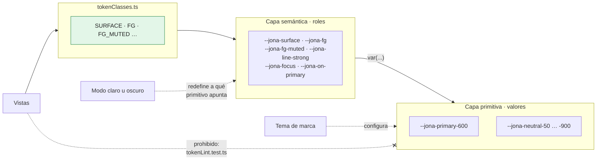
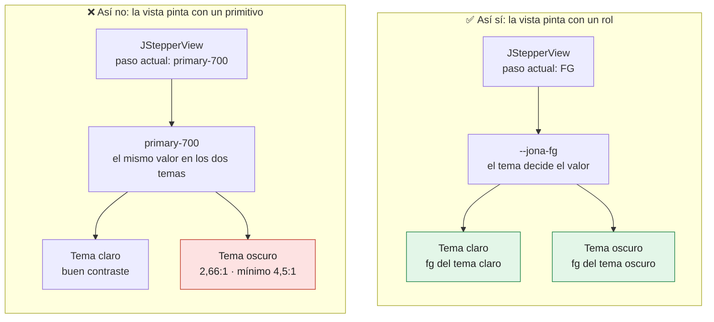
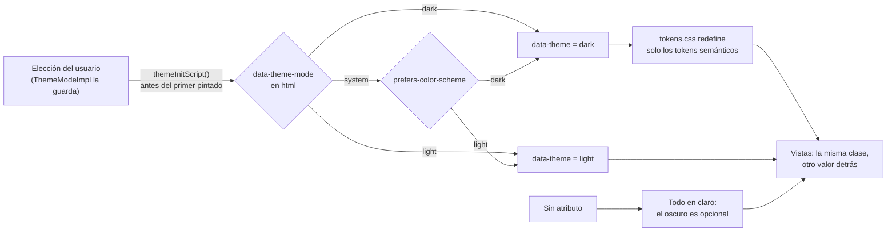
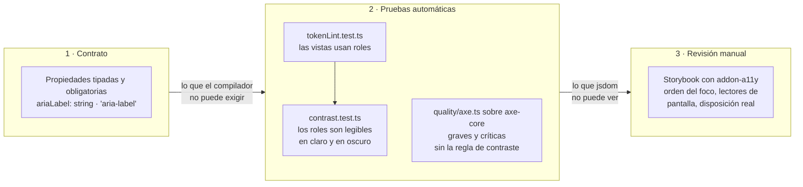
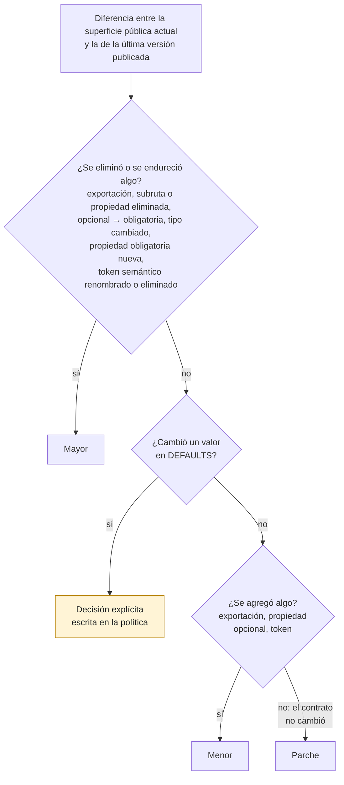
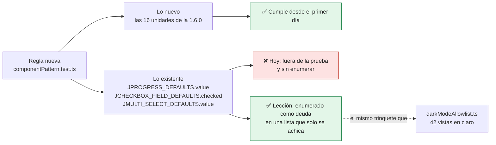
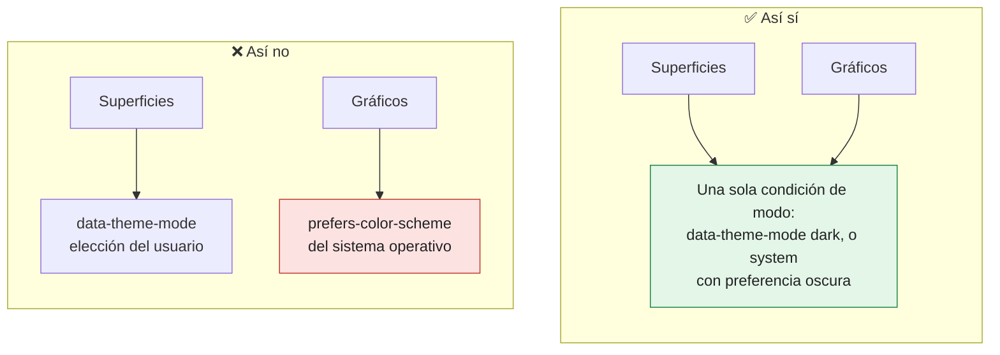

# Capítulo 8. Sistemas de diseño con JONA: tokens, temas, accesibilidad y versionado

En una aplicación, el contrato de UI es un acuerdo entre dos roles del mismo equipo. En un sistema de diseño es otra cosa: una **API pública** que consumen equipos que el autor no conoce, en aplicaciones que no puede compilar. Un error en una aplicación se corrige en el siguiente despliegue; un error en el contrato de un sistema de diseño cuesta una versión mayor y una migración en cada consumidor.

Este capítulo trata las cuatro decisiones que convierten un conjunto de unidades JONA en un producto: tokens, temas, accesibilidad y versionado. La fuente principal es `uijona`, la biblioteca de componentes del repositorio, publicada en npm como `jona-ui`. Varias de las prácticas descritas llegaron con la versión 1.6.0, publicada en npm el 31 de octubre de 2026; el texto indica cuándo un dato proviene de esa versión.

> [!IMPORTANT]
> **Regla del capítulo.** En un sistema de diseño, el contrato de UI, los nombres de los tokens y los archivos de estilo publicados son **API pública**. Las vistas pintan solo con **roles semánticos**, el tema cambia el valor detrás del rol y la **versión se deriva de la diferencia entre contratos**, no de la intuición.

---

## 8.1 Qué cambia cuando la unidad es un producto

| Aspecto | Unidad de una aplicación | Unidad de un sistema de diseño |
|---|---|---|
| Quién consume la entrada | El mismo equipo | Equipos y aplicaciones desconocidos |
| Contrato de servicio | Habitual | Ninguno (capítulo 6): la unidad expone manejadores y la aplicación los conecta |
| Exportación pública | Solo la entrada (N4) | La entrada, el contrato y sus `DEFAULTS`; a veces también la vista, como decisión explícita |
| Costo de cambiar el contrato | Una revisión | Una versión mayor y una migración por consumidor |
| Lo que también es contrato | El contrato de UI | El contrato de UI, **los nombres de los tokens** y los archivos de estilo publicados |

La última fila es la que más se olvida. Un consumidor que redefine `--jona-surface` para su marca depende de ese nombre tanto como de una propiedad de `JButton`.

En `uijona`, la superficie pública tiene dos definiciones: el índice raíz (`src/index.ts`), que reexporta cada unidad, y el mapa `exports` de `package.json`, que publica una subruta por componente, los estilos (`./index.css`, `./base.css`) y el tema (`./theme`, `./theme/tokens.css`). En la versión 1.6.0, una prueba (`packageExports.test.ts`) exige que cada línea del índice tenga su entrada en el mapa, y prohíbe subrutas eliminadas o sin prefijo. Dos definiciones de la misma superficie solo son seguras si una prueba las mantiene iguales.

---

## 8.2 Tokens: valores y roles

Un token de diseño es un nombre para una decisión visual. Los sistemas maduros los organizan en dos capas:

| Capa | Ejemplo en `uijona` | Qué nombra | Quién lo usa |
|---|---|---|---|
| **Primitiva** | `--jona-primary-600`, `--jona-neutral-50` … `-900` | Un valor de la paleta | Los tokens semánticos, y la configuración de temas de marca |
| **Semántica** | `--jona-surface`, `--jona-fg`, `--jona-fg-muted`, `--jona-line-strong`, `--jona-focus`, `--jona-on-primary` | Un rol: fondo, texto, borde, foco | Las vistas |

En `uijona` los tokens son propiedades CSS personalizadas (`src/theme/tokens.css`), almacenadas como tripletes RGB para admitir transparencias. Cada token semántico apunta a uno primitivo con `var(...)`. La versión 1.6.0 agrega `src/theme/tokenClasses.ts`, con una constante por clase semántica (`SURFACE`, `FG`, `FG_MUTED` …), y su encabezado fija la regla: **las vistas de la biblioteca pintan solo a través de esas constantes.**



*Figura 8.1. Las vistas llegan a los valores solo a través de los roles: el tema mueve la flecha entre la capa semántica y la primitiva, y el lint de tokens corta el atajo directo.*

La regla es la versión visual de N1. La vista no depende de un valor (`primary-700`), sino de un rol (`fg`), del mismo modo que la Implementación no depende de un adaptador, sino de un puerto. El valor detrás del rol lo decide el tema.

Un defecto real muestra por qué importa. En el paso a paso `JStepper`, el número del paso actual se pintaba con un primitivo, `primary-700`. En el tema claro tenía buen contraste; sobre la superficie oscura, 2,66:1, muy por debajo del mínimo de 4,5:1. La corrección de la versión 1.6.0 lo cambió por el rol semántico:

```tsx
// uijona 1.6.0 — molecules/JStepper/JStepperView.tsx (extracto)
import { CONTROL_BORDER, FG, FG_MUTED, ON_PRIMARY, SURFACE } from '../../theme/tokenClasses';

// FG, no primary-700: el número debe leerse también sobre la superficie oscura (antes, 2,66:1).
status === 'current' && `border-primary-600 ${SURFACE} ${FG}`,
```

La figura 8.2 muestra el mismo defecto en los dos temas.



*Figura 8.2. El primitivo se ve bien en el tema en que se diseñó y falla en el otro; el rol se adapta a cada tema sin tocar la vista. La prueba de contraste de la 1.6.0 verifica el paso actual en los tres modos (sección 8.4).*

Una vista que usa un primitivo directamente es un defecto de tema esperando a que alguien active el modo oscuro. Por eso la regla no se confía a la revisión: una prueba de *lint* de tokens (`tokenLint.test.ts`) prohíbe colores hexadecimales y utilidades de color sin rol en las vistas.

---

## 8.3 Temas

`uijona` resuelve los temas con un atributo en el elemento `<html>`, no con una clase:

- `data-theme-mode` guarda la elección del usuario: `system`, `light` o `dark`.
- `data-theme` guarda el resultado ya resuelto: `light` o `dark`.
- `tokens.css` redefine **solo los tokens semánticos** bajo `:root[data-theme-mode='dark']`, y bajo `:root[data-theme-mode='system']` dentro de `@media (prefers-color-scheme: dark)`.

Las vistas no saben qué tema está activo. Su clase no cambia; cambia el valor del token detrás de ella. Esa es la condición para que un tema nuevo no exija tocar ninguna vista.



*Figura 8.3. El modo es la elección (`system`, `light` o `dark`); el tema es el resultado (`light` o `dark`). Las vistas no participan en la resolución: solo cambia el valor detrás de cada rol.*

Tres detalles de diseño merecen atención:

1. **El modo de tema es una unidad JONA.** No tiene vista, pero tiene contrato (`InterThemeMode`), valores por defecto (`THEME_MODE_DEFAULTS = { defaultMode: 'system', storageKey: 'jona-theme-mode' }`) e Implementación (`ThemeModeImpl`, que escucha `prefers-color-scheme` y guarda la elección). JONA no se limita a componentes visuales.
2. **Un script previo al primer pintado** (`themeInitScript()`) aplica el atributo antes de que el navegador dibuje, para evitar el destello del tema claro.
3. **El modo oscuro es opcional.** Sin el atributo, todo se dibuja en claro. Eso permitió introducir el modo oscuro de forma gradual: según el CHANGELOG de la 1.6.0, 42 vistas siguen en claro dentro del modo oscuro, y una lista de excepciones (`darkModeAllowlist.ts`) las enumera con la regla de que la lista **solo puede achicarse**.

El tema de **marca** es un mecanismo distinto. `JonaThemeProvider` escribe variables de paleta o semánticas como estilos en línea, sobre `:root` o sobre un elemento con `[data-jona-scope]`. Separar marca y modo (claro u oscuro) es correcto, porque son dos ejes independientes, pero su interacción debe probarse. Un estilo en línea tiene más especificidad que los selectores de modo oscuro, así que un token semántico redefinido por la marca podría quedar fijo en los dos modos. Es una inferencia a partir del código, no un defecto reproducido; el arquitecto debe pedir la prueba.

> [!WARNING]
> Marca y modo son dos ejes independientes, pero un estilo en línea gana a los selectores del modo oscuro. Antes de aceptar un tema de marca que redefina tokens semánticos, pida la prueba que combine marca y modo oscuro.

Una inconsistencia real ilustra el riesgo de dos mecanismos para lo mismo. Los tokens de gráficos cambian a oscuro con `:root:not([data-theme='light'])` dentro de `prefers-color-scheme: dark`, sin la condición de que el modo oscuro haya sido activado. En un sistema operativo oscuro, los gráficos de una aplicación que no activó el modo oscuro pueden oscurecerse mientras las superficies siguen claras. La regla de "oscuro opcional" debe valer para **todos** los tokens, y una prueba debería verificarla por grupo.

---

## 8.4 Accesibilidad

En un sistema de diseño, la accesibilidad se defiende en tres niveles.

**En el contrato.** El contrato de UI declara lo que la unidad necesita para ser accesible, y el compilador lo exige. En `uijona`, `InterJButton` tipa `aria-label`, `aria-pressed` y `aria-expanded`, y las unidades de datos y navegación (`JDataGrid`, `JToolbar`, `JTreeNav`) exigen un `ariaLabel: string` obligatorio. Un consumidor no puede olvidarlo: no compila. El mismo inventario muestra una lección de gobierno: unos contratos usan `'aria-label'` (con comillas, el nombre del atributo) y otros `ariaLabel`. Las dos formas funcionan, pero un sistema de diseño debe elegir una, porque el consumidor aprende el contrato por imitación.

**En pruebas automáticas.** La versión 1.6.0 tiene dos:

- `contrast.test.ts` compila la hoja de estilos, resuelve las cadenas de `var()` hasta los tripletes y calcula la razón de contraste de WCAG para pares semánticos: texto y texto atenuado sobre las superficies (mínimo 4,5:1), foco y borde fuerte sobre la superficie (mínimo 3:1), en claro y en oscuro. Además verifica que el fondo de los diálogos oscurezca lo suficiente la superficie elevada, y que el paso actual de un `JStepper` renderizado alcance 4,5:1 en los tres modos.
- Un asistente sobre axe-core (`quality/axe.ts`) ejecuta las reglas de accesibilidad en las pruebas de varias unidades y conserva solo las violaciones graves y críticas. Desactiva la regla de contraste, porque jsdom no calcula estilos ni disposición; el contraste lo cubre la prueba anterior.

**En revisión manual.** Storybook registra el complemento de accesibilidad (`@storybook/addon-a11y`), útil para lo que ninguna prueba en jsdom ve: el orden del foco, los lectores de pantalla y la disposición real.

Los límites también deben quedar escritos. La prueba de contraste cubre pares **semánticos**; no cubre un primitivo usado directamente en una vista (como el `border-primary-600` del extracto anterior) ni las 42 vistas exceptuadas del modo oscuro. Por eso la prueba de contraste y el *lint* de tokens funcionan juntos: el *lint* garantiza que las vistas usen roles, y la prueba de contraste, que los roles sean legibles.



*Figura 8.4. Tres niveles de defensa: cada uno cubre lo que el anterior no alcanza. Dentro del segundo, el lint y la prueba de contraste solo protegen juntos.*

---

## 8.5 Versionado: el contrato de UI es la API

Un sistema de diseño versionado con *Semantic Versioning* necesita una definición escrita de qué cambio es de cada tipo. Con JONA, la definición sale de los contratos:

| Cambio | Tipo | Razón |
|---|---|---|
| Eliminar una exportación, una subruta o una propiedad del contrato | Mayor | Un consumidor deja de compilar |
| Hacer obligatoria una propiedad opcional | Mayor | Un consumidor deja de compilar |
| Cambiar el tipo de una propiedad | Mayor | Un consumidor deja de compilar o cambia de comportamiento |
| Renombrar o eliminar un token semántico | Mayor | Un consumidor que lo redefine pierde su tema sin aviso |
| Cambiar un valor en `DEFAULTS` | Decisión explícita | Cambia el comportamiento de quien no pasa la propiedad; debe escribirse en la política |
| Agregar una exportación, una propiedad opcional o un token | Menor | Nadie deja de compilar |
| Corregir una vista o una Implementación sin tocar el contrato | Parche | La superficie no cambia |



*Figura 8.5. La versión sale de la diferencia entre contratos, de la pregunta más grave a la más leve: si hay varios cambios, manda el más grave. La única rama que no se decide sola es la de `DEFAULTS`.*

Clasificar a mano es frágil, y la historia de `uijona` lo muestra. Su CHANGELOG sigue *Keep a Changelog* y *Semantic Versioning*. La entrada 1.5.2 se presenta como "una versión de corrección de errores", pero también agrega propiedades de accesibilidad y `density` a `JButton`: trabajo de una versión menor con número de parche. La 1.5.2 nunca llegó a npm; su contenido se publicó en la 1.6.0, que el CHANGELOG describe como "una versión menor aditiva" en la que "no se eliminó ninguna exportación ni propiedad". El desenlace fue correcto, pero dependió de que alguien lo notara.

La alternativa es medir la superficie. Se guarda una **instantánea de la API pública** (cada exportación y, para cada contrato, sus propiedades, su opcionalidad y su tipo) y, en cada versión, una prueba compara la superficie actual con la instantánea, clasifica la diferencia y verifica que el número de versión respete el salto exigido. El ejemplo del capítulo lo implementa.

### La deuda que una regla nueva no cubre

La versión 1.6.0 agregó `componentPattern.test.ts`, que verifica la anatomía de las 16 unidades nuevas de esa versión: que existan sus siete archivos (contrato, Implementación, vista, entrada, índice, historia y prueba), que su objeto `*_DEFAULTS` no contenga claves de estado (`value`, `open`, `selected*`, `checked*`) y que el índice raíz y el mapa de exportaciones las publiquen.

La prueba cubre **solo** esas 16 unidades, y las anteriores tienen excepciones. Tres contratos guardan estado en sus valores por defecto: `JPROGRESS_DEFAULTS.value`, `JCHECKBOX_FIELD_DEFAULTS.checked` y `JMULTI_SELECT_DEFAULTS.value`. Corregirlas no es gratis: si un consumidor depende de ese valor por defecto, quitarlo cambia el comportamiento, y según la tabla anterior eso exige una decisión explícita, quizá una versión mayor.

La lección es general. Una regla nueva se aplica primero a lo nuevo; lo existente se **enumera** como deuda, en una lista que solo se achica, con el mismo trinquete que la lista de excepciones del modo oscuro. Una regla que no puede aplicarse a todo el código desde el primer día igual puede impedir que la deuda crezca.



*Figura 8.6. Una regla que no cubre lo existente lo deja sin ningún control; enumerarlo convierte esa deuda en algo que se puede contar y achicar (capítulo 9, sección 9.4).*

---

## 8.6 Historias: composiciones de demostración

Las historias de Storybook son las composiciones de demostración del capítulo 2 (sección 2.8): componen la unidad con valores de ejemplo, viven junto a ella y nada de la aplicación las importa. En `uijona` hay 106 archivos de historias para 112 contratos; seis unidades no tienen historia. El patrón más frecuente es una historia `Default` y otra `Interactive`, con argumentos editables, y la barra de herramientas de Storybook incluye un selector de tema que fija `data-theme-mode`.

Las historias documentan, pero **no prueban**: `componentPattern.test.ts` solo verifica que el archivo exista. Un arquitecto puede ir más lejos y ejecutar las historias como pruebas, reutilizándolas desde Vitest, de modo que cada historia sea además un caso de accesibilidad y de contraste. Es una extensión posible, no una práctica actual de `uijona`.

---

## 8.7 Gobierno

| Decisión | Quién la toma | Cómo se sostiene |
|---|---|---|
| Agregar o cambiar un contrato | Diseñador de UI y arquitecto | Revisión como API pública; instantánea de la superficie |
| Agregar un token semántico | Diseñador de UI | Prueba de contraste para cada par nuevo |
| Publicar o no las vistas | Arquitecto | Decisión escrita; si se publican, sus propiedades entran en la instantánea |
| Deprecar | Arquitecto | Marca `@deprecated` en una versión menor; eliminación en la siguiente mayor; entrada en el CHANGELOG |
| Aceptar una excepción a una regla | Arquitecto | Lista de excepciones que solo se achica |

---

## 8.8 El ejemplo

El ejemplo es un sistema de diseño mínimo, con los mismos mecanismos que `uijona` pero sin Tailwind ni PostCSS: dos átomos (`JButton` y `JCheckbox`), la unidad de modo de tema y las pruebas que sostienen cada regla del capítulo.

**Tokens.** Una sola hoja de estilos con las dos capas. El modo oscuro redefine solo la capa semántica, y solo cuando se activa:

```css
/* src/tema/tokens.css (extracto) */
:root {
  /* ── Capa primitiva ── */
  --ds-primary-600: 37 99 235;
  --ds-neutral-50: 248 250 252;
  /* … neutral-100 a neutral-900 … */

  /* ── Capa semántica (tema claro) ── */
  --ds-surface: var(--ds-neutral-50);
  --ds-fg: var(--ds-neutral-900);
  --ds-fg-muted: var(--ds-neutral-600);
  --ds-line-strong: var(--ds-neutral-500);
  --ds-focus: var(--ds-primary-600);
  --ds-primary: var(--ds-primary-600);
  --ds-on-primary: var(--ds-neutral-50);
}

/* ── Tema oscuro: elegido explícitamente ── */
:root[data-theme-mode='dark'] {
  --ds-surface: var(--ds-neutral-900);
  --ds-fg: var(--ds-neutral-50);
  --ds-fg-muted: var(--ds-neutral-400);
  --ds-line-strong: var(--ds-neutral-500);
}

/* ── Tema oscuro: "system" y el sistema operativo lo pide ── */
@media (prefers-color-scheme: dark) {
  :root[data-theme-mode='system'] { /* los mismos cuatro tokens */ }
}
```

`--ds-primary` es un token semántico que hoy apunta a un primitivo. Existe para que el botón primario no nombre `primary-600`: si mañana la marca cambia, cambia el token, no la vista.

**Vista.** El botón pinta solo con las constantes de `clasesToken.ts`:

```tsx
// src/atomos/jbutton/JButtonView.tsx (extracto)
const VARIANT_CLASSES = {
  primary: [PRIMARY],
  secondary: [SURFACE, FG, LINE_STRONG],
} as const;
```

Una prueba de *lint* (`test/tokens.test.ts`) recorre las vistas y rechaza colores literales y referencias a primitivos. Su árbol de prueba, una vista con colores, dispara las siete reglas.

**Accesibilidad en el contrato.** El contrato del botón es una unión de dos interfaces. Un botón sin texto visible exige `aria-label`:

```ts
// src/atomos/jbutton/InterJButton.ts (extracto)
/** Con texto visible: el texto es el nombre accesible. */
export interface InterJButtonConTexto extends InterJButtonBase {
  children: ReactNode;
  icon?: ReactNode;
  'aria-label'?: string;
}

/** Solo icono: sin texto visible, el nombre accesible es obligatorio. */
export interface InterJButtonSoloIcono extends InterJButtonBase {
  children?: never;
  icon: ReactNode;
  'aria-label': string;
}

export type InterJButton = InterJButtonConTexto | InterJButtonSoloIcono;
```

La prueba de accesibilidad comprueba los dos niveles: el compilador rechaza el error, y axe-core lo detecta si se fuerza.

```tsx
// test/a11y.test.tsx (extracto)
it('un botón solo icono sin aria-label no compila, y axe lo detecta si se fuerza', async () => {
  // @ts-expect-error -- InterJButtonSoloIcono exige aria-label cuando no hay texto visible.
  const { container } = render(<JButton icon={<Icono />} />);

  expect(await violacionesGraves(container)).toEqual(['button-name']);
});
```

Si alguien relaja el contrato, la directiva `@ts-expect-error` deja de tener un error que esperar y la compilación falla. La regla queda protegida en las dos direcciones.

**Contraste.** La prueba analiza `tokens.css`, resuelve las cadenas de `var()` en cada modo (claro, oscuro y sistema en oscuro) y calcula la razón de WCAG 2.x para cada par:

```ts
// test/contraste.test.ts (extracto)
/** Pares [primer plano, fondo, mínimo]: 4.5 para texto, 3 para foco y bordes de control. */
const PARES: [string, string, number][] = [
  ['--ds-fg', '--ds-surface', 4.5],
  ['--ds-fg-muted', '--ds-surface', 4.5],
  ['--ds-on-primary', '--ds-primary', 4.5],
  ['--ds-focus', '--ds-surface', 3],
  ['--ds-line-strong', '--ds-surface', 3],
];

const MODOS: Modo[] = ['light', 'dark', 'system-oscuro'];
```

Su árbol de prueba (`test/fixtures/tokens-debiles.css`) tiene un `fg-muted` oscuro de 2,36:1, y la prueba exige que se informe.

**Valores por defecto sin estado.** `test/patron.test.ts` verifica que cada átomo tenga contrato, Implementación, vista, entrada e índice, y lee con la API del compilador las claves de cada `*_DEFAULTS` para rechazar `value`, `open`, `selected*` y `checked*`. `JCHECKBOX_DEFAULTS` no tiene `checked`. El árbol de prueba incompleto (`jinterruptor`) no tiene vista ni índice, y sus valores por defecto incluyen `checked` y `selectedLabel`.

**Versión.** `api-publica.json` guarda la superficie de la última versión publicada. `scripts/superficie.mjs` calcula la actual con la API del compilador, y `clasificarCambio` compara las dos con la tabla de la sección 8.5:

```js
// scripts/version.mjs (extracto)
for (const [prop, p] of Object.entries(propsAntes)) {
  const q = propsAhora[prop];
  if (!q) major(`${nombre}.${prop}: propiedad eliminada`);
  else if (p.optional && !q.optional) major(`${nombre}.${prop}: pasó de opcional a obligatoria`);
  else if (p.type !== q.type) major(`${nombre}.${prop}: el tipo cambió de ${p.type} a ${q.type}`);
  else if (!p.optional && q.optional) minor(`${nombre}.${prop}: pasó de obligatoria a opcional`);
}
for (const [prop, q] of Object.entries(propsAhora)) {
  if (prop in propsAntes) continue;
  if (q.optional) minor(`${nombre}.${prop}: propiedad opcional nueva`);
  else major(`${nombre}.${prop}: propiedad obligatoria nueva`);
}
```

La última prueba de `test/version.test.ts` compara la superficie real con la instantánea y verifica que la versión de `package.json` suba al menos lo que el cambio exige. Si alguien agrega una propiedad opcional sin cambiar la versión, la prueba falla con "debe ser al menos 1.1.0". El paso de publicación, `npm run api:actualizar`, regenera la instantánea, y también se niega a hacerlo si la versión no corresponde. La regla es conservadora en un punto: cualquier cambio en el texto de un alias de tipo cuenta como mayor.

El índice público del ejemplo no exporta las vistas. Es la decisión de un sistema de diseño pensado para aplicaciones, que solo necesitan las entradas. Publicarlas, como hace `uijona`, sería la alternativa de la sección 6.2, y en ese caso sus propiedades entrarían en la instantánea.

Ejemplo ejecutable: `ejemplos/sistema-diseno/` (52 pruebas: contraste, *lint* de tokens, anatomía y valores por defecto, axe-core, modo de tema, componentes y versionado).

> [!TIP]
> Cada regla del ejemplo tiene un árbol de prueba que la hace fallar: `VistaConColores.tsx` para el *lint* de tokens, `tokens-debiles.css` para el contraste, `jinterruptor` para la anatomía y los `DEFAULTS`. Es el principio del capítulo 9 aplicado al sistema de diseño: una regla que nunca se vio fallar no demuestra nada.

---

## 8.9 Antipatrones

> [!CAUTION]
> Estos antipatrones no fallan en la aplicación del autor: fallan en la de un consumidor que el autor no conoce, en un tema que nadie activó durante el desarrollo o con una versión que prometía no romper nada.

**Referencia rápida**

| | Antipatrón | Se reconoce porque… | Qué lo evita |
|:-:|---|---|---|
| 🔴 | [Primitivo en la vista](#ap-8-1) | El componente se ve bien en claro e ilegible en oscuro | Pintar solo con roles semánticos; *lint* de tokens |
| 🔴 | [Contrato accesible por convención](#ap-8-2) | El `aria-label` se documenta pero no se tipa | Propiedad obligatoria en el contrato cuando la unidad no tiene texto visible |
| 🔴 | [Versión por intuición](#ap-8-3) | Un parche que agrega propiedades | Instantánea de la superficie pública y clasificación automática |
| 🟠 | [Dos mecanismos de tema](#ap-8-4) | Un grupo de tokens responde al sistema operativo y otro a la elección del usuario | Una sola condición de modo para todos los grupos, verificada por prueba |
| 🟠 | [Estado en `DEFAULTS`](#ap-8-5) | Un valor por defecto que fija `value` o `checked` | Los valores por defecto describen apariencia y textos, no estado; el estado lo recibe la unidad |
| 🟠 | [Regla sin trinquete](#ap-8-6) | Una regla nueva que deja crecer las excepciones antiguas | Lista de deuda que solo se achica |
| 🟡 | [Historias como única documentación del contrato](#ap-8-7) | La historia muestra una propiedad que el contrato ya no tiene | Ejecutar las historias como pruebas, o derivarlas del contrato |

🔴 el consumidor recibe un componente ilegible, inaccesible o incompatible sin aviso · 🟠 la garantía existe pero se degrada · 🟡 la garantía es parcial o documenta otra cosa

---

<a id="ap-8-1"></a>
### 🔴 Primitivo en la vista

**Síntoma.** El componente se ve bien en claro e ilegible en oscuro, como el paso actual de `JStepper` (figura 8.2).

❌ **Así no:** el árbol de prueba del ejemplo, una vista que se salta el sistema de diseño.

```tsx
// test/fixtures/VistaConColores.tsx
<button
  className="ds-primary"
  style={{ background: '#1f4e79', color: 'rgb(var(--ds-neutral-50))' }}
>
```

✅ **Así sí:** la vista pinta solo con las constantes de `clasesToken.ts`.

```tsx
// src/atomos/jbutton/JButtonView.tsx (extracto)
const VARIANT_CLASSES = {
  primary: [PRIMARY],
  secondary: [SURFACE, FG, LINE_STRONG],
} as const;
```

**Por qué duele.** Un primitivo fija un valor que solo fue pensado para un tema; el defecto aparece cuando alguien activa el otro. **Cómo no caer:** es la versión visual de N1, y el *lint* de tokens (`test/tokens.test.ts`) lo detecta: sobre `VistaConColores.tsx` dispara sus siete reglas.

---

<a id="ap-8-2"></a>
### 🔴 Contrato accesible por convención

**Síntoma.** El `aria-label` se documenta, pero el contrato lo deja opcional en todos los casos.

❌ **Así no** (ilustrativo):

```ts
export interface InterJButton {
  children?: ReactNode;
  icon?: ReactNode;
  /** Obligatorio si el botón no tiene texto visible. */
  'aria-label'?: string;
}
```

✅ **Así sí:** el contrato distingue los dos casos, y el compilador exige el nombre accesible cuando no hay texto.

```ts
// src/atomos/jbutton/InterJButton.ts (extracto)
export interface InterJButtonSoloIcono extends InterJButtonBase {
  children?: never;
  icon: ReactNode;
  'aria-label': string;
}
```

**Por qué duele.** El consumidor aprende el contrato por imitación, no leyendo comentarios; lo que no se tipa, se olvida. **Cómo no caer:** `test/a11y.test.tsx` protege la regla en las dos direcciones: `@ts-expect-error` falla si alguien relaja el contrato, y axe-core informa `button-name` si el error se fuerza.

---

<a id="ap-8-3"></a>
### 🔴 Versión por intuición

**Síntoma.** El número de versión lo elige una persona leyendo el CHANGELOG, como en la 1.5.2 de `uijona`.

❌ **Así no** (esquema del caso de la sección 8.5):

```text
1.5.2  «una versión de corrección de errores»
       + propiedades de accesibilidad en JButton
       + density en JButton
       → trabajo de una versión menor con número de parche
```

✅ **Así sí:** una prueba compara la superficie real con la instantánea y exige el salto mínimo.

```ts
// test/version.test.ts (extracto)
expect(
  cumpleIncremento(instantanea.version, version, nivel),
  `cambio ${nivel} desde ${instantanea.version}: la versión debe ser al menos ${versionMinima(instantanea.version, nivel)}\n` +
    cambios.map((c) => `  ${c.nivel} ${c.detalle}`).join('\n'),
).toBe(true);
```

**Por qué duele.** Un cambio que rompe publicado como parche llega a todos los consumidores que aceptan parches automáticamente. **Cómo no caer:** la tabla de la sección 8.5 (figura 8.5) convertida en código: `clasificarCambio` en `scripts/version.mjs` y la instantánea `api-publica.json`, que `npm run api:actualizar` se niega a regenerar si la versión no corresponde.

---

<a id="ap-8-4"></a>
### 🟠 Dos mecanismos de tema

**Síntoma.** En un sistema operativo oscuro, los gráficos de una aplicación que no activó el modo oscuro se oscurecen mientras las superficies siguen claras.



**Por qué duele.** La regla de «oscuro opcional» deja de valer para un grupo de tokens, y el consumidor ve una pantalla a medio cambiar sin haber pedido ningún cambio. **Cómo no caer:** una prueba por grupo de tokens. En el ejemplo, `test/contraste.test.ts` verifica que «el tema oscuro es opcional: solo rige con data-theme-mode dark, o system con preferencia oscura».

---

<a id="ap-8-5"></a>
### 🟠 Estado en `DEFAULTS`

**Síntoma.** Un valor por defecto fija `value` o `checked`, como `JPROGRESS_DEFAULTS.value`, `JCHECKBOX_FIELD_DEFAULTS.checked` y `JMULTI_SELECT_DEFAULTS.value` en `uijona`.

❌ **Así no:** el árbol de prueba incompleto del ejemplo.

```ts
// test/fixtures/atomos-incompletos/jinterruptor/InterJInterruptor.ts
export const JINTERRUPTOR_DEFAULTS = {
  checked: false,
  selectedLabel: 'Activado',
  size: 'md',
} as const;
```

✅ **Así sí:** los valores por defecto describen apariencia y textos, no estado; el estado lo recibe la unidad.

```ts
// src/atomos/jcheckbox/InterJCheckbox.ts (extracto)
export const JCHECKBOX_DEFAULTS = {
  disabled: false,
} as const satisfies Required<Pick<InterJCheckbox, 'disabled'>>;
```

**Por qué duele.** Un consumidor termina dependiendo de ese estado, y quitarlo exige una decisión explícita, quizá una versión mayor (figura 8.5). **Cómo no caer:** N2 visto desde el sistema de diseño; `test/patron.test.ts` lee las claves con el compilador y exige que «`ningún *_DEFAULTS de src guarda estado (value, open, selected*, checked*)`».

---

<a id="ap-8-6"></a>
### 🟠 Regla sin trinquete

**Síntoma.** Una regla nueva se aplica a lo nuevo y lo existente queda fuera, sin enumerar: las excepciones antiguas pueden crecer sin que nadie lo note.

❌ **Así no** y ✅ **Así sí:** las dos ramas de lo existente en la figura 8.6. La correcta, como lista (ilustrativo):

```ts
/** Deuda conocida: esta lista solo puede achicarse. */
export const DEFAULTS_CON_ESTADO = [
  'JPROGRESS_DEFAULTS.value',
  'JCHECKBOX_FIELD_DEFAULTS.checked',
  'JMULTI_SELECT_DEFAULTS.value',
] as const;
```

**Por qué duele.** Sin la lista, «la regla solo cubre lo nuevo» se convierte en «la regla no cubre nada que ya exista», y nada impide que se sume otra excepción. **Cómo no caer:** el mismo trinquete que `darkModeAllowlist.ts` y que la sección 9.4: lo nuevo cumple, lo existente se enumera, la deuda pagada se quita.

---

<a id="ap-8-7"></a>
### 🟡 Historias como única documentación del contrato

**Síntoma.** La historia muestra una propiedad que el contrato ya no tiene, y nadie lo nota porque las historias documentan, pero no prueban.

❌ **Así no** (ilustrativo): una historia con argumentos sin tipar.

```tsx
// JButton.stories.tsx
export const Default = { args: { children: 'Guardar', size: 'lg' } }; // el contrato ya no tiene size
```

✅ **Así sí** (ilustrativo, una extensión posible y no una práctica actual de `uijona`): la historia se reutiliza como prueba desde Vitest.

```tsx
import { composeStories } from '@storybook/react';
import * as historias from './JButton.stories';

const { Default } = composeStories(historias);

it('la historia Default no tiene violaciones graves', async () => {
  const { container } = render(<Default />);
  expect(await violacionesGraves(container)).toEqual([]);
});
```

**Por qué duele.** El consumidor aprende el contrato mirando las historias; una historia desactualizada enseña una API que no existe. **Cómo no caer:** ejecutar las historias como pruebas, o derivarlas del contrato (sección 8.6); `componentPattern.test.ts` solo verifica que el archivo exista.

---

## 8.10 Resumen

- En un sistema de diseño, el contrato de UI es una API pública. Los nombres de los tokens y los archivos de estilo publicados también lo son.
- Los tokens tienen dos capas: primitivos (valores) y semánticos (roles). Las vistas pintan solo con roles; es la versión visual de N1.
- El tema cambia el valor detrás del rol, no la clase de la vista. El modo de tema es en sí una unidad JONA, sin vista.
- La accesibilidad se defiende en el contrato (propiedades tipadas y obligatorias), en pruebas automáticas (contraste WCAG por modo y axe-core) y en revisión manual.
- La versión se deriva de la diferencia entre contratos: eliminar o endurecer es mayor, agregar es menor, corregir sin tocar el contrato es parche. Una instantánea de la superficie lo vuelve verificable.
- Las reglas nuevas se aplican primero a lo nuevo; la deuda existente se enumera en listas que solo se achican.
