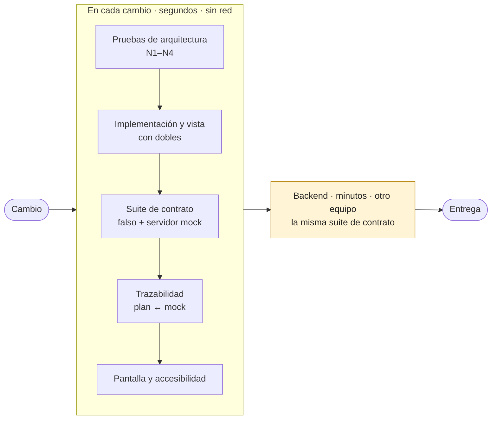
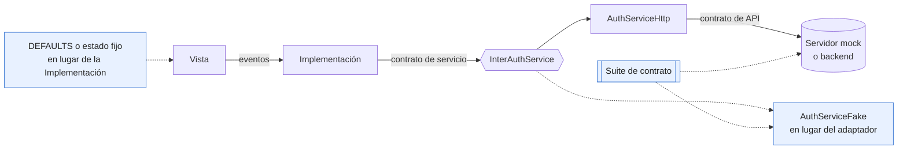
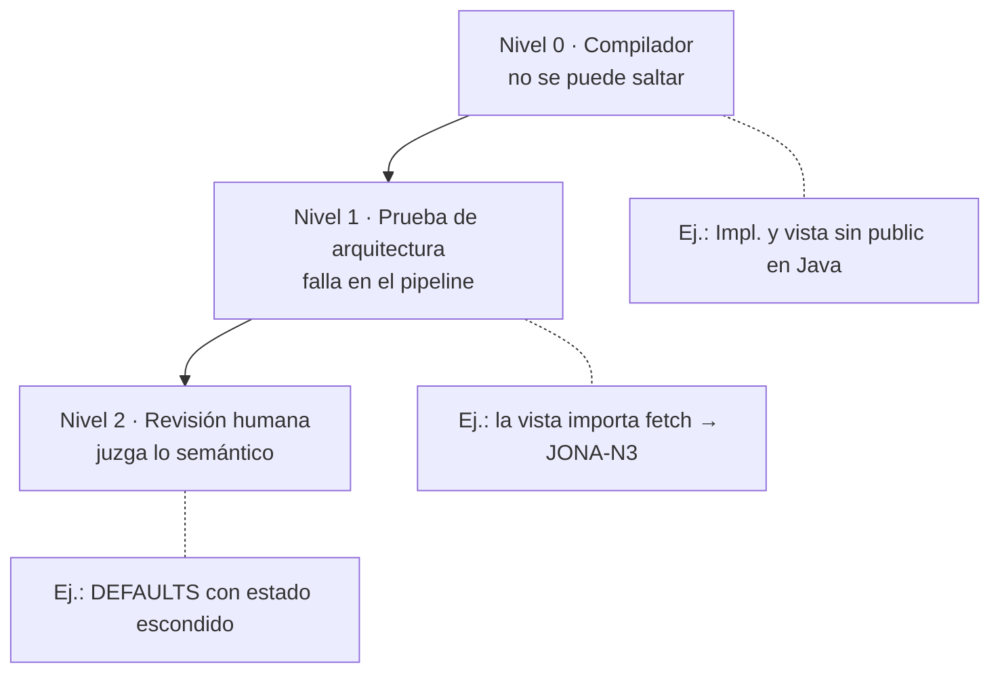
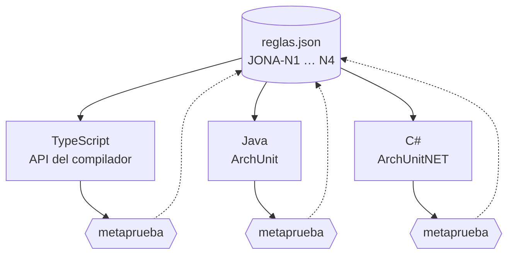
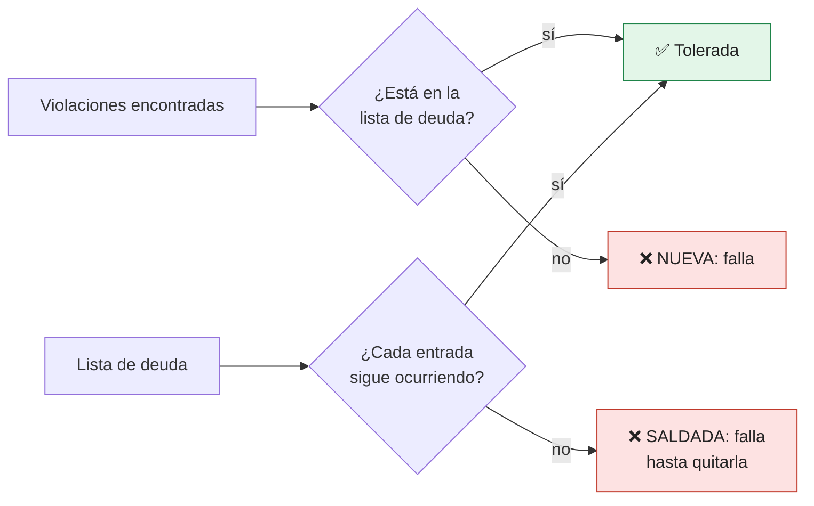
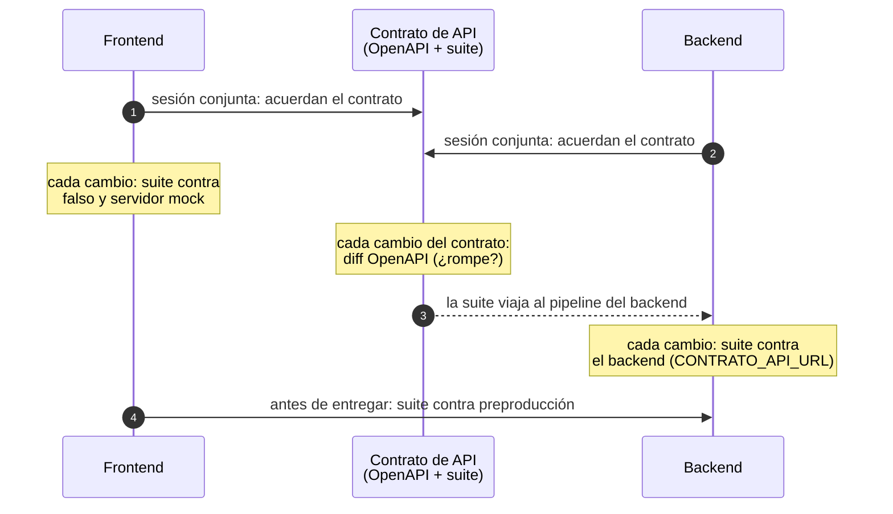
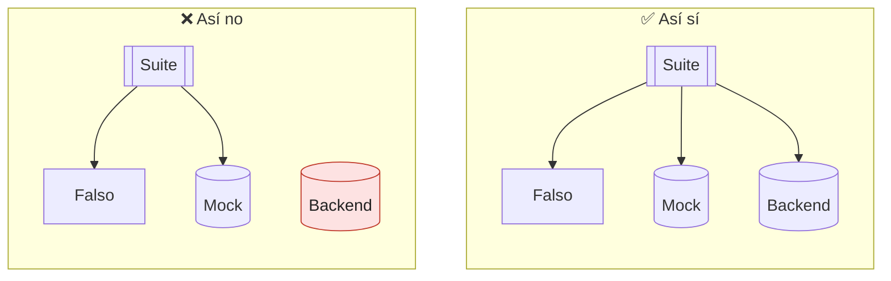
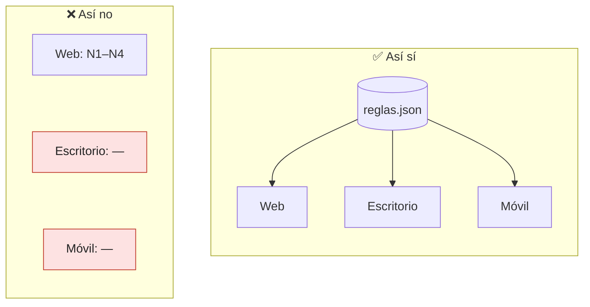

# Capítulo 9. Verificación y gobierno: cómo comprobar el patrón de forma automática

Una regla de arquitectura que solo vive en una wiki dura hasta la primera entrega con prisa. Los capítulos anteriores definieron qué promete JONA: cuatro reglas invariantes (N1–N4), un contrato de servicio verificado contra dos fuentes, un plan de pruebas trazable hasta el servidor mock y un sistema de diseño cuya versión se deriva del contrato. Este capítulo trata la pregunta que queda: **quién comprueba todo eso cuando nadie está mirando.**

La respuesta corta es que cada promesa necesita un mecanismo que pueda fallar, un lugar del flujo donde se ejecuta y un dueño que decide qué hacer cuando falla. Sin las tres cosas, la promesa es una intención.

> [!IMPORTANT]
> **Regla del capítulo.** Toda promesa de JONA necesita tres cosas: un **mecanismo que pueda fallar**, un **lugar del flujo** donde corre y un **dueño** que decide qué hacer cuando falla. Si falta una, la promesa no está gobernada.

---

## 9.1 Qué se verifica y dónde

| Promesa | Mecanismo | Dónde corre | Dueño | Ejemplo |
|---|---|---|---|---|
| N1–N4: la forma de cada unidad | Pruebas de arquitectura sobre el código fuente o el binario | Cada cambio, en segundos | Arquitecto | `ejemplos/gobierno/`, `ejemplos/web-fsd/test/architecture/` |
| El servicio falso se comporta como el backend | Suite de contrato contra el servicio falso y contra el servidor mock | Cada cambio del frontend | Integrador | `authServiceContract.ts` (capítulo 3) |
| El servidor mock respeta el contrato de API | Validación de cada respuesta contra el OpenAPI | Cada cambio del servidor mock | Integrador y backend | `ejemplos/mock-server/test/contrato.mjs` |
| El backend cumple el mismo contrato | La misma suite de contrato, apuntada al backend | Cada cambio del backend y antes de cada entrega | Backend | Paso «contrato externo» de `run-all.mjs` |
| Cada criterio de aceptación tiene escenario y respuesta | Prueba de trazabilidad en las dos direcciones | Cada cambio del plan o del mock | QA | `ejemplos/flujo-bdd/` (capítulo 5) |
| La Implementación decide bien | Pruebas unitarias con el servicio falso | Cada cambio | Integrador | `UiLoginImpl.test.ts` |
| La vista pinta bien cualquier estado | Pruebas o historias con `DEFAULTS` y estados fijos | Cada cambio | Diseñador de UI | Historias de `uijona` (capítulo 8) |
| La pantalla integrada muestra el mensaje correcto | Pruebas de pantalla: entrada más servicio falso | Cada cambio | QA e integrador | `loginScreen.test.tsx` |
| Contraste, accesibilidad, superficie pública | Pruebas del sistema de diseño | Cada cambio de la biblioteca | Diseñador de UI y arquitecto | `ejemplos/sistema-diseno/` (capítulo 8) |

La tabla tiene una propiedad que conviene notar: **casi todo corre en cada cambio y en segundos.** La única verificación que depende de otro equipo es la del backend, y por eso ocupa su propia sección (9.5).



*Figura 9.1. Casi toda la verificación es local y rápida; solo la del backend cruza equipos.*

---

## 9.2 Cada pieza tiene su doble natural

El contrato es la costura del patrón. Lo que está de un lado se puede probar sustituyendo lo que está del otro, y cada pieza tiene un sustituto obvio:

| Pieza bajo prueba | Lo que se sustituye | Con qué | Qué demuestra |
|---|---|---|---|
| Vista | La Implementación | `DEFAULTS` o un estado fijo | Que pinta cada estado sin llamar al sistema |
| Implementación | El servicio | El servicio falso (o un doble que registra llamadas) | Que decide bien: validación, errores, eventos |
| Adaptador HTTP | El backend | El servidor mock con escenarios | Que traduce el contrato de API al de servicio, errores incluidos |
| Servicio falso | — | Nada: corre la suite de contrato | Que no se desvió del servidor mock |
| Entrada | Los adaptadores | El servicio falso, inyectado | Que la composición de producción funciona de punta a punta |
| Backend | — | Nada: corre la suite de contrato | Que cumple lo acordado en la sesión de contratos |



*Figura 9.2. Las líneas punteadas son los dobles: cada costura tiene un sustituto natural, y la suite de contrato verifica que el falso y el servidor digan lo mismo.*

Dos consecuencias para el arquitecto:

- **La pirámide de pruebas sale casi sola.** La mayoría de las pruebas son de Implementación y corren en milisegundos, porque la Implementación no tiene marcado y el servicio falso no tiene red. Las pruebas de vista son pocas y simples, porque la vista no decide nada. Las pruebas de pantalla cubren lo que queda entre ambas, que es poco.
- **Una pieza difícil de probar es un síntoma.** Si una vista necesita un servicio falso para su prueba, está llamando al sistema (N3). Si una prueba de la Implementación necesita un DOM, la Implementación está pintando. Las pruebas de arquitectura de la sección siguiente detectan esos casos antes de que alguien escriba la prueba incómoda.

---

## 9.3 Las reglas como funciones de aptitud

Ford, Parsons y Kua llaman **función de aptitud** (*fitness function*) a cualquier mecanismo que evalúa de forma objetiva una característica de la arquitectura (*Building Evolutionary Architectures*, 2017). Las reglas N1–N4 son buenas candidatas: son estructurales, se expresan en términos de archivos, tipos e importaciones, y una herramienta puede decidir si se cumplen sin interpretar intenciones.

### Tres niveles de aplicación

Una regla se puede sostener en tres niveles, de más barato a más caro:

| Nivel | Cómo | Ventaja | Límite |
|---|---|---|---|
| **0. El compilador** | Visibilidad del lenguaje y fronteras de módulo | No se puede saltar; el error aparece en el editor | Solo funciona si la frontera del módulo coincide con la de la unidad |
| **1. Prueba de arquitectura** | Un análisis del código fuente o del binario que se ejecuta con las pruebas | Expresa lo que el lenguaje no puede: qué contiene un contrato, quién importa a quién | Hay que escribirla, probarla y mantenerla por tecnología |
| **2. Revisión humana** | Revisión de código guiada por el catálogo de reglas | Juzga lo semántico | Depende de que alguien mire, y de que sepa qué mirar |



*Figura 9.3. Cada regla se empuja al nivel más bajo que pueda sostenerla; lo que queda arriba es lo que solo una persona puede juzgar.*

El nivel 0 es el más subestimado. Cada plataforma tiene alguna forma de él:

| Plataforma | Mecanismo de visibilidad | Qué regla sostiene |
|---|---|---|
| Java | Visibilidad de paquete: la Implementación y la vista sin `public`, la entrada `public` | N4, si cada unidad es un paquete |
| Java 9+ | `module-info.java` con `exports` | N4 entre módulos |
| Kotlin / Android | `internal` y módulos de Gradle | N4 entre módulos |
| C# | `internal` y un proyecto por frontera | N4 entre ensamblados; dentro de un mismo ensamblado no ayuda |
| Swift | `internal` y objetivos de SwiftPM | N4 entre módulos |
| Unity | Archivos `.asmdef` con referencias explícitas | N4, y N3 en parte: el ensamblado de vistas no puede referenciar el de adaptadores |
| TypeScript | Mapa `exports` de `package.json` | N4 entre paquetes; dentro de una aplicación, nada |

La última fila explica por qué los ejemplos web del libro usan pruebas de arquitectura: TypeScript no tiene visibilidad de carpeta. Dentro de una aplicación, cualquier archivo puede importar cualquier otro, y solo el nivel 1 lo impide.

### Qué nivel sostiene cada regla

| Regla | Nivel 0 | Nivel 1 | Nivel 2 |
|---|---|---|---|
| **N1.** Toda unidad tiene contrato de UI; la Implementación depende de un contrato de servicio, no de un adaptador | — | Existe el archivo o tipo del contrato; los parámetros del constructor o la fábrica de la Implementación son interfaces | ¿El contrato expresa capacidades del negocio o calca el adaptador? |
| **N2.** El contrato no tiene comportamiento | Parcial: una interfaz sin cuerpo, en lenguajes sin métodos por defecto | El archivo de contrato solo declara tipos y datos literales; en Java, ninguna interfaz de contrato tiene métodos `default`; en C#, ninguna tiene implementaciones por defecto | ¿`DEFAULTS` contiene solo valores neutros o ya guarda estado? |
| **N3.** Efectos solo en la Implementación y los adaptadores | En parte, con `.asmdef` en Unity | Ni la vista ni el contrato importan adaptadores, red, almacenamiento ni temporizadores | ¿La vista calcula algo que debería decidir la Implementación? |
| **N4.** El resto de la aplicación solo conoce la entrada | Visibilidad, según la tabla anterior | Ninguna importación desde fuera de la unidad apunta a su Implementación o a su vista | — |

La columna del nivel 2 no es decorativa. El capítulo 8 encontró tres `DEFAULTS` heredados en `uijona` que guardan estado (`JPROGRESS` con `value`, `JCHECKBOX_FIELD` con `checked`, `JMULTI_SELECT` con `value`). Una prueba de arquitectura puede verificar que `DEFAULTS` es un literal; no puede saber si un `value` es un valor neutro o el estado de una pantalla. Para eso existen el catálogo de reglas y la revisión.

### Tres técnicas para el nivel 1

| Técnica | Cómo funciona | Herramientas | Usada en |
|---|---|---|---|
| **Árbol sintáctico del código fuente** | Se analiza cada archivo y se recorren importaciones y declaraciones | API del compilador de TypeScript, `dependency-cruiser`, `eslint` con `no-restricted-imports`; Konsist para Kotlin | `ejemplos/gobierno/ts/`, `ejemplos/web-fsd/` |
| **Análisis del binario** | Se cargan las clases compiladas y se consultan sus dependencias | ArchUnit (Java, y Kotlin en la JVM) | `ejemplos/gobierno/java/` |
| **Análisis del ensamblado** | Se inspeccionan los tipos del ensamblado y sus referencias | ArchUnitNET, NetArchTest | `ejemplos/gobierno/dotnet/` |

La elección depende menos de la técnica que de una pregunta práctica: **¿quién del equipo va a mantener la regla?** Una prueba de arquitectura que nadie entiende se desactiva en la primera falsa alarma.

### El catálogo es la norma; las pruebas son su implementación

Un equipo que trabaja en tres tecnologías no debería tener tres versiones de N3. El ejemplo de este capítulo separa las dos cosas:

- Un **catálogo de reglas** (`ejemplos/gobierno/reglas.json`) con un identificador estable por regla (`JONA-N1` … `JONA-N4`), un título y una descripción. Es la norma, y es lo que se cita en revisiones, mensajes de error y decisiones de arquitectura.
- Una **implementación por tecnología**, con una metaprueba que compara la implementación con el catálogo. Si el catálogo gana una regla que una tecnología no implementa, la suite de esa tecnología falla.



*Figura 9.4. Una norma, tres implementaciones. Cada metaprueba vuelve contra el catálogo con dos preguntas: ¿falta o sobra una regla?, ¿alguna regla no tiene caso de violación?*

Un identificador estable cambia la conversación en una revisión. «Esto rompe JONA-N3» se puede buscar, enlazar y discutir; «esto no me parece limpio» no.

### Toda regla necesita un caso que la haga fallar

Una regla de arquitectura que nunca falla es indistinguible de una regla rota. Si el análisis de importaciones tiene un error y no encuentra ninguna, la prueba pasa en verde para siempre.

Por eso cada regla del ejemplo tiene al menos un **caso de violación** (*fixture*): un proyecto diminuto que la incumple a propósito, y una prueba que exige que la regla lo detecte con su identificador. Es el mismo principio que el desarrollo guiado por pruebas aplica al código de producción, aplicado a las propias reglas: primero se ve fallar, después se confía en el verde.

> [!TIP]
> Para revisar una regla de arquitectura nueva, la primera pregunta no es «¿pasa en verde?», sino **«¿dónde está el caso que la hace fallar?»**.

---

## 9.4 El trinquete: adoptar reglas con deuda

Ninguna base de código heredada pasa una regla nueva el primer día. Las dos salidas habituales son malas: desactivar la regla hasta «arreglarlo todo», que no llega nunca, o aceptar las violaciones con comentarios de excepción dispersos, que nadie vuelve a leer.

La alternativa es un **trinquete** (*ratchet*): una lista explícita de la deuda conocida que solo se puede achicar. El capítulo 8 lo aplicó a las vistas de `uijona` que todavía pintan con primitivos; aquí se generaliza.

El trinquete tiene tres comportamientos, y los tres deben estar probados:

| Situación | Resultado | Por qué |
|---|---|---|
| Una violación está en la lista de deuda | Pasa | Es deuda conocida y enumerada |
| Aparece una violación que no está en la lista | Falla | El código nuevo cumple la regla desde el primer día |
| Una entrada de la lista ya no ocurre | **Falla**, y pide quitarla | Si la deuda pagada no se borra, el espacio libre lo ocupa la próxima violación |

El tercer comportamiento es el que convierte una lista de excepciones en un trinquete. Sin él, la lista solo crece.



*Figura 9.5. Los dos caminos rojos son los que hacen del trinquete un trinquete: la deuda no crece y la deuda pagada no deja un hueco.*

En Java, ArchUnit ofrece el mecanismo listo: `FreezingArchRule` guarda las violaciones existentes en un almacén y solo falla con las nuevas. El ejemplo lo configura para que ninguna prueba pueda crear ni modificar el almacén por su cuenta (`allowStoreCreation=false`, `allowStoreUpdate=false`): la línea base se crea una vez, a propósito, y se revisa como cualquier otro cambio.

Dos reglas de gobierno completan el mecanismo:

- **Nadie agrega entradas a la lista de deuda en un cambio cualquiera.** El archivo tiene dueño (sección 9.6), y agregar una entrada es una decisión de arquitectura con su justificación.
- **El tamaño de la lista es la métrica.** No hace falta un tablero: el número de entradas en el tiempo dice si la adopción avanza.

---

## 9.5 Verificar el contrato entre equipos

El capítulo 3 dejó pendiente cómo organizar la verificación del contrato cuando el backend la ejecuta. Es la parte del gobierno que cruza equipos, y la que más se rompe.

### El punto de partida

En JONA, frontend y backend acuerdan el contrato de API en una sesión conjunta, lo escriben como OpenAPI y construyen el servidor mock a partir de él. Desde ese momento existen tres implementaciones del mismo contrato (el servicio falso, el servidor mock y el backend) y una sola suite de contrato. El objetivo es que **las tres pasen la misma suite**, y que una divergencia se detecte en el cambio que la introduce, no en la integración.

### Las etapas

| Etapa | Qué corre | Contra qué | Bloquea |
|---|---|---|---|
| Cambio del frontend | Suite de contrato; validación OpenAPI de las respuestas del mock | Servicio falso y servidor mock locales | El cambio del frontend |
| Cambio del contrato de API | Detección de cambios incompatibles en el OpenAPI | La versión anterior del contrato | El cambio del contrato, hasta que ambos equipos lo aprueben |
| Cambio del backend | La misma suite de contrato | El backend en ejecución, en el entorno de pruebas del backend | El cambio del backend |
| Antes de cada entrega | La misma suite de contrato | El entorno previo a producción | La entrega |

La segunda fila usa un comparador de especificaciones OpenAPI (existen varios, por ejemplo `oasdiff`) para clasificar el cambio: agregar un campo opcional es compatible; quitar un campo, hacerlo obligatorio o cambiar un código de error no lo es. Es la misma clasificación que el capítulo 8 aplica a los contratos de UI de una biblioteca, y la misma regla del capítulo 3: los cambios aditivos se hacen; los que rompen se negocian.



*Figura 9.6. Un contrato, una suite, tres implementaciones verificadas: servicio falso, servidor mock y backend.*

### Cómo llega la suite al backend

La suite está escrita en el lenguaje del frontend. Hay tres formas razonables de que el backend la ejecute:

| Forma | Cómo | Cuándo conviene |
|---|---|---|
| **Ejecutarla desde el repositorio del frontend** | El pipeline del backend descarga la suite y la corre con una variable de entorno que apunta al backend (`CONTRATO_API_URL` en los ejemplos) | Un solo frontend; equipos que comparten pipeline |
| **Publicarla como artefacto** | La suite se publica como paquete o imagen de contenedor versionada con el contrato | Varios frontends del mismo backend |
| **Reescribirla en el lenguaje del backend** | El backend mantiene una copia de los casos en su propio marco de pruebas | Solo si las dos anteriores no son posibles: dos copias de los mismos casos tienden a separarse |

En los ejemplos, la primera forma ya está demostrada: el paso «contrato externo» de `run-all.mjs` arranca el servidor mock como si fuera un backend real y ejecuta las suites de `web-react`, `web-fsd`, `java-swing`, `java-javafx` y `dotnet-wpf` contra esa URL. Las pruebas que solo tienen sentido contra el mock (por ejemplo, forzar el escenario `errorServidor`) se omiten cuando la URL es externa, y la suite lo informa como pruebas omitidas, no como pruebas superadas.

### Frente a los contratos guiados por el consumidor

La técnica más conocida para este problema son los **contratos guiados por el consumidor** (*consumer-driven contracts*), popularizados por Pact: el consumidor registra lo que espera del proveedor mientras corre sus pruebas, y el proveedor verifica esas expectativas.

| Aspecto | Contratos guiados por el consumidor (Pact) | Contrato conjunto de JONA |
|---|---|---|
| Quién escribe el contrato | El consumidor, como efecto de sus pruebas | Ambos equipos, antes de escribir código |
| Forma del contrato | Interacciones registradas | Especificación OpenAPI más una suite de casos |
| Qué verifica el proveedor | Las interacciones que algún consumidor usó | Todos los casos de la suite |
| Varios consumidores | Es su punto fuerte: cada uno publica sus expectativas | Requiere publicar la suite como artefacto |
| Servidor mock | Lo genera la herramienta a partir de las interacciones | Se construye a partir del OpenAPI, con escenarios |

No son excluyentes. Un backend con muchos consumidores puede usar Pact como mecanismo de transporte y seguir definiendo el contrato en una sesión conjunta. Lo que JONA no acepta es el orden inverso al de su principio: que el frontend espere a que el backend exista para saber qué contrato cumplir.

---

## 9.6 Gobierno: dueños, excepciones y reglas nuevas

### Los dueños, en el repositorio

La tabla de dueños del capítulo 5 se puede llevar al repositorio. En GitHub y GitLab, un archivo `CODEOWNERS` exige la aprobación de un equipo para cambiar ciertas rutas. Un fragmento ilustrativo, que no forma parte de los ejemplos:

```text
# Contratos de UI y de servicio: el arquitecto aprueba
**/Inter*.ts                 @organizacion/arquitectura
# Contrato de API: frontend y backend aprueban juntos
/contrato-api/               @organizacion/arquitectura @organizacion/backend
# Catálogo de reglas y deuda enumerada
/gobierno/reglas.json        @organizacion/arquitectura
/gobierno/ts/deuda.json      @organizacion/arquitectura
```

La convención de nombres de JONA hace que la primera línea sea posible: los contratos se reconocen por el nombre del archivo. Es una ventaja práctica de un patrón con nombres fijos.

### Las excepciones

Una excepción a una regla es una decisión de arquitectura, y se registra como tal:

1. Una entrada en la lista de deuda, con la regla y el archivo exactos.
2. Una nota breve (un registro de decisión de arquitectura, o ADR) que dice por qué y hasta cuándo.
3. La aprobación del dueño del archivo de deuda.

Lo que no se acepta son los comentarios que desactivan la regla en el propio archivo. Se dispersan, no tienen dueño y no aparecen en ninguna métrica.

### Reglas nuevas

El catálogo crece. Un ciclo que funciona:

1. **Proponer** la regla con un caso real que la justifique y un identificador nuevo.
2. **Implementarla** en cada tecnología del equipo, con su caso de violación. La metaprueba del catálogo obliga a hacerlo en todas.
3. **Aplicarla** con trinquete: lo nuevo cumple desde el primer día; lo existente queda enumerado.
4. **Medir** cómo baja la lista de deuda. Si no baja, la regla o el plan de adopción necesitan revisión.

### Lo que el gobierno no debe medir

La cobertura de líneas es una métrica tentadora y engañosa para JONA. Una vista con cobertura del cien por ciento puede seguir llamando al sistema; un contrato sin una sola línea ejecutable no aparece en la cobertura. Las métricas útiles son las que este capítulo ya definió: reglas del catálogo implementadas en cada tecnología, tamaño de la lista de deuda y resultado de la suite de contrato en cada entorno.

---

## 9.7 Orden y costo en el pipeline

Las verificaciones no cuestan lo mismo, y el orden importa. Lo barato y determinista va primero, para que un error de forma no espere a una prueba lenta:

| Orden | Etapa | Costo típico | Depende de la red o de otro equipo |
|---|---|---|---|
| 1 | Compilación y visibilidad (nivel 0) | Segundos | No |
| 2 | Pruebas de arquitectura y metaprueba del catálogo | Segundos | No |
| 3 | Pruebas de Implementación y de vista | Segundos | No |
| 4 | Suite de contrato contra el servicio falso y el servidor mock local | Segundos | No |
| 5 | Trazabilidad del plan de pruebas | Segundos | No |
| 6 | Pruebas de pantalla y de accesibilidad | Decenas de segundos | No |
| 7 | Suite de contrato contra el backend | Minutos | Sí |

Las seis primeras etapas corren en la máquina de cada persona y en cada cambio. El ejecutor de los ejemplos (`run-all.mjs`) sigue esta misma idea: todas las etapas locales primero y, al final, las suites de contrato contra un servidor externo.

---

## 9.8 El ejemplo

El ejemplo `ejemplos/gobierno/` implementa el catálogo de reglas en tres tecnologías: TypeScript con la API del compilador, Java con ArchUnit y C# con ArchUnitNET. Cada una tiene una aplicación de muestra que cumple las reglas, casos de violación para cada regla y la metaprueba del catálogo. TypeScript y Java además tienen un trinquete.

| Carpeta | Técnica | Pruebas |
|---|---|---:|
| `gobierno/ts/` | Árbol sintáctico (`typescript`), sin otras dependencias | 31 |
| `gobierno/java/` | Bytecode con ArchUnit y `FreezingArchRule` | 22 |
| `gobierno/dotnet/` | Ensamblado con ArchUnitNET; N2 con reflexión | 16 |

### El catálogo

```json
{
  "id": "JONA-N3",
  "titulo": "Efectos solo en la Implementación y en los adaptadores",
  "descripcion": "Las vistas y los contratos no importan servicios ni adaptadores, y ningún archivo de la unidad fuera de la Implementación produce efectos (red, almacenamiento, temporizadores, hilos)."
}
```

`reglas.json` tiene exactamente las cuatro reglas del núcleo. Cada tecnología tiene un mapa de identificador a regla y una metaprueba que lo compara con el catálogo; en TypeScript (`ts/test/catalogo.test.ts`):

```ts
it('cada regla del catálogo está implementada en TypeScript, y no hay reglas fuera del catálogo', () => {
  assert.deepEqual(Object.keys(REGLAS).sort(), idsCatalogo);
});

it('cada regla del catálogo tiene al menos un fixture que la hace fallar', () => {
  assert.deepEqual([...new Set(CASOS.map(([, regla]) => regla))].sort(), idsCatalogo);
});
```

La segunda prueba es la sección 9.3 hecha código: una regla sin caso de violación hace fallar la suite. Java (`CatalogoTest.java`) y C# (`CatalogoTests.cs`) tienen las mismas dos comprobaciones.

### TypeScript: las convenciones a la vista

El verificador (`ts/herramientas/jona-check.ts`) reconoce los roles por nombre, y toda su configuración está en un bloque al principio del archivo:

```ts
const EXENTOS = /\.(test|spec|stories)\.tsx?$|\.d\.ts$/;
const CONTRATO_SERVICIO = /^Inter[A-Z]\w*Service$/;
const CONTRATO_UI = /^Inter[A-Z]\w*$/;
/** `AuthServiceHttp` es un adaptador si existe el contrato `InterAuthService`. */
const ADAPTADOR = /^(\w+)Service[A-Z]\w*$/;
/** Valores constantes permitidos en un contrato: `DEFAULTS` o `ALGO_DEFAULTS`. */
const DEFAULTS = /^(\w+_)?DEFAULTS$/;
/** Efectos que solo la Implementación y los adaptadores pueden producir (N3). */
const EFECTOS = new Set([
  'fetch', 'XMLHttpRequest', 'WebSocket', 'EventSource', 'localStorage', 'sessionStorage', 'indexedDB',
  'setTimeout', 'setInterval',
]);
```

N2 es la regla que más muestra la ventaja del árbol sintáctico. Un contrato solo puede contener interfaces, tipos, importaciones de solo tipos y constantes `DEFAULTS` cuyo valor sea un literal:

```ts
function permitidoEnContrato(sentencia: ts.Statement): boolean {
  if (ts.isInterfaceDeclaration(sentencia) || ts.isTypeAliasDeclaration(sentencia)) return true;
  if (ts.isImportDeclaration(sentencia)) return esImportSoloTipos(sentencia);
  if (ts.isExportDeclaration(sentencia)) return sentencia.isTypeOnly;
  if (ts.isVariableStatement(sentencia)) {
    const esConst = (sentencia.declarationList.flags & ts.NodeFlags.Const) !== 0;
    return esConst && sentencia.declarationList.declarations.every((d) =>
      ts.isIdentifier(d.name) && DEFAULTS.test(d.name.text) && d.initializer !== undefined && esValorLiteral(d.initializer));
  }
  return false;
}
```

`esValorLiteral` acepta texto, números, booleanos, `null` y objetos o arreglos hechos solo de ellos. Un `DEFAULTS` con una función adentro falla, y es uno de los casos de violación.

N4 es la más corta: para cada importación que entra en otra unidad, el destino tiene que ser una de sus entradas:

```ts
function n4SoloLaEntrada({ archivos, unidades }: Proyecto): Violacion[] {
  const violaciones: Violacion[] = [];
  for (const archivo of archivos.values()) {
    for (const imp of archivo.importaciones) {
      const destino = imp.destino ? archivos.get(imp.destino) : undefined;
      if (!destino?.unidad || destino.unidad === archivo.unidad) continue;
      const entradas = unidades.get(destino.unidad) ?? [];
      if (entradas.includes(destino.ruta)) continue;
      violaciones.push({
        regla: 'JONA-N4', archivo: archivo.ruta, linea: imp.linea,
        mensaje: `importa ${destino.ruta}, interno de la unidad ${destino.unidad}; use su entrada: ${entradas.join(' o ') || '(no tiene)'}`,
      });
    }
  }
  return violaciones;
}
```

Los casos de violación son catorce proyectos diminutos, cada uno con exactamente una violación (`ts/test/casos.ts`). El más simple, `fixtures/n4-importa-impl/App.ts`, importa la Implementación en lugar de la entrada:

```ts
import { crearUiLoginImpl } from './uilogin/UiLoginImpl';
```

### TypeScript: generalidad

Una regla escrita contra la aplicación de muestra puede estar ajustada a esa muestra. Para comprobarlo, el verificador se ejecuta en modo de solo lectura sobre dos ejemplos de capítulos anteriores, `web-react/src` (formas mínima a, b y extendida) y `web-ts-puro/src` (forma clásica), y la prueba exige cero violaciones. Pasan.

La corrida encontró un falso positivo, que obligó a precisar la regla. En la forma clásica, `main.ts` importa `UiLoginImpl` directamente, y está bien: en esa forma la Implementación hereda de la Plantilla y **es** la entrada (capítulo 2). El verificador lo reconoce por la estructura (`class XImpl extends X`) y, en ese caso, trata a la Plantilla como interna. Dos casos de violación cubren esta forma sin depender de los otros ejemplos.

### TypeScript: el trinquete

`ts/herramientas/deuda.ts` aplica una lista de deuda a las violaciones encontradas. Cada entrada tolera una ocurrencia; lo que sobra de cualquiera de los dos lados hace fallar:

```ts
export function aplicarDeuda(violaciones: Violacion[], deuda: EntradaDeuda[]): ResultadoTrinquete {
  const pendientes = new Map<string, EntradaDeuda[]>();
  for (const entrada of deuda) pendientes.set(clave(entrada), [...(pendientes.get(clave(entrada)) ?? []), entrada]);

  const toleradas: Violacion[] = [];
  const nuevas: Violacion[] = [];
  for (const violacion of violaciones) {
    const anotadas = pendientes.get(clave(violacion));
    if (anotadas && anotadas.length > 0) {
      anotadas.pop();
      toleradas.push(violacion);
    } else {
      nuevas.push(violacion);
    }
  }
  const saldadas = [...pendientes.values()].flat();
  return { toleradas, nuevas, saldadas, aprobado: nuevas.length === 0 && saldadas.length === 0 };
}
```

Las entradas no guardan el número de línea, a propósito: mover código no debe romper la deuda. Las pruebas (`ts/test/deuda.test.ts`) cubren los tres comportamientos de la tabla de 9.4, y la línea de comandos (`npm run check -- <carpeta> --deuda <archivo>`) los informa con una línea `NUEVA` o `SALDADA` por caso y termina con código 1. Para una entrada saldada, el mensaje pide quitarla del archivo de deuda.

### Java: ArchUnit y `FreezingArchRule`

En Java, las reglas son `ArchRule` sobre las clases compiladas (`java/src/test/java/jona/gobierno/ReglasJona.java`). N3 combina tres condiciones en una regla compuesta:

```java
public static final ArchRule N3 = CompositeArchRule
    .of(noClasses().that(EN_UNA_UNIDAD.and(not(tienenRol(Rol.IMPL, Rol.ADAPTADOR)))).should().dependOnClassesThat(PRODUCEN_EFECTOS))
    .and(noClasses().that(tienenRol(Rol.VISTA, Rol.CONTRATO)).should().dependOnClassesThat(ADAPTADORES))
    .and(noClasses().that(tienenRol(Rol.VISTA)).should().dependOnClassesThat(CONTRATOS_DE_SERVICIO))
    .as("JONA-N3 Efectos solo en la Implementación y en los adaptadores");
```

N2 exige que el contrato sea una interfaz sin métodos con código (los métodos `default` y `static` fallan) y sin inicializador estático. Esto último significa que los `DEFAULTS` tienen que ser constantes de compilación.

El trinquete usa el mecanismo de ArchUnit:

```java
private static final ArchRule N3_CONGELADA = FreezingArchRule.freeze(ReglasJona.N3);
private static final ArchRule N4_CONGELADA = FreezingArchRule.freeze(ReglasJona.N4);
```

La configuración (`java/src/test/resources/archunit.properties`) es lo que lo convierte en un trinquete y no en una aspiradora de violaciones:

```properties
freeze.store.default.path=deuda-archunit
freeze.store.default.allowStoreCreation=false
freeze.store.default.allowStoreUpdate=false
freeze.refreeze=false
```

Con estos valores, una prueba nunca agrega deuda. Si el almacén falta, la regla congelada falla con `StoreInitializationFailedException` en lugar de congelar todo lo que encuentre. Si una violación congelada desaparece, falla con `StoreUpdateFailedException`: es el tercer comportamiento de la tabla de 9.4, la deuda pagada se quita del almacén. La actualización es un acto deliberado y local:

```bash
mvn test -Darchunit.freeze.store.default.allowStoreUpdate=true
```

`DeudaTest.java` prueba los tres comportamientos, y una prueba más compara el contenido del almacén antes y después de evaluar las reglas para demostrar que una corrida normal no lo reescribe. El almacén (`java/deuda-archunit/`) se versiona con el código.

### C#: ArchUnitNET y reflexión

En C#, las reglas usan ArchUnitNET (`dotnet/Gobierno/ReglasJona.cs`), con las unidades como espacios de nombres. N2 no se puede expresar con dependencias, porque ArchUnitNET describe qué tipos usa cada tipo, no si un método tiene cuerpo. Por eso se resuelve con reflexión:

```csharp
private static IEnumerable<string> ComportamientoDe(IType contrato)
{
    var tipo = System.Reflection.Assembly.Load(contrato.Assembly.FullName).GetType(contrato.FullName.Replace('/', '+'));
    if (tipo is null) yield break;
    if (!tipo.IsInterface) yield return "no es una interfaz: un contrato solo declara";
    const BindingFlags Todos = BindingFlags.DeclaredOnly | BindingFlags.Public | BindingFlags.NonPublic | BindingFlags.Instance | BindingFlags.Static;
    foreach (var metodo in tipo.GetMethods(Todos).Where(m => !m.IsAbstract)) yield return $"el método {metodo.Name} tiene código";
    if (tipo.TypeInitializer is not null) yield return "calcula valores al cargarse: los DEFAULTS son constantes";
}
```

Una advertencia práctica: los constructores fluidos de ArchUnitNET son mutables. Si se reutiliza el mismo `Types().That()…` para dos reglas, los predicados se acumulan y la segunda regla filtra con los de la primera. El ejemplo crea uno nuevo para cada regla.

### N4 no es igual en todas las tecnologías

En TypeScript, la entrada reexporta el contrato, así que N4 exige que desde fuera solo se importe la entrada. En Java y en C#, un tipo no se reexporta: quien usa la entrada necesita nombrar el contrato. Por eso N4 permite allí la entrada **y** el contrato de UI. El catálogo es el mismo, pero cada implementación lo traduce a lo que su lenguaje permite expresar. Esa traducción conviene escribirla junto a la regla, como hace el ejemplo.

### Lo que los verificadores no ven

| Límite | Dónde |
|---|---|
| Los roles salen de los nombres: una clase mal nombrada escapa a su rol | Las tres |
| Las listas de efectos son explícitas y se amplían a mano | Las tres |
| Un efecto escondido detrás de una función auxiliar que la vista llama no se detecta: ninguno sigue los efectos de forma transitiva | Las tres |
| Solo se resuelven importaciones relativas: los alias de rutas (`@/…`, `paths` de `tsconfig`), `require()` e `import()` con ruta calculada son invisibles | TypeScript |
| `window['localStorage']`, escrito como acceso por índice, no se detecta | TypeScript |
| Solo se analizan `.ts` y `.tsx`: ni `.vue` ni plantillas de Angular | TypeScript |
| Reflexión, `ServiceLoader` y contenedores de inyección son invisibles para el análisis de dependencias | Java y C# |
| N2 solo admite constantes de compilación: un `DEFAULTS` con arreglos o colecciones falla | Java |
| El almacén de deuda se indexa por la descripción de la regla: cambiar el texto de `.as(...)` deja huérfanas las violaciones congeladas | Java |
| Los efectos con tareas se detectan solo por `Task.Run` y `Task.Delay`, porque todo método asíncrono usa `Task` | C# |

Ninguno de estos límites invalida las reglas; dice dónde termina el nivel 1 y empieza el nivel 2. Una revisión que sabe qué no ve la herramienta mira justo ahí.

---

## 9.9 Antipatrones

> [!CAUTION]
> Estos antipatrones no rompen el código: rompen **la capacidad de saber si el código cumple**. Por eso pasan desapercibidos hasta que alguien descubre que una regla lleva meses sin comprobar nada.

**Referencia rápida**

| | Antipatrón | Se reconoce porque… | Qué lo evita |
|:-:|---|---|---|
| 🔴 | [Reglas en la wiki](#ap-9-1) | La regla está escrita y ninguna prueba la ejecuta | Prueba de arquitectura en el pipeline |
| 🔴 | [Regla sin caso de violación](#ap-9-2) | La prueba de arquitectura nunca falló | Un caso de violación por regla |
| 🔴 | [Suite de contrato solo en el frontend](#ap-9-3) | El backend nunca corrió la suite | La suite en el pipeline del backend |
| 🟠 | [Lista de excepciones que crece](#ap-9-4) | Cada cambio agrega una entrada «temporal» | Trinquete con entradas saldadas que fallan |
| 🟠 | [Excepciones en comentarios](#ap-9-5) | `eslint-disable` o `@SuppressWarnings` repartidos | Lista de deuda central con dueño |
| 🟠 | [Omitidas que cuentan como superadas](#ap-9-6) | La suite «pasa» porque se saltó casos | Informar las omitidas aparte |
| 🟡 | [Reglas en una sola tecnología](#ap-9-7) | Web cumple; escritorio ni las conoce | Catálogo común y metaprueba |
| 🟡 | [Gobernar por cobertura](#ap-9-8) | Se exige un porcentaje de líneas | Métricas del catálogo y de la deuda |

🔴 deja el patrón sin ninguna verificación · 🟠 la verificación existe pero se degrada · 🟡 la verificación es parcial o mide otra cosa

---

<a id="ap-9-1"></a>
### 🔴 Reglas en la wiki

**Síntoma.** El patrón está explicado en un documento, en una charla o en este libro, y nada en el pipeline falla cuando se rompe.

❌ **Así no**

```markdown
<!-- CONTRIBUTING.md -->
Las vistas no deben llamar a fetch ni a localStorage. Por favor, respetarlo.
```

✅ **Así sí:** la regla corre con las pruebas, nombra el archivo y la línea, y termina con código 1.

```text
$ npm run check -- fixtures/n3-vista-con-fetch
JONA: 1 violaciones en fixtures/n3-vista-con-fetch (0 toleradas por la deuda)
  NUEVA    JONA-N3 jbutton/JButtonView.ts:4 la vista usa fetch; los efectos van en la Implementación o en un adaptador
```

**Por qué duele.** Una regla que depende de que alguien la recuerde dura hasta la primera entrega con prisa. **Cómo no caer:** ninguna regla del catálogo se publica sin su prueba (sección 9.3).

---

<a id="ap-9-2"></a>
### 🔴 Regla sin caso de violación

**Síntoma.** La prueba de arquitectura está en verde desde el día en que se escribió.

❌ **Así no:** solo se comprueba que el código real pasa.

```ts
it('src cumple las reglas', () => {
  assert.deepEqual(revisar('src'), []); // ¿y si revisar() no encuentra nada nunca?
});
```

✅ **Así sí:** además, un proyecto diminuto que rompe la regla a propósito.

```ts
it('detecta una vista que llama a fetch', () => {
  const [violacion] = revisar('fixtures/n3-vista-con-fetch');
  assert.equal(violacion.regla, 'JONA-N3');
});
```

**Por qué duele.** Un error en el análisis (una ruta mal resuelta, un alias no soportado) convierte la regla en un sello de aprobación automático. **Cómo no caer:** la metaprueba del catálogo exige al menos un caso de violación por regla.

---

<a id="ap-9-3"></a>
### 🔴 Suite de contrato solo en el frontend

**Síntoma.** El servicio falso y el servidor mock pasan la suite; el backend nunca la ejecutó. La divergencia aparece en la integración, que es lo que JONA promete evitar.



✅ **Así sí:** el pipeline del backend corre la misma suite contra su servicio.

```bash
CONTRATO_API_URL=http://localhost:8080 npx vitest run src/services/AuthServiceHttp.test.ts
```

**Por qué duele.** El mock pasa a ser la opinión del frontend sobre el backend, no el contrato. **Cómo no caer:** la etapa «cambio del backend» de la sección 9.5 bloquea el cambio.

---

<a id="ap-9-4"></a>
### 🟠 Lista de excepciones que crece

**Síntoma.** El archivo de deuda aparece modificado en cambios de funcionalidad, y siempre suma líneas.

❌ **Así no**

```diff
 // deuda.json, en un cambio de funcionalidad cualquiera
+  { "regla": "JONA-N4", "archivo": "pedidos/Resumen.ts", "mensaje": "importa pedidos/PedidoImpl.ts…" }
```

✅ **Así sí:** las entradas pagadas hacen fallar la suite hasta que se quitan, y agregar una requiere al dueño del archivo.

```text
  SALDADA  JONA-N4 App.ts: ya no ocurre; quítela de fixtures/deuda/deuda.json
```

**Por qué duele.** Una lista que solo crece es una forma educada de desactivar la regla. **Cómo no caer:** trinquete con el tercer comportamiento probado (figura 9.5) y el archivo en `CODEOWNERS`.

---

<a id="ap-9-5"></a>
### 🟠 Excepciones en comentarios

**Síntoma.** Comentarios que apagan la regla en la línea que la rompe.

❌ **Así no**

```ts
// UiLoginView.ts
// eslint-disable-next-line no-restricted-imports -- temporal
import { createAuthServiceHttp } from '../services/AuthServiceHttp';
```

✅ **Así sí:** la excepción se registra en un solo lugar, con dueño y con razón.

```json
{ "regla": "JONA-N3", "archivo": "uilogin/UiLoginView.ts", "mensaje": "la vista importa services/AuthServiceHttp.ts, un servicio" }
```

**Por qué duele.** Los comentarios no se cuentan, no tienen dueño y no aparecen en ninguna métrica: la deuda se vuelve invisible. **Cómo no caer:** el verificador ignora esos comentarios; la única excepción válida es la lista de deuda.

---

<a id="ap-9-6"></a>
### 🟠 Omitidas que cuentan como superadas

**Síntoma.** El resumen dice «pasó» y nadie sabe cuántos casos se saltaron.

❌ **Así no**

```text
OK     contrato externo (java-swing)     pruebas: 7
```

✅ **Así sí:** las omitidas aparecen aparte, como hace el ejecutor de los ejemplos.

```text
OK     contrato externo (java-swing)     pruebas: 7 (1 omitidas)
```

**Por qué duele.** Una suite que se salta la mitad de los casos contra el backend da la misma señal verde que una completa. **Cómo no caer:** cada omisión tiene una razón escrita en la prueba (en el ejemplo, «el escenario errorServidor solo existe en el servidor mock») y el informe las cuenta.

---

<a id="ap-9-7"></a>
### 🟡 Reglas en una sola tecnología

**Síntoma.** El frontend web tiene pruebas de arquitectura; el de escritorio o el móvil no las conoce.



**Por qué duele.** El vocabulario común entre tecnologías, uno de los valores de JONA, se pierde justo donde más se necesita. **Cómo no caer:** catálogo común y metaprueba por tecnología (figura 9.4).

---

<a id="ap-9-8"></a>
### 🟡 Gobernar por cobertura

**Síntoma.** El pipeline exige un porcentaje de líneas cubiertas y ninguna regla de forma.

❌ **Así no**

```json
"coverageThreshold": { "global": { "lines": 90 } }
```

✅ **Así sí:** se mide lo que el patrón promete.

| Métrica | Dirección esperada |
|---|---|
| Reglas del catálogo implementadas en cada tecnología | Todas |
| Entradas en la lista de deuda | Solo baja |
| Suite de contrato contra el backend, por entorno | Verde, sin omitidas sin razón |

**Por qué duele.** Una vista con cobertura completa puede seguir llamando al sistema; un contrato sin líneas ejecutables no aparece en la cobertura. **Cómo no caer:** la cobertura puede informarse, pero no gobierna.

---

## 9.10 Resumen

- Cada promesa de JONA necesita un mecanismo que pueda fallar, un lugar del flujo donde corre y un dueño. Casi todo corre en cada cambio y en segundos; solo la verificación del backend depende de otro equipo.
- El contrato es la costura: cada pieza tiene un doble natural, y una pieza difícil de probar es un síntoma de que rompe una regla.
- Las reglas N1–N4 se sostienen en tres niveles: el compilador, las pruebas de arquitectura y la revisión humana. Lo semántico, como el estado escondido en `DEFAULTS`, solo lo ve la revisión.
- Un catálogo de reglas con identificadores estables es la norma; cada tecnología lo implementa, y una metaprueba lo comprueba. Cada regla tiene un caso de violación que demuestra que puede fallar.
- Las reglas nuevas se adoptan con un trinquete: la deuda conocida se enumera, lo nuevo cumple, y la deuda pagada se borra de la lista.
- El servicio falso, el servidor mock y el backend pasan la misma suite de contrato. Los cambios incompatibles del contrato de API se detectan antes de escribir código y se negocian entre ambos equipos.
