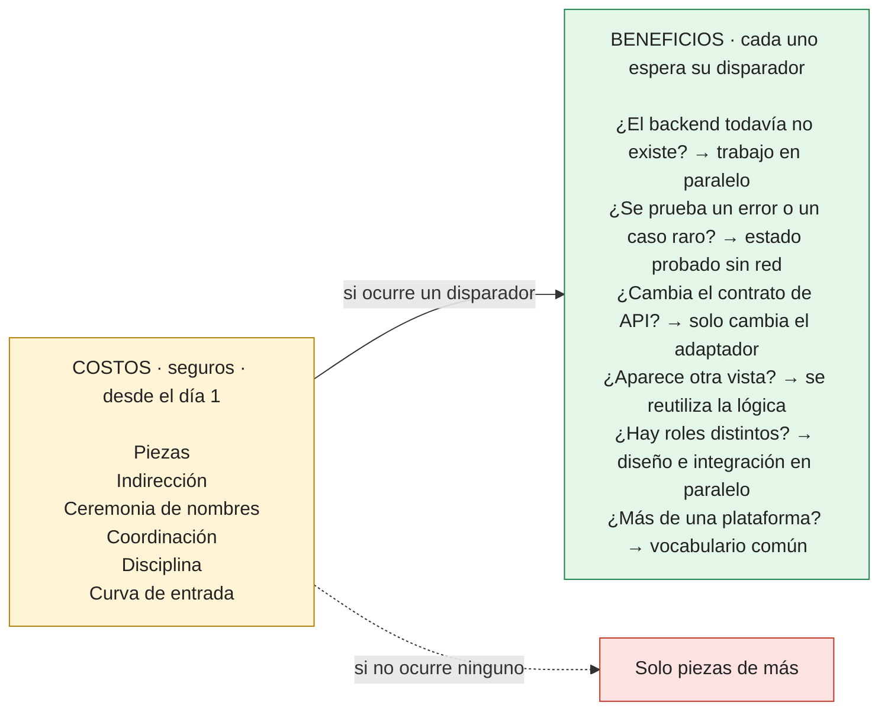
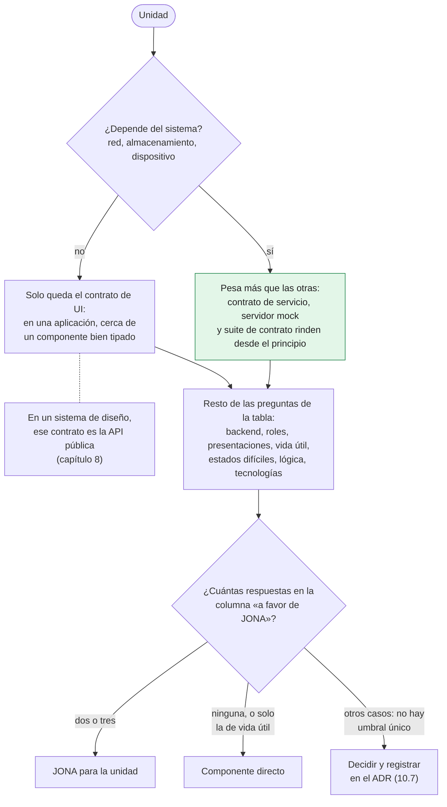
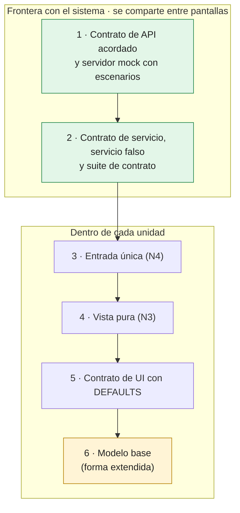
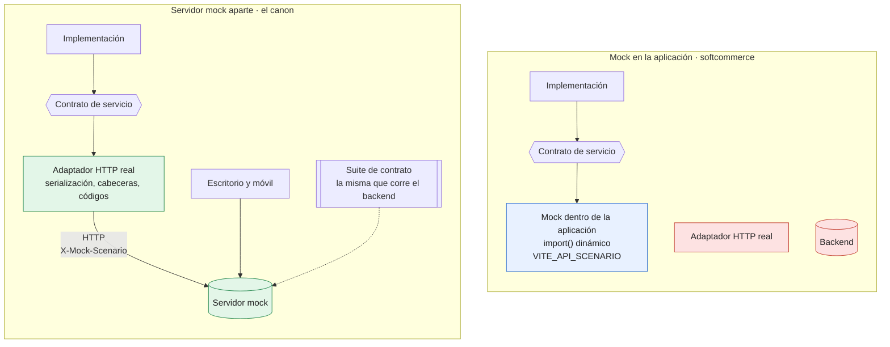
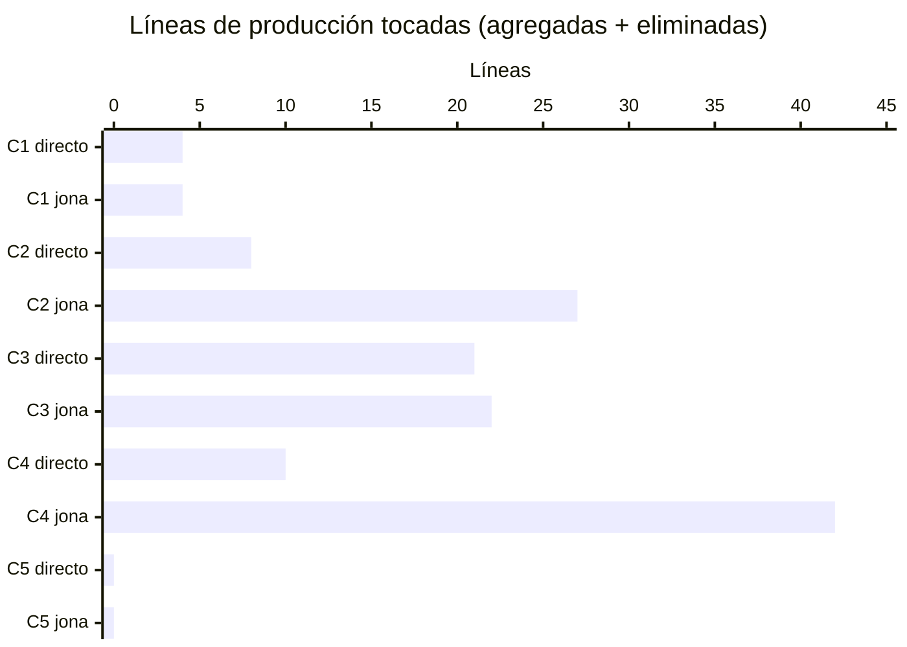
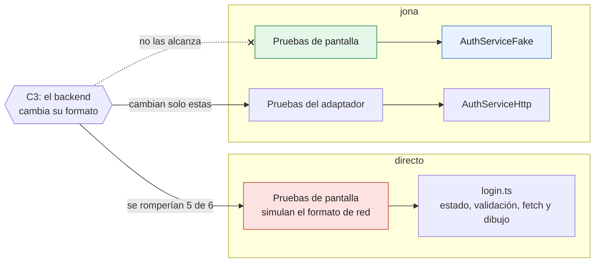
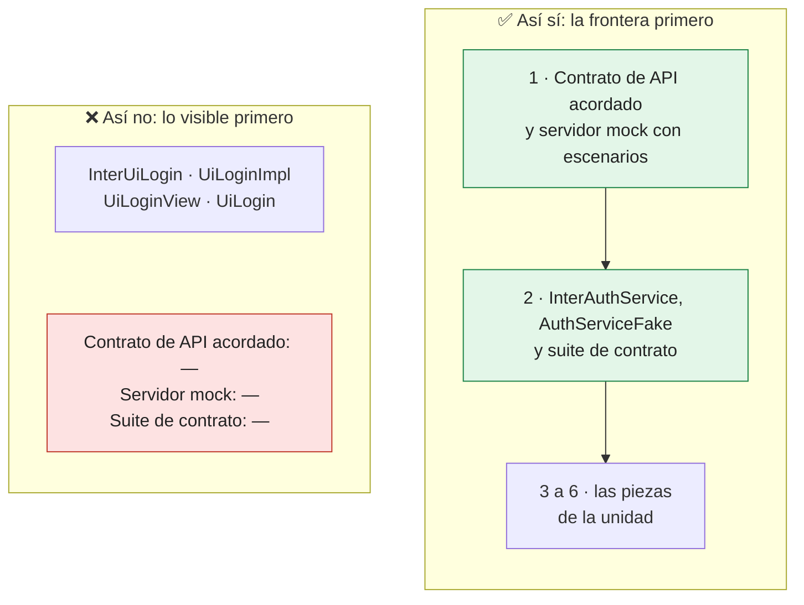
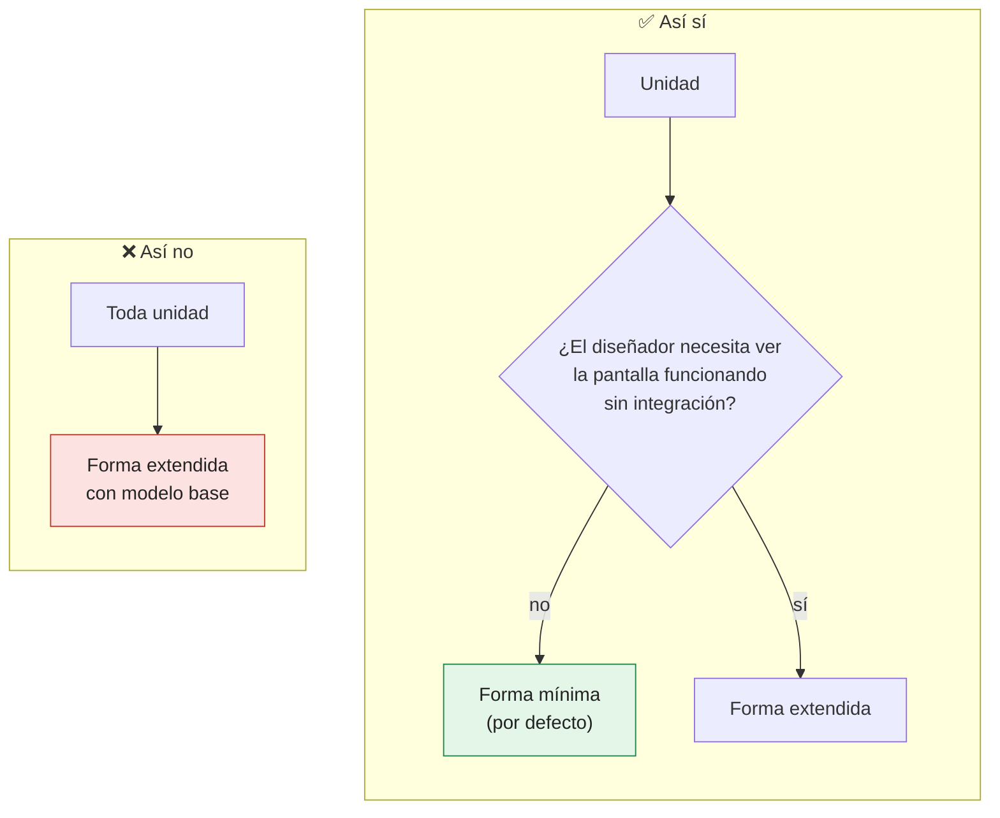

# Capítulo 10. Decisiones y compromisos: cuándo usar JONA y cuándo no

El capítulo 1 lo advirtió: JONA no elimina la complejidad, la reparte. Separar responsabilidades agrega piezas, nombres e indirección, y ese costo se paga desde el primer día. Los beneficios llegan después, cuando algo cambia: el backend, la presentación, el equipo, la plataforma.

Un arquitecto no recomienda un patrón porque es bueno; lo recomienda porque, en un contexto concreto, lo que compra vale más de lo que cuesta. Este capítulo da los criterios para hacer esa cuenta, muestra una medición reproducible de los dos lados y propone cómo registrar la decisión.

> [!IMPORTANT]
> **Regla del capítulo.** JONA se decide **por unidad**, no por aplicación. Sus costos son seguros y sus beneficios, condicionales; la pregunta que más pesa es si la unidad **depende del sistema**, porque casi todo el valor medible del patrón está en esa frontera.

---

## 10.1 Qué compra JONA y con qué se paga

| Lo que compra | De qué objetivo sale (capítulo 1) | Cuándo se cobra |
|---|---|---|
| El frontend trabaja sin esperar al backend | Contrato primero, trabajo en paralelo | Desde la primera semana, si el backend todavía no existe |
| Cada estado de la pantalla se prueba sin red | Puntos de sustitución | Cada vez que se prueba un error o un caso raro |
| Un cambio del backend toca solo el adaptador | Una sola razón para cambiar | Cuando el contrato de API cambia |
| Una presentación nueva reutiliza la lógica | Una sola razón para cambiar | Cuando aparece una segunda vista o plataforma |
| Diseño e integración trabajan en piezas distintas | Trabajo en paralelo | Cuando hay roles distintos, o sombreros distintos |
| Un vocabulario común entre tecnologías | Independencia de la tecnología | Cuando el equipo trabaja en más de una plataforma |

| Lo que cuesta | Cómo se manifiesta |
|---|---|
| **Piezas** | Entre tres y seis por unidad, según la forma (capítulo 2), frente a una en un componente directo |
| **Indirección** | Para seguir un clic hasta la red hay que pasar por la vista, la Implementación, el contrato de servicio y el adaptador |
| **Ceremonia de nombres** | `Inter*`, `*Impl`, `*View`, `DEFAULTS` en cada unidad, incluso en las simples |
| **Coordinación** | Una sesión de contratos con el backend antes de escribir código, y un servidor mock que mantener |
| **Disciplina** | Las reglas no se sostienen solas; necesitan las verificaciones del capítulo 9 |
| **Curva de entrada** | Una persona nueva tiene que aprender dónde va cada cosa antes de ser productiva |

La asimetría importa: **los costos son seguros y los beneficios son condicionales.** Si el backend nunca cambia, nadie prueba los errores y no hay una segunda presentación, JONA solo deja piezas de más.



*Figura 10.1. Los costos se pagan siempre; cada beneficio espera su disparador. La cuenta del arquitecto es cuántos de esos disparadores son probables para la unidad.*

---

## 10.2 Las preguntas que deciden

No hay un umbral único. Hay preguntas cuya respuesta inclina la balanza:

| Pregunta | A favor de JONA | En contra de JONA |
|---|---|---|
| ¿La pantalla depende del sistema (red, almacenamiento, dispositivo)? | Sí: el contrato de servicio y el servidor mock rinden desde el principio | No: solo queda el contrato de UI, y suele bastar con un componente bien tipado |
| ¿El backend existe y es estable? | No existe o cambia seguido | Existe, es estable y lo mantiene el mismo equipo |
| ¿Hay roles separados (diseño de UI, integración, backend)? | Sí, o personas que alternan sombreros | Una sola persona, en un solo rol, por poco tiempo |
| ¿Cuántas presentaciones comparten la misma lógica? | Dos o más: web y escritorio, completa y compacta | Una, y no se espera otra |
| ¿Cuánto vivirá el código? | Años, con equipos que rotan | Semanas: un prototipo o una prueba de concepto |
| ¿Cuánto importan los estados difíciles (errores, bloqueos, vacíos)? | Mucho: hay que probarlos y mostrarlos bien | Poco: el camino feliz es todo lo que importa |
| ¿Cuánta lógica tiene la pantalla? | Validaciones, estados y reglas de negocio de presentación | Mostrar datos sin decidir nada |
| ¿El equipo trabaja en más de una tecnología? | Sí: el vocabulario común rinde | No |

Dos o tres respuestas en la columna izquierda suelen justificar el patrón para una unidad. Ninguna, o solo la de vida útil, sugiere no usarlo.

La primera pregunta pesa más que las otras. Casi todo el valor medible de JONA está en la frontera con el sistema: el contrato de servicio, el servidor mock, la suite de contrato. Una unidad puramente visual cumple N1 con su contrato de UI, y en un sistema de diseño ese contrato es la API pública (capítulo 8); pero en una aplicación, la diferencia entre esa unidad y un componente bien tipado es pequeña.

La figura 10.2 ordena las preguntas con la primera delante.



*Figura 10.2. La primera pregunta no decide sola, pero es la que más pesa: si la unidad no toca el sistema, lo que queda de JONA se parece mucho a un componente bien tipado.*

---

## 10.3 Cuándo no usar JONA

Hay contextos donde el patrón cuesta más de lo que devuelve:

- **Prototipos y pruebas de concepto.** Se escriben para aprender algo y tirarlos. Si sobreviven, se migran (capítulo 11); pero diseñarlos para durar es pagar por un futuro que probablemente no llega.
- **Pantallas sin sistema ni lógica.** Una página de contenido, un aviso legal, un panel que solo muestra lo que recibe. No hay nada que sustituir ni que decidir.
- **Herramientas internas de una persona.** Sin roles que separar, sin backend que negociar y sin equipo que rote, la mayoría de los beneficios de la tabla 10.1 no se cobran.
- **Interfaces donde el servidor decide la pantalla.** En aplicaciones que reciben HTML del servidor o en interfaces dirigidas por el servidor (*server-driven UI*), el estado y la lógica viven del otro lado. El frontend no tiene una Implementación que proteger; el contrato que importa es el de la respuesta del servidor.
- **Lecturas de datos que el framework resuelve en el servidor.** Cuando un componente de servidor lee los datos directamente y entrega el resultado ya resuelto, el contrato de servicio del frontend pierde buena parte de su razón de ser. El contrato de UI sigue siendo útil para los componentes interactivos del cliente.
- **El ciclo de un juego.** En Unity, JONA organiza menús, inventarios y pantallas de configuración (capítulo 4). El ciclo de cada cuadro, con sus requisitos de rendimiento, no es una interfaz de usuario y no debería pasar por contratos de UI.

En todos estos casos, la decisión puede revisarse. Un prototipo que se convierte en producto, o una pantalla que empieza a depender del sistema, cambian las respuestas de la sección 10.2.

---

## 10.4 Adopción parcial: no es todo o nada

JONA se decide **por unidad**, no por aplicación. Una aplicación puede tener pantallas JONA junto a componentes simples, y el capítulo 2 ya recomendaba elegir la forma unidad por unidad.

Cuando el presupuesto no alcanza para todo, no todas las piezas rinden lo mismo. Este es un orden razonable de valor por costo:

| Orden | Pieza | Qué compra | Costo |
|---|---|---|---|
| 1 | Contrato de API acordado y servidor mock con escenarios | Trabajo en paralelo con el backend; errores reproducibles | Una sesión de contratos y un servidor pequeño |
| 2 | Contrato de servicio, servicio falso y suite de contrato | Pruebas sin red; el cambio de backend toca un solo archivo | Dos o tres archivos por servicio, no por pantalla |
| 3 | Entrada única (N4) | Libertad para reorganizar la unidad por dentro | Un archivo y una regla de importación |
| 4 | Vista pura (N3) | La vista se prueba y se diseña con datos fijos | Separar un archivo |
| 5 | Contrato de UI con `DEFAULTS` | Diseño sin integración; acuerdo explícito entre roles | Un archivo por unidad |
| 6 | Modelo base (forma extendida) | El diseñador ve la pantalla funcionando sin integración | Una o dos piezas más y más coordinación |

Las dos primeras filas se comparten entre pantallas: un mismo servicio sirve a varias. Por eso son las más baratas por unidad.



*Figura 10.3. La escalera de valor por costo: los dos primeros peldaños se pagan una vez y sirven a varias pantallas; el último agrega piezas y coordinación, y solo se sube cuando una unidad lo justifica.*

Hay que ser preciso con el nombre. Según la sección 1.8, una unidad es JONA si cumple N1 a N4. **Una unidad con solo algunas piezas no es JONA: está en camino.** Es una posición legítima, siempre que se diga así y que el trinquete del capítulo 9 registre lo que falta. El capítulo 11 trata ese camino.

> [!WARNING]
> «Está en camino» no es lo mismo que «es JONA». Una unidad a medio camino presentada como JONA promete garantías que todavía no tiene; nómbrela como tal y registre lo que falta en la lista de deuda.

---

## 10.5 Compromisos frecuentes

Además de la decisión de adoptar, un arquitecto toma decisiones dentro del patrón. Ninguna tiene una respuesta universal; todas tienen consecuencias conocidas.

| Decisión | Opción A | Opción B | Cómo decidir |
|---|---|---|---|
| Forma de la unidad | Clásica (herencia) | Mínima o extendida (composición) | El mecanismo natural de la tecnología (capítulo 4) |
| Estilo del contrato de UI | Capacidades | Modelo de vista con `DEFAULTS` | Sigue a la forma; ver capítulo 3 |
| Dónde corre el mock | Servidor mock aparte | Mock dentro del navegador o de la aplicación | Ver abajo |
| Servicio falso | Escrito a mano | Generado desde el OpenAPI | A mano mientras haya pocos servicios; generado cuando son muchos y el contrato es estable |
| Suite de contrato para el backend | Ejecutada desde el repositorio del frontend o publicada como artefacto | Reescrita en el lenguaje del backend | Evitar la reescritura si se puede (capítulo 9) |
| Vistas en un sistema de diseño | Solo se publica la entrada | También se publican las vistas | Publicarlas amplía la API y su costo de versión (capítulo 8) |
| Uniformidad | Una forma para toda la aplicación | Una forma por unidad | El núcleo debe ser uniforme; la forma, no (capítulo 2) |

### Servidor mock o mock en la aplicación

El canon de este libro es el servidor mock como modo de desarrollo por defecto (capítulos 2 y 3). Existe una alternativa real, que `softcommerce` usa como modo por defecto (`VITE_API_MODE=mock`): un mock dentro de la propia aplicación. En `softcommerce` el mock reemplaza a los adaptadores en el nivel del contrato de servicio, y se carga en su propio fragmento con un `import()` dinámico (`src/services/serviceComposer.ts`); otra técnica habitual es interceptar las peticiones en el navegador. La decisión tiene costos en los dos sentidos:

| Aspecto | Servidor mock aparte | Mock en la aplicación |
|---|---|---|
| Ejercita el adaptador HTTP real | Sí: serialización, cabeceras, códigos de estado | No, si el mock reemplaza al adaptador, como en `softcommerce`; en parte, si intercepta la red |
| El backend puede correr la misma suite contra él | Sí; es la tercera implementación del contrato | No directamente |
| Se usa desde otras plataformas (escritorio, móvil) | Sí: es un servidor | No: vive en una sola aplicación |
| Arranque y despliegue de demostraciones | Hay que levantar un proceso más | La aplicación se despliega sola, por ejemplo como sitio estático |
| Selección de escenarios | Por petición (en los ejemplos, la cabecera `X-Mock-Scenario`) | Por configuración de la aplicación (en `softcommerce`, `VITE_API_SCENARIO`) |



*Figura 10.4. Con el mock dentro de la aplicación en el nivel del contrato de servicio, el adaptador HTTP real y el backend quedan fuera del circuito (en rojo). Por eso sirve para demostraciones, pero no como referencia del contrato.*

El mock en la aplicación es una buena herramienta para demostraciones y para trabajar sin ningún proceso adicional. Lo que no debería hacer es reemplazar al servidor mock como referencia del contrato, porque deja fuera al adaptador real y al backend.

---

## 10.6 Lo que dicen los números

Las afirmaciones de este capítulo sobre costos y beneficios se pueden medir. El ejemplo `ejemplos/costo-de-cambio/` implementa la misma pantalla de inicio de sesión de dos maneras y les aplica los mismos pedidos de cambio:

- **`directo`**: un solo módulo con el estado, la validación, la llamada con `fetch` y el dibujo, escrito como lo haría un desarrollador competente sin ningún patrón. No es un hombre de paja: es corto y legible.
- **`jona`**: forma mínima, variante a, con contrato de UI, contrato de servicio, Implementación, vista, entrada, adaptador HTTP y servicio falso.

Cada pedido de cambio es una copia completa del punto de partida (`v0`) con solo ese cambio aplicado. Una suite de comportamiento común (inicio correcto, clave incorrecta, usuario bloqueado, campos vacíos con detalle, error del servidor, sin red, doble envío) corre contra cada variante y cada cambio, de modo que ningún cambio es de mentira: 278 pruebas en total. Una herramienta mide cada cambio contra `v0` con un diff por líneas, y una prueba exige que el resultado coincida con el archivo `resultados.json`. **Los números de esta sección no se pueden editar a mano sin que el ejemplo falle.**

### El costo de partida

Líneas de código, sin líneas en blanco ni comentarios:

| Variante | Archivos de producción | Líneas de producción | Archivos de prueba | Líneas de prueba |
|---|---:|---:|---:|---:|
| directo | 1 | 80 | 1 | 52 |
| jona | 8 | 209 | 2 | 80 |

JONA parte con 2,6 veces las líneas de producción y ocho archivos contra uno. Cerca de 50 de esas líneas son el modelo de error (`ApiError`) y el servicio falso, que en una aplicación real se comparten entre muchas pantallas; en un experimento de una sola pantalla pesan completas.

### El costo de cada cambio

| Cambio | Variante | Archivos tocados (nuevos) | Producción +/− | Pruebas +/− | ¿Toca la lógica? |
|---|---|---:|---:|---:|:---:|
| C1 Estilo del botón | directo | 1 (0) | +2 / −2 | +0 / −0 | sí |
| | jona | 2 (0) | +2 / −2 | +0 / −0 | no |
| C2 Campo «recordarme» que viaja al backend | directo | 2 (0) | +6 / −2 | +10 / −1 | sí |
| | jona | 7 (0) | +19 / −8 | +19 / −3 | sí |
| C3 El backend cambia su formato | directo | 2 (0) | +12 / −9 | +6 / −6 | sí |
| | jona | 2 (0) | +10 / −12 | +5 / −5 | no |
| C4 Segunda vista (compacta) | directo | 2 (0) | +8 / −2 | +10 / −0 | sí |
| | jona | 3 (2) | +42 / −0 | +9 / −0 | no |
| C5 Probar el usuario bloqueado sin servidor | directo | 1 (0) | +0 / −0 | +5 / −0 | no |
| | jona | 1 (0) | +0 / −0 | +4 / −0 | no |

«¿Toca la lógica?» indica si el cambio modificó el archivo que guarda el estado de la pantalla y decide qué mostrar: `login.ts` en `directo`, `UiLoginImpl.ts` en `jona`. En `directo` ese archivo es el único, así que cualquier cambio de producción lo toca; la columna mide **localidad**, no es un puntaje.



*Figura 10.5. La columna «Producción +/−» de la tabla, sumada por cambio y variante (por ejemplo, C2 en `jona`: 19 + 8 = 27). En líneas, el directo gana o empata; los dos casos caros de JONA son C2, que atraviesa todas las capas, y C4, que agrega una vista y una entrada.*

### Lo que dicen, y lo que no

**En líneas, el directo gana o empata.** El peor caso de JONA es C2: un campo nuevo que viaja de la interfaz al backend atraviesa todas las capas (contrato de UI, Implementación, contrato de servicio, adaptador, vista y pruebas en dos niveles), con siete archivos y unas tres veces las líneas. C4 le cuesta al directo una bandera de dos líneas; a JONA, una vista y una entrada nuevas. C3 y C5 empatan.

**En localidad, JONA gana en tres de los cinco cambios.** C1 no toca la lógica. C4 es puramente aditivo: cero líneas eliminadas, y la Implementación queda igual. C3 es el caso que justifica el contrato de servicio: el mismo cambio del backend, en `jona`, queda entero dentro del adaptador:

```diff
-      return { token: body.token, user: body.user };
+      return { token: body.accessToken, user: body.user };
     },
   };
 }

-function toApiError(status: number, body: ErrorBody): ApiError {
+function toApiError(status: number, { error = {}, traceId = '' }: ErrorBody): ApiError {
```

En `directo`, el mismo cambio entra en la función que también maneja el estado, los mensajes y el dibujo:

```diff
-  function showErrors(message: string, details: ErrorBody['details'] = []): void {
-    const detail = (field: string) => details.find((d) => d.field === field)?.message ?? '';
+  function showErrors(message: string, fields: FieldError[] = []): void {
+    const detail = (name: string) => fields.find((f) => f.name === name)?.message ?? '';
     screen.message.text = message;
-    screen.emailError.text = detail('usuario');
+    screen.emailError.text = detail('correo');
```

**La diferencia más grande no está en la tabla: está en qué saben las pruebas.** En `directo`, las pruebas de pantalla simulan el formato de red del backend (todas menos la de «sin red»), porque no hay otra costura donde cortar:

```ts
// directo/prueba-bloqueado/test/login.test.ts
it('con un usuario bloqueado (403) muestra el mensaje', async () => {
  responderCon(403, { code: 'USER_DISABLED', message: 'x', details: [], traceId: 't' });
  const { screen } = await ingresar('bloqueado@ejemplo.com', 'secreta123');
  assert.equal(screen.message.text, 'Su usuario está bloqueado. Contacte al administrador.');
});
```

En `jona`, la misma prueba usa el servicio falso y no sabe nada de la red:

```ts
// jona/prueba-bloqueado/test/UiLogin.test.ts
it('con un usuario bloqueado (403) muestra el mensaje', async () => {
  const { screen } = await ingresar(createAuthServiceFake(), 'bloqueado@ejemplo.com', 'secreta123');
  assert.equal(screen.message.text, 'Su usuario está bloqueado. Contacte al administrador.');
});
```

Las dos cuestan casi lo mismo hoy (+5 y +4 líneas). La diferencia aparece en el cambio siguiente: si después llega C3, en `directo` se romperían cinco de las seis pruebas de pantalla, las que conocen el formato viejo; en `jona` solo cambiarían las pruebas del adaptador (como ya muestra C3 en la tabla), que son las únicas que conocen la red.



*Figura 10.6. Lo que saben las pruebas decide cuánto cuesta el cambio siguiente: en `directo`, las pruebas de pantalla conocen la red; en `jona`, solo las del adaptador.*

### Cómo usar este resultado

- **El costo fijo de JONA es real y se paga por unidad.** En una pantalla aislada, el directo es más barato de escribir y, en líneas, también de cambiar.
- **JONA compra localidad, no brevedad.** Cada cambio cae en la pieza que tiene esa razón para cambiar, y las pruebas de la pantalla no conocen la red. Eso reduce el riesgo de cada cambio y el costo del cambio siguiente, dos cosas que un conteo de líneas no ve.
- **Los cambios que atraviesan todas las capas son el punto débil.** Un campo nuevo de punta a punta toca todo. Si el producto cambia sobre todo así, y el backend y la presentación son estables, la tabla 10.2 ya lo advertía.

Las limitaciones del experimento también son reales: una sola pantalla, cinco cambios y un solo autor; las líneas como aproximación del esfuerzo; y decisiones que mueven los números, como contar el servicio falso como código de producción o resolver C4 en `directo` con una bandera en lugar de una copia. El ejemplo existe para que cada equipo repita la medición con sus propias pantallas y sus propios cambios probables, no para cerrar la discusión con un número.

> [!TIP]
> Antes de recomendar o rechazar JONA con números, repita la medición con una pantalla real y sus cambios probables: `npm run medir` en `ejemplos/costo-de-cambio/` reescribe `resultados.json` e imprime las tablas, y `test/resultados.test.ts` falla si el archivo deja de coincidir con la medición.

---

## 10.7 Registrar la decisión

Una decisión de arquitectura que no se escribe se vuelve a discutir en cada incorporación al equipo. El formato habitual es un registro de decisión de arquitectura (ADR). Para adoptar JONA, estos son los campos que no deberían faltar:

```markdown
# ADR-0007: Adoptar JONA en las pantallas del módulo de ventas

## Contexto
Qué pantallas, qué equipos y qué tecnologías. Respuestas a las preguntas de la sección 10.2.

## Decisión
- Alcance: qué unidades adoptan JONA y cuáles no (y por qué).
- Forma por defecto y variante: por ejemplo, mínima, variante a.
- Dónde corre el mock y quién mantiene sus escenarios.
- Cómo llega la suite de contrato al backend.

## Verificación
Reglas del catálogo que se aplican (JONA-N1 … N4), en qué etapa del pipeline,
y con qué lista de deuda inicial.

## Consecuencias
Costos aceptados (piezas, coordinación) y beneficios esperados, con un indicador
observable para cada uno.

## Revisión
Fecha o condición para revisar la decisión.
```

El último campo es el más olvidado y el más útil. Una decisión de adopción tomada para un prototipo, o rechazada porque el backend era estable, tiene que poder revisarse cuando el contexto cambia.

---

## 10.8 Antipatrones de decisión

> [!CAUTION]
> Estos antipatrones no rompen ninguna regla de N1 a N4: rompen **la cuenta**. Se paga el costo seguro de la sección 10.1 sin cobrar el beneficio, o se rechaza el beneficio midiendo lo que no importa.

**Referencia rápida**

| | Antipatrón | Se reconoce porque… | Qué lo evita |
|:-:|---|---|---|
| 🔴 | [JONA de nombres](#ap-10-1) | Archivos `Inter*` e `*Impl` sin contrato de API acordado, sin servidor mock y sin suite de contrato | Empezar por las piezas de mayor valor (tabla de 10.4), no por las más visibles |
| 🔴 | [JONA en todo](#ap-10-2) | Un aviso legal con contrato de UI, Implementación vacía y servicio falso | Decidir por unidad con las preguntas de 10.2 |
| 🟠 | [Parcial sin decirlo](#ap-10-3) | Unidades a medio camino presentadas como JONA | Llamarlas en camino y enumerar lo que falta en la lista de deuda |
| 🟠 | [Decisión sin revisión](#ap-10-4) | La adopción, o el rechazo, sigue vigente aunque cambiaron el equipo, el backend o la plataforma | Campo de revisión en el ADR |
| 🟠 | [Forma extendida por defecto](#ap-10-5) | Modelos base en unidades simples, con más coordinación que contenido | Mínima por defecto; extendida cuando una unidad lo justifique (capítulo 2) |
| 🟡 | [Rechazarlo contando archivos](#ap-10-6) | «Son cinco archivos para un formulario» como único argumento | Medir el costo de los cambios probables, no solo el de la primera versión (sección 10.6) |

🔴 se paga el costo del patrón sin cobrar su beneficio · 🟠 la decisión era defendible, pero se oculta, envejece o cuesta más de lo necesario · 🟡 la decisión se toma midiendo otra cosa

---

<a id="ap-10-1"></a>
### 🔴 JONA de nombres

**Síntoma.** La unidad tiene todos los archivos `Inter*`, `*Impl` y `*View`, pero no hay contrato de API acordado, ni servidor mock, ni suite de contrato.



**Por qué duele.** Se paga toda la ceremonia de nombres y se pierde casi todo el valor medible, que está en la frontera con el sistema (sección 10.2). **Cómo no caer:** subir la escalera de la figura 10.3 desde abajo, y escribir en el ADR cómo llega la suite de contrato al backend (sección 10.7).

---

<a id="ap-10-2"></a>
### 🔴 JONA en todo

**Síntoma.** Unidades sin sistema ni lógica tienen todas las piezas del patrón.

❌ **Así no** (ilustrativo):

```text
src/avisolegal/
  InterUiAvisoLegal.ts        contrato de UI con DEFAULTS
  UiAvisoLegalImpl.ts         Implementación vacía: no hay nada que decidir
  UiAvisoLegalView.ts
  UiAvisoLegal.ts
  AvisoLegalServiceFake.ts    un servicio falso que no sustituye nada
```

✅ **Así sí** (ilustrativo):

```text
src/avisolegal/
  AvisoLegal.tsx              un componente bien tipado
```

**Por qué duele.** Los costos de la sección 10.1 se pagan completos y ningún disparador de la figura 10.1 va a ocurrir: no hay nada que sustituir ni que decidir. **Cómo no caer:** decidir por unidad con la figura 10.2; una pantalla sin sistema ni lógica es uno de los casos de la sección 10.3.

---

<a id="ap-10-3"></a>
### 🟠 Parcial sin decirlo

**Síntoma.** Unidades a medio camino se presentan como JONA, y nadie sabe qué les falta.

❌ **Así no** (ilustrativo):

```markdown
<!-- README.md del módulo de ventas -->
Las pantallas de este módulo usan JONA.
```

✅ **Así sí:** lo que falta queda enumerado en la lista de deuda del capítulo 9, regla por regla.

```json
{ "regla": "JONA-N3", "archivo": "uilogin/UiLoginView.ts", "mensaje": "la vista usa sessionStorage; los efectos van en la Implementación o en un adaptador" }
```

**Por qué duele.** Quien confía en el nombre espera garantías (pruebas sin red, cambios localizados) que la unidad todavía no da. **Cómo no caer:** llamarla «en camino» y aplicar el trinquete de la sección 9.4; la entrada del ejemplo es real, de `ejemplos/gobierno/ts/fixtures/deuda/deuda.json`.

---

<a id="ap-10-4"></a>
### 🟠 Decisión sin revisión

**Síntoma.** La adopción, o el rechazo, sigue vigente aunque cambiaron el equipo, el backend o la plataforma.

❌ **Así no** (ilustrativo):

```markdown
## Decisión
No adoptar JONA: el backend existe y es estable.

## Consecuencias
Menos piezas por pantalla.
```

✅ **Así sí** (ilustrativo): el ADR de la sección 10.7 con su último campo.

```markdown
## Revisión
Revisar si el backend deja de mantenerlo el mismo equipo,
o si aparece una segunda presentación de estas pantallas.
```

**Por qué duele.** Una decisión correcta para su contexto se vuelve incorrecta cuando el contexto cambia, y nadie la reabre porque está escrita como definitiva. **Cómo no caer:** el campo «Revisión» del ADR, con una fecha o una condición observable.

---

<a id="ap-10-5"></a>
### 🟠 Forma extendida por defecto

**Síntoma.** Modelos base en unidades simples, con más coordinación que contenido.



**Por qué duele.** El modelo base agrega una o dos piezas y más coordinación (tabla de 10.4); en una unidad simple, ese costo no compra nada. **Cómo no caer:** mínima por defecto y extendida cuando una unidad lo justifique (capítulo 2); el último peldaño de la figura 10.3 se sube a propósito.

---

<a id="ap-10-6"></a>
### 🟡 Rechazarlo contando archivos

**Síntoma.** «Son cinco archivos para un formulario» es el único argumento.

❌ **Así no:** comparar solo el costo de partida.

| Variante | Archivos de producción | Líneas de producción |
|---|---:|---:|
| directo | 1 | 80 |
| jona | 8 | 209 |

✅ **Así sí:** medir también los cambios probables, y qué toca cada uno.

| Cambio | Variante | Archivos tocados (nuevos) | Producción +/− | ¿Toca la lógica? |
|---|---|---:|---:|:---:|
| C3 El backend cambia su formato | directo | 2 (0) | +12 / −9 | sí |
| | jona | 2 (0) | +10 / −12 | no |

**Por qué duele.** El conteo de partida mide el costo fijo, que JONA siempre pierde; no mide la localidad ni lo que saben las pruebas (figura 10.6), que es lo que el patrón compra. **Cómo no caer:** repetir la medición de `ejemplos/costo-de-cambio/` con los cambios probables del propio producto (sección 10.6).

---

## 10.9 Resumen

- JONA cambia costos seguros (piezas, indirección, coordinación, disciplina) por beneficios condicionales (trabajo en paralelo, pruebas sin red, cambios localizados, reutilización entre presentaciones).
- La decisión se toma por unidad. La pregunta que más pesa es si la unidad depende del sistema: casi todo el valor medible del patrón está en esa frontera.
- No conviene en prototipos, pantallas sin lógica ni sistema, herramientas de una persona, interfaces que decide el servidor ni en el ciclo de un juego.
- La adopción parcial es legítima si se nombra como tal. Las piezas de la frontera (contrato de API, servidor mock, contrato de servicio y suite de contrato) son las de mayor valor por costo.
- El servidor mock es el canon; el mock en la aplicación es una alternativa útil para demostraciones, pero no reemplaza al servidor como referencia del contrato.
- La decisión se escribe en un ADR con su alcance, su verificación y una condición de revisión.
