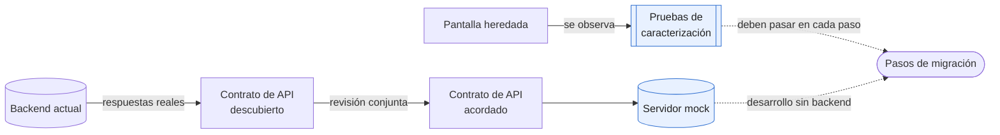
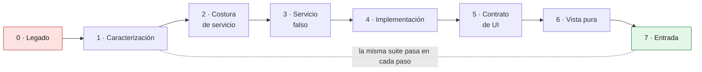
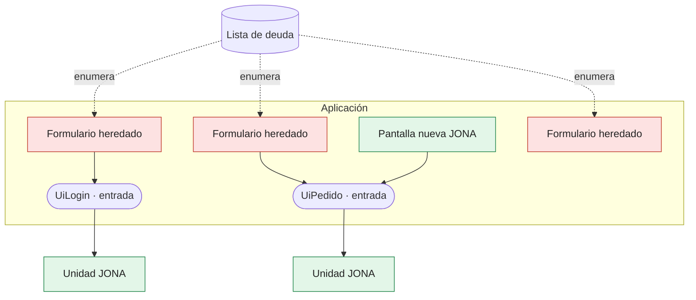
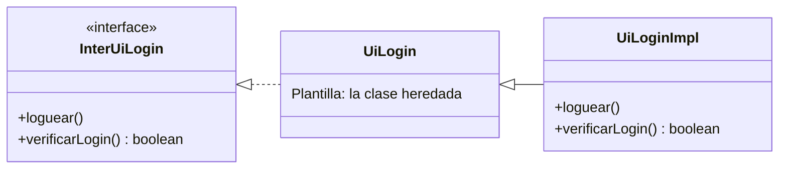
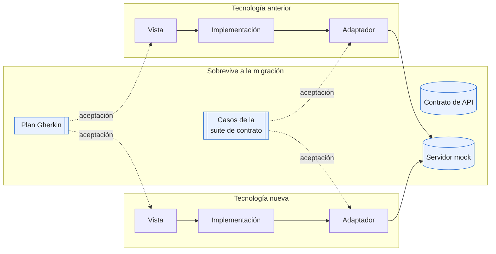
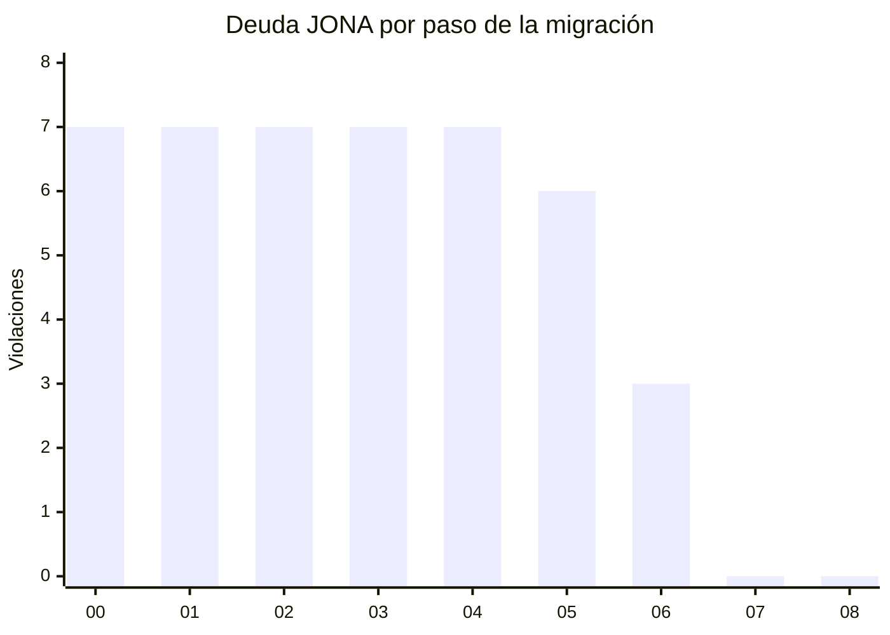
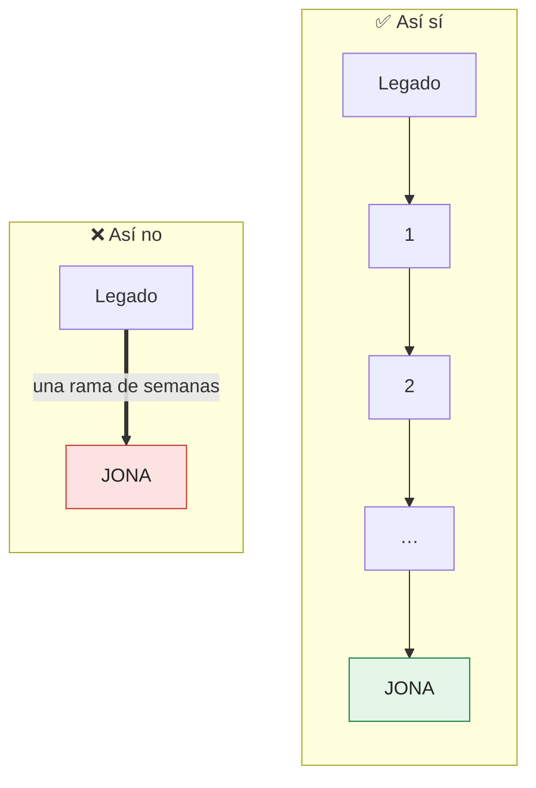

# Capítulo 11. Migración: de código heredado a JONA y entre tecnologías

Casi nadie adopta JONA en un proyecto vacío. Lo habitual es una aplicación que funciona, que factura y que nadie quiere romper, con pantallas que mezclan estado, validación, llamadas al sistema y dibujo en un mismo archivo. El capítulo 10 dijo que la adopción parcial es legítima si se nombra como tal: una unidad «en camino». Este capítulo trata ese camino: cómo llevar una pantalla heredada hasta JONA sin cambiar su comportamiento, y cómo llevar una unidad JONA de una tecnología a otra.

> [!IMPORTANT]
> **Regla del capítulo.** Una migración a JONA es una serie de pasos pequeños en la que **el comportamiento no cambia** (lo garantizan las pruebas de caracterización) y **la deuda solo baja** (lo garantiza el trinquete del capítulo 9). Si un paso rompe cualquiera de las dos cosas, no es un paso de migración: es una reescritura.

---

## 11.1 Qué migrar y qué no

Migrar cuesta, y el capítulo 10 ya dio los criterios para decidir dónde se recupera ese costo. Aplicados al código heredado, se reducen a una pregunta: **¿esta pantalla va a cambiar?**

| Situación de la pantalla | Qué hacer |
|---|---|
| Cambia seguido, depende del sistema y sus errores importan | Migrarla primero: cada cambio futuro recupera parte del costo |
| Va a recibir una funcionalidad nueva | Migrarla justo antes, en un cambio separado (11.3) |
| Es estable y no tiene cambios previstos | Dejarla como está y anotarla como deuda |
| Va a desaparecer o a reescribirse por otro motivo | No migrarla |

> [!TIP]
> La pantalla que más conviene migrar no es la más fea, sino la que más se toca. El costo de la migración se recupera en los cambios siguientes, y una pantalla que nunca cambia nunca devuelve esa inversión.

---

## 11.2 Antes de tocar nada: la red de seguridad

### Pruebas de caracterización

Michael Feathers llama **pruebas de caracterización** a las que documentan lo que el código hace hoy, no lo que debería hacer (*Working Effectively with Legacy Code*, 2004). Son la red de seguridad de toda la migración: se escriben contra la pantalla heredada, al nivel de la pantalla, y deben pasar **sin cambios** después de cada paso.

Tres reglas para escribirlas:

- **Observan desde afuera.** Interactúan con la pantalla como lo haría una persona: escriben en los campos, pulsan el botón y leen lo que se muestra. Si miraran funciones internas, se romperían con el primer paso de la migración.
- **Incluyen las rarezas.** Si la pantalla heredada hace algo extraño, la prueba de caracterización lo fija. Corregirlo es un cambio de comportamiento, y va en un cambio aparte, con su propia decisión.
- **Simulan el sistema en el borde.** Al principio no hay contrato de servicio que sustituir, así que la prueba reemplaza la red (por ejemplo, `fetch`) con respuestas fijas en el formato real del backend.

### El contrato se descubre, no se inventa

En un proyecto nuevo, el contrato de API sale de una sesión conjunta (capítulo 3). En una migración, el backend ya existe y ya responde. El contrato se **escribe a partir de lo que el backend hace hoy**: sus rutas, sus cuerpos de error y sus códigos de estado. Después, el equipo de backend lo revisa en una sesión conjunta, y desde ese momento el contrato vuelve a ser un acuerdo entre dos partes.

El servidor mock se construye a partir de ese contrato. Es lo que permite que el resto de la migración avance sin depender de la disponibilidad del backend.



*Figura 11.1. Dos redes antes del primer paso: las pruebas de caracterización fijan el comportamiento, y el contrato descubierto fija lo que el backend hace hoy.*

---

## 11.3 El orden de los pasos

Con la red puesta, la pantalla se lleva hasta JONA en pasos que se pueden entregar uno por uno. El orden sigue la escalera de valor por costo del capítulo 10: **primero la frontera con el sistema, al final la vista.**

| Paso | Qué cambia | Qué compra desde ese momento |
|---|---|---|
| 0. Legado | Nada | — |
| 1. Caracterización | Solo pruebas | Una red que detecta cualquier cambio de comportamiento |
| 2. Costura de servicio | Contrato de servicio y adaptador HTTP; la pantalla recibe el servicio | El backend se puede sustituir |
| 3. Servicio falso | Servicio falso y suite de contrato contra el falso y contra el adaptador | Pruebas sin red; paridad de doble fuente |
| 4. Implementación | El estado y las decisiones salen a la Implementación | La lógica se prueba sin interfaz |
| 5. Contrato de UI | `InterUiLogin` con `DEFAULTS` | Diseño e integración pueden trabajar por separado |
| 6. Vista pura | La vista solo dibuja; los efectos se van a la Implementación o a un adaptador | La vista se diseña y se prueba con datos fijos |
| 7. Entrada | La entrada compone; el resto de la aplicación solo la importa | La unidad se puede reorganizar por dentro: es JONA |



*Figura 11.2. Cada flecha es un cambio que se puede entregar solo. Las pruebas de caracterización del paso 1 no se editan hasta el final.*

Dos reglas prácticas sostienen el orden:

- **Un paso por cambio, y sin funcionalidad nueva.** Si un cambio migra y agrega funcionalidad a la vez, y las pruebas fallan, nadie sabe cuál de las dos cosas rompió el comportamiento.
- **El pipeline queda en verde en todos los pasos.** La deuda que todavía existe se enumera en la lista del trinquete (capítulo 9). Ningún paso la hace crecer, aunque no todos la bajan: la sección 11.7 muestra por qué.

### El orden no es dogma: un caso real

`softcommerce-desktop`, la aplicación Swing del repositorio, siguió otro orden. De sus pantallas, solo tres son unidades JONA (`uilogin`, `uiregisterlocalidad` y `uiregistertipocambio`, en `view/ui/`), y conviven con 381 archivos Java en carpetas `formularios` heredadas. Esas tres unidades empezaron por la separación de la interfaz, en forma clásica (`InterUiLogin`, `UiLogin` como Plantilla, `UiLoginImpl`), y la frontera con el sistema quedó pendiente: `UiLoginImpl` importa directamente `DAOGeneral` y escribe sus campos estáticos de conexión.

El orden es defendible en ese contexto. Es una aplicación de escritorio que habla con su base de datos a través de objetos de acceso a datos, sin un equipo de backend en paralelo, y el beneficio principal del contrato de servicio (trabajar sin esperar al backend) es menor. Pero la unidad sigue **en camino**: sin contrato de servicio, N1 no se cumple, y la Implementación no se puede probar sin la base de datos. La lista de deuda tiene que decirlo.

---

## 11.4 Convivencia: el estrangulador

Martin Fowler llama **aplicación estranguladora** (*strangler fig application*, 2004) a la estrategia de reemplazar un sistema por partes, dejando que lo nuevo crezca alrededor de lo viejo hasta que lo viejo se puede retirar. Aplicada a JONA, la unidad de reemplazo es la unidad:

- **Las pantallas nuevas nacen en JONA.** La regla de arquitectura se aplica a todo el código nuevo desde el primer día.
- **Las pantallas viejas siguen funcionando.** Su deuda está enumerada, no escondida.
- **El código heredado llega a una unidad JONA solo por su entrada** (N4). En `softcommerce-desktop`, la ventana principal heredada crea la unidad con `new UiLoginImpl(this)`; en la forma clásica la Implementación es la entrada, así que eso cumple N4.



*Figura 11.3. Lo heredado y lo nuevo conviven. La frontera entre ambos es siempre la entrada de la unidad, y lo que falta migrar está en la lista de deuda.*

> [!WARNING]
> El estrangulador solo avanza si algo lo empuja. Sin la regla aplicada al código nuevo y sin la lista de deuda, la convivencia se vuelve permanente y la aplicación termina con dos arquitecturas en lugar de una.

---

## 11.5 Código basado en clases: la forma clásica como primer paso

El capítulo 2 recomendaba la forma clásica cuando la tecnología se organiza en clases o cuando JONA se adopta sobre código heredado. La razón es práctica: en una aplicación de ventanas como Swing, la clase heredada ya **es** casi una Plantilla. El primer paso consiste en:

1. Escribir el contrato de capacidades (`InterUiLogin`) con los métodos que la pantalla ya ofrece.
2. Dejar la clase heredada como Plantilla, con su interfaz y su comportamiento por defecto.
3. Crear `UiLoginImpl`, que hereda de la Plantilla y reemplaza las capacidades que integran con el sistema.



*Figura 11.4. Sobre código de clases, el primer paso casi no mueve código: la clase existente pasa a ser la Plantilla, y la integración se reemplaza en la Implementación.*

El costo de este atajo es el que describe el capítulo 4: la Implementación queda acoplada a los detalles internos de la Plantilla. Y el contrato hereda lo que la clase ya exponía. En `softcommerce-desktop`, `InterUiLogin` declara `setProperties(ReadProperties r)`, un tipo de la capa de formularios heredada: un detalle de implementación dentro del contrato (capítulo 3, sección 3.7). Es deuda visible, y es mejor que sea visible.

---

## 11.6 Migrar entre tecnologías

Migrar de Swing a la web, o de Angular a React, es otra clase de migración. El código de la vista se reescribe sí o sí. La pregunta es qué **no** hay que reescribir.

| Activo | ¿Sobrevive a la migración? | Por qué |
|---|---|---|
| Contrato de API (OpenAPI) | Sí, intacto | No depende de la tecnología del frontend |
| Servidor mock y sus escenarios | Sí, intacto | Es un servidor: lo usan las dos aplicaciones |
| Plan de pruebas en Gherkin y su trazabilidad | Sí, intacto | Describe comportamiento, no tecnología |
| Suite de contrato | Sus casos sí; el código, solo si el lenguaje se mantiene | Los casos son los mismos; se reescriben en el lenguaje nuevo si cambia |
| Contrato de servicio | Su forma y su modelo de error | Se traduce al lenguaje nuevo, sin rediseñarlo |
| Contrato de UI y `DEFAULTS` | Sus datos y eventos | El estilo puede cambiar con la forma: capacidades en clases, modelo de vista en composición (capítulo 4) |
| Textos de la interfaz | Sí, como parte del acuerdo | Los usuarios los reconocen; cambiarlos es una decisión aparte |
| Implementación | Se reescribe si cambia el lenguaje | Si el lenguaje se mantiene, puede quedar intacta (sección 11.8) |
| Vista y entrada | Se reescriben | Son lo que la tecnología nueva cambia |

Los ejemplos del libro ya muestran la primera mitad de la tabla. Un solo servidor mock y un solo contrato de API sirven a `web-react`, `web-fsd`, `java-swing`, `java-javafx` y `dotnet-wpf`, y el paso «contrato externo» del ejecutor general corre sus suites de contrato contra la misma URL. En `softcommerce`, la aplicación web que sucede a la de escritorio, los textos heredados de escritorio se tratan como parte del acuerdo: su propuesta de producto deja fuera de alcance, explícitamente, «cambiar cualquier texto en español que exija la aplicación de escritorio».



*Figura 11.5. Durante la convivencia, las dos aplicaciones hablan con el mismo servidor mock y se aceptan con los mismos casos. Lo que se reescribe queda a los costados; lo que se conserva queda en el medio.*

Un orden que funciona:

1. **Sacar los activos comunes** (contrato de API, servidor mock, plan de pruebas) del repositorio de la aplicación vieja, si viven ahí. Pasan a ser de las dos.
2. **Migrar unidad por unidad**, con la suite de contrato y el plan de pruebas como criterio de aceptación de cada una.
3. **Mantener las dos aplicaciones contra el mismo servidor mock** mientras convivan. Si una diverge, la suite lo dice.
4. **Respetar la forma natural de la tecnología nueva.** Una unidad que en Swing era clásica puede ser mínima en React (capítulo 4). Se conservan el núcleo y los datos del contrato, no la mecánica de herencia.

> [!CAUTION]
> Las pruebas de caracterización de pantalla no sobreviven a un cambio de tecnología: leen controles que dejan de existir. Lo que sobrevive es el **plan de pruebas**. Por eso, en una migración entre tecnologías, el plan en Gherkin (capítulo 5) cumple el papel de caracterización para las dos aplicaciones.

---

## 11.7 Medir el avance

Una migración sin medida se estanca sin que nadie lo note. La medida más simple ya existe: **el verificador de reglas del capítulo 9, ejecutado en cada paso.** El ejemplo `ejemplos/migracion/` lo hace con la pantalla de inicio de sesión heredada, y guarda el resultado en `progreso.json`, protegido por una prueba:

| Paso | N1 | N2 | N3 | N4 | Deuda total | Archivos de producción | Líneas de producción |
|---|---:|---:|---:|---:|---:|---:|---:|
| 00 · Legado | 1 | 0 | 5 | 1 | **7** | 2 | 100 |
| 01 · Caracterización | 1 | 0 | 5 | 1 | **7** | 2 | 100 |
| 02 · Costura de servicio | 1 | 0 | 5 | 1 | **7** | 4 | 128 |
| 03 · Servicio falso | 1 | 0 | 5 | 1 | **7** | 5 | 147 |
| 04 · Implementación | 1 | 0 | 5 | 1 | **7** | 6 | 189 |
| 05 · Contrato de UI | 0 | 0 | 5 | 1 | **6** | 7 | 197 |
| 06 · Vista pura | 0 | 0 | 2 | 1 | **3** | 7 | 194 |
| 07 · Entrada | 0 | 0 | 0 | 0 | **0** | 8 | 198 |
| 08 · Cambio de vista | 0 | 0 | 0 | 0 | **0** | 8 | 170 |



*Figura 11.6. La deuda no baja de forma pareja: los pasos 01 a 04 la dejan igual y la caída llega en los pasos 05 a 07.*

La tabla enseña tres cosas que conviene saber antes de empezar:

- **Los primeros pasos compran seguridad, no cumplimiento.** Las pruebas de caracterización, la costura de servicio y el servicio falso no mueven el contador, porque N1 a N4 hablan de la forma de la unidad, no de su red de pruebas. Si el avance se mide solo con el verificador, la primera mitad de la migración parece estancada. Por eso cada paso se acompaña con lo que compra (tabla de la sección 11.3).
- **Una entrada de deuda puede cambiar de forma sin crecer.** En el paso 02, la vista deja de usar `fetch` y `setTimeout`, pero todavía elige el adaptador por defecto para que `App` no cambie; el verificador cambia «la vista usa fetch» por «la vista importa un servicio». En el paso 04, la falta de contrato de UI pasa de señalarse en la vista a señalarse en la Implementación. El total nunca sube, y el ejemplo exige que cada cambio de forma esté declarado con su motivo.
- **Lo que no se nombra no se mide.** El verificador reconoce las unidades por la convención de nombres. Un módulo heredado con un nombre cualquiera mide cero violaciones, no porque cumpla, sino porque es invisible. En una migración real, el primer paso medible es darle a la unidad un nombre que el verificador reconozca.

> [!WARNING]
> Una deuda en cero no prueba que la migración esté terminada. Prueba que el verificador no encuentra nada en lo que puede ver. Las unidades sin nombre JONA y lo que el nivel 2 del capítulo 9 deja a la revisión siguen fuera de la medida.

---

## 11.8 El ejemplo

El ejemplo `ejemplos/migracion/` recorre los nueve pasos con una pantalla de inicio de sesión heredada. Cada paso es una copia completa del anterior con un solo cambio (`pasos/00-legado` … `pasos/08-cambio-de-vista`). En total son 279 pruebas, y cuatro guardas sostienen las promesas del capítulo:

| Guarda | Qué exige | Dónde |
|---|---|---|
| Caracterización | La misma suite pasa en los pasos 01 a 08, y es idéntica, byte a byte, en todos | `caracterizacion/suite.ts` |
| Trinquete | Cada paso pasa con su propia `deuda.json`; ninguna entrada nueva aparece sin un cambio de forma declarado | `test/deuda.test.ts` |
| Progreso | La deuda total nunca sube, y es cero desde el paso 07 | `test/progreso.test.ts` |
| Cambio de vista | Entre los pasos 07 y 08 solo cambian la vista, la entrada y sus pruebas | `test/guardas.test.ts` |

### El legado

La pantalla heredada (`pasos/00-legado/src/uilogin/UiLoginView.ts`) está escrita como suele estarlo una pantalla con años de cambios: el estado, la validación, la llamada al backend, el límite de tiempo y el almacenamiento del token en una sola función. Un fragmento:

```ts
const temporizador = setTimeout(() => control.abort(), 10000);
try {
  const r = await fetch(URL_API + '/auth/login', {
    method: 'POST',
    headers: { 'Content-Type': 'application/json' },
    body: JSON.stringify({ usuario: p.correo.value, clave: p.clave.value }),
    signal: control.signal,
  });
  const datos = await r.json();
  if (r.ok) {
    localStorage.setItem('tkn', datos.token); // otras pantallas leen 'tkn'
    localStorage.setItem('ultimoCorreo', datos.user.usuario);
    ocupar(false);
    alEntrar(datos.user);
    return;
  }
```

El verificador del capítulo 9, ejecutado sobre el paso 00, encuentra siete violaciones:

```text
JONA-N1 uilogin/UiLoginView.ts    la unidad uilogin no tiene contrato de UI (Inter*.ts)
JONA-N3 uilogin/UiLoginView.ts:37 la vista usa localStorage; los efectos van en la Implementación o en un adaptador
JONA-N3 uilogin/UiLoginView.ts:58 la vista usa setTimeout; los efectos van en la Implementación o en un adaptador
JONA-N3 uilogin/UiLoginView.ts:60 la vista usa fetch; los efectos van en la Implementación o en un adaptador
JONA-N3 uilogin/UiLoginView.ts:68 la vista usa localStorage; los efectos van en la Implementación o en un adaptador
JONA-N3 uilogin/UiLoginView.ts:69 la vista usa localStorage; los efectos van en la Implementación o en un adaptador
JONA-N4 App.ts:2 importa uilogin/UiLoginView.ts, interno de la unidad uilogin; use su entrada: (no tiene)
```

### Las rarezas, fijadas

La pantalla tiene cuatro comportamientos que nadie documentó: solo valida el correo en el cliente; borra la clave cuando es incorrecta, pero no cuando el usuario está bloqueado; recuerda el último correo; y tiene un límite de tiempo de diez segundos con su propio mensaje. Las pruebas de caracterización (`caracterizacion/suite.ts`) los fijan todos:

```ts
it('con una clave incorrecta muestra el mensaje y borra la clave (rareza conservada)', async () => {
  const p = await abrir();
  p.ingresar('ana@ejemplo.com', 'otra');
  await p.backend.responder();
  assert.deepEqual(p.leer(), { ...INICIAL, correo: 'ana@ejemplo.com', clave: '', mensaje: MENSAJES.credenciales });
  assert.equal(p.saludo(), '');
  assert.deepEqual(p.almacen.contenido(), {});
});

it('con un usuario bloqueado muestra el mensaje y, a diferencia del caso anterior, conserva la clave', async () => {
  const p = await abrir();
  p.ingresar('bloqueado@ejemplo.com', 'secreta123');
  await p.backend.responder();
  assert.deepEqual(p.leer(), { ...INICIAL, correo: 'bloqueado@ejemplo.com', clave: 'secreta123', mensaje: MENSAJES.bloqueado });
});
```

`p.leer()` lee la pantalla desde afuera, como lo haría una persona. En el paso 08, cuando la vista cambia de tecnología, un lector pequeño por tecnología (`caracterizacion/lectores.ts`) permite que la misma suite siga leyendo la pantalla sin editarse.

### La costura

El paso 02 es el más importante para el resto: la pantalla recibe el servicio, con el adaptador HTTP como valor por defecto, para que `App` todavía no cambie:

```diff
-export function crearLogin(alEntrar: (usuario: Usuario) => void): PantallaLogin {
+// Costura: la pantalla recibe el servicio. Por defecto, el adaptador HTTP, para que App no cambie todavía.
+export function crearLogin(alEntrar: (usuario: Usuario) => void, servicio: InterAuthService = crearAuthServiceHttp()): PantallaLogin {
```

Las líneas de `fetch`, límite de tiempo y traducción de errores salen de la pantalla y se van a `AuthServiceHttp`. La pantalla queda con una llamada a `servicio.iniciarSesion(...)`, y desde el paso 03 se puede probar con el servicio falso.

### El trinquete con cambios de forma

Cada paso tiene su `deuda.json`, generada con el verificador como lo haría un equipo al congelar su línea base. La prueba del trinquete exige que la lista de cada paso esté contenida en la del anterior. Las dos excepciones de la sección 11.7 no se esconden: se declaran, con la entrada que sale, la que entra y el motivo (`test/deuda.test.ts`):

```ts
'04-implementacion': [
  {
    regla: 'JONA-N1',
    sale: { archivo: 'uilogin/UiLoginView.ts', mensaje: 'la unidad uilogin no tiene contrato de UI (Inter*.ts)' },
    entra: { archivo: 'uilogin/UiLoginImpl.ts', mensaje: 'la unidad uilogin no tiene contrato de UI (Inter*.ts)' },
    motivo: 'la misma falta; el verificador la señala en la Implementación cuando existe',
  },
  // …
],
```

La prueba falla si aparece una entrada nueva que no está declarada, y también si una declaración no reemplaza nada.

### Una regla, copias vigiladas

El ejemplo usa el mismo verificador que `ejemplos/gobierno/`, copiado en `herramientas/`. Una prueba (`test/copias.test.ts`) falla si una copia se aparta del original:

```ts
it(`herramientas/${archivo} es idéntico a gobierno/ts/herramientas/${archivo}`, () => {
  assert.equal(leer(join(COPIAS, archivo)), leer(join(ORIGINALES, archivo)),
    `herramientas/${archivo} se apartó del original; vuelva a copiarlo desde gobierno/ts/herramientas`);
});
```

Es la versión mínima de una idea del capítulo 9: una sola implementación de cada regla. Si dos copias pueden divergir, tarde o temprano miden cosas distintas.

### Cambiar la tecnología de la vista

El paso 08 reemplaza la vista imperativa (controles que se modifican) por una vista declarativa (una función pura del modelo de vista a un árbol):

```ts
export function UiLoginView(m: InterUiLogin): Nodo {
  return h('form', { id: 'login' },
    h('h1', { id: 'titulo' }, m.titulo ?? ''),
    h('input', { id: 'correo', valor: m.correo, deshabilitado: m.ocupada, alEscribir: m.alCambiarCorreo }),
    // …
    h('p', { id: 'mensaje' }, m.mensaje ?? ''));
}
```

La guarda (`test/guardas.test.ts`) compara los pasos 07 y 08 archivo por archivo, y solo admite cambios en cuatro: `UiLoginView.ts`, `UiLogin.ts` y sus dos pruebas. Contratos, Implementación, adaptadores, servicio falso y `App` quedan idénticos. Es la tabla de la sección 11.6 hecha prueba: dentro del mismo lenguaje, un cambio de tecnología de vista es un cambio de vista y entrada.

### Límites del ejemplo

- Es una pantalla pequeña, sin vecinas, sin estado global compartido más allá del almacenamiento y sin el ciclo de vida de un framework. El backend falso implementa solo `/auth/login`.
- El archivo heredado ya se llama `UiLoginView.ts`, para que el verificador pueda medirlo desde el paso 00 (sección 11.7).
- La Implementación usa `localStorage` directamente, lo que las reglas permiten. Una migración real probablemente agregaría después un contrato de almacenamiento y su adaptador.
- El «cambio de tecnología» es entre dos juegos de controles mínimos escritos para el ejemplo, no entre frameworks reales, y no hay un período en que las dos vistas convivan.

---

## 11.9 Antipatrones

> [!CAUTION]
> Estos antipatrones convierten una migración en una apuesta: se pierde la garantía de que el comportamiento no cambió, o la de que la deuda baja. Cualquiera de las dos, por sí sola, basta para que la migración se detenga a mitad de camino.

**Referencia rápida**

| | Antipatrón | Se reconoce porque… | Qué lo evita |
|:-:|---|---|---|
| 🔴 | [Reescritura de una vez](#ap-11-1) | Una rama larga que reemplaza la pantalla entera | Pasos pequeños, entregables uno por uno |
| 🔴 | [Migrar sin red](#ap-11-2) | No hay pruebas que fallen si cambia el comportamiento | Pruebas de caracterización antes del primer paso |
| 🔴 | [Contrato inventado](#ap-11-3) | El contrato describe lo que el frontend quisiera, no lo que el backend hace | Contrato descubierto y revisado con el backend |
| 🟠 | [Migración y funcionalidad juntas](#ap-11-4) | Un mismo cambio separa piezas y agrega un campo | Un cambio para migrar, otro para la funcionalidad |
| 🟠 | [Corregir rarezas en el camino](#ap-11-5) | Una prueba de caracterización se edita durante la migración | Las rarezas se corrigen después, con su propia decisión |
| 🟠 | [Renombrar sin separar](#ap-11-6) | Aparecen archivos `Inter*` e `*Impl`, pero el código es el mismo | Medir la deuda con el verificador, no contar nombres |
| 🟡 | [Migración sin trinquete](#ap-11-7) | El código nuevo agrega violaciones mientras se migra el viejo | La regla aplicada a lo nuevo y la deuda enumerada |
| 🟡 | [Portar línea por línea](#ap-11-8) | La unidad React reproduce la herencia de la versión Swing | Conservar el núcleo y los datos; adoptar la forma natural |

🔴 se pierde la garantía de comportamiento o de contrato · 🟠 la migración avanza, pero sin saber qué cambió · 🟡 la migración avanza más lento o deja una forma ajena a la tecnología

---

<a id="ap-11-1"></a>
### 🔴 Reescritura de una vez

**Síntoma.** Una rama de semanas que reemplaza la pantalla completa por una versión «ya en JONA», y un único cambio enorme para revisar.



**Por qué duele.** Nadie puede revisar el cambio en serio, el comportamiento cambia en lugares que nadie notó, y mientras la rama vive, la pantalla original sigue recibiendo cambios que hay que trasladar. **Cómo no caer:** los pasos de la sección 11.3, cada uno entregable y con el pipeline en verde.

---

<a id="ap-11-2"></a>
### 🔴 Migrar sin red

**Síntoma.** La migración empieza separando piezas, y las únicas pruebas son las que se escriben para las piezas nuevas.

❌ **Así no** (ilustrativo): la prueba se escribe sobre la pieza nueva, después de moverla, y fija lo que el código nuevo hace, no lo que hacía el viejo.

```ts
it('UiLoginImpl muestra el error', async () => {
  const impl = createUiLoginImpl(createAuthServiceFake());
  // ...lo que la Implementación recién extraída hace, sea igual o no al legado
});
```

✅ **Así sí:** la prueba se escribe antes, contra la pantalla heredada, desde afuera, y no se toca hasta el final. El ejemplo de la sección 11.8 la muestra.

**Por qué duele.** Sin una prueba escrita contra el comportamiento anterior, no hay forma de saber si la migración lo conservó. **Cómo no caer:** el paso 1 es solo pruebas, y en el ejemplo una prueba verifica que la suite de caracterización es la misma en todos los pasos.

---

<a id="ap-11-3"></a>
### 🔴 Contrato inventado

**Síntoma.** El contrato de API de la migración describe el backend que el frontend quisiera tener: códigos de error prolijos, nombres nuevos, campos que el backend no envía. El servidor mock lo implementa al pie de la letra.

❌ **Así no** (ilustrativo)

```yaml
# El backend real responde 401 con { "error": "bad credentials" }
responses:
  '401':
    content:
      application/json:
        schema: { $ref: '#/components/schemas/ErrorConCodigoYDetalles' }
```

✅ **Así sí:** el contrato describe lo que el backend responde hoy; las mejoras se negocian después, como cambios del contrato (capítulo 3).

**Por qué duele.** Todo el trabajo contra el servidor mock pasa sus pruebas y falla al integrarse, que es exactamente lo que JONA promete evitar. **Cómo no caer:** el contrato se escribe a partir de respuestas reales, se revisa con el backend y la suite de contrato se ejecuta contra el backend actual antes del paso 2.

---

<a id="ap-11-4"></a>
### 🟠 Migración y funcionalidad juntas

**Síntoma.** El cambio que extrae la Implementación también agrega el campo «recordarme».

❌ **Así no** (ilustrativo)

```text
feat(login): extraer UiLoginImpl y agregar «recordarme»
 src/login.ts            | 120 ------
 src/UiLoginImpl.ts      |  64 +++
 src/UiLoginView.ts      |  48 +++
 test/caracterizacion.ts |   9 +-
```

✅ **Así sí:** dos cambios. El primero migra y no toca las pruebas de caracterización; el segundo agrega la funcionalidad y sus pruebas.

```text
refactor(login): extraer UiLoginImpl          (caracterización intacta)
feat(login): agregar «recordarme»             (pruebas nuevas)
```

**Por qué duele.** Si algo falla, no se sabe si lo rompió la migración o la funcionalidad, y la prueba de caracterización editada ya no prueba nada. **Cómo no caer:** un cambio que mueve código no edita pruebas de caracterización.

---

<a id="ap-11-5"></a>
### 🟠 Corregir rarezas en el camino

**Síntoma.** Durante la extracción, alguien nota un comportamiento extraño de la pantalla heredada, lo corrige y ajusta la prueba de caracterización «porque estaba mal».

**Por qué duele.** La corrección puede ser correcta, pero es un cambio de comportamiento escondido dentro de una migración, sin la decisión de quien es dueño de ese comportamiento. Algún usuario, o algún otro sistema, puede depender de la rareza. **Cómo no caer:** la rareza se anota y se corrige en un cambio aparte, después de terminar la migración de la unidad, con su propia prueba.

---

<a id="ap-11-6"></a>
### 🟠 Renombrar sin separar

**Síntoma.** El módulo heredado se partió en archivos con nombres JONA, pero la «vista» sigue llamando a `fetch` y la «Implementación» sigue dibujando.

❌ **Así no** (ilustrativo)

```ts
// UiLoginView.ts — se llama vista, pero sigue haciendo lo que hacía el legado
export function UiLoginView(pantalla: Pantalla) {
  pantalla.boton.onClick(async () => {
    const r = await fetch('/auth/login', { method: 'POST', body: '…' });
    localStorage.setItem('token', (await r.json()).token);
  });
}
```

✅ **Así sí:** el avance se mide con el verificador, no con los nombres. Con ese archivo y su contrato, el verificador del capítulo 9 marca la vista dos veces:

```text
  NUEVA    JONA-N3 uilogin/UiLoginView.ts:3 la vista usa fetch; los efectos van en la Implementación o en un adaptador
  NUEVA    JONA-N3 uilogin/UiLoginView.ts:4 la vista usa localStorage; los efectos van en la Implementación o en un adaptador
```

**Por qué duele.** Es el «JONA de nombres» del capítulo 10: se paga la ceremonia y no se obtiene ninguna separación. **Cómo no caer:** el verificador del capítulo 9 en cada paso; los casos `n3-vista-con-fetch` y `n3-entrada-con-almacenamiento` de `ejemplos/gobierno/ts/fixtures/` muestran que esos efectos se detectan.

---

<a id="ap-11-7"></a>
### 🟡 Migración sin trinquete

**Síntoma.** Mientras un equipo migra pantallas viejas, otro escribe pantallas nuevas que rompen las mismas reglas. La deuda total no baja.

**Por qué duele.** La migración nunca termina: avanza por un lado y retrocede por el otro. **Cómo no caer:** la regla se aplica a todo el código nuevo desde el primer día, y la deuda existente se enumera en una lista que solo baja (capítulo 9, sección 9.4).

---

<a id="ap-11-8"></a>
### 🟡 Portar línea por línea

**Síntoma.** La versión React de una unidad tiene una clase `UiLoginPlantilla` con métodos `protected` y una `UiLoginImpl` que la extiende, porque así estaba en Swing.

**Por qué duele.** La unidad conserva la mecánica de la tecnología anterior y pierde las ventajas de la nueva: en React, la herencia de componentes no es natural y el enlace tardío que justificaba la Plantilla no existe (capítulo 4). **Cómo no caer:** al cambiar de tecnología se conservan el núcleo (N1–N4), los datos del contrato y los casos de prueba; la forma se elige otra vez, con los criterios de la sección 4.1.

---

## 11.10 Resumen

- Se migra lo que va a cambiar. Una pantalla estable se deja como está y se anota como deuda.
- Antes del primer paso hay dos redes: pruebas de caracterización, escritas desde afuera contra la pantalla heredada, y un contrato de API descubierto a partir del backend real y revisado con su equipo.
- Los pasos siguen el orden de valor: primero la frontera con el sistema, al final la vista. Cada paso se entrega solo, sin funcionalidad nueva, con las pruebas de caracterización intactas y el pipeline en verde.
- El orden no es dogma: `softcommerce-desktop` empezó por la interfaz, en forma clásica, y su frontera con el sistema sigue pendiente. Lo importante es que la lista de deuda lo diga.
- Lo heredado y lo nuevo conviven como en una aplicación estranguladora; la frontera entre ambos es siempre la entrada de la unidad.
- Entre tecnologías sobreviven el contrato de API, el servidor mock, el plan de pruebas, los casos de la suite de contrato y los textos. Se reescriben la vista, la entrada y, si cambia el lenguaje, la Implementación. La forma se elige otra vez.
- El avance se mide con el verificador de reglas en cada paso: la deuda solo baja.
