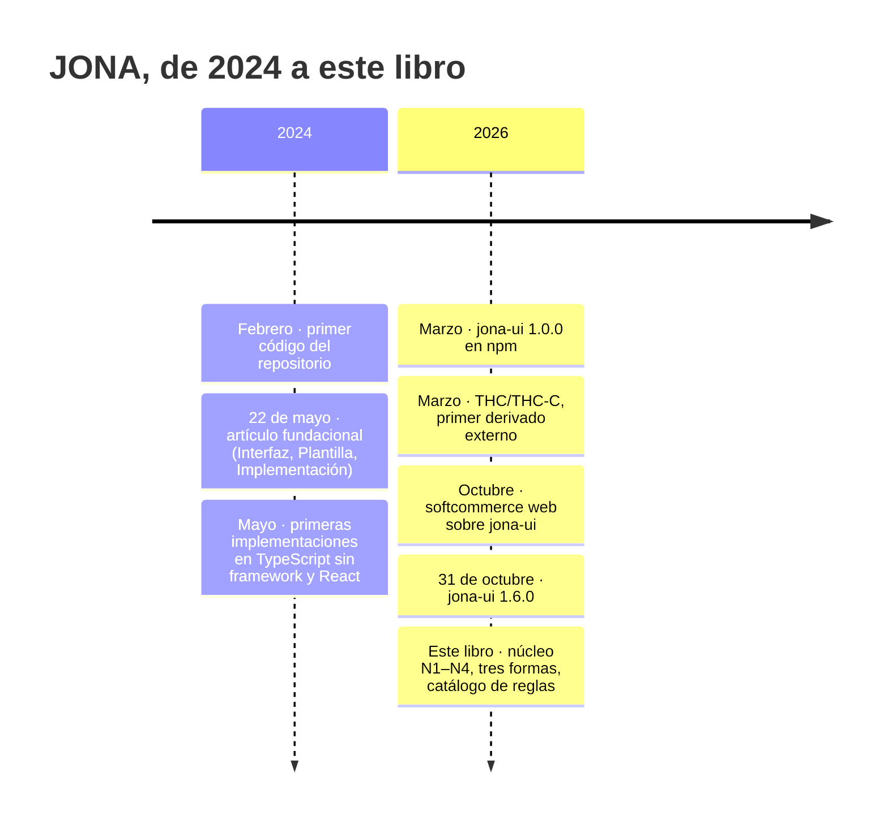
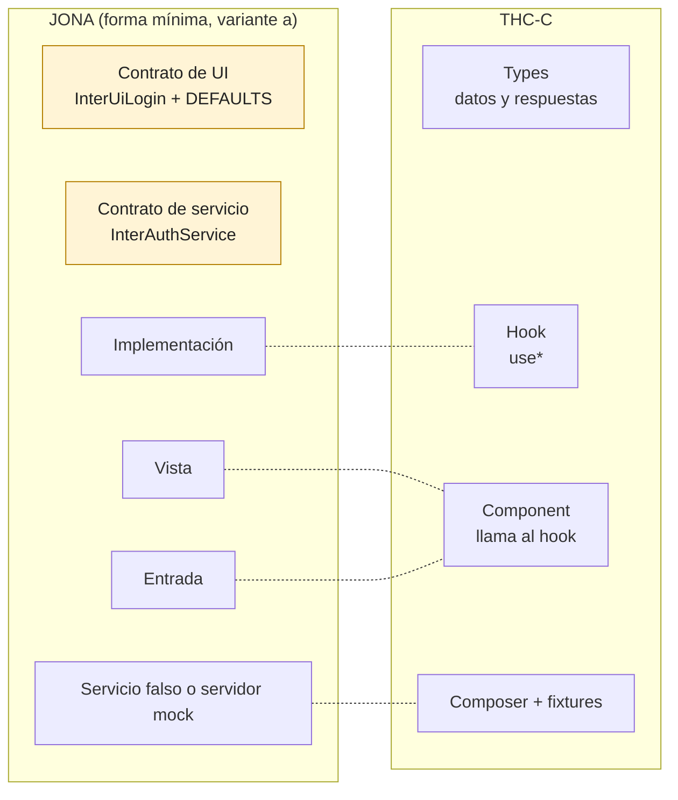
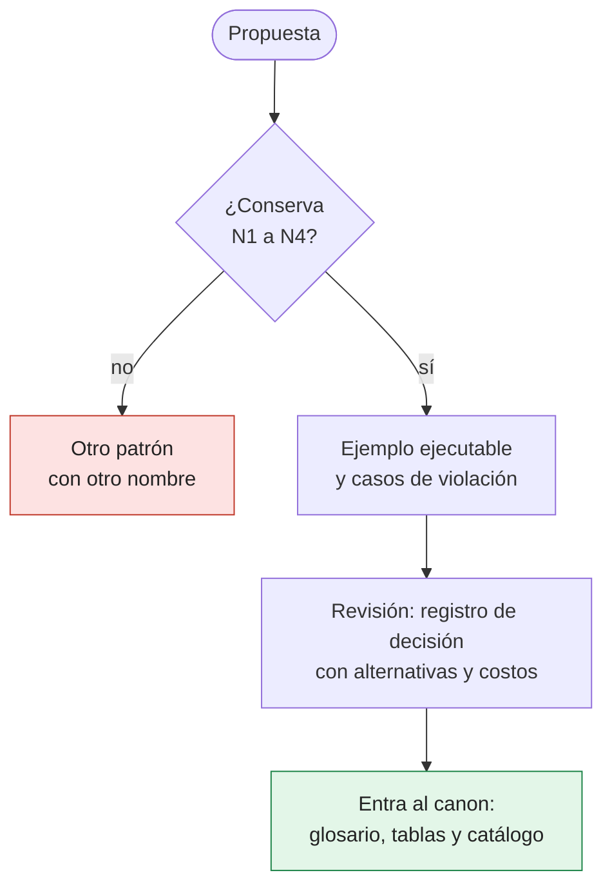

# Capítulo 12. Evolución del patrón y antipatrones

Un patrón que se usa cambia. JONA nació en 2024 como tres clases TypeScript que construían el DOM, y hoy se expresa en una docena de tecnologías, con dos estilos de contrato, tres formas y un catálogo de reglas verificables. Algunos de esos cambios mejoraron el patrón; otros dejaron nombres cruzados, ejemplos que no compilan o atajos que se volvieron costumbre.

Este capítulo cierra el libro mirando hacia atrás y hacia adelante: qué se mantuvo y qué cambió, qué enseña el primer derivado externo del patrón, cuáles son los antipatrones de todo el libro reunidos en un solo lugar, y cómo debería evolucionar el canon a partir de aquí.

> [!IMPORTANT]
> **Regla del capítulo.** El patrón puede cambiar de nombres, de formas y de herramientas. Lo que no puede cambiar sin decirlo es el núcleo: N1 a N4. Una evolución que conserva el núcleo es una forma nueva; una que lo rompe es otro patrón, y debe llamarse de otra manera.

---

## 12.1 Línea de tiempo

Las fechas que siguen se pueden verificar en el artículo fundacional, en el historial del repositorio y en el registro de npm.



*Figura 12.1. Hitos verificables. Entre 2024 y 2026 aparecieron las implementaciones por herencia y por composición que el capítulo 1 enumera; el historial del repositorio no permite fecharlas una por una, porque se reorganizaron de carpeta en 2026.*

---

## 12.2 Qué se mantuvo y qué cambió

| Aspecto | Artículo de 2024 | Hoy (este libro) | Tipo de cambio |
|---|---|---|---|
| Separar el contrato de la implementación | Interfaz de métodos | Contrato de UI (capacidades o modelo de vista) y contrato de servicio | **Se mantuvo**, y se precisó (N1) |
| Comportamiento base intercambiable | Clase Plantilla | Plantilla (clásica), modelo base (extendida) o servicio falso | **Se mantuvo**, con tres mecanismos |
| La integración solo en la Implementación | La capa `controllers` solo la llama la Implementación | N3: efectos solo en la Implementación y los adaptadores | **Se mantuvo**, y se volvió regla |
| Punto de composición | Implícito | La entrada (N4) | **Se agregó** |
| Vista pura | La Plantilla dibujaba y daba comportamiento | Vista que solo dibuja (formas por composición) | **Se agregó** |
| Mecanismo | Herencia de clases | Herencia o composición, según la tecnología | **Se amplió** |
| Contrato con el backend | No aparece | Contrato de API conjunto y servidor mock | **Se agregó** |
| Verificación | No aparece | Catálogo de reglas con pruebas en tres tecnologías | **Se agregó** |
| Roles | No aparecen | Diseñador de UI, integrador, backend, QA, arquitecto | **Se agregó** |

La lectura es que la intención del artículo sobrevivió intacta. Lo que cambió fue cuánto de esa intención quedó escrito como regla verificable.

### La nomenclatura previa

Entre el artículo y este libro hubo una etapa con otros nombres. Algunas implementaciones de referencia del repositorio, como `web_ts/appjona_codex_react_hooks`, usan:

| Pieza | Nomenclatura previa | Canon de este libro |
|---|---|---|
| Punto de composición | `UiIniciarSesionView.tsx` («View Orchestrator») | `UiIniciarSesion.tsx`, la **entrada** |
| Dibujo | `UiIniciarSesion.tsx` | `UiIniciarSesionView.tsx`, la **vista** |
| Estado y comportamiento por defecto | `UiIniciarSesionTemplateModel.ts` | `UiIniciarSesionBase.ts`, el **modelo base** |

Los nombres se cruzan: «View» designaba al orquestador, y el archivo sin sufijo, al dibujo. La estructura respeta la intención del núcleo, pero un verificador que reconoce los roles por el nombre la lee al revés. El verificador del capítulo 9, ejecutado sobre esa aplicación, informa:

```text
JONA-N4 App.tsx:2 importa views/uihome/UiHomeView.tsx, interno de la unidad views/uihome; use su entrada: views/uihome/UiHome.tsx
```

El mensaje es falso en los dos sentidos: `UiHomeView.tsx` **es** la entrada, y `UiHome.tsx`, el archivo que sugiere, es el dibujo. No es un error de estructura, sino de nombres. Por eso este libro trata la nomenclatura como parte del contrato del patrón: es lo que permite que las herramientas, y las personas, reconozcan cada pieza sin leer su código. El ejemplo de la sección 12.6 lo demuestra con una reconstrucción mínima, antes y después del cambio de nombres.

---

## 12.3 Un derivado: THC y THC-C

En marzo de 2026, Harol Rodriguez publicó el patrón **THC** (*Types · Hooks · Components*) y su variante **THC-C**, que agrega un *Composer*. El artículo se declara «basado en el Patrón JONA» y lo adapta a librerías reactivas como React, Vue y Alpine. Es el primer derivado externo conocido, y su análisis enseña tanto sobre JONA como sobre el propio THC.

<https://medium.com/@elbugdepajarito/patr%C3%B3n-thc-thc-c-2e7887a03921>

### Qué propone

- **Tres capas siempre:** *Types* (datos, sin lógica), *Hooks* (la lógica: validación, estado, llamadas a servicios; el hook es «el orquestador del feature») y *Components* (render e interacción, sin lógica de negocio).
- **El *Composer* (THC-C):** un punto de intercambio entre la implementación real y un mock que lee *fixtures* por escenario, una carpeta por caso. En la variante A intercambia una función; en la B, un objeto de servicio, con un `composeConfig` global que dice qué *features* están en modo mock.
- **Capas opcionales** (servicios, repositorios, *mappers*, validadores, *store*) que se agregan «solo cuando el feature las necesita», y **cinco niveles** de escalado, de tres archivos a doce.
- **Un patrón micro:** «THC no organiza proyectos. Organiza features», y convive con FSD o Hexagonal.
- **Un flujo con BDD:** QA escribe el plan de pruebas, y cada caso hoja se convierte en una carpeta de *fixtures*. El capítulo 5 ya comparó ese flujo con el de JONA.

### Cómo se corresponde con JONA



*Figura 12.2. Las líneas punteadas unen piezas con la misma responsabilidad. El componente de THC reúne la vista y la entrada. Las cajas ámbar, el contrato de UI y el de servicio, no tienen una pieza propia en THC-C; los *Types* describen datos, no lo que la unidad ofrece.*

| Pieza de JONA | En THC-C | Observación |
|---|---|---|
| Contrato de UI | No existe como pieza | El tipo de lo que devuelve el hook se infiere; no hay un acuerdo escrito entre quien dibuja y quien integra |
| Contrato de servicio | No existe como pieza | El servicio real y el mock coinciden por forma, no por una interfaz declarada |
| Implementación | Hook | Equivalente; el artículo lo llama orquestador |
| Vista y entrada | Component, que llama al hook | Se fusionan: para dibujar el componente hay que ejecutar el hook |
| Punto de sustitución | *Composer* | Un interruptor en un módulo, en lugar de la inyección por la entrada |
| Servidor mock con escenarios | *Fixtures* por carpeta | Los escenarios viven dentro de la aplicación; no se ejercita el adaptador HTTP real |
| Contrato de API | Swagger del backend («el Swagger gana») | Lo dicta un lado; en JONA se acuerda entre los dos |

Medido contra el núcleo, THC-C cumple N2 (los *Types* no tienen comportamiento) y en lo esencial N3 (el componente no llama a servicios). Cumple N4 a nivel de *feature*, con su archivo `[feature].tsx`. Donde se separa es en N1: no hay contrato de UI ni contrato de servicio como piezas propias. Según la sección 1.8, una unidad THC-C no es JONA, y el artículo tampoco dice serlo: se declara **basado** en JONA. Es exactamente lo que la regla de este capítulo pide.

### Lo que el código del artículo muestra

El artículo incluye código, y vale la pena tomarlo en serio, porque los lectores lo copian. El ejemplo de la sección 12.6 reconstruye sus formas (no su texto), las compila con TypeScript y las empaqueta con esbuild. Estas son las observaciones, todas medidas:

| # | Observación | Lo que mide el ejemplo |
|---|---|---|
| 1 | El *fixture* `emailDuplicado` agrega `code: 'EMAIL_DUPLICADO'`, que `ApiErrorResponse` no declara | TypeScript lo rechaza: TS2353, *Object literal may only specify known properties, and 'code' does not exist in type 'ApiErrorResponse'* |
| 2 | El plan de pruebas incluye `503 EMAIL_SERVICE_UNAVAILABLE`, pero la unión de estados es `400 \| 401 \| 409 \| 500` | Un *fixture* con `status: 503` no compila: TS2322 |
| 3 | El *Composer* de la variante B importa el mock de forma estática y elige con una condición | Con `useMock: false`, esbuild **no** elimina el mock: va en el paquete de entrada. Sin división en fragmentos, también van todos los *fixtures*, incluido el que no compila |
| 4 | El servicio real devuelve `response.json()` como `ApiResponse<T>`, que lleva `status` **dentro** del cuerpo | Con un backend típico, que envía el código en HTTP y no en el cuerpo, `result.status` es `undefined`. Un 201 con la cuenta creada se muestra como error, y sin mensaje |
| 5 | El *hook* del artículo usa `result.error` en la rama `else` | No compila: TS2339. `status: 200 \| 201` no es un único literal, así que la rama `else` no estrecha la unión. La variante con TanStack Query del propio artículo usa un *cast* que lo evita |

La observación 4 es la más seria, porque no la detecta el compilador. Esta tabla resume lo que el ejemplo mide con un `fetch` simulado:

| Respuesta del backend | `result.status` | Lo que muestra la pantalla |
|---|---|---|
| *Fixture* del mock: `{ status: 409, error }` | `409` | El error, como se espera |
| HTTP 409, cuerpo `{ error }` | `undefined` | El error, pero solo porque `undefined` no es 200 ni 201 |
| HTTP 201, cuerpo con la cuenta creada | `undefined` | **Un error sin mensaje**: el alta funcionó y la pantalla dice lo contrario |

El mock y el backend real cumplen contratos distintos, y nada lo detecta hasta la integración. Es exactamente el problema que el servidor mock de JONA resuelve: el adaptador HTTP real corre desde el primer día contra un servidor que responde como el backend, con el código en HTTP y el error en el cuerpo (capítulo 3).

Ninguna de estas observaciones invalida la idea de THC-C. Muestran algo más general, que la ficha [Ejemplos que nadie compiló](#ap-12-4) desarrolla: el código de la documentación de un patrón es parte del patrón, y si no se ejecuta, se degrada.

### Lo que JONA puede aprender de THC-C

El análisis no es solo una lista de faltas. THC-C acierta en cosas que este libro trata con menos fuerza:

- **El escalado gradual, explícito.** Los cinco niveles de THC dicen qué agregar y cuándo. El capítulo 10 decide por unidad entre usar JONA o no, pero la escalera de piezas de la sección 10.4 es menos concreta que los niveles de THC.
- **Los *fixtures* como artefacto del equipo.** «La Mock Library es un artefacto del equipo, no de Front IMP»: QA co-construye los escenarios porque son la traducción directa de los criterios de aceptación. La tabla de dueños del capítulo 5 dice lo mismo de los escenarios del servidor mock; THC-C lo dice mejor.
- **Un mapa central del modo de cada *feature*.** El `composeConfig` responde de un vistazo qué partes de la aplicación están contra el mock. Con el servidor mock, la respuesta está repartida entre la URL base y las cabeceras de cada prueba. Para demostraciones, la idea es útil.

---

## 12.4 Catálogo de antipatrones

Cada capítulo cerró con sus antipatrones. Esta sección los reúne en dos índices: uno por la promesa que rompen y otro, completo, por capítulo. Una prueba del libro (`herramientas/antipatrones`) verifica que este catálogo y las fichas de los capítulos coincidan: si un capítulo gana o pierde una ficha, el catálogo falla hasta actualizarse.

> [!NOTE]
> La gravedad de cada ficha se lee con la leyenda de su capítulo: 🔴 en el capítulo de verificación no significa lo mismo que 🔴 en el de decisiones. Cuando un mismo antipatrón aparece en varios capítulos, puede tener gravedades distintas.

### Por promesa

| Promesa | Antipatrones |
|---|---|
| **N1** · contratos explícitos | [Implementación atada al adaptador](02-anatomia.md#ap-2-3) · [Un servicio artificial para «cumplir N1»](02-anatomia.md#ap-2-6) · [El contrato es la clase del modelo de vista](07-mvc-mvp-mvvm.md#ap-7-1) · [Contrato de datos sin contrato de unidad](#ap-12-2) |
| **N2** · contratos sin comportamiento | [Contrato con comportamiento](02-anatomia.md#ap-2-4) · [Comportamiento en el contrato](03-contratos.md#ap-3-1) · `DEFAULTS` con estado ([cap. 2](02-anatomia.md#ap-2-5), [cap. 3](03-contratos.md#ap-3-3), [cap. 8](08-sistemas-de-diseno.md#ap-8-5)) |
| **N3** · efectos solo en la Implementación y los adaptadores | [La vista llama al servicio](02-anatomia.md#ap-2-1) · [Efecto en `model/`](06-atomic-fsd-hexagonal.md#ap-6-2) · [Modelo que llama a la red](07-mvc-mvp-mvvm.md#ap-7-2) · [Organismo con negocio](06-atomic-fsd-hexagonal.md#ap-6-1) |
| **N4** · solo la entrada | [Importar una pieza interna](02-anatomia.md#ap-2-2) · [API pública ancha en una aplicación](06-atomic-fsd-hexagonal.md#ap-6-3) · [La navegación arma las piezas](07-mvc-mvp-mvvm.md#ap-7-3) |
| **Contrato primero, conjunto** | [El frontend espera al backend](05-roles-y-flujo.md#ap-5-1) · [El backend dicta el contrato](05-roles-y-flujo.md#ap-5-2) · [Mock inventado](05-roles-y-flujo.md#ap-5-3) · [Contrato inventado](11-migracion.md#ap-11-3) · [Suite de contrato solo en el frontend](09-verificacion-y-gobierno.md#ap-9-3) · [Mock en el paquete de producción](#ap-12-3) |
| **Verificación** | [Reglas en la wiki](09-verificacion-y-gobierno.md#ap-9-1) · [Regla sin caso de violación](09-verificacion-y-gobierno.md#ap-9-2) · [Regla sin trinquete](08-sistemas-de-diseno.md#ap-8-6) · [Migración sin trinquete](11-migracion.md#ap-11-7) · [Ejemplos que nadie compiló](#ap-12-4) |
| **Nombres** | [JONA de nombres](10-decisiones-y-compromisos.md#ap-10-1) · [Renombrar sin separar](11-migracion.md#ap-11-6) · [Colisión de «plantilla»](06-atomic-fsd-hexagonal.md#ap-6-6) · [Nomenclatura cruzada](#ap-12-1) |

### Por capítulo

<!-- CATALOGO:INICIO -->
| | Antipatrón | Capítulo |
|:-:|---|---|
| 🔴 | [La vista llama al servicio](02-anatomia.md#ap-2-1) | 2. Anatomía: el núcleo invariante, las formas del patrón y su glosario |
| 🔴 | [Importar una pieza interna](02-anatomia.md#ap-2-2) | 2. Anatomía: el núcleo invariante, las formas del patrón y su glosario |
| 🔴 | [Implementación atada al adaptador](02-anatomia.md#ap-2-3) | 2. Anatomía: el núcleo invariante, las formas del patrón y su glosario |
| 🟠 | [Contrato con comportamiento](02-anatomia.md#ap-2-4) | 2. Anatomía: el núcleo invariante, las formas del patrón y su glosario |
| 🟠 | [`DEFAULTS` con estado](02-anatomia.md#ap-2-5) | 2. Anatomía: el núcleo invariante, las formas del patrón y su glosario |
| 🟡 | [Un servicio artificial para «cumplir N1»](02-anatomia.md#ap-2-6) | 2. Anatomía: el núcleo invariante, las formas del patrón y su glosario |
| 🔴 | [Comportamiento en el contrato](03-contratos.md#ap-3-1) | 3. Contratos: capacidades, datos, eventos y valores por defecto |
| 🟠 | [Tipos de transporte en el contrato de UI](03-contratos.md#ap-3-2) | 3. Contratos: capacidades, datos, eventos y valores por defecto |
| 🟠 | [Estado en `DEFAULTS`](03-contratos.md#ap-3-3) | 3. Contratos: capacidades, datos, eventos y valores por defecto |
| 🟠 | [Detalles de implementación](03-contratos.md#ap-3-4) | 3. Contratos: capacidades, datos, eventos y valores por defecto |
| 🟡 | [Tipos del framework en una pantalla portable](03-contratos.md#ap-3-5) | 3. Contratos: capacidades, datos, eventos y valores por defecto |
| 🟡 | [Contratos gigantes](03-contratos.md#ap-3-6) | 3. Contratos: capacidades, datos, eventos y valores por defecto |
| 🟡 | [Explosión de indicadores booleanos](03-contratos.md#ap-3-7) | 3. Contratos: capacidades, datos, eventos y valores por defecto |
| 🔴 | [Esperar enlace tardío en la forma extendida](04-herencia-y-composicion.md#ap-4-1) | 4. Herencia y composición: el patrón en web, escritorio, móvil y motores de juego |
| 🔴 | [Lanzar el error a través del IPC](04-herencia-y-composicion.md#ap-4-2) | 4. Herencia y composición: el patrón en web, escritorio, móvil y motores de juego |
| 🟠 | [Clase base frágil](04-herencia-y-composicion.md#ap-4-3) | 4. Herencia y composición: el patrón en web, escritorio, móvil y motores de juego |
| 🟠 | [El patrón de la plataforma en lugar de los contratos](04-herencia-y-composicion.md#ap-4-4) | 4. Herencia y composición: el patrón en web, escritorio, móvil y motores de juego |
| 🟠 | [Lógica en el *code-behind*](04-herencia-y-composicion.md#ap-4-5) | 4. Herencia y composición: el patrón en web, escritorio, móvil y motores de juego |
| 🟡 | [JONA en el bucle de juego](04-herencia-y-composicion.md#ap-4-6) | 4. Herencia y composición: el patrón en web, escritorio, móvil y motores de juego |
| 🔴 | [El frontend espera al backend](05-roles-y-flujo.md#ap-5-1) | 5. Roles y flujo de trabajo: diseño, frontend e integración en paralelo |
| 🔴 | [El backend dicta el contrato](05-roles-y-flujo.md#ap-5-2) | 5. Roles y flujo de trabajo: diseño, frontend e integración en paralelo |
| 🔴 | [Mock inventado](05-roles-y-flujo.md#ap-5-3) | 5. Roles y flujo de trabajo: diseño, frontend e integración en paralelo |
| 🟠 | [El integrador edita la vista](05-roles-y-flujo.md#ap-5-4) | 5. Roles y flujo de trabajo: diseño, frontend e integración en paralelo |
| 🟠 | [Una persona «hace todo» sin sombreros](05-roles-y-flujo.md#ap-5-5) | 5. Roles y flujo de trabajo: diseño, frontend e integración en paralelo |
| 🟡 | [Escenarios huérfanos](05-roles-y-flujo.md#ap-5-6) | 5. Roles y flujo de trabajo: diseño, frontend e integración en paralelo |
| 🔴 | [Organismo con negocio](06-atomic-fsd-hexagonal.md#ap-6-1) | 6. JONA junto a Atomic Design, FSD y Clean/Hexagonal |
| 🔴 | [Efecto en `model/`](06-atomic-fsd-hexagonal.md#ap-6-2) | 6. JONA junto a Atomic Design, FSD y Clean/Hexagonal |
| 🟠 | [API pública ancha en una aplicación](06-atomic-fsd-hexagonal.md#ap-6-3) | 6. JONA junto a Atomic Design, FSD y Clean/Hexagonal |
| 🟡 | [Caso de uso de reenvío](06-atomic-fsd-hexagonal.md#ap-6-4) | 6. JONA junto a Atomic Design, FSD y Clean/Hexagonal |
| 🟡 | [Adaptador de vista](06-atomic-fsd-hexagonal.md#ap-6-5) | 6. JONA junto a Atomic Design, FSD y Clean/Hexagonal |
| 🟡 | [Colisión de «plantilla»](06-atomic-fsd-hexagonal.md#ap-6-6) | 6. JONA junto a Atomic Design, FSD y Clean/Hexagonal |
| 🔴 | [El contrato es la clase del modelo de vista](07-mvc-mvp-mvvm.md#ap-7-1) | 7. JONA frente a MVC, MVP, MVVM y contenedor-presentacional |
| 🔴 | [Modelo que llama a la red](07-mvc-mvp-mvvm.md#ap-7-2) | 7. JONA frente a MVC, MVP, MVVM y contenedor-presentacional |
| 🔴 | [La navegación arma las piezas](07-mvc-mvp-mvvm.md#ap-7-3) | 7. JONA frente a MVC, MVP, MVVM y contenedor-presentacional |
| 🟠 | [Llamar MVP a la forma clásica](07-mvc-mvp-mvvm.md#ap-7-4) | 7. JONA frente a MVC, MVP, MVVM y contenedor-presentacional |
| 🟠 | [Dividir por dogma](07-mvc-mvp-mvvm.md#ap-7-5) | 7. JONA frente a MVC, MVP, MVVM y contenedor-presentacional |
| 🟡 | [Reescribir los modelos de vista](07-mvc-mvp-mvvm.md#ap-7-6) | 7. JONA frente a MVC, MVP, MVVM y contenedor-presentacional |
| 🔴 | [Primitivo en la vista](08-sistemas-de-diseno.md#ap-8-1) | 8. Sistemas de diseño con JONA: tokens, temas, accesibilidad y versionado |
| 🔴 | [Contrato accesible por convención](08-sistemas-de-diseno.md#ap-8-2) | 8. Sistemas de diseño con JONA: tokens, temas, accesibilidad y versionado |
| 🔴 | [Versión por intuición](08-sistemas-de-diseno.md#ap-8-3) | 8. Sistemas de diseño con JONA: tokens, temas, accesibilidad y versionado |
| 🟠 | [Dos mecanismos de tema](08-sistemas-de-diseno.md#ap-8-4) | 8. Sistemas de diseño con JONA: tokens, temas, accesibilidad y versionado |
| 🟠 | [Estado en `DEFAULTS`](08-sistemas-de-diseno.md#ap-8-5) | 8. Sistemas de diseño con JONA: tokens, temas, accesibilidad y versionado |
| 🟠 | [Regla sin trinquete](08-sistemas-de-diseno.md#ap-8-6) | 8. Sistemas de diseño con JONA: tokens, temas, accesibilidad y versionado |
| 🟡 | [Historias como única documentación del contrato](08-sistemas-de-diseno.md#ap-8-7) | 8. Sistemas de diseño con JONA: tokens, temas, accesibilidad y versionado |
| 🔴 | [Reglas en la wiki](09-verificacion-y-gobierno.md#ap-9-1) | 9. Verificación y gobierno: cómo comprobar el patrón de forma automática |
| 🔴 | [Regla sin caso de violación](09-verificacion-y-gobierno.md#ap-9-2) | 9. Verificación y gobierno: cómo comprobar el patrón de forma automática |
| 🔴 | [Suite de contrato solo en el frontend](09-verificacion-y-gobierno.md#ap-9-3) | 9. Verificación y gobierno: cómo comprobar el patrón de forma automática |
| 🟠 | [Lista de excepciones que crece](09-verificacion-y-gobierno.md#ap-9-4) | 9. Verificación y gobierno: cómo comprobar el patrón de forma automática |
| 🟠 | [Excepciones en comentarios](09-verificacion-y-gobierno.md#ap-9-5) | 9. Verificación y gobierno: cómo comprobar el patrón de forma automática |
| 🟠 | [Omitidas que cuentan como superadas](09-verificacion-y-gobierno.md#ap-9-6) | 9. Verificación y gobierno: cómo comprobar el patrón de forma automática |
| 🟡 | [Reglas en una sola tecnología](09-verificacion-y-gobierno.md#ap-9-7) | 9. Verificación y gobierno: cómo comprobar el patrón de forma automática |
| 🟡 | [Gobernar por cobertura](09-verificacion-y-gobierno.md#ap-9-8) | 9. Verificación y gobierno: cómo comprobar el patrón de forma automática |
| 🔴 | [JONA de nombres](10-decisiones-y-compromisos.md#ap-10-1) | 10. Decisiones y compromisos: cuándo usar JONA y cuándo no |
| 🔴 | [JONA en todo](10-decisiones-y-compromisos.md#ap-10-2) | 10. Decisiones y compromisos: cuándo usar JONA y cuándo no |
| 🟠 | [Parcial sin decirlo](10-decisiones-y-compromisos.md#ap-10-3) | 10. Decisiones y compromisos: cuándo usar JONA y cuándo no |
| 🟠 | [Decisión sin revisión](10-decisiones-y-compromisos.md#ap-10-4) | 10. Decisiones y compromisos: cuándo usar JONA y cuándo no |
| 🟠 | [Forma extendida por defecto](10-decisiones-y-compromisos.md#ap-10-5) | 10. Decisiones y compromisos: cuándo usar JONA y cuándo no |
| 🟡 | [Rechazarlo contando archivos](10-decisiones-y-compromisos.md#ap-10-6) | 10. Decisiones y compromisos: cuándo usar JONA y cuándo no |
| 🔴 | [Reescritura de una vez](11-migracion.md#ap-11-1) | 11. Migración: de código heredado a JONA y entre tecnologías |
| 🔴 | [Migrar sin red](11-migracion.md#ap-11-2) | 11. Migración: de código heredado a JONA y entre tecnologías |
| 🔴 | [Contrato inventado](11-migracion.md#ap-11-3) | 11. Migración: de código heredado a JONA y entre tecnologías |
| 🟠 | [Migración y funcionalidad juntas](11-migracion.md#ap-11-4) | 11. Migración: de código heredado a JONA y entre tecnologías |
| 🟠 | [Corregir rarezas en el camino](11-migracion.md#ap-11-5) | 11. Migración: de código heredado a JONA y entre tecnologías |
| 🟠 | [Renombrar sin separar](11-migracion.md#ap-11-6) | 11. Migración: de código heredado a JONA y entre tecnologías |
| 🟡 | [Migración sin trinquete](11-migracion.md#ap-11-7) | 11. Migración: de código heredado a JONA y entre tecnologías |
| 🟡 | [Portar línea por línea](11-migracion.md#ap-11-8) | 11. Migración: de código heredado a JONA y entre tecnologías |
| 🔴 | [Nomenclatura cruzada](#ap-12-1) | 12. Evolución del patrón y antipatrones |
| 🟠 | [Contrato de datos sin contrato de unidad](#ap-12-2) | 12. Evolución del patrón y antipatrones |
| 🟠 | [Mock en el paquete de producción](#ap-12-3) | 12. Evolución del patrón y antipatrones |
| 🟡 | [Ejemplos que nadie compiló](#ap-12-4) | 12. Evolución del patrón y antipatrones |
<!-- CATALOGO:FIN -->

---

## 12.5 Antipatrones de la evolución

> [!CAUTION]
> Estos antipatrones no aparecen al escribir una pantalla, sino al transmitir el patrón: en un artículo, en una implementación de referencia o en un derivado. Por eso se copian, y por eso conviene nombrarlos.

**Referencia rápida**

| | Antipatrón | Se reconoce porque… | Qué lo evita |
|:-:|---|---|---|
| 🔴 | [Nomenclatura cruzada](#ap-12-1) | El sufijo de un rol nombra a otro rol | El glosario del capítulo 2 y un verificador por nombres |
| 🟠 | [Contrato de datos sin contrato de unidad](#ap-12-2) | Hay tipos de datos, pero nada declara qué ofrece la unidad | Un contrato de UI y uno de servicio, aunque sean breves |
| 🟠 | [Mock en el paquete de producción](#ap-12-3) | El intercambio importa el mock de forma estática | Carga diferida del mock, o un servidor mock fuera de la aplicación |
| 🟡 | [Ejemplos que nadie compiló](#ap-12-4) | El código de la documentación no pasa el compilador | Ejemplos ejecutables, en el pipeline |

🔴 las herramientas y las personas leen mal la estructura · 🟠 se pierde una garantía del patrón sin que se note · 🟡 la documentación enseña algo que no funciona

---

<a id="ap-12-1"></a>
### 🔴 Nomenclatura cruzada

**Síntoma.** El sufijo de un rol designa a otro: el orquestador se llama `*View` y el dibujo no tiene sufijo.

❌ **Así no** (nomenclatura previa)

```text
uiiniciarsesion/
├── UiIniciarSesionView.tsx           # orquestador: crea la Implementación y la pasa al dibujo
├── UiIniciarSesion.tsx               # dibujo
└── UiIniciarSesionTemplateModel.ts   # modelo base
```

✅ **Así sí** (canon)

```text
uiiniciarsesion/
├── UiIniciarSesion.tsx               # entrada
├── UiIniciarSesionView.tsx           # vista
└── UiIniciarSesionBase.ts            # modelo base
```

**Por qué duele.** Un lector entrena el ojo con los nombres, y un verificador también. Con los nombres cruzados, el verificador del capítulo 9 marca como violación la importación correcta y sugiere importar el dibujo (sección 12.2). **Cómo no caer:** el glosario del capítulo 2 es parte del contrato del patrón; una migración de nombres es un paso de migración más (capítulo 11), con su propio cambio.

---

<a id="ap-12-2"></a>
### 🟠 Contrato de datos sin contrato de unidad

**Síntoma.** La unidad tiene tipos para los datos y las respuestas, pero nada declara qué le ofrece la lógica a la vista ni qué le pide la lógica al sistema. El tipo del hook se infiere de lo que devuelve.

❌ **Así no** (ilustrativo, con la forma de THC)

```ts
// types/crearCuenta.types.ts: solo datos
export interface CrearCuentaFormData { nombre: string; email: string; password: string }

// hooks/useCrearCuenta.ts: el «contrato» es lo que esta función devuelva hoy
export function useCrearCuenta() { /* ... */ return { formData, errors, isLoading, updateField, registrar }; }
```

✅ **Así sí:** el acuerdo se escribe antes que la lógica.

```ts
export interface InterUiCrearCuenta {
  formData: CrearCuentaFormData;
  errors: CrearCuentaErrors;
  isLoading: boolean;
  onChangeField?: (value: string, field: keyof CrearCuentaFormData) => void;
  onSubmit?: () => void;
}
export interface InterCuentaService {
  registrar(data: CrearCuentaFormData): Promise<Cuenta>;
}
```

**Por qué duele.** Quien dibuja no puede empezar sin la lógica, porque no hay un acuerdo escrito, y el servicio real y el mock coinciden por casualidad, no por contrato. **Cómo no caer:** N1. El caso `n1-unidad-sin-contrato` de `ejemplos/gobierno/ts/fixtures/` muestra que el verificador lo detecta cuando la unidad sigue la convención de nombres.

---

<a id="ap-12-3"></a>
### 🟠 Mock en el paquete de producción

**Síntoma.** El punto de intercambio importa el mock y sus *fixtures* de forma estática, y elige con una condición.

❌ **Así no** (con la forma de la variante B de THC-C)

```ts
import { cuentaService as real } from './cuentaService';
import { cuentaService as mock } from './cuentaService.mock';
export const cuentaService = composeConfig.registro.useMock ? mock : real;
```

✅ **Así sí:** el mock se carga con un `import()` dinámico solo si se pide, como hace `softcommerce` (`src/services/serviceComposer.ts`); o vive fuera de la aplicación, en un servidor mock.

```ts
loadMock: async (scenario) => (await loadMock(scenario)).auth,   // import() dinámico
```

**Por qué duele.** El ejemplo de la sección 12.6 lo mide con esbuild: con la importación estática, el mock va en el paquete que descarga cada usuario aunque `useMock` sea `false`. Con el `import()` dinámico, el paquete de entrada ya no lo lleva, pero el mock y sus *fixtures* siguen publicándose como fragmentos aparte. Datos de prueba, y a veces nombres, correos o tokens de ejemplo, quedan accesibles en el servidor de producción. **Cómo no caer:** el `import()` dinámico evita la descarga; para que el mock no se publique, la condición tiene que resolverse al compilar (una variable de entorno que el empaquetador reemplace) o el mock tiene que vivir fuera de la aplicación. En los dos casos, una prueba del empaquetado que busque una marca de los *fixtures* en la salida lo comprueba.

---

<a id="ap-12-4"></a>
### 🟡 Ejemplos que nadie compiló

**Síntoma.** El código de un artículo, de un README o de un libro se ve bien, pero no pasa el compilador o no hace lo que dice el texto.

❌ **Así no:** el *hook* del artículo de THC-C, reconstruido y compilado (sección 12.3, observación 5).

```text
error TS2339: Property 'error' does not exist on type 'ApiResponse<Cuenta>'.
  Property 'error' does not exist on type 'ApiSuccessResponse<Cuenta>'.
```

✅ **Así sí:** cada fragmento de código del libro sale de un ejemplo que `npm run all:limpio` compila y prueba desde cero.

**Por qué duele.** Los ejemplos son la parte de la documentación que más se copia. Un error en un ejemplo se multiplica en cada proyecto que lo adopta, y desacredita el texto que lo rodea. **Cómo no caer:** los ejemplos se ejecutan en el pipeline, como hace este libro con `ejemplos/run-all.mjs`. En el ejemplo de THC-C, el compilador encontró tres errores de tipos y una prueba encontró un error de comportamiento que el compilador no ve.

---

## 12.6 El ejemplo

El ejemplo `ejemplos/evolucion/` tiene dos partes y 26 pruebas. Usa el verificador del capítulo 9, copiado y vigilado por una prueba, como el ejemplo del capítulo 11.

| Parte | Qué demuestra |
|---|---|
| `nomenclatura/` | La misma unidad con la nomenclatura previa (`antes/`) y con la canónica (`despues/`): el verificador lee mal la primera y aprueba la segunda, y el cambio es solo de nombres |
| `thc-c/` | Las cinco observaciones de la sección 12.3, sobre una reconstrucción del código del artículo |

### Nomenclatura: el mismo código, otros nombres

En `antes/`, el orquestador se llama `UiIniciarSesionView`:

```ts
// Orquestador: instancia la Implementación y se la entrega al render.
import { UiIniciarSesion } from './UiIniciarSesion.js';
import { useUiIniciarSesionImpl } from './UiIniciarSesionImpl.js';

export function UiIniciarSesionView(email: string): string {
  const impl = useUiIniciarSesionImpl();
  impl.email = email;
  impl.handlerLogin();
  return UiIniciarSesion(impl);
}
```

El verificador informa una sola violación, y la prueba fija tanto el mensaje como su error:

```ts
it('en antes/ informa una sola violación: N4 en App.ts, que importa el orquestador', () => {
  assert.deepEqual(revisar(ANTES), [{
    regla: 'JONA-N4', archivo: 'App.ts', linea: 3,
    mensaje: `importa ${UNIDAD}/UiIniciarSesionView.ts, interno de la unidad ${UNIDAD}; use su entrada: ${UNIDAD}/UiIniciarSesion.ts`,
  }]);
});

it('la "entrada" que sugiere es el render: el archivo que no instancia la Implementación', () => { /* … */ });
```

`despues/` se generó aplicando las reglas de `nomenclatura/mapeo.json`, que dicen qué rol tenía cada sufijo y cuál tiene en el canon:

| Rol | Antes | Después |
|---|---|---|
| Orquestador (instancia la Implementación) | `{U}View` | `{U}`, la entrada |
| Dibujo | `{U}` | `{U}View`, la vista |
| Modelo base | `{U}TemplateModel` | `{U}Base` |
| Función del modelo base | `use{U}` | `use{U}Base` |

Los cambios de nombre se aplican a la vez y no en cadena, porque el orquestador y el dibujo intercambian nombres. Las pruebas verifican que la lista de archivos de `antes/`, con las reglas aplicadas, es exactamente la de `despues/`; que cada archivo, con sus identificadores renombrados, es idéntico byte a byte a su par; y que la aplicación da el mismo resultado en los dos árboles. Con eso queda probado que el cambio es **solo de nombres**: la estructura ya cumplía el núcleo. En `despues/`, el verificador no encuentra ninguna violación.

Una prueba más ejecuta el verificador, en modo de solo lectura, sobre la aplicación real del repositorio (`web_ts/appjona_codex_react_hooks`), y exige el mismo mensaje engañoso de la sección 12.2.

### THC-C: el compilador y el empaquetador

Los archivos reconstruidos citan el artículo en su encabezado y dicen que son una reconstrucción para análisis. Los dos *fixtures* que no compilan quedan fuera del `tsconfig.json` del ejemplo; las pruebas los compilan aparte con la API de TypeScript y comprueban el código de cada diagnóstico (TS2353, TS2322 y, para el *hook*, TS2339).

La prueba del empaquetado compara tres configuraciones con `useMock: false`:

| Configuración | Paquete de entrada | ¿Lleva el mock? | ¿Lleva los *fixtures*? |
|---|---:|:-:|:-:|
| *Composer* estático, un solo archivo | 1730 B | Sí | Sí, todos, incluido el que no compila |
| *Composer* estático, con fragmentos | 1126 B | Sí | No: van en fragmentos que se publican con la entrada |
| *Composer* con `import()` dinámico, con fragmentos | 777 B | No | No: el mock y los *fixtures* van en fragmentos aparte |

```ts
// Alternativa: el mock se carga con import() dinámico, como en softcommerce.
export const crearCuentaService: typeof real = composeConfig.register.useMock
  ? { registrar: async (data) => (await import('./crearCuentaService.mock.js')).crearCuentaService.registrar(data) }
  : real;
```

Una advertencia de medición: esbuild solo empaqueta la importación de *fixtures* del artículo (`import(\`@/fixtures/${SCENARIO}/crearCuenta.fixture\`)`) si la ruta es relativa y termina en `.ts`. Sin extensión, como en el artículo, esbuild avisa que el patrón no coincide con ningún archivo y no incluye ningún *fixture*: el mock fallaría al ejecutarse. El ejemplo usa la forma que esbuild sí resuelve. No se midió el comportamiento de Vite.

### Límites del ejemplo

- La reconstrucción reproduce las formas del artículo, no su texto. Donde el artículo no muestra un tipo (la entidad de verificación de correo), el ejemplo usa uno mínimo.
- El artículo importa `ApiResponse` y `Cuenta` desde `crearCuenta.types`, pero los define en otros archivos; el ejemplo los reexporta para que las importaciones resuelvan.
- Las medidas del empaquetado son de esbuild 0.25 con salida minificada; otro empaquetador puede eliminar más o menos código.

---

## 12.7 Cómo debería evolucionar el canon

Un patrón sin reglas de evolución termina en una familia de dialectos incompatibles. La propuesta de este libro es tratar el canon como se trata una biblioteca: con una superficie estable, cambios clasificados y un proceso para proponerlos.

| Cambio | Ejemplos | Qué exige |
|---|---|---|
| **Compatible:** una forma nueva | Una forma para una plataforma que hoy no tiene una natural | Cumple N1 a N4; un ejemplo ejecutable; su fila en las tablas de los capítulos 2 y 4 |
| **Compatible:** una regla nueva en el catálogo | Una regla sobre accesibilidad en el contrato | Implementación en cada tecnología, caso de violación y trinquete (capítulo 9) |
| **Compatible:** nomenclatura por plataforma | Sufijos idiomáticos en Kotlin o Swift | Una tabla de correspondencia con el glosario, que el verificador pueda usar |
| **Incompatible:** cambiar el núcleo | Permitir efectos en la vista, o contratos con comportamiento | No es una evolución de JONA: es otro patrón, y debe llamarse de otra manera |



*Figura 12.3. El filtro es el núcleo. Todo lo demás se puede proponer, siempre con un ejemplo que se ejecute y un registro de la decisión.*

Para los derivados, como THC-C, la regla es la misma que el artículo de THC ya aplica: decir de dónde viene y en qué se separa. Un derivado que no cumple N1 no es «JONA para React»; es un patrón propio basado en JONA, con sus aciertos y sus límites, y es más útil para todos si lo dice así.

---

## 12.8 Resumen

- La intención del artículo de 2024 sobrevivió intacta. Lo que cambió fue cuánto de ella quedó escrito como regla verificable: la entrada, la vista pura, el contrato conjunto con el backend, los roles y el catálogo de reglas.
- La nomenclatura es parte del contrato del patrón. Con los nombres previos cruzados, un verificador por nombres lee la estructura al revés.
- THC-C es el primer derivado externo: acierta en el escalado gradual, en los *fixtures* como artefacto del equipo y en un mapa central del modo mock; se separa de JONA en N1, porque no tiene contrato de UI ni contrato de servicio como piezas propias. Su código, compilado y empaquetado, muestra tres errores de tipos, el mock en el paquete de producción y una asimetría entre el mock y el backend real que solo una prueba detecta.
- Los antipatrones del libro se reúnen en un catálogo por promesa y por capítulo, protegido por una prueba.
- Los antipatrones de la evolución son los que se transmiten: nombres cruzados, contratos solo de datos, mocks en producción y ejemplos que nadie compiló.
- El canon evoluciona con un filtro: lo que conserva N1 a N4 es una forma o una regla nueva; lo que lo rompe es otro patrón.
