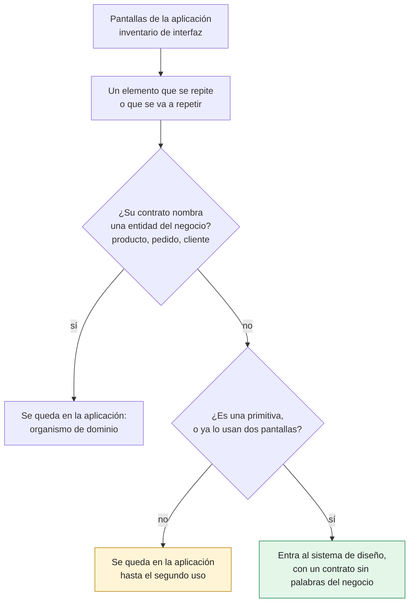
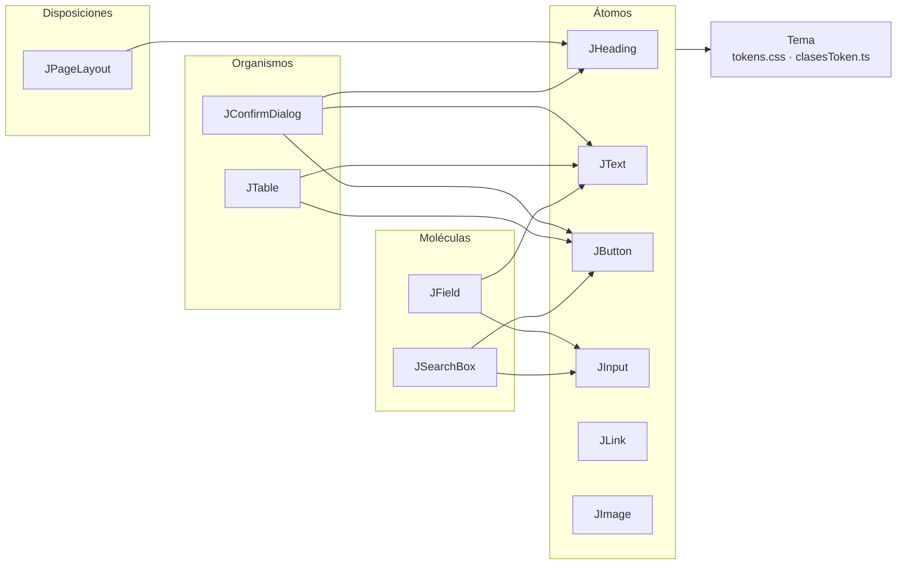
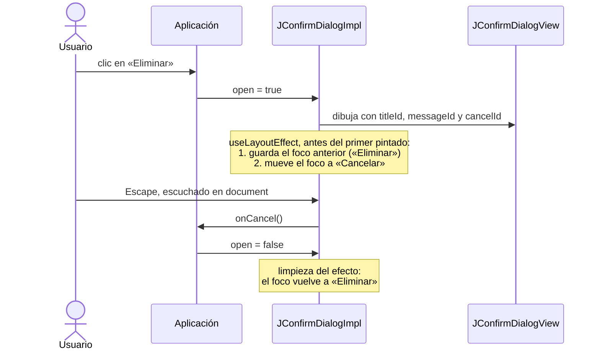
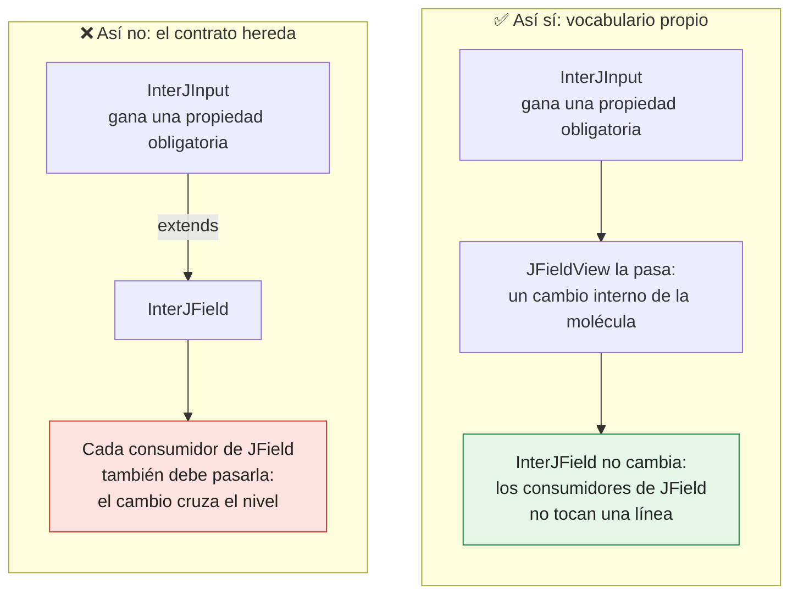
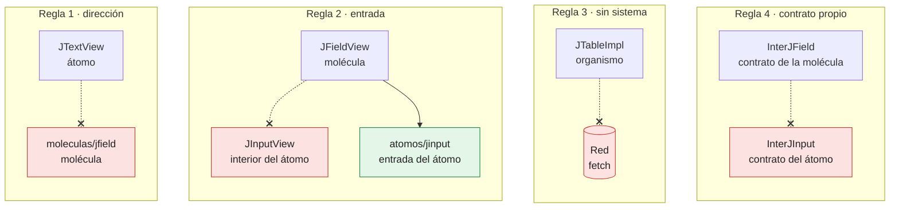
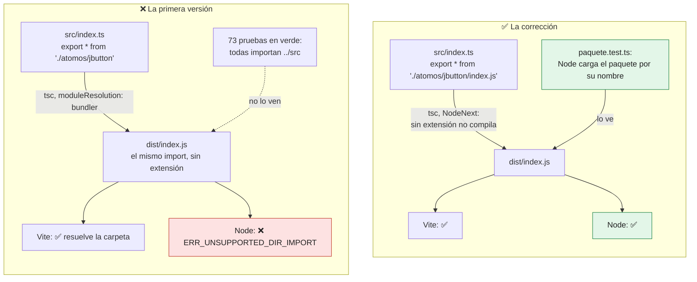

# Capítulo 13. Construir un sistema de diseño con Atomic Design y JONA

El capítulo 6 decidió cómo conviven Atomic Design y JONA: cualquier nivel atómico puede ser una unidad JONA, sin contrato de servicio. El capítulo 8 trató lo que convierte un conjunto de unidades en un producto: tokens, temas, accesibilidad y versionado. Falta el recorrido completo: partir de las pantallas y llegar a un paquete que una aplicación pueda instalar, nivel por nivel, con las reglas que mantienen los niveles en orden.

Este capítulo hace ese recorrido con un ejemplo construido desde cero, `ejemplos/sistema-diseno-atomico/`. Tiene seis átomos, dos moléculas, dos organismos y una disposición, y 110 pruebas. El capítulo 14 lo instala como dependencia y construye con él una aplicación. Tres de los átomos, `JHeading`, `JLink` y `JImage`, llegaron después, con la versión 1.1.0 y el capítulo 16.

> [!IMPORTANT]
> **Regla del capítulo.**
> - Cada nivel atómico es una unidad JONA con la **misma anatomía**.
> - Un nivel solo compone niveles **inferiores**, y solo a través de su **entrada**.
> - Ninguna unidad del sistema de diseño llega al **sistema**: expone manejadores.
> - Cada contrato tiene **vocabulario propio**.
> - El paquete se prueba **como lo carga un consumidor**, no como lo ve su código fuente.

---

## 13.1 Antes de escribir un componente: el inventario

Un sistema de diseño no empieza por los átomos, sino por las pantallas. Brad Frost llama a ese primer paso *inventario de interfaz*: capturar las pantallas existentes o previstas y agrupar lo que se repite. El inventario responde dos preguntas antes de escribir código. La primera es qué elementos existen. La segunda, y más importante para un arquitecto, es **cuáles entran al sistema de diseño y cuáles se quedan en la aplicación**.

La tabla muestra el inventario de las pantallas del catálogo de productos que construye el capítulo 14:

| Elemento de la pantalla | Qué parte es genérica | Qué parte es del negocio | Dónde vive |
|---|---|---|---|
| Botón «Guardar», «Nuevo producto» | El botón, sus variantes, su foco | El texto | Átomo `JButton`; el texto lo pone la aplicación |
| Campo «Precio» con su ayuda y su error | La etiqueta asociada, la ayuda, el error anunciado | Qué campo es, qué regla incumple | Molécula `JField`; la regla está en el dominio |
| Buscador del catálogo | El campo, el botón, el envío con Enter | Qué se busca y dónde | Molécula `JSearchBox` |
| Tabla de productos | Encabezados, filas, acciones por fila, estado vacío y de carga | Las columnas: SKU, nombre, precio en soles | Organismo `JTable`; las columnas, en la aplicación |
| «¿Eliminar Mouse inalámbrico?» | El diálogo, el foco, Escape | El título, el mensaje, qué se elimina | Organismo `JConfirmDialog`; los textos y el borrado, en la aplicación |
| Formulario de producto | Nada propio: compone campos y botones | Todo: los cuatro campos del producto | **La aplicación**: es un organismo de dominio (capítulo 14) |
| Pantalla «Productos» | Título, acciones y contenido en su lugar | Qué contenido | Disposición `JPageLayout`; la página, en la aplicación |

La última columna sale de un criterio que conviene escribir, porque es el que más discusiones evita:



*Figura 13.1. Qué entra al sistema de diseño. La primera pregunta excluye lo que sabe del negocio; la segunda evita publicar, versionar y mantener un componente que solo usa una pantalla.*

La segunda pregunta tiene un costo que el capítulo 8 midió: cada componente publicado es superficie pública, y cambiar su contrato cuesta una versión mayor en cada consumidor. Un componente que solo usa una pantalla no paga ese costo mientras viva en la aplicación. Cuando aparece el segundo uso, se **promueve**, y su contrato se reescribe sin las palabras del negocio.

> [!TIP]
> Para decidir si un componente entra al sistema de diseño, lea su contrato en voz alta. Si menciona `producto`, `precio` o `cliente`, no es del sistema de diseño: es un organismo de dominio y pertenece a la aplicación.

---

## 13.2 Los niveles como unidades JONA

Atomic Design define cinco niveles. El sistema de diseño implementa cuatro; el quinto, la página, pertenece a la aplicación, porque una página es una disposición con contenido real.

| Nivel | Qué agrega al nivel anterior | En el ejemplo | Qué guarda su Implementación |
|---|---|---|---|
| **Tema** (no es unidad) | Roles de color y escala de espaciado | `tokens.css`, `clasesToken.ts` | — |
| **Átomo** | Un elemento con su rol y su accesibilidad mínima | `JButton`, `JInput`, `JText`, `JHeading`, `JLink`, `JImage` | Nada: aplica los `DEFAULTS` |
| **Molécula** | Asociar átomos en una sola función | `JField`, `JSearchBox` | Identificadores de accesibilidad; el borrador de una búsqueda |
| **Organismo** | Una sección con comportamiento propio, genérica | `JTable`, `JConfirmDialog` | El foco y el teclado del diálogo |
| **Disposición** | La estructura de una página, con huecos | `JPageLayout` | Nada |
| Página | La disposición con contenido real | — | En la aplicación (capítulo 14) |

`JHeading`, `JLink` y `JImage` son los átomos semánticos: un título con nivel obligatorio, un enlace que siempre tiene destino y una imagen con texto alternativo y dimensiones. El capítulo 16 explica por qué existen, y cómo la semántica que lee un buscador termina siendo responsabilidad del sistema de diseño.

El libro llama **disposición** al nivel que Atomic Design llama *template*, por la colisión que describe el capítulo 6 (ficha [Colisión de «plantilla»](06-atomic-fsd-hexagonal.md#ap-6-6)): «Plantilla» queda reservada para la forma clásica de JONA.

Las once unidades tienen la misma anatomía, la de la forma mínima, variante b (capítulo 2): no hay servicio que inyectar, así que la entrada reexporta la Implementación.

```
src/moleculas/jfield/
├── InterJField.ts     contrato de UI + JFIELD_DEFAULTS
├── JFieldImpl.tsx     aplica los DEFAULTS y asocia etiqueta, ayuda y error
├── JFieldView.tsx     render puro: compone los átomos JInput y JText
├── JField.tsx         entrada: reexporta la Implementación
└── index.ts           exportación pública de la unidad
```

`test/patron.test.ts` exige esos cinco archivos en las once carpetas de los cuatro niveles, y lee con el compilador cada objeto `*_DEFAULTS` para rechazar claves de estado (`value`, `open`, `rows`, `busy`, `selected*`, `checked*`). Su árbol de prueba es una molécula incompleta, `jselect`, sin vista ni índice y con `value` y `open` en sus valores por defecto. El tamaño cambia de un nivel a otro; la anatomía no.

La figura 13.2 es el grafo real de dependencias del ejemplo:



*Figura 13.2. Las dependencias del ejemplo, de izquierda a derecha, del nivel más alto al más bajo. Todas bajan de nivel, y ninguna une dos unidades del mismo nivel. Un nivel puede saltarse otros: `JTable` compone átomos sin pasar por una molécula. Todas las vistas pintan con el tema, no solo los átomos; la figura dibuja una sola flecha para no repetirla. `JLink` y `JImage` no tienen consumidores dentro del sistema de diseño: los usan las aplicaciones (capítulo 16).*

---

## 13.3 Qué guarda cada Implementación: interacción, nunca dominio

En una aplicación, la Implementación coordina la pantalla con el sistema. En un sistema de diseño no hay sistema con el cual coordinar, y aun así tres de las once Implementaciones del ejemplo hacen algo más que aplicar los `DEFAULTS`. La distinción que las ordena es entre dos clases de estado:

| | Estado de interacción | Estado de dominio |
|---|---|---|
| Qué es | Lo que solo existe mientras el usuario manipula el componente | Lo que existe aunque el componente no esté en pantalla |
| Ejemplos | El borrador de una búsqueda, los identificadores que asocian etiqueta y error, el foco anterior a un diálogo | La lista de productos, el producto a eliminar, si el diálogo está abierto |
| Dónde vive | En la Implementación del componente | En quien usa el componente, que lo pasa como propiedad |
| Regla | Puede guardarse dentro | Nunca entra: el componente es controlado |

`JSearchBox` guarda el borrador porque a nadie más le importa hasta que el usuario envía; lo que importa a la aplicación es el término enviado, y lo recibe ya recortado:

```tsx
// ejemplos/sistema-diseno-atomico/src/moleculas/jsearchbox/JSearchBoxImpl.tsx (extracto)
export function JSearchBoxImpl({ label, placeholder, onSearch, submitLabel = JSEARCHBOX_DEFAULTS.submitLabel }: InterJSearchBox) {
  const [term, setTerm] = useState('');
  return (
    <JSearchBoxView
      label={label}
      placeholder={placeholder}
      submitLabel={submitLabel}
      term={term}
      onTermChange={setTerm}
      onSubmit={() => onSearch(term.trim())}
    />
  );
}
```

`JConfirmDialog`, en cambio, no decide si está abierto: `open` llega como propiedad, porque es estado de dominio. Qué producto se elimina y si la eliminación terminó son cosas que sabe la aplicación, no el diálogo.

### El contrato tiene dos caras

Cuando la Implementación agrega datos de interacción, la vista necesita más de lo que el consumidor entrega. `JField` recibe una etiqueta, un valor y quizá un error; su vista necesita además los identificadores que asocian los tres. El contrato declara las dos caras en el mismo archivo:

```ts
// ejemplos/sistema-diseno-atomico/src/moleculas/jfield/InterJField.ts (extracto)
export interface InterJField {
  label: string;
  /** Estado: lo decide quien usa el campo, nunca los DEFAULTS. */
  value: string;
  onChange?: (value: string) => void;
  type?: 'text' | 'email' | 'number';
  hint?: string;
  error?: string;
  required?: boolean;
  disabled?: boolean;
}

/** Lo que dibuja la vista: el contrato más los identificadores que asocian etiqueta, ayuda y error. */
export interface InterJFieldVista extends InterJField {
  inputId: string;
  hintId?: string;
  errorId?: string;
}
```

Solo la primera cara es pública. `test/superficie.test.ts` verifica que ningún índice reexporte un tipo `*Vista`, una vista o una Implementación: un consumidor no puede pasar identificadores que la molécula genera, ni depender de cómo los nombra.

### Efectos sobre el DOM, nunca sobre el sistema

N3 dice que los efectos viven en el lado de la integración, es decir, en la Implementación. En un sistema de diseño eso tiene un límite más estrecho: la Implementación puede tener efectos sobre el **DOM** (mover el foco, escuchar el teclado), pero nunca sobre el **sistema** (red, almacenamiento, conexiones). La regla 3 de la sección 13.5 lo verifica.

El diálogo de confirmación es el caso que lo justifica, y su historia muestra por qué ese comportamiento debe vivir en la Implementación. La primera versión del ejemplo tenía dos defectos, y los encontraron las pruebas:

1. **Escape dejaba de funcionar.** La vista escuchaba la tecla en el propio diálogo. Mientras la aplicación procesaba la confirmación, los botones quedaban deshabilitados, el foco salía del diálogo y Escape ya no llegaba. La prueba «Escape cancela, salvo mientras la aplicación procesa» falló con `expected "spy" to be called once, but got 0 times`.
2. **El foco no volvía a su lugar.** La vista ponía `autoFocus` en «Cancelar», y la Implementación guardaba el foco anterior en un efecto. Pero React aplica `autoFocus` al montar el botón, antes de ejecutar los efectos de la Implementación: cuando la Implementación guardaba «el foco anterior», ya era el botón «Cancelar», que desaparece al cerrar. La prueba «al cerrarse, el foco vuelve a donde estaba» encontró el foco en `<body>`.

La corrección sacó el comportamiento de la vista y lo concentró en la Implementación:

```tsx
// ejemplos/sistema-diseno-atomico/src/organismos/jconfirmdialog/JConfirmDialogImpl.tsx (extracto)
// Antes del primer pintado: se guarda el foco anterior antes de moverlo.
useLayoutEffect(() => {
  if (!open) return undefined;
  const anterior = document.activeElement instanceof HTMLElement ? document.activeElement : undefined;
  document.getElementById(cancelId)?.focus();
  return () => anterior?.focus();
}, [open, cancelId]);

useEffect(() => {
  if (!open || busy) return undefined;
  const alPulsar = (evento: KeyboardEvent) => {
    if (evento.key === 'Escape') onCancel();
  };
  document.addEventListener('keydown', alPulsar);
  return () => document.removeEventListener('keydown', alPulsar);
}, [open, busy, onCancel]);
```



*Figura 13.3. El comportamiento de interacción del diálogo, todo en la Implementación. La vista solo recibe identificadores; no decide dónde está el foco ni qué tecla escucha.*

> [!WARNING]
> El comportamiento de interacción de un organismo (foco, teclado, anuncios) es su valor real, y también su parte más frágil. Póngalo en la Implementación, donde una prueba lo ve, y no en atributos de la vista como `autoFocus`, cuyo momento de ejecución decide el framework.

---

## 13.4 Contratos con vocabulario propio

`JField` usa el átomo `JInput` en su vista, pero su contrato no hereda el del átomo. Declara su propio `type`, y más estrecho: `JInput` acepta `'search'` y `JField` no, porque un campo de formulario con etiqueta no es un buscador. Componer en la **vista** y no en el **contrato** es una decisión de versionado:



*Figura 13.4. El paquete sube de versión mayor en los dos casos, porque `JInput` es público y su contrato cambió. La diferencia es quién paga la migración: con herencia, también todos los consumidores de `JField`; con vocabulario propio, solo los de `JInput`.*

Un contrato propio no significa un contrato sin genéricos. `JTable` no sabe qué es un producto: recibe filas de cualquier tipo y, por cada columna, una función que dibuja la celda. Las funciones del contrato son **tipos**, no comportamiento, así que N2 se cumple: el archivo del contrato sigue sin código que ejecutar.

```ts
// ejemplos/sistema-diseno-atomico/src/organismos/jtable/InterJTable.ts (extracto)
export interface JTableColumn<Row> {
  id: string;
  header: string;
  cell: (row: Row) => ReactNode;
  /** Alineación: `end` para números e importes. */
  align?: 'start' | 'end';
}

export interface InterJTable<Row> {
  caption: string;
  columns: readonly JTableColumn<Row>[];
  rows: readonly Row[];
  rowKey: (row: Row) => string;
  actions?: readonly JTableAction<Row>[];
  busy?: boolean;
  emptyMessage?: string;
  busyMessage?: string;
}
```

Las columnas de producto (SKU, nombre, precio en soles) las escribe la aplicación del capítulo 14. El organismo pone la estructura accesible: el `caption`, los encabezados con `scope`, un nombre accesible por fila para cada acción («Editar Teclado», no cinco botones «Editar» indistinguibles) y los estados vacío y de carga.

---

## 13.5 Las reglas entre niveles, verificadas

Las secciones anteriores son decisiones; si solo están escritas, se degradan con el primer componente apurado. El ejemplo las convierte en cuatro reglas sobre los imports, con la API del compilador de TypeScript (`test/niveles/reglas.ts`), igual que el capítulo 6 hizo con FSD:

| # | Regla | Metodología | Árbol de prueba | Mensaje real |
|:-:|---|---|---|---|
| 1 | Un nivel solo importa niveles **inferiores** | Atomic Design | `nivel-invertido`, `nivel-hermano` | «atomos/jtext (atomos) importa moleculas/jfield, de un nivel superior» |
| 2 | Otra unidad se usa **solo por su entrada** | Atomic Design y N4 | `importa-interior` | «importa atomos/jinput/JInputView, una pieza interna; otra unidad se usa solo por atomos/jinput/index.ts» |
| 3 | **Sin dependencias del sistema**: ni paquetes fuera de React, ni `fetch`, `localStorage` o conexiones | N1 y N3 | `organismo-con-red`, `paquete-externo` | «usa fetch: una unidad del sistema de diseño no llega al sistema; expone manejadores» |
| 4 | Un contrato **no importa contratos** de otras unidades | N1 | `contrato-heredado` | «el contrato importa atomos/jinput; un cambio en esa unidad rompería también este contrato» |



*Figura 13.5. Una regla por panel. Las flechas con cruz son las que cada regla prohíbe, y cada una tiene su árbol de prueba. La única flecha continua es la permitida: la vista de una molécula llega al átomo por su entrada.*

La regla 1 es la más simple de escribir y la que más decide. Prohíbe también los imports entre unidades del **mismo** nivel:

```ts
// ejemplos/sistema-diseno-atomico/test/niveles/reglas.ts (extracto)
function direccionDeNiveles(de: Ubicacion, a: Ubicacion): string | undefined {
  if (de.unidad === undefined || de.unidad === a.unidad || a.nivel < 0) return undefined;
  if (a.nivel >= de.nivel) {
    const relacion = a.nivel === de.nivel ? 'del mismo nivel' : 'de un nivel superior';
    return `${de.unidad} (${NIVELES[de.nivel]}) importa ${a.ruta}, ${relacion}`;
  }
  return undefined;
}
```

Es una decisión, no una consecuencia de Atomic Design, y tiene un costo. Frost admite organismos hechos de otros organismos; el ejemplo no. La razón es que una molécula que compone otra molécula ya es, por definición, un organismo: la regla obliga a **promoverla** en lugar de dejar crecer un nivel hacia los lados, y mantiene el grafo sin ciclos sin necesidad de buscarlos. La alternativa razonable es permitir el mismo nivel a través de la entrada y agregar una prueba de ciclos; sirve cuando los organismos grandes se arman con organismos pequeños, y vale la pena si el sistema de diseño crece en esa dirección.

Como en los capítulos 6 y 9, cada regla se ejecuta contra un árbol de `test/fixtures/` con exactamente una violación, y la prueba exige que la regla la señale en el archivo esperado. La suite `test/niveles/niveles.test.ts` tiene 9 pruebas: la que comprueba que `src/` se analiza de verdad, la que exige cero violaciones en `src/`, la que exige al menos un árbol por regla y una por cada uno de los seis árboles.

Las reglas del capítulo 8 siguen vigentes en todos los niveles. El *lint* de tokens recorre ahora las once vistas. La prueba de contraste suma los dos tokens que pidieron los niveles superiores: `--ds-danger`, para los errores de `JField`, y `--ds-surface-raised`, para el fondo de `JConfirmDialog`. Su árbol de prueba es un `tokens.css` con el rojo oscuro del tema claro usado también en el oscuro: 2,76:1 sobre la superficie oscura, y la prueba exige que se informe.

> [!NOTE]
> Un nivel nuevo trae tokens nuevos. Cuando un organismo necesita un fondo o un color que no existe, la respuesta correcta es un **rol** nuevo en `tokens.css`, con su par en la prueba de contraste, y no un primitivo en la vista.

---

## 13.6 El paquete: lo que se publica y cómo se prueba

La superficie pública es la del capítulo 8: entradas, contratos y `DEFAULTS`. Ni las vistas, ni las Implementaciones, ni `clasesToken`, ni los tipos `*Vista`. El mapa `exports` de `package.json` publica dos rutas, la raíz y `./tokens.css`; cualquier otra ruta no existe para un consumidor.

Hasta aquí, el ejemplo tenía 73 pruebas en verde, y la aplicación del capítulo 14 lo consumía sin problemas con Vite. Pero ninguna de esas pruebas cargaba el paquete: todas importaban `../src`. Cuando se cargó `dist/` desde Node, como lo haría un renderizado del lado del servidor o un ejecutor de pruebas que no empaqueta, falló:

```text
Error [ERR_UNSUPPORTED_DIR_IMPORT]: Directory import '…\sistema-diseno-atomico\dist\atomos\jbutton'
is not supported resolving ES modules imported from …\sistema-diseno-atomico\dist\index.js
```

La causa estaba en la compilación. Con `moduleResolution: "bundler"`, TypeScript acepta `export * from './atomos/jbutton'` y lo emite tal cual. Un empaquetador como Vite resuelve esa carpeta a su `index`; Node no lo hace, porque en módulos ES exige la ruta completa del archivo.



*Figura 13.6. Las pruebas del código fuente no ven el artefacto que se publica. La corrección tiene dos partes: una compilación que rechaza el error y una prueba que carga el paquete como un consumidor.*

La compilación de publicación usa ahora `NodeNext` (`tsconfig.build.json`), que rechaza un import relativo sin extensión, y cada import de `src/` lleva `.js` o `/index.js`. La verificación de tipos de las pruebas sigue con `bundler`, porque no se publica. Y una prueba nueva, `test/paquete.test.ts`, ejecuta Node desde la raíz del paquete para cargarlo por su nombre:

```ts
// ejemplos/sistema-diseno-atomico/test/paquete.test.ts (extracto)
it('una ruta interna no publicada no se puede importar (N4 a nivel de paquete)', () => {
  const r = enNode("await import('@jona-libro/ds-atomico/dist/organismos/jtable/JTableView.js');");

  expect(r.ok).toBe(false);
  expect(r.error).toContain('ERR_PACKAGE_PATH_NOT_EXPORTED');
});
```

Otra prueba del mismo archivo comprueba que el paquete cargado expone exactamente los 22 nombres de la superficie: once entradas y once objetos `DEFAULTS`. La que se ve arriba muestra N4 aplicado al paquete. El mapa `exports` es la exportación pública del sistema de diseño entero, y Node la hace cumplir en tiempo de ejecución, además del compilador.

> [!CAUTION]
> Un paquete que solo se prueba desde su código fuente puede pasar todas sus pruebas y no cargar en ningún consumidor. **Pruebe el artefacto**: lo que está en `dist/`, cargado por el nombre del paquete, con el entorno de módulos de quien lo va a usar.

El versionado no cambia respecto del capítulo 8. Este ejemplo no repite la instantánea de la superficie ni la clasificación automática de la versión; un sistema de diseño real las necesita, porque `exports` dice qué rutas existen pero no qué propiedades tiene cada contrato. La versión 1.1.0, la de los átomos semánticos del capítulo 16, se clasificó a mano con el criterio del capítulo 8: solo agrega exportaciones y una propiedad opcional (`name` en `JInput`), así que es un cambio menor, y los consumidores de los capítulos 14 y 15 no cambiaron una línea.

---

## 13.7 Desarrollar el sistema de diseño: orden, roles y revisión

### En qué orden

El orden de construcción es de abajo arriba: tema, átomos, moléculas, organismos, disposiciones. Cada nivel se prueba antes de componerse en el siguiente. El orden de **descubrimiento** es el inverso: el inventario parte de las pantallas, y casi siempre un organismo revela un átomo o un token que faltaba. En el ejemplo, `JConfirmDialog` pidió `--ds-surface-raised`; `JField`, `--ds-danger`; y el diálogo pidió que `JButton` aceptara un `id` para poder recibir el foco.

Atomic Design describe este ir y venir como un proceso, no como una secuencia. La regla 1 es lo que lo hace seguro: un componente puede bajar de nivel o promoverse, pero nunca apuntar hacia arriba.

### Quién escribe cada pieza

Los roles del capítulo 5 se aplican con un cambio: en un sistema de diseño no hay contrato de servicio ni adaptadores, así que el integrador no integra con el backend. Escribe el comportamiento de interacción.

| Pieza | Autor | Revisa | Por qué |
|---|---|---|---|
| Contrato de UI y `DEFAULTS` | Diseñador de UI e integrador | Arquitecto | Es superficie pública: cambiarlo cuesta una versión (capítulo 8) |
| Vista | Diseñador de UI | — | Render puro con las clases de token |
| Implementación | Integrador | Diseñador de UI | El foco, el teclado y los identificadores son accesibilidad |
| Tokens nuevos | Diseñador de UI | — | Con su par en la prueba de contraste |
| Reglas entre niveles y del paquete | Arquitecto | — | Capítulo 9: una regla que nunca se vio fallar no prueba nada |
| Criterios de accesibilidad | QA | Diseñador de UI | Cada criterio termina en una prueba con axe-core o de teclado |

### Revisar sin aplicación: la composición de demostración

El diseñador necesita ver el sistema de diseño funcionando antes de que exista una aplicación que lo use. Para eso está la composición de demostración del capítulo 2 (sección 2.8): `test/demo.test.tsx` arma una pantalla entera con estado en memoria y sin ningún servicio. Agrega un elemento, busca y elimina, y verifica la pantalla compuesta con axe-core. Una historia de Storybook cumpliría el mismo papel, como describe el capítulo 8. La diferencia es que esta, además, se ejecuta en cada cambio.

```tsx
// ejemplos/sistema-diseno-atomico/test/demo.test.tsx (extracto)
<JPageLayout title="Catálogo" actions={<JButton onClick={() => setItems([...items, { id: nuevo, nombre: nuevo }])}>Agregar</JButton>}>
  <JField label="Nombre del nuevo elemento" value={nuevo} onChange={setNuevo} />
  <JSearchBox label="Buscar en el catálogo" onSearch={setTermino} />
  <JTable
    caption="Elementos"
    columns={[{ id: 'nombre', header: 'Nombre', cell: (i: Item) => i.nombre }]}
    rows={visibles}
    rowKey={(i) => i.id}
    actions={[{ id: 'eliminar', label: 'Eliminar', accessibleLabel: (i) => `Eliminar ${i.nombre}`, onAction: setAEliminar }]}
  />
```

---

## 13.8 El ejemplo

| Archivo de prueba | Pruebas | Qué protege |
|---|--:|---|
| `test/niveles/niveles.test.ts` | 9 | Las cuatro reglas entre niveles, cada una con su árbol |
| `test/semantica/semantica.test.ts` | 8 | Las reglas 5 y 6 del capítulo 16: títulos solo de `JHeading`, enlaces con destino |
| `test/patron.test.ts` | 4 | Anatomía JONA en los cuatro niveles y `DEFAULTS` sin estado |
| `test/tokens.test.ts` | 32 | Las once vistas pintan solo con `clasesToken`; cada clase tiene su regla CSS |
| `test/contraste.test.ts` | 5 | Contraste WCAG de ocho pares semánticos en tres modos |
| `test/superficie.test.ts` | 3 | La superficie pública y el mapa `exports` |
| `test/paquete.test.ts` | 3 | Node carga el paquete compilado; una ruta interna falla |
| `test/atomos.test.tsx` | 23 | Comportamiento y accesibilidad de los átomos; lo que no debe compilar, con `@ts-expect-error` |
| `test/moleculas.test.tsx` | 8 | Asociación de etiqueta, ayuda y error; borrador y envío de la búsqueda |
| `test/organismos.test.tsx` | 9 | Tabla genérica con acciones por fila; foco, Escape y retorno del foco del diálogo |
| `test/disposiciones.test.tsx` | 4 | Un único `h1`, de `JHeading`, dentro de `<header>`; huecos de acciones y contenido |
| `test/demo.test.tsx` | 2 | Una pantalla entera solo con el sistema de diseño |
| **Total** | **110** | |

Ejemplo ejecutable: `ejemplos/sistema-diseno-atomico/` (`npm run build` antes de `npm test`, porque `paquete.test.ts` carga `dist/`).

> [!TIP]
> Cada regla del capítulo tiene algo que la hace fallar:
> - Las reglas entre niveles tienen seis árboles en `test/fixtures/`, y las reglas 5 y 6 del capítulo 16, cinco más.
> - Los `DEFAULTS` sin estado tienen `anatomia-incompleta`.
> - El *lint* de tokens tiene `VistaConColores.tsx`, y el contraste, `tokens-debiles.css`.
> - La superficie del paquete se pone a prueba con una ruta interna.
> - Las dos pruebas del diálogo fallaron de verdad antes de la corrección de la sección 13.3.

---

## 13.9 Antipatrones

> [!CAUTION]
> Estos antipatrones no rompen el componente que los tiene: rompen al **nivel de arriba** o al **consumidor**. Por eso se cuelan en la revisión de un solo componente, y por eso cada uno tiene una regla o una prueba que lo detecta sin mirar el código.

**Referencia rápida**

| | Antipatrón | Se reconoce porque… | Qué lo evita |
|:-:|---|---|---|
| 🔴 | [Nivel invertido](#ap-13-1) | Un átomo importa una molécula o un organismo | Regla 1: un nivel solo importa niveles inferiores |
| 🔴 | [Organismo que pide sus datos](#ap-13-2) | Una tabla o una lista del sistema de diseño llama a `fetch` | Regla 3: el organismo recibe las filas y expone manejadores |
| 🟠 | [Contrato heredado](#ap-13-3) | `interface InterJField extends InterJInput` | Regla 4: vocabulario propio; componer en la vista |
| 🟠 | [Interior de otra unidad](#ap-13-4) | Una molécula importa `JInputView` por su ruta | Regla 2 y el mapa `exports` |
| 🟠 | [Interacción escondida en la vista](#ap-13-5) | `autoFocus` o un `onKeyDown` en la vista de un organismo | El foco y el teclado en la Implementación, con su prueba |
| 🟠 | [Paquete probado solo desde el código fuente](#ap-13-6) | Todas las pruebas importan `../src` | Compilar con `NodeNext` y cargar `dist/` por el nombre del paquete |
| 🟡 | [Molécula de moléculas](#ap-13-7) | Una molécula compone otra del mismo nivel | Promoverla a organismo |

🔴 el sistema de diseño deja de ser reutilizable o de componerse en orden · 🟠 la garantía existe pero se degrada para el consumidor · 🟡 el nivel queda mal clasificado

---

<a id="ap-13-1"></a>
### 🔴 Nivel invertido

**Síntoma.** Un átomo importa una molécula o un organismo, «porque ya resolvía lo que necesitaba».

❌ **Así no:** el árbol de prueba `ejemplos/sistema-diseno-atomico/test/fixtures/nivel-invertido/` (archivo `atomos/jtext/JTextView.tsx`).

```tsx
// Violación: un átomo importa una molécula; los niveles solo usan niveles inferiores.
import { JField } from '../../moleculas/jfield';

export const JTextView = () => <JField label="Nombre" value="" />;
```

✅ **Así sí:** el átomo solo conoce el tema (`ejemplos/sistema-diseno-atomico/src/atomos/jtext/JTextView.tsx`, extracto).

```tsx
import { DANGER, FG, FG_MUTED } from '../../tema/clasesToken.js';
import { JTEXT_DEFAULTS, type InterJText } from './InterJText.js';

const TONOS = { default: FG, muted: FG_MUTED, danger: DANGER } as const;
```

**Por qué duele.** `JField` usa `JText`; si `JText` usa `JField`, hay un ciclo, y ningún nivel puede cambiar sin arrastrar al otro. Un átomo que depende de una molécula ya no es la pieza mínima: es una molécula mal clasificada. **Cómo no caer:** la regla 1 señala el árbol con «atomos/jtext (atomos) importa moleculas/jfield, de un nivel superior» (sección 13.5).

---

<a id="ap-13-2"></a>
### 🔴 Organismo que pide sus datos

**Síntoma.** Una tabla, una lista o un selector del sistema de diseño carga sus filas del servidor.

❌ **Así no:** el árbol de prueba `ejemplos/sistema-diseno-atomico/test/fixtures/organismo-con-red/` (archivo `organismos/jtable/JTableImpl.tsx`).

```tsx
// Violación: el organismo pide sus filas al servidor; la tabla debía recibirlas.
import { useEffect, useState } from 'react';

export function JTableImpl() {
  const [filas, setFilas] = useState<unknown[]>([]);
  useEffect(() => {
    fetch('/api/productos').then((r) => r.json()).then(setFilas);
  }, []);
  return filas.length;
}
```

✅ **Así sí:** las filas y las acciones son propiedades del contrato (`ejemplos/sistema-diseno-atomico/src/organismos/jtable/InterJTable.ts`, extracto); quién las carga lo decide la aplicación (capítulo 14).

```ts
export interface InterJTable<Row> {
  caption: string;
  columns: readonly JTableColumn<Row>[];
  rows: readonly Row[];
  rowKey: (row: Row) => string;
  actions?: readonly JTableAction<Row>[];
  busy?: boolean;
```

**Por qué duele.** Es la variante más directa del [organismo con negocio](06-atomic-fsd-hexagonal.md#ap-6-1) del capítulo 6. La tabla queda atada a una URL de una aplicación, y la siguiente aplicación no puede usarla. Tampoco se prueba sin red. **Cómo no caer:** la regla 3 señala el árbol con «usa fetch: una unidad del sistema de diseño no llega al sistema; expone manejadores». El árbol `paquete-externo` cubre la variante de un paquete que no es React («importa el paquete analytics-sdk; el sistema de diseño solo depende de React»).

---

<a id="ap-13-3"></a>
### 🟠 Contrato heredado

**Síntoma.** El contrato de una molécula u organismo extiende, con `extends`, `Omit` o `Pick`, el contrato de una unidad que compone.

❌ **Así no:** el árbol de prueba `ejemplos/sistema-diseno-atomico/test/fixtures/contrato-heredado/` (archivo `moleculas/jfield/InterJField.ts`).

```ts
// Violación: el contrato de la molécula hereda el del átomo; un cambio en JInput rompe a JField.
import type { InterJInput } from '../../atomos/jinput';

export interface InterJField extends InterJInput {
  label: string;
}
```

✅ **Así sí:** vocabulario propio, más estrecho que el del átomo (`ejemplos/sistema-diseno-atomico/src/moleculas/jfield/InterJField.ts`, extracto); la composición ocurre en la vista.

```ts
export interface InterJField {
  label: string;
  value: string;
  onChange?: (value: string) => void;
  type?: 'text' | 'email' | 'number';
```

**Por qué duele.** Cada cambio en el contrato del átomo cruza al nivel de arriba y a todos sus consumidores (figura 13.4). Además, la molécula publica todo lo que el átomo acepta, incluso lo que no tiene sentido para ella, como un `type: 'search'` en un campo de formulario. **Cómo no caer:** la regla 4 señala el árbol con «el contrato importa atomos/jinput; un cambio en esa unidad rompería también este contrato».

---

<a id="ap-13-4"></a>
### 🟠 Interior de otra unidad

**Síntoma.** Una unidad importa la vista o la Implementación de otra por su ruta, sin pasar por su entrada.

❌ **Así no:** el árbol de prueba `ejemplos/sistema-diseno-atomico/test/fixtures/importa-interior/` (archivo `moleculas/jfield/JFieldView.tsx`).

```tsx
// Violación: la molécula importa la vista del átomo por su ruta, sin pasar por su entrada.
import { JInputView } from '../../atomos/jinput/JInputView';

export const JFieldView = () => <JInputView value="" />;
```

✅ **Así sí:** por la entrada (`ejemplos/sistema-diseno-atomico/src/moleculas/jfield/JFieldView.tsx`, extracto).

```tsx
import { JInput } from '../../atomos/jinput/index.js';
import { JText } from '../../atomos/jtext/index.js';
```

**Por qué duele.** La vista del átomo se salta los `DEFAULTS` que aplica su Implementación, y queda atada a un archivo que el átomo puede renombrar o dividir sin aviso. Es N4 dentro del sistema de diseño. **Cómo no caer:** la regla 2 señala el árbol con «importa atomos/jinput/JInputView, una pieza interna; otra unidad se usa solo por atomos/jinput/index.ts». Desde fuera del paquete, el mapa `exports` lo impide en tiempo de ejecución con `ERR_PACKAGE_PATH_NOT_EXPORTED` (sección 13.6).

---

<a id="ap-13-5"></a>
### 🟠 Interacción escondida en la vista

**Síntoma.** El foco inicial, la tecla Escape o el retorno del foco de un organismo dependen de atributos o manejadores de la vista (`autoFocus`, `onKeyDown` en el contenedor).

❌ **Así no:** la primera versión del diálogo del ejemplo (reconstruida; la sección 13.3 cuenta qué falló).

```tsx
// Vista: el foco y el teclado, puestos en el marcado.
<div role="alertdialog" onKeyDown={(event) => onKeyDown(event.key)}>
  <JButton variant="secondary" autoFocus disabled={busy} onClick={onCancel}>{cancelLabel}</JButton>
```

✅ **Así sí:** la Implementación guarda el foco antes de moverlo y escucha Escape en `document` (`ejemplos/sistema-diseno-atomico/src/organismos/jconfirmdialog/JConfirmDialogImpl.tsx`, extracto completo en la sección 13.3).

```tsx
useLayoutEffect(() => {
  if (!open) return undefined;
  const anterior = document.activeElement instanceof HTMLElement ? document.activeElement : undefined;
  document.getElementById(cancelId)?.focus();
  return () => anterior?.focus();
}, [open, cancelId]);
```

**Por qué duele.** El comportamiento queda repartido entre el marcado y los efectos, y su orden lo decide el framework: `autoFocus` se aplica antes de los efectos, y el foco anterior se pierde. Escape escuchado en el diálogo deja de funcionar en cuanto el foco sale de él. Para un usuario de teclado, el diálogo queda inservible. **Cómo no caer:** el comportamiento de interacción va en la Implementación, y cada promesa tiene su prueba en `test/organismos.test.tsx`. Dos de esas pruebas fallaron con la primera versión: «Escape cancela, salvo mientras la aplicación procesa» y «al cerrarse, el foco vuelve a donde estaba».

---

<a id="ap-13-6"></a>
### 🟠 Paquete probado solo desde el código fuente

**Síntoma.** Todas las pruebas del sistema de diseño importan `../src`, y ninguna carga lo que se publica.

❌ **Así no:** la primera versión del ejemplo, compilada con `moduleResolution: "bundler"`. Sus 73 pruebas pasaban, y Node no podía cargar el paquete.

```text
Error [ERR_UNSUPPORTED_DIR_IMPORT]: Directory import '…\sistema-diseno-atomico\dist\atomos\jbutton'
is not supported resolving ES modules imported from …\sistema-diseno-atomico\dist\index.js
```

✅ **Así sí:** la compilación de publicación con `NodeNext` (`ejemplos/sistema-diseno-atomico/tsconfig.build.json`, extracto) y una prueba que carga `dist/` por el nombre del paquete (`test/paquete.test.ts`, sección 13.6).

```jsonc
// NodeNext, no bundler: el paquete debe cargarse también en Node (SSR, ejecutores de pruebas),
// y NodeNext rechaza en la compilación un import relativo sin extensión.
"module": "NodeNext",
"moduleResolution": "NodeNext",
```

**Por qué duele.** El defecto aparece en el consumidor que no usa el mismo empaquetador que el autor, en un renderizado del lado del servidor o en un ejecutor de pruebas, y el autor no lo ve nunca en su propio entorno. **Cómo no caer:** pruebe el artefacto (figura 13.6). `paquete.test.ts` falla si Node no carga el paquete, si la superficie cargada no tiene los 22 nombres esperados o si una ruta interna deja de dar `ERR_PACKAGE_PATH_NOT_EXPORTED`.

---

<a id="ap-13-7"></a>
### 🟡 Molécula de moléculas

**Síntoma.** Una molécula compone otra molécula, y el nivel crece hacia los lados.

❌ **Así no:** el árbol de prueba `ejemplos/sistema-diseno-atomico/test/fixtures/nivel-hermano/` (archivo `moleculas/jsearchbox/JSearchBoxView.tsx`).

```tsx
// Violación: una molécula compone otra del mismo nivel; eso la convierte en un organismo.
import { JField } from '../jfield';

export const JSearchBoxView = () => <JField label="Buscar" value="" />;
```

✅ **Así sí:** la molécula compone átomos (`ejemplos/sistema-diseno-atomico/src/moleculas/jsearchbox/JSearchBoxView.tsx`, extracto). Si de verdad necesita otra molécula, se promueve a organismo.

```tsx
import { JButton } from '../../atomos/jbutton/index.js';
import { JInput } from '../../atomos/jinput/index.js';
```

**Por qué duele.** El nivel deja de decir algo: una «molécula» puede ser cualquier cosa, y el inventario de la sección 13.1 pierde su clasificación. No rompe a ningún consumidor, por eso es 🟡. **Cómo no caer:** la regla 1 señala el árbol con «moleculas/jsearchbox (moleculas) importa moleculas/jfield, del mismo nivel». Si el sistema de diseño decide admitir composición dentro del nivel, la sección 13.5 describe la alternativa con una prueba de ciclos.

---

## 13.10 Resumen

- El sistema de diseño empieza por el inventario de las pantallas. Entra lo que no nombra el negocio y ya tiene un segundo uso, o es una primitiva; lo demás se queda en la aplicación.
- Cada nivel atómico es una unidad JONA con la misma anatomía (forma mínima, variante b). La página no es del sistema de diseño: es de la aplicación.
- La Implementación de un componente guarda estado de interacción (borradores, identificadores, foco), nunca estado de dominio. Puede tener efectos sobre el DOM; nunca sobre el sistema.
- El contrato tiene dos caras: la que entrega el consumidor, que es pública, y la que dibuja la vista, que no se exporta.
- Cada contrato tiene vocabulario propio: se compone en la vista, no en el contrato, para que un cambio de un nivel no cruce al de arriba.
- Cuatro reglas sobre los imports sostienen los niveles: dirección, entrada, sin sistema y contrato propio. Cada una tiene su árbol de violación.
- El paquete se prueba como lo carga un consumidor: compilación con `NodeNext` y una prueba que importa `dist/` por el nombre del paquete. El mapa `exports` es N4 a nivel de paquete.
- El orden de construcción es de abajo arriba; el de descubrimiento, de arriba abajo. La regla de dirección hace seguro el ir y venir.
