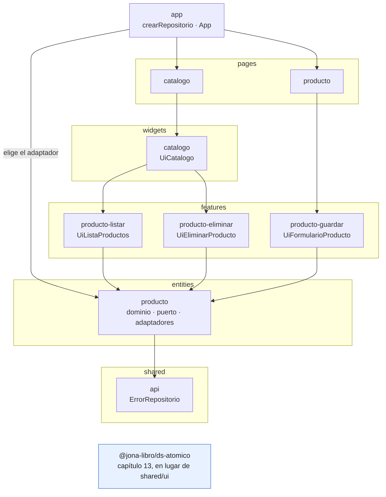
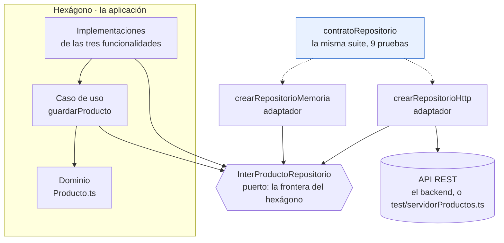
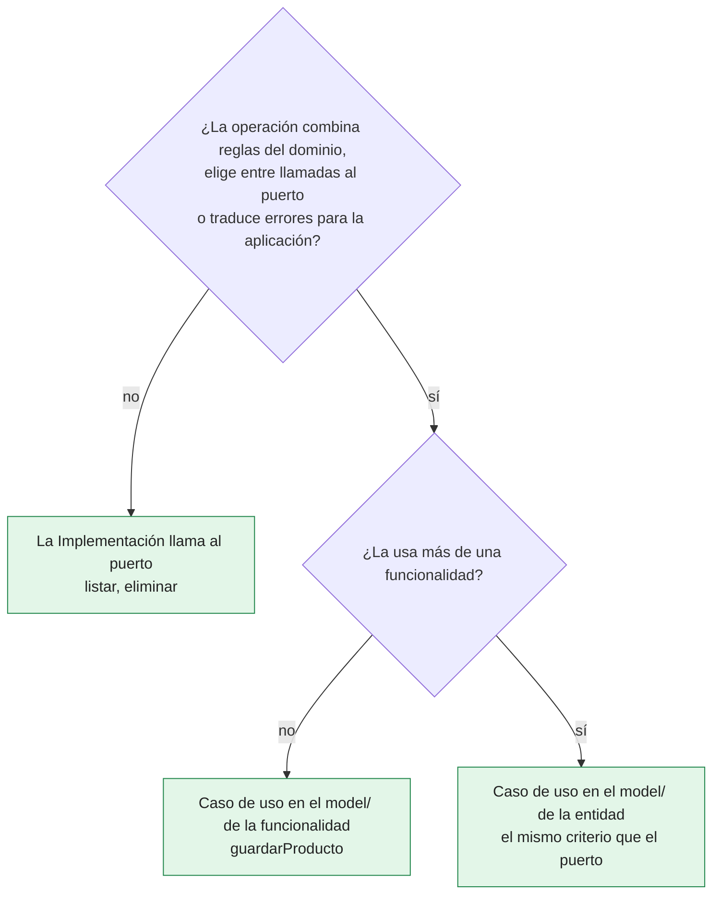
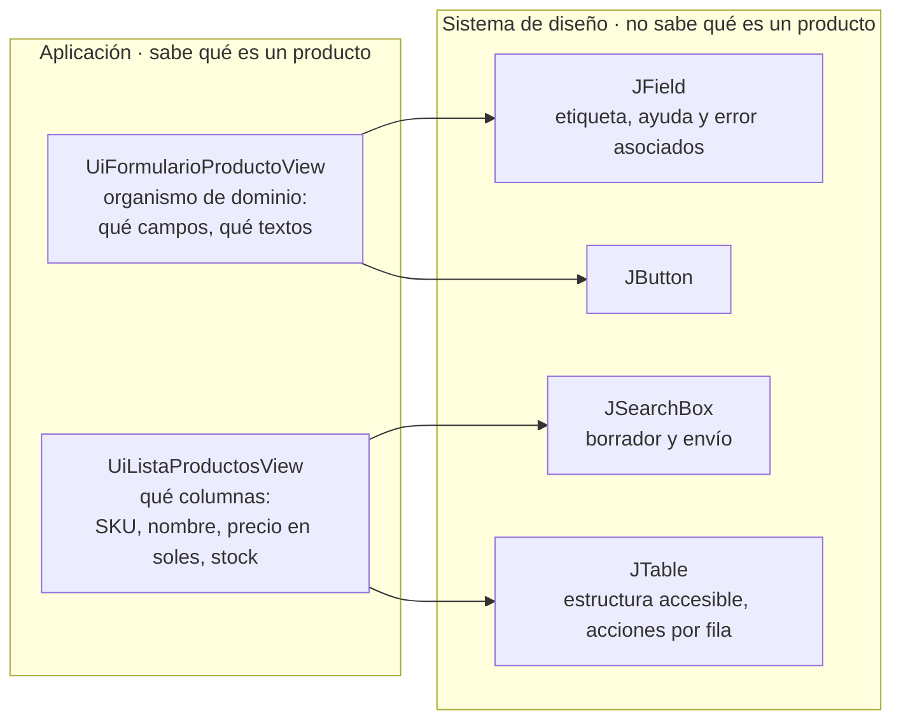
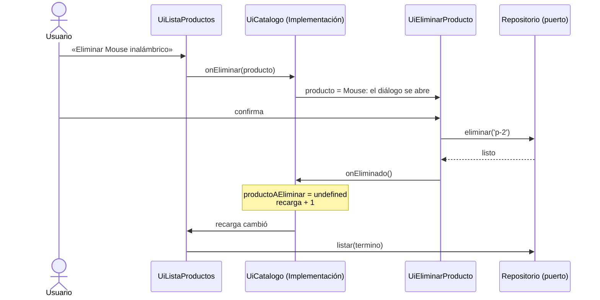

# Capítulo 14. Desarrollar una aplicación con FSD, Clean/Hexagonal y JONA

El capítulo 6 mostró cómo encajan las cuatro metodologías con una sola funcionalidad, el inicio de sesión. Una aplicación real plantea preguntas que una sola pantalla no plantea:

- Dónde vive el dominio cuando varias funcionalidades lo comparten.
- Cuándo se justifica un caso de uso.
- Cómo cooperan dos funcionalidades que, por FSD, no pueden conocerse.
- Cómo se depende de un sistema de diseño que llega como paquete.
- Cómo se verifica todo eso sin depender de la disciplina de cada revisión.

Este capítulo responde con una aplicación completa: un catálogo de productos con alta, consulta, modificación y baja, en `ejemplos/aplicacion-catalogo/`. Sus vistas se componen con el sistema de diseño del capítulo 13, instalado como dependencia. Tiene 62 pruebas y siete reglas de arquitectura.

> [!IMPORTANT]
> **Regla del capítulo.**
> - Las dependencias apuntan al **dominio**:
>   - el dominio no importa nada;
>   - los casos de uso, solo el dominio y el puerto;
>   - las Implementaciones, el puerto y, si existe, el caso de uso;
>   - las vistas, el sistema de diseño;
>   - y solo `app` elige un adaptador.
> - Una capa más (un caso de uso, un widget) se agrega **cuando tiene una responsabilidad propia**, y no antes.

---

## 14.1 El caso: un catálogo de productos

| Requisito | Regla | Dónde vive |
|---|---|---|
| Listar productos ordenados por SKU | — | Adaptadores (orden) y `UiListaProductos` |
| Buscar por nombre o por SKU, sin distinguir mayúsculas | `coincide(producto, termino)` | Dominio, y la API REST para el adaptador HTTP |
| Dar de alta y modificar | SKU con formato `AAA-000`; nombre de 3 a 60 caracteres; precio mayor que cero con dos decimales como máximo; stock entero no negativo | Dominio: `validarProducto` |
| El SKU es único | Un SKU repetido es un conflicto | El repositorio (el backend); el caso de uso lo traduce |
| Dar de baja con confirmación | Borrar algo que ya no existe cuenta como éxito | `UiEliminarProducto` |
| Desarrollar sin backend | Los mismos resultados que con la API REST | Adaptador en memoria, verificado con la suite de contrato |

La última fila es la que más pesa en la arquitectura. Si el adaptador en memoria no se comporta como el HTTP, el entorno de desarrollo miente: una pantalla que funciona con `npm run dev` puede fallar en producción. La sección 14.4 muestra cómo se evita.

---

## 14.2 El mapa: capas, unidades y hexágono

```
src/
├── app/                        raíz de composición y elección de página
├── pages/
│   ├── catalogo/               JPageLayout + el widget de catálogo
│   └── producto/               JPageLayout + el formulario
├── widgets/
│   └── catalogo/               unidad UiCatalogo: coordina listar y eliminar
├── features/
│   ├── producto-listar/        unidad UiListaProductos
│   ├── producto-guardar/       unidad UiFormularioProducto + caso de uso guardarProducto
│   └── producto-eliminar/      unidad UiEliminarProducto
├── entities/
│   └── producto/
│       ├── model/              dominio (Producto.ts) y puerto (InterProductoRepositorio.ts)
│       └── api/                adaptadores en memoria y HTTP, y la suite de contrato
└── shared/
    └── api/                    ErrorRepositorio
```

No hay `shared/ui`: ese lugar lo ocupa el paquete `@jona-libro/ds-atomico`, que es exactamente lo que el capítulo 6 previó para un sistema de diseño externo.



*Figura 14.1. Las capas de FSD de arriba abajo, con las unidades JONA en cada slice. Todas las flechas bajan. Las tres funcionalidades no se conocen entre sí: las une el widget. El sistema de diseño (en azul) es una dependencia externa que solo importan los segmentos `ui/` y `app` (sección 14.8); la figura no dibuja esas flechas para no repetirlas.*

En cada archivo conviven los cuatro vocabularios. La tabla es la de la sección 6.5, ahora con las piezas que el inicio de sesión no tenía:

| Archivo | FSD | Atomic Design | Hexagonal | JONA |
|---|---|---|---|---|
| `entities/producto/model/Producto.ts` | Segmento `model` de una entidad | — | Dominio | Tipos que usan los contratos |
| `entities/producto/model/InterProductoRepositorio.ts` | Segmento `model` de una entidad | — | Puerto | Contrato de servicio |
| `entities/producto/api/crearRepositorioHttp.ts` | Segmento `api` | — | Adaptador conducido | Adaptador |
| `features/producto-guardar/model/guardarProducto.ts` | Segmento `model` | — | Caso de uso | Capa agregada entre la Implementación y el puerto |
| `features/producto-guardar/model/UiFormularioProductoImpl.ts` | Segmento `model` | — | Lado que conduce | Implementación |
| `features/producto-guardar/ui/UiFormularioProductoView.tsx` | Segmento `ui` | Organismo **de dominio** | Lado que conduce | Vista |
| `widgets/catalogo/ui/UiCatalogo.tsx` | Capa `widgets` | — | Composición | Entrada de una unidad que coordina |
| `pages/catalogo/ui/CatalogoPage.tsx` | Capa `pages` | Página | — | Compone entradas; no es una unidad |
| `app/crearRepositorio.ts` | Capa `app` | — | Raíz de composición | Elige el adaptador |
| `JPageLayout` (del paquete) | Fuera de las capas | Disposición | — | Entrada de una unidad del sistema de diseño |

---

## 14.3 El dominio en el centro

El dominio es un archivo de TypeScript sin imports. Define el producto, lo que el usuario escribe (el **borrador**, siempre texto) y las reglas que convierten lo segundo en lo primero:

```ts
// ejemplos/aplicacion-catalogo/src/entities/producto/model/Producto.ts (extracto)
/** Las reglas del producto. El formulario las muestra; ningún adaptador las repite. */
export function validarProducto(borrador: BorradorProducto): Validacion {
  const errores: ErroresProducto = {};
  const sku = borrador.sku.trim().toUpperCase();
  const nombre = borrador.nombre.trim().replace(/\s+/g, ' ');
  const precioTexto = borrador.precio.trim().replace(',', '.');
  const stockTexto = borrador.stock.trim();

  if (!SKU.test(sku)) errores.sku = 'Use el formato AAA-000';
  if (nombre.length < 3 || nombre.length > 60) errores.nombre = 'Entre 3 y 60 caracteres';
  if (!DECIMAL.test(precioTexto) || Number(precioTexto) <= 0) errores.precio = 'Debe ser un número mayor que cero';
  else if ((precioTexto.split('.')[1] ?? '').length > 2) errores.precio = 'Como máximo dos decimales';
  if (!/^\d+$/.test(stockTexto)) errores.stock = 'Debe ser un entero mayor o igual a cero';

  if (Object.keys(errores).length > 0) return { ok: false, errores };
  return { ok: true, datos: { sku, nombre, precio: Number(precioTexto), stock: Number(stockTexto) } };
}
```

Tres decisiones se ven en ese extracto.

**El borrador y el producto son tipos distintos.** El borrador es lo que hay en el formulario: `precio` es `'120,50'`. El producto es lo que el dominio garantiza: `precio` es `120.5`. La frontera entre los dos es `validarProducto`, y nada que no la haya cruzado llega al repositorio.

**Las reglas viven una sola vez.** La Implementación del formulario no valida: muestra lo que el dominio devuelve, un mensaje por campo. El adaptador tampoco valida: transporta. Si la regla del precio cambia, cambia un archivo.

**El dominio se prueba sin nada.** `Producto.test.ts` tiene 8 pruebas que corren en el entorno `node`, sin React, sin DOM y sin dobles: entran textos y salen datos o errores.

La regla 6 de la sección 14.10 mantiene esa pureza. Un dominio que importa React o un cliente HTTP deja de ser el centro del hexágono.

> [!TIP]
> Si una regla del negocio solo puede probarse renderizando una pantalla, está en el lugar equivocado. Muévala al dominio, donde una prueba la ejecuta en milisegundos y cualquier funcionalidad puede reutilizarla.

---

## 14.4 El puerto, sus adaptadores y la suite de contrato

El puerto vive en la entidad, no en una funcionalidad, porque lo usan tres: listar, guardar y eliminar. Es el criterio del capítulo 6: el puerto vive en la capa del concepto que representa.

```ts
// ejemplos/aplicacion-catalogo/src/entities/producto/model/InterProductoRepositorio.ts (extracto)
export interface InterProductoRepositorio {
  /** Productos que coinciden con el término (por nombre o SKU), ordenados por SKU. */
  listar(termino?: string): Promise<Producto[]>;
  /** undefined si no existe. */
  obtener(id: string): Promise<Producto | undefined>;
  crear(datos: DatosProducto): Promise<Producto>;
  actualizar(id: string, datos: DatosProducto): Promise<Producto>;
  eliminar(id: string): Promise<void>;
}
```

Los errores también son parte del contrato. Cada adaptador traduce lo que puede salir mal a un `ErrorRepositorio` con tres tipos, y ninguna otra pieza de la aplicación ve un código HTTP:

| La API REST responde | El adaptador HTTP lanza | El adaptador en memoria lanza | La aplicación decide |
|---|---|---|---|
| 409 | `conflicto` | `conflicto`, si el SKU ya existe | Error en el campo SKU (caso de uso) |
| 404 | `no-encontrado` (`obtener` devuelve `undefined`) | `no-encontrado` | Al eliminar, cuenta como éxito |
| 500, o la red falla | `red` | — | «No se pudo guardar. Intente de nuevo.» |



*Figura 14.2. Las flechas continuas son dependencias. El puerto está en la frontera del hexágono: lo usan las piezas de adentro y lo implementan los adaptadores de afuera, y ningún adaptador llega más allá. Las punteadas no son dependencias del código de la aplicación: la suite de contrato (en azul) ejecuta las mismas nueve pruebas contra los dos adaptadores. Cuál de los dos se usa lo elige la raíz de composición (figura 14.1 y sección 14.9). El servidor de la API queda fuera del hexágono, como el backend.*

La suite de contrato es lo que convierte el adaptador en memoria en algo más que un doble de prueba. Es una función que recibe una fábrica de repositorios vacíos y define nueve pruebas: orden por SKU, búsqueda sin mayúsculas, `obtener` inexistente, conflicto al crear y al actualizar, `no-encontrado` al actualizar y eliminar, eliminación y copias defensivas. Cada adaptador la ejecuta:

```ts
// ejemplos/aplicacion-catalogo/src/entities/producto/api/crearRepositorioHttp.test.ts (extracto)
contratoRepositorio('adaptador HTTP', () => {
  servidor.vaciar();
  return crearRepositorioHttp({ baseUrl: servidor.url });
});
```

El adaptador HTTP corre la suite contra `test/servidorProductos.ts`, un servidor de la API REST que se arranca en un puerto libre durante la prueba. No reutiliza el adaptador en memoria, a propósito: es otra implementación de la API, del lado del backend, como el servidor mock del capítulo 6. Si el adaptador en memoria se olvidara de rechazar un SKU repetido, la prueba «crear con un SKU que ya existe es un conflicto» fallaría en él y pasaría en el HTTP. Esa asimetría es justo la que la suite existe para atrapar.

> [!NOTE]
> El adaptador en memoria no es un *mock*: es un adaptador más, que pasa la misma suite que el adaptador de producción. Por eso `npm run dev` sin backend es confiable, y por eso las pruebas de pantalla lo usan como repositorio real; solo agregan un espía cuando necesitan provocar un error de red.

---

## 14.5 Cuándo un caso de uso, y cuándo no

El capítulo 6 advirtió contra el [caso de uso de reenvío](06-atomic-fsd-hexagonal.md#ap-6-4): una clase que solo llama al servicio suma una capa sin responsabilidad. La aplicación tiene tres operaciones y un solo caso de uso, y la diferencia se puede explicar operación por operación:

| Operación | ¿Caso de uso? | Por qué |
|---|---|---|
| Listar | No | Es una llamada al puerto con el término de búsqueda; no hay nada que decidir |
| Eliminar | No | Su única decisión propia (que `no-encontrado` cuenta como éxito) es de esta pantalla y no la comparte nadie |
| Guardar | **Sí** | Valida con el dominio, elige entre crear y actualizar, y traduce un conflicto del repositorio a un error de campo. Son tres responsabilidades que no son de la pantalla |



*Figura 14.3. Cuándo agregar un caso de uso y dónde ponerlo. Las tres salidas son correctas; lo incorrecto es agregarlo cuando la respuesta a la primera pregunta es «no».*

```ts
// ejemplos/aplicacion-catalogo/src/features/producto-guardar/model/guardarProducto.ts (extracto)
export async function guardarProducto(
  repositorio: InterProductoRepositorio,
  borrador: BorradorProducto,
  id?: string,
): Promise<ResultadoGuardar> {
  const validacion = validarProducto(borrador);
  if (!validacion.ok) return validacion;
  try {
    const producto = id === undefined
      ? await repositorio.crear(validacion.datos)
      : await repositorio.actualizar(id, validacion.datos);
    return { ok: true, producto };
  } catch (error) {
    // La unicidad del SKU la garantiza el repositorio (el backend); aquí solo se traduce.
    if (error instanceof ErrorRepositorio && error.tipo === 'conflicto') {
      return { ok: false, errores: { sku: 'Ya existe un producto con ese SKU' } };
    }
    throw error;
  }
}
```

El caso de uso recibe el puerto como argumento; no sabe qué adaptador hay detrás. Por eso sus cuatro pruebas usan el adaptador en memoria, sin React y sin red. Una de ellas verifica con un espía que un borrador inválido **no llega** al repositorio, y otra, que un error de red sigue su camino hasta la pantalla, que es quien decide qué mostrar.

> [!WARNING]
> No verifique la unicidad con una consulta previa («¿existe este SKU?») y luego cree. Entre la consulta y la creación, otro usuario puede crear el mismo SKU. La unicidad la garantiza quien guarda (el backend, con un 409), y el cliente solo traduce la respuesta. La ficha [Unicidad solo en el cliente](#ap-14-3) muestra la diferencia.

---

## 14.6 Las unidades JONA de cada funcionalidad

Cada funcionalidad tiene una unidad en la forma mínima, variante a: la entrada recibe el puerto y lo entrega a la Implementación, igual que `UiLogin` en el capítulo 6.

| Funcionalidad | Unidad | Su Implementación | Su vista compone, del sistema de diseño |
|---|---|---|---|
| `producto-listar` | `UiListaProductos` | Carga lo que coincide con el término; recarga cuando cambia `recarga` | `JSearchBox`, `JTable` con las columnas del producto, `JText` |
| `producto-guardar` | `UiFormularioProducto` | Carga el producto a editar; mantiene el borrador y los errores; llama al caso de uso | `JField` ×4, `JButton` ×2, `JText` |
| `producto-eliminar` | `UiEliminarProducto` | Elimina; trata `no-encontrado` como éxito; muestra el error si falla | `JConfirmDialog` |

La entrada del formulario muestra la anatomía completa en pocas líneas:

```tsx
// ejemplos/aplicacion-catalogo/src/features/producto-guardar/ui/UiFormularioProducto.tsx (extracto)
export function UiFormularioProducto({ repositorio, id, onGuardado, onCancelar }: UiFormularioProductoProps) {
  const impl = useUiFormularioProductoImpl(repositorio, id, onGuardado);
  return <UiFormularioProductoView {...UIFORMULARIOPRODUCTO_DEFAULTS} {...impl} onCancelar={onCancelar} />;
}
```

### El organismo de dominio

La vista del formulario es un organismo en el sentido de Atomic Design: una sección con varios campos y acciones. Pero el criterio de la sección 13.1 la deja fuera del sistema de diseño, porque su contrato nombra el producto. Vive en la aplicación y se **compone** con piezas genéricas:

```tsx
// ejemplos/aplicacion-catalogo/src/features/producto-guardar/ui/UiFormularioProductoView.tsx (extracto)
<JField label="SKU" hint="Tres letras, guion y tres dígitos: TEC-001" value={borrador.sku} error={errores.sku} required onChange={(v) => onCambiar('sku', v)} />
<JField label="Nombre" value={borrador.nombre} error={errores.nombre} required onChange={(v) => onCambiar('nombre', v)} />
<JField label="Precio (S/)" value={borrador.precio} error={errores.precio} required onChange={(v) => onCambiar('precio', v)} />
<JField label="Stock" value={borrador.stock} error={errores.stock} required onChange={(v) => onCambiar('stock', v)} />
```



*Figura 14.4. Dónde está cada conocimiento. La aplicación decide qué se muestra; el sistema de diseño, cómo se muestra de forma accesible. Ninguna caja del sistema de diseño menciona el producto.*

Las pruebas de pantalla prueban la unidad completa, entrada incluida, con el adaptador en memoria: 7 pruebas del formulario (alta inválida, corrección de un campo, alta válida normalizada, SKU repetido, error de red, edición y producto inexistente), 5 de la lista y 4 de la eliminación.

---

## 14.7 Funcionalidades que no se conocen: el widget

Eliminar un producto toca dos funcionalidades. El botón «Eliminar» está en la lista, el diálogo y la llamada al puerto están en `producto-eliminar`, y cuando la eliminación termina, la lista debe recargarse. FSD prohíbe que `producto-listar` importe `producto-eliminar`, y el capítulo 6 nombró la salida: componer las dos entradas en una capa superior.

```tsx
// ejemplos/aplicacion-catalogo/src/widgets/catalogo/ui/UiCatalogo.tsx (extracto)
export function UiCatalogo({ repositorio, onEditar }: UiCatalogoProps) {
  const impl = useUiCatalogoImpl();
  return (
    <UiCatalogoView
      {...UICATALOGO_DEFAULTS}
      lista={<UiListaProductos repositorio={repositorio} recarga={impl.recarga} onEditar={onEditar} onEliminar={impl.onPedirEliminar} />}
      dialogo={
        <UiEliminarProducto
          repositorio={repositorio}
          producto={impl.productoAEliminar}
          onEliminado={impl.onEliminado}
          onCerrar={impl.onCerrarDialogo}
        />
      }
    />
  );
}
```

El widget es una unidad JONA con una forma particular. Su **Implementación** guarda el estado de coordinación: qué producto se pidió eliminar y un contador `recarga`. Su **vista** solo dispone dos huecos: su contrato es `{ lista: ReactNode; dialogo: ReactNode }`. Y su **entrada** llena los huecos con las entradas de las dos funcionalidades y les pasa el mismo puerto. Ninguna de las dos funcionalidades sabe que la otra existe.



*Figura 14.5. La lista y el diálogo nunca se hablan: cada uno avisa al widget, y el widget decide. Cuando `recarga` cambia, la Implementación de la lista vuelve a pedir los productos.*

Había otras dos salidas, y conviene saber por qué no se eligieron:

| Alternativa | Qué cuesta | Cuándo conviene |
|---|---|---|
| **Widget que coordina** (la elegida) | Una unidad más, pequeña | Cuando la coordinación es local a un bloque de pantalla |
| Unir listar y eliminar en una funcionalidad | El *slice* crece y eliminar ya no se reutiliza en otra pantalla (el detalle de un producto, por ejemplo) | Cuando las dos acciones nunca aparecen por separado |
| Un almacén global o un bus de eventos | Un acoplamiento que no aparece en los imports: ninguna regla de la sección 14.10 lo ve | Cuando muchas pantallas lejanas reaccionan al mismo cambio |

La tercera merece una advertencia. Un bus de eventos no viola ninguna regla de imports, y justamente por eso: el acoplamiento existe, pero quedó fuera de lo que se verifica.

---

## 14.8 El sistema de diseño como dependencia

La aplicación declara el sistema de diseño como cualquier paquete (`"@jona-libro/ds-atomico": "file:../sistema-diseno-atomico"`; en un equipo real, una versión del registro de npm). Dos reglas gobiernan cómo se usa:

1. **Solo `ui/` dibuja.** Importan el paquete los segmentos `ui/` (vistas, entradas y páginas) y `app`, que importa los tokens una vez. Ni `model/` ni `api/` lo conocen: una Implementación que importa `JField` empezó a dibujar.
2. **Solo por la raíz.** `@jona-libro/ds-atomico` y `@jona-libro/ds-atomico/tokens.css`, nada más. El mapa `exports` del capítulo 13 ya lo impide en tiempo de ejecución; la regla lo detecta antes, en el código fuente.

Las dos son la regla 7 de la sección 14.10. Una consecuencia práctica: la aplicación no tiene acceso a las clases de token, porque `clasesToken` no se exporta. Si una vista necesita disponer elementos de una manera que el sistema de diseño no ofrece, no le corresponde a la aplicación imitar los tokens con estilos propios: le corresponde **pedir la pieza** al sistema de diseño, con el criterio de la figura 13.1. Es la forma de que la promoción funcione en las dos direcciones.

> [!NOTE]
> El versionado del capítulo 8 protege esta dependencia. La mayoría de los cambios mayores del sistema de diseño (una propiedad eliminada, un tipo cambiado) rompen la compilación de la aplicación antes de llegar a producción, porque `tsc --noEmit` corre antes que `vite build`. Los que no la rompen, como el nombre de un token o un valor de `DEFAULTS`, son los que el capítulo 8 obliga a clasificar y declarar.

---

## 14.9 La raíz de composición y la navegación

`app/crearRepositorio.ts` es el único lugar que elige un adaptador:

```ts
// ejemplos/aplicacion-catalogo/src/app/crearRepositorio.ts (extracto)
/** Raíz de composición: el único lugar de la aplicación que elige un adaptador del puerto. */
export function crearRepositorio(entorno: EntornoRepositorio): InterProductoRepositorio {
  if (entorno.VITE_REPOSITORIO === 'http') {
    return crearRepositorioHttp({ baseUrl: entorno.VITE_API_URL ?? 'http://127.0.0.1:4020' });
  }
  return crearRepositorioMemoria(PRODUCTOS_DE_EJEMPLO);
}
```

`App` recibe el repositorio ya creado y elige la página con un estado de dos valores, sin biblioteca de rutas. Al pasar del catálogo al formulario, la página del producto recibe una `key` con el id (o `'nuevo'`), para que editar un producto después de otro empiece con un estado limpio. Las páginas no son unidades: componen la disposición `JPageLayout` con la entrada del widget o del formulario.

La prueba de punta a punta (`App.test.tsx`) recorre la aplicación como un usuario, con el adaptador en memoria:

```tsx
// ejemplos/aplicacion-catalogo/src/app/App.test.tsx (extracto)
// Alta
await userEvent.click(screen.getByRole('button', { name: 'Nuevo producto' }));
expect(screen.getByRole('heading', { level: 1 }).textContent).toBe('Nuevo producto');
await escribir('SKU', 'aud-004');
await escribir('Nombre', 'Audífonos');
await escribir('Precio (S/)', '89.90');
await escribir('Stock', '12');
await userEvent.click(screen.getByRole('button', { name: 'Guardar' }));
expect(await skus()).toEqual(['AUD-004', 'MON-003', 'MOU-002', 'TEC-001']);
```

Todas las búsquedas de la prueba son por **rol y nombre accesible**: `button` «Nuevo producto», `textbox` «Precio (S/)», `alertdialog`. Funcionan porque el sistema de diseño resolvió la accesibilidad en cada nivel. La prueba de la aplicación es, de paso, una prueba más de accesibilidad del sistema de diseño.

---

## 14.10 La verificación completa

### Las pruebas, de adentro hacia afuera

| Archivo | Pruebas | Qué prueba | Sin React | Sin DOM | Sin red |
|---|--:|---|:-:|:-:|:-:|
| `entities/producto/model/Producto.test.ts` | 8 | Dominio: validación, borrador, búsqueda | ✅ | ✅ | ✅ |
| `features/producto-guardar/model/guardarProducto.test.ts` | 4 | Caso de uso con el adaptador en memoria | ✅ | ✅ | ✅ |
| `entities/producto/api/crearRepositorioMemoria.test.ts` | 9 | Suite de contrato, adaptador en memoria | ✅ | ✅ | ✅ |
| `entities/producto/api/crearRepositorioHttp.test.ts` | 11 | Suite de contrato contra la API REST, y dos errores de red | ✅ | ✅ | — |
| `app/crearRepositorio.test.ts` | 2 | La raíz de composición elige cada adaptador | ✅ | ✅ | — |
| `features/producto-listar/UiListaProductos.test.tsx` | 5 | Unidad de la lista | — | — | ✅ |
| `features/producto-guardar/UiFormularioProducto.test.tsx` | 7 | Unidad del formulario | — | — | ✅ |
| `features/producto-eliminar/UiEliminarProducto.test.tsx` | 4 | Unidad de la eliminación | — | — | ✅ |
| `widgets/catalogo/UiCatalogo.test.tsx` | 2 | Coordinación del widget y retorno del foco | — | — | ✅ |
| `app/App.test.tsx` | 2 | De punta a punta: alta, modificación, baja y cancelación | — | — | ✅ |
| `test/architecture/architecture.test.ts` | 8 | Las siete reglas sobre `src/` y siete árboles de violación | ✅ | ✅ | ✅ |
| **Total** | **62** | | | | |

Las cinco primeras filas cubren todo el comportamiento del negocio y corren sin React. Las pantallas se prueban encima con el mismo adaptador en memoria que la suite de contrato ya verificó; el único doble que agregan es un espía para provocar un error de red.

### Las siete reglas

| # | Regla | Metodología | Origen | Árbol de este capítulo y mensaje real |
|:-:|---|---|---|---|
| 1 | Dirección de capas | FSD | Capítulo 6 | — |
| 2 | Aislamiento entre *slices* | FSD | Capítulo 6 | `funcionalidades-hermanas`: «el slice features/producto-listar importa features/producto-eliminar/index, de otro slice de la misma capa» |
| 3 | API pública | FSD y N4 | Capítulo 6 | — |
| 4 | Roles dentro de la unidad; solo `app` elige un adaptador | JONA y hexagonal | Capítulo 6 | `caso-de-uso-elige-adaptador`: «importa el adaptador crearRepositorioHttp de entities/producto/index; solo app elige un adaptador» |
| 5 | Contratos sin comportamiento | N2 | Capítulo 6 | — |
| 6 | Modelo sin framework: en `model/`, lo que no es contrato ni Implementación no importa paquetes | Clean/Hexagonal | **Nueva** | `dominio-con-react`: «Producto es dominio o aplicación e importa el paquete react; solo depende del modelo». También `caso-de-uso-con-http` |
| 7 | El sistema de diseño, solo desde `ui/` y por su raíz | Atomic Design y N4 | **Nueva** | `ds-por-ruta-interna`: «importa @jona-libro/ds-atomico/dist/organismos/jtable/JTableView.js, una pieza interna del sistema de diseño; solo su raíz es pública». También `modelo-dibuja` |

Las funciones de las reglas 1 a 5 se copiaron de `ejemplos/web-fsd/test/architecture/rules.ts` sin cambios; solo se agregó la lectura de los paquetes importados, que necesitan las reglas nuevas. Sus once árboles de violación siguen en ese ejemplo. Que una aplicación más grande no haya necesitado modificarlas es en sí un dato. Las reglas del capítulo 6 no dependían del inicio de sesión: dependían de las capas, los segmentos y los roles, que aquí son los mismos.

La regla 6 es la regla de dependencia de Clean Architecture llevada a los archivos:

```ts
// ejemplos/aplicacion-catalogo/test/architecture/rules.ts (extracto)
function frameworkFreeModel(module: Module): string[] {
  const { segment, name } = module.at;
  if (segment !== 'model' || /^Inter[A-Z]/.test(name) || name.endsWith('Impl')) return [];
  return module.packages.map((pkg) => `${name} es dominio o aplicación e importa el paquete ${pkg}; solo depende del modelo`);
}
```

Usa la convención de nombres de JONA para separar lo que el segmento `model/` de FSD mezcla. `Inter*` es contrato, `*Impl` es Implementación (que sí usa React, porque es un *hook*), y todo lo demás es dominio o caso de uso. Es el mismo recurso que el capítulo 6 usó para distinguir la vista de la entrada dentro de `ui/`.

> [!TIP]
> Cuando una metodología mezcla en una carpeta dos roles que otra distingue, una **convención de nombres** basta para que una regla automática los separe. FSD pone en `model/` el dominio, el caso de uso, el contrato y la Implementación; los nombres de JONA dicen cuál es cuál.

---

## 14.11 Antipatrones

> [!CAUTION]
> En una aplicación que combina cuatro metodologías, los antipatrones aparecen donde una metodología **permite** lo que otra prohíbe. FSD permite cualquier import dentro de `model/`; Clean no. JONA permite que una unidad use otra; FSD no, si son de la misma capa. Las reglas de la sección 14.10 deciden esos empates por escrito.

**Referencia rápida**

| | Antipatrón | Se reconoce porque… | Qué lo evita |
|:-:|---|---|---|
| 🔴 | [Dominio con framework](#ap-14-1) | `Producto.ts` importa React o un cliente HTTP | Regla 6: el dominio solo depende del modelo |
| 🔴 | [El caso de uso elige el adaptador](#ap-14-2) | `guardarProducto` crea su repositorio HTTP | Regla 4: el caso de uso recibe el puerto; solo `app` elige |
| 🟠 | [Unicidad solo en el cliente](#ap-14-3) | Una consulta «¿existe?» antes de crear | El repositorio garantiza; el caso de uso traduce el conflicto |
| 🟠 | [Adaptador en memoria sin suite de contrato](#ap-14-4) | El entorno de desarrollo acepta lo que producción rechaza | La misma suite para todos los adaptadores |
| 🟠 | [Funcionalidades que se llaman entre sí](#ap-14-5) | `producto-listar` importa `producto-eliminar` | Regla 2: un widget las compone |
| 🟠 | [El sistema de diseño fuera de su lugar](#ap-14-6) | Una ruta interna del paquete, o una Implementación que importa componentes | Regla 7: desde `ui/` y por la raíz |
| 🟡 | [Reglas del dominio repetidas](#ap-14-7) | El formulario o el adaptador vuelven a validar el precio | Una sola función de dominio; las capas la usan |

🔴 el centro del hexágono depende de un detalle · 🟠 una garantía se degrada: consistencia, honestidad del entorno de desarrollo, independencia · 🟡 dos fuentes de verdad para la misma regla

---

<a id="ap-14-1"></a>
### 🔴 Dominio con framework

**Síntoma.** Un archivo del dominio importa React, un cliente HTTP o cualquier otro paquete.

❌ **Así no:** el árbol de prueba `ejemplos/aplicacion-catalogo/test/fixtures/dominio-con-react/` (archivo `entities/producto/model/Producto.ts`).

```ts
// Violación: el dominio depende de React; ya no se prueba ni se reutiliza sin el framework.
import { useState } from 'react';

export function useValidarProducto() {
  return useState<Record<string, string>>({});
}
```

✅ **Así sí:** funciones puras sin imports (`ejemplos/aplicacion-catalogo/src/entities/producto/model/Producto.ts`, extracto; la función completa está en la sección 14.3).

```ts
/** Las reglas del producto. El formulario las muestra; ningún adaptador las repite. */
export function validarProducto(borrador: BorradorProducto): Validacion {
```

**Por qué duele.** El dominio era la única pieza que no dependía de nada. Con React dentro, sus reglas solo corren dentro de un componente, y el caso de uso, que las usa, hereda la dependencia. Cambiar de framework, o usar las reglas en un servidor, deja de ser posible sin reescribirlas. **Cómo no caer:** la regla 6 señala el árbol con «Producto es dominio o aplicación e importa el paquete react; solo depende del modelo».

---

<a id="ap-14-2"></a>
### 🔴 El caso de uso elige el adaptador

**Síntoma.** Un caso de uso crea su propio repositorio en lugar de recibir el puerto.

❌ **Así no:** el árbol de prueba `ejemplos/aplicacion-catalogo/test/fixtures/caso-de-uso-elige-adaptador/` (archivo `features/producto-guardar/model/guardarProducto.ts`).

```ts
// Violación: el caso de uso crea su adaptador en lugar de recibir el puerto; solo app elige.
import { crearRepositorioHttp } from '../../../entities/producto';

const repositorio = crearRepositorioHttp({ baseUrl: 'http://127.0.0.1:4020' });

export const guardarProducto = (datos: unknown) => repositorio.crear(datos);
```

✅ **Así sí:** el puerto llega como argumento (`ejemplos/aplicacion-catalogo/src/features/producto-guardar/model/guardarProducto.ts`, extracto).

```ts
export async function guardarProducto(
  repositorio: InterProductoRepositorio,
  borrador: BorradorProducto,
  id?: string,
): Promise<ResultadoGuardar> {
```

**Por qué duele.** El caso de uso queda atado a la red: ya no se prueba con el adaptador en memoria, y `npm run dev` sin backend deja de funcionar en esa pantalla. Es el [efecto en `model/`](06-atomic-fsd-hexagonal.md#ap-6-2) del capítulo 6, un nivel más adentro. **Cómo no caer:** la regla 4 señala el árbol con «importa el adaptador crearRepositorioHttp de entities/producto/index; solo app elige un adaptador». El árbol `caso-de-uso-con-http` cubre la variante que se salta el puerto y usa un cliente HTTP directamente (regla 6).

---

<a id="ap-14-3"></a>
### 🟠 Unicidad solo en el cliente

**Síntoma.** Antes de crear, el cliente pregunta si el SKU existe, y confía en la respuesta.

❌ **Así no** (ilustrativo)

```ts
const existentes = await repositorio.listar(datos.sku);
if (existentes.some((p) => p.sku === datos.sku)) {
  return { ok: false, errores: { sku: 'Ya existe un producto con ese SKU' } };
}
return { ok: true, producto: await repositorio.crear(datos) };
```

✅ **Así sí:** el repositorio garantiza la unicidad y el caso de uso traduce su respuesta (`ejemplos/aplicacion-catalogo/src/features/producto-guardar/model/guardarProducto.ts`, extracto).

```ts
} catch (error) {
  // La unicidad del SKU la garantiza el repositorio (el backend); aquí solo se traduce.
  if (error instanceof ErrorRepositorio && error.tipo === 'conflicto') {
    return { ok: false, errores: { sku: 'Ya existe un producto con ese SKU' } };
  }
  throw error;
}
```

**Por qué duele.** Entre la consulta y la creación hay una ventana en la que otro usuario puede crear el mismo SKU. Cuando eso pasa, el backend responde 409 y, como el cliente no lo esperaba, el usuario ve «No se pudo guardar» en lugar del error del campo. Además, la consulta previa es una llamada más en cada alta. **Cómo no caer:** que la unicidad la garantice quien guarda. Las pruebas «el conflicto del repositorio se convierte en un error del campo SKU» (caso de uso) y «un SKU repetido se informa en su campo» (pantalla) fijan el comportamiento, y la suite de contrato exige el conflicto a los dos adaptadores. Ninguna regla de imports lo detecta: es una decisión de revisión.

---

<a id="ap-14-4"></a>
### 🟠 Adaptador en memoria sin suite de contrato

**Síntoma.** El adaptador en memoria se escribió «para salir del paso» y nadie verifica que se comporte como el de producción.

❌ **Así no** (ilustrativo)

```ts
// Un "mock" que acepta cualquier cosa: el SKU repetido nunca falla en desarrollo.
async crear(datos) {
  const producto = { ...datos, id: `p-${siguiente++}` };
  productos.set(producto.id, producto);
  return producto;
},
```

✅ **Así sí:** la misma suite para los dos adaptadores (`ejemplos/aplicacion-catalogo/src/entities/producto/api/contratoRepositorio.ts`, extracto).

```ts
it('crear con un SKU que ya existe es un conflicto', async () => {
  await repositorio.crear(TECLADO);

  expect(await tipoDeError(repositorio.crear({ ...MOUSE, sku: 'TEC-001' }))).toBe('conflicto');
});
```

**Por qué duele.** El entorno de desarrollo miente. La pantalla de alta nunca muestra el error de SKU repetido mientras se desarrolla, así que nadie lo diseña ni lo prueba, y aparece por primera vez en producción. El ejemplo ilustrativo tiene un segundo defecto: devuelve el objeto guardado, no una copia, y una pantalla que lo modifique cambia «la base de datos» sin llamar a `actualizar`. La suite también lo atrapa, con «lo que devuelve es una copia». **Cómo no caer:** cada adaptador, incluido el de memoria, ejecuta `contratoRepositorio` (sección 14.4). Un adaptador que no la pasa no se usa.

---

<a id="ap-14-5"></a>
### 🟠 Funcionalidades que se llaman entre sí

**Síntoma.** Una funcionalidad importa la entrada de otra de la misma capa «porque la necesita».

❌ **Así no:** el árbol de prueba `ejemplos/aplicacion-catalogo/test/fixtures/funcionalidades-hermanas/` (archivo `features/producto-listar/ui/UiListaProductos.tsx`).

```tsx
// Violación: una funcionalidad usa otra de la misma capa; quien las coordina es un widget.
import { UiEliminarProducto } from '../../producto-eliminar';

export const UiListaProductos = () => <UiEliminarProducto />;
```

✅ **Así sí:** el widget compone las dos entradas y coordina (`ejemplos/aplicacion-catalogo/src/widgets/catalogo/ui/UiCatalogo.tsx`, extracto; completo en la sección 14.7).

```tsx
lista={<UiListaProductos repositorio={repositorio} recarga={impl.recarga} onEditar={onEditar} onEliminar={impl.onPedirEliminar} />}
```

**Por qué duele.** Las funcionalidades dejan de poder usarse por separado: la lista ya no aparece en una pantalla sin el diálogo, y un cambio en eliminar obliga a probar listar. Con más funcionalidades, el grafo termina en todas conociendo a todas, que es lo que FSD existe para impedir. **Cómo no caer:** la regla 2 señala el árbol con «el slice features/producto-listar importa features/producto-eliminar/index, de otro slice de la misma capa». La sección 14.7 compara el widget con las otras dos salidas.

---

<a id="ap-14-6"></a>
### 🟠 El sistema de diseño fuera de su lugar

**Síntoma.** Una vista importa una pieza interna del paquete por su ruta, o una Implementación importa componentes del sistema de diseño.

❌ **Así no:** el árbol de prueba `ejemplos/aplicacion-catalogo/test/fixtures/ds-por-ruta-interna/` (archivo `features/producto-listar/ui/UiListaProductosView.tsx`).

```tsx
// Violación: la vista importa la vista interna de un organismo, por una ruta que el paquete no publica.
import { JTableView } from '@jona-libro/ds-atomico/dist/organismos/jtable/JTableView.js';
```

✅ **Así sí:** por la raíz del paquete, desde `ui/` (`ejemplos/aplicacion-catalogo/src/features/producto-listar/ui/UiListaProductosView.tsx`, extracto).

```tsx
import { JSearchBox, JTable, JText, type JTableColumn } from '@jona-libro/ds-atomico';
```

**Por qué duele.** La ruta interna se salta los `DEFAULTS` que aplica la Implementación del organismo y depende de un archivo que el sistema de diseño puede mover en un parche. Además, falla en tiempo de ejecución, con `ERR_PACKAGE_PATH_NOT_EXPORTED` (sección 13.6). La variante en `model/` es más sutil: una Implementación que importa `JField` empezó a dibujar, y el diseñador ya no es el único autor de la vista. **Cómo no caer:** la regla 7 señala el árbol con «importa @jona-libro/ds-atomico/dist/organismos/jtable/JTableView.js, una pieza interna del sistema de diseño; solo su raíz es pública». El árbol `modelo-dibuja` cubre la variante en `model/`: «el segmento model importa el sistema de diseño; solo ui/ dibuja».

---

<a id="ap-14-7"></a>
### 🟡 Reglas del dominio repetidas

**Síntoma.** El formulario, el caso de uso o el adaptador vuelven a comprobar una regla que ya está en el dominio.

❌ **Así no** (ilustrativo)

```ts
// En la Implementación del formulario: la regla del precio, otra vez, y un poco distinta.
if (Number(borrador.precio) <= 0) setErrores({ precio: 'El precio debe ser positivo' });
```

✅ **Así sí:** la Implementación muestra lo que devuelve el caso de uso, que usa el dominio (`ejemplos/aplicacion-catalogo/src/features/producto-guardar/model/UiFormularioProductoImpl.ts`, extracto).

```ts
const resultado = await guardarProducto(repositorio, borrador, id);
if (resultado.ok) onGuardado(resultado.producto);
else setErrores(resultado.errores);
```

**Por qué duele.** Dos copias de una regla divergen. En el ejemplo ilustrativo, la copia acepta `'12.345'`, que el dominio rechaza, y muestra otro texto. Cuando la regla cambie, alguien cambiará una copia y no la otra. No rompe la arquitectura (por eso es 🟡), pero deja dos fuentes de verdad. **Cómo no caer:** las reglas viven en `validarProducto` y sus pruebas están en `Producto.test.ts` (sección 14.3). Ninguna regla de imports lo detecta: es una decisión de revisión. La pregunta útil en esa revisión es «¿esta condición ya existe en el dominio?».

---

## 14.12 Resumen

- Una aplicación con FSD, Clean/Hexagonal y JONA reparte el trabajo así:
  - FSD ordena las capas;
  - el hexágono pone el dominio en el centro;
  - JONA ordena cada unidad;
  - el sistema de diseño del capítulo 13 ocupa el lugar de `shared/ui`.
- El dominio es TypeScript sin imports. El borrador (lo que el usuario escribe) y el producto (lo que el dominio garantiza) son tipos distintos, y `validarProducto` es la frontera.
- El puerto vive en la entidad porque lo usan tres funcionalidades. Los adaptadores traducen los errores a `ErrorRepositorio`; nadie más ve un código HTTP.
- El adaptador en memoria pasa la misma suite de contrato que el HTTP: por eso el entorno de desarrollo es confiable y las pantallas se prueban con él como repositorio real.
- Un caso de uso existe cuando tiene responsabilidad propia: `guardarProducto` sí, listar y eliminar no. Vive en la funcionalidad que lo usa, o en la entidad si lo usan varias.
- La unicidad la garantiza quien guarda; el cliente traduce el conflicto.
- Dos funcionalidades que no pueden conocerse cooperan a través de un widget: su Implementación coordina y su entrada las compone.
- El sistema de diseño se importa desde `ui/` y por su raíz. Lo que la aplicación necesite y el sistema de diseño no tenga se pide, no se imita.
- Siete reglas sostienen la combinación: las cinco del capítulo 6, con sus funciones sin cambios, y dos nuevas, modelo sin framework y sistema de diseño en su lugar. Cada una tiene un árbol de violación.
