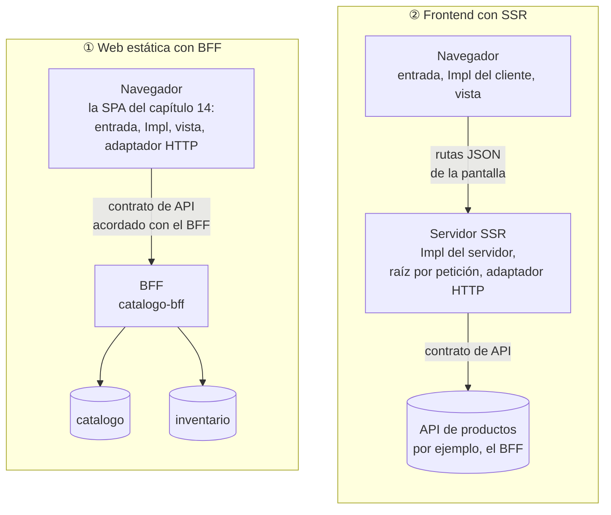
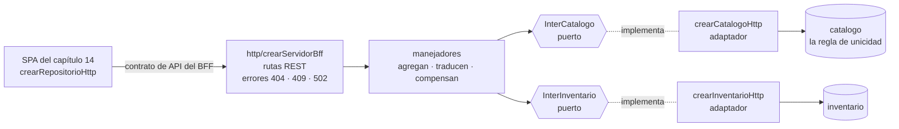
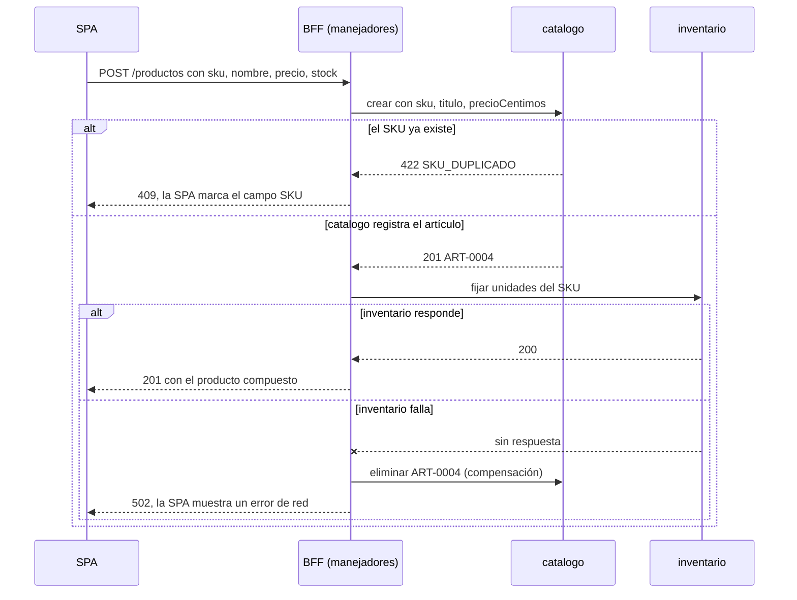
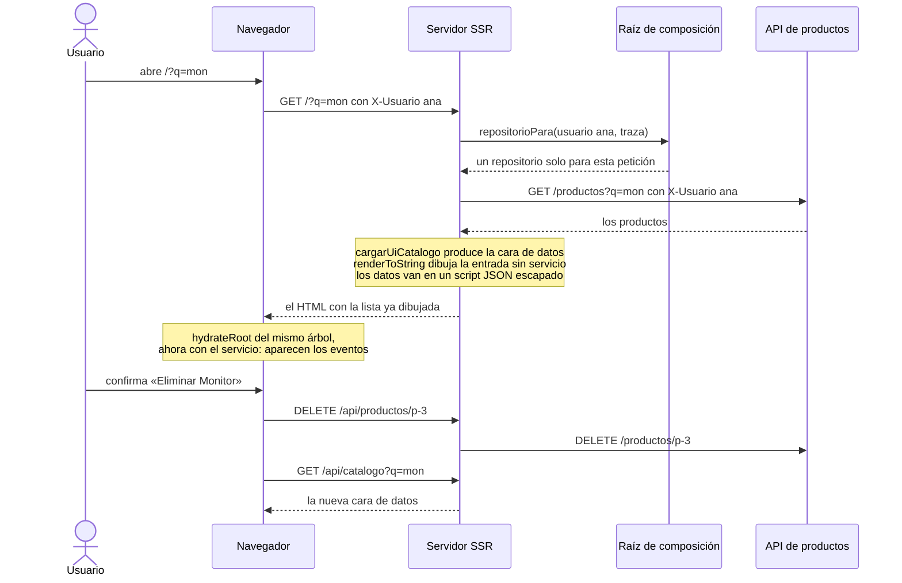
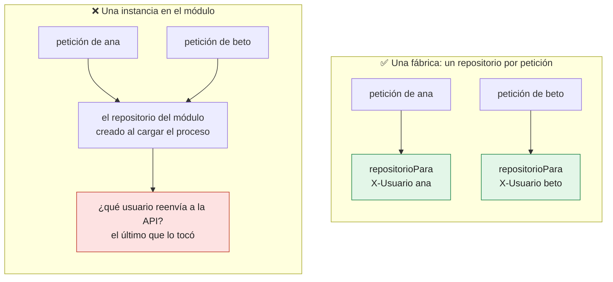
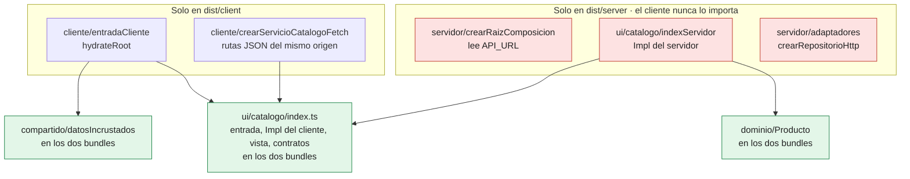

# Capítulo 15. Una web estática con BFF y un frontend con SSR

El capítulo 14 terminó con una aplicación que habla con «una API REST de productos». En producción, esa frase esconde dos problemas que la aplicación no resolvió:

- **La API no existe como la aplicación la quiere.** El negocio está repartido entre servicios con contratos propios: uno sabe del SKU y del precio, otro del stock. Ninguno habla en soles ni conoce el formato de error que la aplicación espera.
- **La primera página debe llegar dibujada.** Por posicionamiento en buscadores, por el primer pintado en dispositivos lentos o porque la lista debe verse antes de que cargue el JavaScript. Eso es renderizar en el servidor (SSR).

Este capítulo resuelve los dos con dos ejemplos que se apoyan en los anteriores. `ejemplos/catalogo-bff/` es un BFF (*backend for frontend*) delante de dos backends de negocio simulados, y la aplicación del capítulo 14 corre contra él sin cambiar una línea. `ejemplos/catalogo-ssr/` es la lista de productos renderizada en el servidor a mano, con React 19, Vite y un servidor `node:http`, y las vistas del sistema de diseño del capítulo 13. Entre los dos suman 131 pruebas y siete reglas de arquitectura.

La tesis del capítulo es una sola: **JONA vive donde se dibuja la pantalla.** En los dos casos los contratos son los mismos. Lo que cambia es dónde corre cada pieza y con quién se acuerda el contrato de API.

> [!IMPORTANT]
> **Regla del capítulo.**
> - El contrato de API de una interfaz se acuerda con **su** servidor: el BFF, o el servidor SSR. Nunca con los backends de negocio.
> - Ese servidor **traduce, agrega y compensa**; no decide reglas de negocio.
> - Con SSR, la Implementación se parte en dos: la del **servidor** produce datos serializables; la del **cliente** lleva la interacción.
> - Lo que depende de la petición se crea **en cada petición**, y lo que es del servidor **no llega al navegador**.

> **Sobre los fragmentos de código.** Los fragmentos de este capítulo son extractos, a veces abreviados, de los ejemplos ejecutables de la carpeta `ejemplos/` (apéndice B). Omiten detalles que no aportan a la explicación; al final de cada sección se indica el archivo completo, que compila y tiene pruebas.

---

## 15.1 Dos topologías, los mismos contratos

| Pieza | Web estática con BFF | Frontend con SSR |
|---|---|---|
| Contrato de UI, vista, entrada | En el navegador, como en el capítulo 14 | En el servidor y en el navegador: el mismo árbol se dibuja en los dos lados |
| Implementación | En el navegador: carga y muta por el puerto | Partida en dos: la del servidor carga; la del cliente lleva la interacción |
| Puerto y adaptador del repositorio | En el navegador | Solo en el servidor |
| Raíz de composición | Una por pestaña del navegador (`app/crearRepositorio.ts`) | Una por petición, en el servidor |
| Contrato de API de la interfaz | El del BFF | Las rutas JSON del servidor SSR, y el servidor SSR habla con la API de productos |
| Quién habla con los backends de negocio | El BFF | La API de productos (por ejemplo, el mismo BFF) |



*Figura 15.1. Las dos topologías del capítulo. Mire dónde está el adaptador HTTP del repositorio: en ① vive en el navegador, en ② en el servidor. En las dos, el navegador habla con un solo servidor que es suyo, y los backends de negocio quedan detrás.*

Las dos topologías se combinan. En el ejemplo, el servidor SSR usa el BFF como su API de productos (`REPOSITORIO=http API_URL=http://127.0.0.1:4020`), y la cadena navegador → servidor SSR → BFF → catalogo e inventario funciona de punta a punta.

---

## 15.2 El contrato de API es del BFF

El capítulo 3 estableció que el contrato de API se acuerda entre frontend y backend. Con un BFF, la pregunta es **qué** backend. La respuesta del capítulo es el BFF: el contrato que la SPA consume es el que el BFF sirve, y los contratos de los backends de negocio son asunto del BFF.

Los dos backends del ejemplo tienen formatos distintos a propósito, para que haya algo que traducir:

| | La SPA (contrato del BFF) | catalogo | inventario |
|---|---|---|---|
| Identificador | `id` | `codigoArticulo` (`ART-0001`) | — (por SKU) |
| Nombre | `nombre` | `titulo` | — |
| Precio | `precio`, en soles | `precioCentimos`, entero | — |
| Stock | `stock` | — | `unidades` |
| Lista | un arreglo | `{ datos, total }` | `{ existencias }` |
| SKU repetido | 409 | 422 `{ falla: { tipo: 'SKU_DUPLICADO' } }` | — |
| No existe | 404 | 404 `{ falla: { tipo: 'ARTICULO_INEXISTENTE' } }` | 404 `{ codigo: 'SIN_EXISTENCIA' }` |
| Un backend no responde | 502, que la SPA trata como `red` | — | — |

### La prueba: la SPA del capítulo 14 sin cambiar una línea

El BFF sirve exactamente la API que espera `crearRepositorioHttp` del capítulo 14. Eso no se afirma: se prueba con la misma suite de contrato, `contratoRepositorio`, que el capítulo 14 corría contra su servidor de prueba. El archivo de la prueba aceptó una variable para correr contra un servidor externo, y nada más cambió en la aplicación:

```ts
// ejemplos/aplicacion-catalogo/src/entities/producto/api/crearRepositorioHttp.test.ts (extracto)
const EXTERNO = process.env.CATALOGO_API_URL;
const REINICIAR = (process.env.CATALOGO_REINICIAR ?? '').split(',').filter((url) => url !== '');

if (EXTERNO) {
  contratoRepositorio(`adaptador HTTP contra ${EXTERNO}`, async () => {
    for (const url of REINICIAR) await fetch(url, { method: 'POST' });
    return crearRepositorioHttp({ baseUrl: EXTERNO });
  });
}
```

`CATALOGO_REINICIAR` son las rutas de solo prueba de los dos backends, que vacían su almacenamiento antes de cada prueba. El BFF no tiene rutas de solo prueba: la prueba «no expone rutas de solo prueba» lo exige.

```bash
# terminal 1: catalogo en 4021, inventario en 4022 y el BFF en 4020
cd ejemplos/catalogo-bff && npm start
# terminal 2
cd ejemplos/aplicacion-catalogo
CATALOGO_API_URL=http://127.0.0.1:4020 \
CATALOGO_REINICIAR=http://127.0.0.1:4021/__pruebas/reiniciar,http://127.0.0.1:4022/__pruebas/reiniciar \
npx vitest run src/entities/producto/api/crearRepositorioHttp.test.ts
```

```text
 Test Files  1 passed (1)
      Tests  11 passed (11)
```

Las 11 pruebas son las 9 de la suite de contrato y las dos del archivo que no dependen del servidor. El ejecutor general (`node run-all.mjs`) repite esta corrida al final, con los tres servidores en puertos libres. Sin la variable, la prueba sigue usando `test/servidorProductos.ts`, y la aplicación conserva sus 62 pruebas.

> [!NOTE]
> La SPA no sabe que hay un BFF. Su raíz de composición sigue eligiendo `crearRepositorioHttp` con una URL base, que es el punto de sustitución 3 del capítulo 2. El puerto 4020 del BFF es, a propósito, la `VITE_API_URL` por defecto de la aplicación del capítulo 14.

Ejemplo ejecutable: `ejemplos/catalogo-bff/` y `ejemplos/aplicacion-catalogo/src/entities/producto/api/crearRepositorioHttp.test.ts`.

---

## 15.3 Dentro del BFF: un hexágono

El BFF es un servidor pequeño, y aun así se organiza con la arquitectura hexagonal del capítulo 6, por la misma razón que la aplicación: para probar su lógica sin red y cambiar un backend sin tocarla.



*Figura 15.2. El BFF por dentro, de izquierda a derecha como viaja una petición. Los manejadores solo conocen los dos puertos, uno por backend. Cada adaptador implementa un puerto (la línea punteada) y es el único que ve una URL. La raíz de composición, que elige los adaptadores, no se dibuja: está en la tabla. La regla de unicidad está en catalogo, fuera del BFF.*

| Pieza | Archivo | Qué hace |
|---|---|---|
| Contrato que sirve | `src/api/InterApiProductos.ts` | La forma de `InterProductoRepositorio` del capítulo 14, ahora del otro lado de HTTP |
| Puertos | `src/puertos/InterCatalogo.ts`, `InterInventario.ts`, `ErrorBackend.ts` | Uno por backend, en el idioma de ese backend: artículos, títulos y céntimos |
| Adaptadores | `src/adaptadores/crearCatalogoHttp.ts`, `crearInventarioHttp.ts` | El transporte: rutas, sobres, tiempo límite, y cada formato de error a un `ErrorBackend` |
| Manejadores | `src/manejadores/crearManejadoresProductos.ts` | Agregan los dos backends, traducen el modelo y compensan |
| Capa HTTP | `src/http/crearServidorBff.ts` | Rutas REST y `ErrorBackend` a 404, 409 o 502 |
| Raíz de composición | `src/app/crearBff.ts` | Elige los adaptadores; `CATALOGO_URL` e `INVENTARIO_URL` |

### Dos traducciones, en dos lugares

El adaptador traduce el **transporte**. El de catalogo convierte su falla propia en un `ErrorBackend`, y solo una falla concreta es un conflicto:

```ts
// ejemplos/catalogo-bff/src/adaptadores/crearCatalogoHttp.ts (extracto)
async function fallar(respuesta: Response): Promise<never> {
  const { falla } = ((await respuesta.json().catch(() => ({}))) ?? {}) as FallaCatalogo;
  if (respuesta.status === 404) throw new ErrorBackend('no-encontrado', falla?.detalle);
  // Solo este tipo es un conflicto: el BFF traduce la decisión de catalogo, no la toma.
  if (respuesta.status === 422 && falla?.tipo === 'SKU_DUPLICADO') throw new ErrorBackend('conflicto', falla.detalle);
  throw new ErrorBackend('no-disponible', `catalogo respondió HTTP ${respuesta.status}`);
}
```

Los manejadores traducen el **modelo**: catalogo habla de artículos, títulos y céntimos; la SPA, de productos, nombres y soles.

```ts
// ejemplos/catalogo-bff/src/manejadores/crearManejadoresProductos.ts (extracto)
const aProducto = (articulo: Articulo, unidades = 0): Producto => ({
  id: articulo.codigoArticulo,
  sku: articulo.sku,
  nombre: articulo.titulo,
  precio: articulo.precioCentimos / 100,
  stock: unidades,
});
```

La capa HTTP cierra el círculo con una tabla. La SPA del capítulo 14 traduce 404 a `no-encontrado`, 409 a `conflicto` y cualquier otro código a `red`; el BFF le entrega exactamente esos códigos:

```ts
// ejemplos/catalogo-bff/src/http/crearServidorBff.ts (extracto)
const ESTADO_DE: Record<TipoErrorBackend, number> = { 'no-encontrado': 404, conflicto: 409, 'no-disponible': 502 };
```

Un error inesperado responde 500 sin su mensaje, para no filtrar detalles internos al navegador.

### Agregar sin multiplicar las llamadas

Listar compone cada producto con dos backends. La forma ingenua pide el stock de cada artículo por separado: con cien productos, ciento una llamadas. Los manejadores piden las existencias de todos los SKU en **una** llamada a inventario y las unen con un `Map`:

```ts
// ejemplos/catalogo-bff/src/manejadores/crearManejadoresProductos.ts (extracto)
async listar(termino = '') {
  // Qué coincide con el término lo decide catalogo, como el orden por SKU.
  const articulos = await catalogo.buscar(termino);
  const unidades = await unidadesDe(articulos);
  return articulos.map((a) => aProducto(a, unidades.get(a.sku)));
},
```

La prueba «listar pide las existencias en una sola llamada, no una por producto» lo fija con un espía. Que la búsqueda y el orden los decida catalogo no es un detalle: el BFF no filtra ni ordena por su cuenta.

### Pruebas en las dos fronteras

El BFF tiene dos fronteras, y cada una tiene su suite de contrato:

| Frontera | Quién escribe la suite | Contra qué corre | Qué garantiza |
|---|---|---|---|
| SPA → BFF | La SPA (`contratoRepositorio`, capítulo 14) | El BFF con los backends reales | Que la SPA funciona contra el BFF sin cambios |
| BFF → cada backend | El BFF (`test/contratos/contratoCatalogo.ts`, `contratoInventario.ts`) | El falso en memoria **y** el adaptador HTTP contra el backend simulado | Que las pruebas de los manejadores, hechas con los falsos, dicen la verdad |

La segunda fila es el contrato guiado por el consumidor del capítulo 9 aplicado hacia adentro: el BFF escribe lo que necesita de cada backend, y el falso y el real pasan las mismas pruebas. Los falsos viven en `test/falsos/` y no en `src/`, porque simulan la regla de unicidad de catalogo, y esa regla no es del BFF (sección 15.4).

Ejemplo ejecutable: `ejemplos/catalogo-bff/src/` y `ejemplos/catalogo-bff/test/contratos/`.

---

## 15.4 Lo que no va en el BFF

### Las reglas de negocio

La unicidad del SKU es una regla de catalogo. El BFF no la comprueba: deja que catalogo la decida y traduce su respuesta, el 422 con `SKU_DUPLICADO`, al 409 que la SPA entiende. Es la decisión del capítulo 14, «la unicidad la garantiza quien guarda», aplicada un piso más abajo. Si el BFF preguntara antes «¿existe este SKU?», tendría la misma ventana de carrera que la ficha [Unicidad solo en el cliente](14-aplicacion-fsd-hexagonal.md#ap-14-3), y además dos dueños para una regla.

La regla 3 de las pruebas de arquitectura del BFF busca la forma habitual de ese error: recorrer una colección comparando SKU.

```ts
// ejemplos/catalogo-bff/test/architecture/reglas.ts (extracto)
function sinReglasDeNegocio(modulo: Modulo): string[] {
  const violaciones: string[] = [];
  const visitar = (nodo: ts.Node) => {
    if (ts.isCallExpression(nodo) && ts.isPropertyAccessExpression(nodo.expression) && BUSQUEDAS.has(nodo.expression.name.text)) {
      const [callback] = nodo.arguments;
      if (callback && (ts.isArrowFunction(callback) || ts.isFunctionExpression(callback)) && comparaSku(callback.body)) {
        const linea = modulo.fuente.getLineAndCharacterOfPosition(nodo.getStart()).line + 1;
        violaciones.push(`línea ${linea}: recorre una colección comparando SKU; la unicidad es una regla de catalogo, no del BFF`);
      }
    }
    ts.forEachChild(nodo, visitar);
  };
  visitar(modulo.fuente);
  return violaciones;
}
```

`BUSQUEDAS` son `some`, `every`, `find`, `findIndex`, `findLast`, `findLastIndex` y `filter`, y `comparaSku` busca una comparación (`===`, `!==`, `==`, `!=`) con una propiedad `sku`. Es una **heurística documentada**: atrapa la forma habitual de la regla de unicidad, no toda regla de negocio posible. Para unir datos, el BFF indexa con un `Map`, que la regla no señala; comparar el SKU anterior con el nuevo de un mismo artículo, al actualizar, tampoco es buscar en una colección. Un caso con otra forma (un `for` que compara, una consulta por SKU) pasa la regla, y queda para la revisión.

### La compensación, con sus límites

Crear un producto escribe en dos backends, y la segunda escritura puede fallar después de que la primera tuvo éxito. Sin más, quedaría un artículo en catalogo sin registro en inventario, que la SPA nunca pidió. El BFF compensa: deshace el primer paso.

```ts
// ejemplos/catalogo-bff/src/manejadores/crearManejadoresProductos.ts (extracto)
async crear(datos) {
  // Primero catalogo: si el SKU ya existe, catalogo responde el conflicto y aquí termina.
  const articulo = await catalogo.crear(aArticulo(datos));
  try {
    const existencia = await inventario.fijar(articulo.sku, datos.stock);
    return aProducto(articulo, existencia.unidades);
  } catch {
    // Inventario falló: sin compensación quedaría un producto sin stock que la SPA no pidió.
    return compensar('inventario no registró el stock', 'el alta', () => catalogo.eliminar(articulo.codigoArticulo));
  }
},
```



*Figura 15.3. El alta en dos backends. El orden importa: catalogo va primero porque es quien puede rechazar el alta por una regla de negocio, y ese rechazo no deja nada que deshacer. Si inventario falla, el BFF borra lo que creó y la SPA recibe un error de red. La prueba «compensación de punta a punta» lo verifica con catalogo real e inventario caído.*

Las otras escrituras siguen el mismo criterio. Un cambio que inventario no puede registrar devuelve a catalogo los datos anteriores. Una baja va primero a catalogo, porque después de ese paso el producto ya no existe para la SPA, y lo único que puede fallar (quitar sus unidades) deja un registro huérfano que nadie lista.

La compensación tiene límites que conviene decir en voz alta:

- **No es una transacción.** Entre el alta y su deshacer, otro lector puede ver el artículo. Y la compensación también puede fallar: en ese caso el BFF responde 502 con un mensaje que lo dice («…y el alta no se pudo deshacer»), y queda un dato para revisar.
- **Es técnica, no de negocio.** Evita que una escritura quede a medias por un fallo de transporte. Si la coherencia entre catalogo e inventario se vuelve una **regla del negocio** («no puede existir un artículo sin stock registrado»), esa regla tiene dueño, y no es el BFF: pertenece a un backend o a un servicio de orquestación que el negocio reconozca, con sus propias pruebas y su propio almacenamiento del estado de la operación.
- **Degradar también es una decisión de contrato.** Sam Newman sugiere que un BFF puede degradar la respuesta cuando un servicio falla, por ejemplo quitando el indicador de stock. Aquí no se puede sin cambiar el contrato: `stock` es obligatorio en el `Producto` de la SPA. Con inventario caído, listar responde 502. Degradar exigiría un contrato con `stock` opcional y una SPA que lo muestre así, es decir, una sesión conjunta (capítulo 3).

Ejemplo ejecutable: `ejemplos/catalogo-bff/src/manejadores/crearManejadoresProductos.ts` y su prueba, y `ejemplos/catalogo-bff/src/app/crearBff.test.ts`.

---

## 15.5 Un BFF por tipo de cliente, en el mismo origen

Un BFF existe para **una** experiencia de usuario. Newman lo resume en la regla que atribuye a sus colegas: una experiencia, un BFF. Si la aplicación móvil necesita otra forma de los mismos datos (menos campos, paginación distinta, imágenes de otro tamaño), le corresponde su propio BFF, con su propio contrato acordado con su propio equipo. Un BFF genérico para todos los clientes vuelve a ser la API de propósito general que el BFF vino a reemplazar, con una capa más (ficha [Un BFF genérico para todos los clientes](#ap-15-3)).

En producción, la SPA y el BFF se sirven desde el **mismo origen**. Un proxy inverso lleva `/api/*` al BFF, quitando el prefijo, y la SPA se compila con `VITE_API_URL=/api`. Así el navegador no hace peticiones de otro origen, no hace falta CORS y los backends de negocio no se exponen. El ejemplo no incluye ese proxy.

El BFF del ejemplo sí responde CORS, con `*` por defecto: es una comodidad de desarrollo, para que la SPA servida por Vite en otro puerto pueda llamarlo. `BFF_CORS_ORIGEN` lo restringe a un origen. En el despliegue de mismo origen, esa cabecera no se usa.

Ejemplo ejecutable: `ejemplos/catalogo-bff/src/app/crearBff.ts` y su `README.md`.

---

## 15.6 SSR: el servidor ya es un BFF

Con SSR, el navegador pide la página a un servidor que la dibuja. Ese servidor ya está entre la interfaz y la API de productos, y cumple el papel del BFF: es el único con quien habla el navegador. El ejemplo lo hace explícito con dos rutas JSON propias de la pantalla, además de la página:

| Ruta | Qué responde | Quién la usa |
|---|---|---|
| `GET /?q=` | La página con la lista ya dibujada y sus datos incrustados | El navegador, al entrar |
| `GET /api/catalogo?q=` | La cara de datos del contrato de UI, en JSON | La Implementación del cliente, al buscar y después de borrar |
| `DELETE /api/productos/:id` | 204, o 404 si ya no existía | La Implementación del cliente, al confirmar la baja |

El navegador nunca ve la URL de la API de productos ni el adaptador que la usa. El contrato de API de esta interfaz son esas tres rutas, y el servidor SSR habla con la API de productos con el adaptador HTTP del capítulo 14, que ahora corre en el servidor.



*Figura 15.4. Una visita completa. Siga la petición de arriba abajo: la raíz de composición crea un repositorio para esta petición, con su usuario; la Implementación del servidor llena la cara de datos; el HTML llega dibujado; la hidratación agrega los eventos; y la baja pasa por las rutas JSON del servidor, nunca directo a la API.*

Ejemplo ejecutable: `ejemplos/catalogo-ssr/src/servidor/crearServidorSsr.ts`.

---

## 15.7 La Implementación partida en dos

En el capítulo 14, la Implementación de la lista es un *hook* que carga al montarse y guarda la lista en su estado. Con SSR eso no sirve: en el servidor los efectos no se ejecutan, y si el cliente cargara al montarse, la lista se pediría dos veces. La Implementación se parte en dos, cada una con lo suyo.

La **Implementación del servidor** es una función, no un *hook*. Corre una vez por petición, carga por el puerto y llena la cara de datos del contrato:

```ts
// ejemplos/catalogo-ssr/src/ui/catalogo/UiCatalogoImplServidor.ts (extracto)
export async function cargarUiCatalogo(repositorio: InterProductoRepositorio, peticion: PeticionUiCatalogo): Promise<DatosUiCatalogo> {
  const termino = (peticion.termino ?? '').trim();
  try {
    return { termino, productos: (await repositorio.listar(termino)).map(aFila) };
  } catch {
    return { termino, productos: [], aviso: 'No se pudo cargar el catálogo' };
  }
}
```

`aFila` formatea el precio una sola vez, en el servidor (`S/ 45.50`): el cliente recibe el texto y no vuelve a formatear. Sus seis pruebas corren en el entorno `node`, con el adaptador en memoria, sin DOM y sin React.

La **Implementación del cliente** es un *hook* con estado de interacción: el borrador del buscador, si hay una operación pendiente, qué producto se pidió eliminar y el error. No carga al montarse, porque los datos ya llegaron en el HTML. Cuando necesita datos nuevos, se los pide al servidor, que los calcula con la Implementación del servidor; ella solo guarda la última respuesta, sin recalcularla.

```ts
// ejemplos/catalogo-ssr/src/ui/catalogo/UiCatalogoImplCliente.ts (extracto)
onConfirmarEliminar: async () => {
  if (!servicio || !aEliminar) return;
  setPendiente(true);
  try {
    // `eliminado` o `no-encontrado`: para la pantalla es lo mismo, el producto ya no está.
    await servicio.eliminar(aEliminar.id);
  } catch {
    setError('No se pudo eliminar. Intente de nuevo.');
    setPendiente(false);
    return;
  }
  setAEliminar(undefined);
  await consultar(datos.termino, 'Se eliminó, pero no se pudo actualizar la lista.');
  setPendiente(false);
},
```

El servicio que recibe es un contrato de servicio del cliente, `InterServicioCatalogo`, con dos operaciones: `consultar` y `eliminar`. Su adaptador, `crearServicioCatalogoFetch`, llama a las rutas JSON del mismo origen.

La **entrada** es la misma en los dos lados. En el servidor se dibuja sin servicio, porque allí no hay eventos; en el navegador, con él:

```tsx
// ejemplos/catalogo-ssr/src/ui/catalogo/UiCatalogo.tsx (extracto)
/** Entrada: el mismo árbol en el servidor (renderToString) y en el cliente (hydrateRoot). */
export function UiCatalogo({ datos, servicio }: UiCatalogoProps) {
  const impl = useUiCatalogoImplCliente(datos, servicio);
  return <UiCatalogoView {...UICATALOGO_DEFAULTS} {...impl} />;
}
```

Las pruebas de la Implementación del cliente siguen el estilo del capítulo 14: por la entrada, con un servicio real. Ese servicio es la Implementación del servidor sobre el adaptador en memoria (`test/servicioEnMemoria.ts`), sin HTTP de por medio, así que las seis pruebas ejercitan también el encaje entre las dos mitades. La primera fija que la entrada **no** pide datos al montarse.

La unidad tiene dos APIs públicas: `index.ts` para quien dibuja la entrada, en los dos lados, e `indexServidor.ts` para el servidor, con la Implementación del servidor. Es el equivalente, dentro de una unidad, del `exports['./server']` de un paquete: el cliente importa `index.ts` y no arrastra lo que no necesita.

Ejemplo ejecutable: `ejemplos/catalogo-ssr/src/ui/catalogo/`.

---

## 15.8 El contrato de UI con dos caras

El capítulo 13 ya mostró un contrato con dos caras: la que entrega el consumidor y la que dibuja la vista. Con SSR aparece otra división, más estricta, porque una parte del contrato cruza la red dentro del HTML:

```ts
// ejemplos/catalogo-ssr/src/ui/catalogo/InterUiCatalogo.ts (extracto)
/** Cara de datos. Solo valores que sobreviven a JSON: ni funciones ni instancias (regla 2 de test/architecture). */
export interface DatosUiCatalogo {
  /** El término con el que se cargó la lista. */
  termino: string;
  productos: readonly FilaProductoUi[];
  /** Si el servidor no pudo cargar el catálogo. */
  aviso?: string;
}

/** Cara de eventos: solo existe en el cliente. */
export interface EventosUiCatalogo {
  onCambiarBorrador: (texto: string) => void;
  onBuscar: () => void;
  onPedirEliminar: (fila: FilaProductoUi) => void;
  onConfirmarEliminar: () => void;
  onCancelarEliminar: () => void;
}
```

Entre las dos está `InteraccionUiCatalogo` (borrador, pendiente, el producto a eliminar, el error), que no viaja: la crea la Implementación del cliente. Y `UICATALOGO_DEFAULTS` sigue teniendo solo textos.

La cara de datos es **serializable** porque viaja como JSON. Si llevara una función, `JSON.stringify` la descartaría en silencio; si llevara un `Date`, llegaría como texto aunque el tipo dijera `Date`. Las dos fallas se detectan antes de ejecutar: la regla 2 recorre, con el verificador de tipos de TypeScript, cada tipo `Datos*` de un contrato `Inter*.ts` y los tipos que usa, y solo admite textos, números, booleanos, `null`, arreglos y objetos hechos de lo mismo. Una clase, un tipo de la biblioteca estándar como `Date` o `Map`, una función o un método la hacen fallar. Sus dos árboles de violación dan:

```text
la cara de datos no es serializable: DatosUiCatalogo.formatearPrecio es una función ((precio: number) => string)
la cara de datos no es serializable: DatosUiCatalogo.productos[].actualizado es una instancia de Date, que JSON convierte en otra cosa
```

Y una prueba lo confirma en ejecución: lo que produce la Implementación del servidor es igual, en profundidad, a `JSON.parse(JSON.stringify(datos))`.

> [!NOTE]
> El límite es JSON porque este servidor serializa con JSON. Los frameworks que usan la serialización de React para pasar datos del servidor al cliente admiten más tipos, entre ellos `Date`, `Map`, `Set` y promesas (sección 15.15). La regla cambia con el transporte; la idea no: la cara de datos solo tiene lo que el transporte conserva.

Ejemplo ejecutable: `ejemplos/catalogo-ssr/src/ui/catalogo/InterUiCatalogo.ts` y `ejemplos/catalogo-ssr/test/architecture/reglas.ts`.

---

## 15.9 Incrustar los datos sin abrir una puerta

Para hidratar, el cliente necesita exactamente los datos con los que el servidor dibujó. Viajan dentro del HTML, en un `<script type="application/json">`. Ahí hay un riesgo concreto: si el nombre de un producto contiene `</script>`, el navegador cierra el elemento en ese punto y lo que sigue se interpreta como HTML. Un nombre como `</script><script>…</script>` ejecuta código en la página de cada visitante.

```ts
// ejemplos/catalogo-ssr/src/compartido/datosIncrustados.ts (extracto)
export function serializarParaHtml(datos: unknown): string {
  return JSON.stringify(datos).replace(/[<>&\u2028\u2029]/g, (c) => `\\u${c.charCodeAt(0).toString(16).padStart(4, '0')}`);
}
```

`<`, `>` y `&` se escriben con su secuencia de escape de JSON. Dentro del HTML no forman ninguna etiqueta ni comentario, y `JSON.parse` devuelve el texto original. Escribir y leer viven en el mismo archivo, `compartido/datosIncrustados.ts`, porque son las dos mitades de un mismo formato.

Hay una segunda trampa, menos conocida, al poner el HTML en la plantilla:

```ts
// ejemplos/catalogo-ssr/src/servidor/renderizarPagina.tsx (extracto)
export function componerPagina(plantilla: string, datos: DatosUiCatalogo): string {
  const html = renderizarCatalogo(datos);
  const script = `<script id="${ID_DATOS}" type="application/json">${serializarParaHtml(datos)}</script>`;
  return plantilla.replace(MARCAS.html, () => html).replace(MARCAS.datos, () => script);
}
```

El reemplazo es una función y no un texto. Con un texto, `String.replace` interpreta `$&` y `$'` como patrones, y un producto llamado `Oferta $&` insertaría la marca de la plantilla en medio de la tabla.

Las pruebas usan un nombre hostil con todo junto: `</script><script>window.atacado = true</script><!-- $& $'` y un separador de línea. Analizan la página con el parser HTML de jsdom, como lo haría el navegador, y exigen un solo script de datos, intacto, y el nombre como texto en la tabla. Dos pruebas más demuestran que no son vacías: con `JSON.stringify` a secas, el mismo nombre inyecta un script y su `<!--` deja dentro de un comentario el script del cliente; con un texto como reemplazo, el `$&` rompe la celda.

Ejemplo ejecutable: `ejemplos/catalogo-ssr/src/servidor/renderizarPagina.test.tsx`.

---

## 15.10 La vista pura, condición técnica de la hidratación

Hasta aquí, que la vista fuera un render puro era una decisión de diseño (N3): la vista no llama a servicios. Con SSR se vuelve una **condición técnica**. `hydrateRoot` espera que el árbol produzca en el navegador exactamente lo mismo que en el servidor, y la documentación de React pide tratar cada diferencia como un defecto. Una vista que lee `window`, la hora o un número al azar dibuja distinto en cada lado.

La prueba de hidratación dibuja la entrada con `renderToString`, sin servicio, pone el HTML en un contenedor de jsdom y lo hidrata con servicio. Cuenta los errores recuperables con `onRecoverableError` y los avisos con un espía sobre la consola:

```tsx
// ejemplos/catalogo-ssr/src/ui/catalogo/hidratacion.test.tsx (extracto)
const datos = await cargarUiCatalogo(repositorio, { termino: '' });
// Lo que recibe el cliente es lo que sobrevivió al HTML, no el objeto del servidor.
const recibidos = JSON.parse(serializarParaHtml(datos)) as DatosUiCatalogo;

const r = await hidratar(<UiCatalogo datos={datos} />, <UiCatalogo datos={recibidos} servicio={servicio} />);

expect(r).toMatchObject({ recuperables: 0, consola: 0 });
```

Dos pruebas del mismo archivo muestran que la medición no es vacía: un componente que lee un reloj, y la entrada con datos distintos en cada lado, sí producen errores de hidratación.

La regla 3 lo detecta antes de ejecutar: un archivo `*View.tsx` no usa `window`, `document`, `globalThis`, `navigator`, `location`, `localStorage`, `sessionStorage`, `performance` ni `crypto`, no llama a `Date.now` ni a `Math.random`, y no crea fechas. Sus árboles de violación dan «la vista usa Date.now, que cambia entre el servidor y el cliente» y «la vista lee window, que no existe igual en el servidor». La hora, si hace falta, llega como dato de la cara de datos, calculada una vez en el servidor.

### Por qué el buscador se compone con átomos

La aplicación del capítulo 14 usa la molécula `JSearchBox`, que guarda el borrador adentro y empieza vacía. Con SSR eso no alcanza: si la página se pidió con `?q=mon`, el campo debe mostrar «mon» desde el primer pintado, en el servidor y al hidratar. `JSearchBox` no recibe un valor inicial, así que la vista compone el buscador con los átomos `JInput` y `JButton`, y el borrador pasa a la Implementación del cliente, que lo inicia con el término que trajo la cara de datos.

No es un defecto de `JSearchBox`: guardar el borrador adentro es correcto para una SPA (sección 13.3). Es un pedido nuevo al sistema de diseño, con el criterio de la sección 14.8: si una segunda pantalla con SSR lo necesita, la molécula debería aceptar un término inicial, y no imitarse en cada aplicación.

Ejemplo ejecutable: `ejemplos/catalogo-ssr/src/ui/catalogo/hidratacion.test.tsx` y `UiCatalogoView.tsx`.

---

## 15.11 La raíz de composición por petición

Es el error más caro de SSR, y el más difícil de ver en desarrollo. En el navegador, la raíz de composición del capítulo 14 se ejecuta una vez y hay un solo usuario. En el servidor, un mismo proceso atiende muchas peticiones a la vez, de usuarios distintos, y todo lo que vive a nivel de módulo lo comparten todas.



*Figura 15.5. A la izquierda, el repositorio vive en el módulo y las dos peticiones lo comparten: si guarda el usuario, la API recibe el de otra persona. A la derecha, la raíz es una fábrica y cada petición recibe un repositorio con su propio usuario. En desarrollo, con un solo usuario, las dos versiones se comportan igual.*

El módulo de la raíz exporta una fábrica, no una instancia. La raíz se arma una vez con el entorno, y el repositorio se crea en cada petición con lo propio de esa petición:

```ts
// ejemplos/catalogo-ssr/src/servidor/crearRaizComposicion.ts (extracto)
export function crearRaizComposicion(entorno: EntornoServidor): RaizComposicion {
  if (entorno.REPOSITORIO === 'http') {
    const baseUrl = entorno.API_URL ?? 'http://127.0.0.1:4020';
    return {
      repositorioPara: ({ usuario, traza }) => crearRepositorioHttp({ baseUrl, cabeceras: { 'X-Usuario': usuario, 'X-Traza': traza } }),
    };
  }
  // En memoria, el almacén es del proceso: hace de base de datos, así que lo comparten las
  // peticiones. Lo crea la fábrica, no el módulo: cada prueba y cada proceso tienen el suyo.
  const almacen = crearRepositorioMemoria(PRODUCTOS_DE_EJEMPLO);
  return { repositorioPara: () => almacen };
}
```

El almacén en memoria es compartido a propósito: hace de base de datos. Lo que no se comparte es lo que lleva el contexto de una petición. Y aun el almacén lo crea la fábrica, no el módulo, así que cada prueba arma su propia raíz y ninguna ve las bajas de otra.

Dos pruebas lo verifican con concurrencia real. Una API de prueba responde con demora a «ana» y sin demora a «beto», de modo que la petición de ana empieza primero y termina última; si compartieran estado, se cruzarían. La primera prueba lo hace sobre la raíz; la segunda, de punta a punta, con dos `GET /` simultáneos al servidor SSR, y exige que cada página contenga solo la lista de su usuario.

La regla 4 busca la forma detectable del error: en un módulo del servidor (todo lo de `servidor/` y lo que termina en `Servidor`), a nivel de módulo solo puede haber imports, tipos, funciones, clases y `const` con valores literales.

```ts
// ejemplos/catalogo-ssr/test/architecture/reglas.ts (extracto)
function sentenciaSinEstado(sentencia: ts.Statement): boolean {
  if (ts.isImportDeclaration(sentencia) || ts.isExportDeclaration(sentencia)) return true;
  if (ts.isInterfaceDeclaration(sentencia) || ts.isTypeAliasDeclaration(sentencia)) return true;
  if (ts.isFunctionDeclaration(sentencia) || ts.isClassDeclaration(sentencia)) return true;
  if (ts.isVariableStatement(sentencia)) {
    const esConst = (sentencia.declarationList.flags & ts.NodeFlags.Const) !== 0;
    return esConst && sentencia.declarationList.declarations.every((d) => d.initializer !== undefined && esValorLiteral(d.initializer));
  }
  return false;
}
```

Un `let`, o un `const` que llama a una fábrica, es un singleton de módulo. Sus dos árboles de violación son los dos casos típicos: la raíz que crea el repositorio al cargarse, y un adaptador que guarda en una variable el usuario de la petición en curso. Es también una **heurística documentada**: las funciones flecha y las expresiones regulares sin `g` ni `y` se admiten como literales, y `servidor/principal.ts`, el punto de entrada del proceso, es la excepción declarada. Un `Map` creado dentro de una función que se llama una sola vez al arrancar no lo ve la regla; lo ve la prueba de concurrencia, si llega a mezclar usuarios.

Ejemplo ejecutable: `ejemplos/catalogo-ssr/src/servidor/crearRaizComposicion.ts` y sus pruebas, y `crearServidorSsr.test.ts`.

---

## 15.12 Lo del servidor no llega al navegador

El servidor y el navegador comparten código: la entrada, la vista, la Implementación del cliente, el dominio. Por eso es fácil que un import arrastre al bundle del cliente algo que solo debía correr en el servidor: el adaptador HTTP, la URL de la API, el nombre de una variable de entorno o, en un sistema real, una credencial.



*Figura 15.6. Las tres zonas del código. Arriba, lo que solo existe en un lado; abajo, en verde, lo que comparten. Las flechas son imports y todas bajan: el cliente y el servidor importan el código compartido, y ninguna flecha cruza de la zona del cliente a la del servidor. Lo que la regla 1 llama «código del servidor» es la zona roja.*

La regla 1 lo verifica sobre los imports: lo que está en `servidor/` o termina en `Servidor` es código del servidor, y nada fuera de esa zona lo importa, ni importa `node:*` ni `react-dom/server`. Sus árboles de violación son una Implementación del cliente que crea el adaptador HTTP y una entrada del navegador que importa `indexServidor` «para reutilizar la carga»:

```text
importa servidor/adaptadores/crearRepositorioHttp, código del servidor; el navegador no debe recibirlo
importa ui/catalogo/indexServidor, código del servidor; el navegador no debe recibirlo
```

Una regla sobre el código fuente puede pasar y el artefacto, igual, contener lo que no debía; es la lección de la sección 13.6. Por eso hay también una prueba del **artefacto**. El adaptador HTTP del servidor tiene una marca, la cadena `jona-catalogo-ssr/adaptador-http`, que envía a la API como cabecera `X-Origen`. Después de `vite build`, la prueba recorre el JavaScript de `dist/client`:

```ts
// ejemplos/catalogo-ssr/test/artefacto.test.ts (extracto)
it('el bundle del cliente no contiene el adaptador HTTP ni la variable del servidor', () => {
  const cliente = codigo('client');

  expect(cliente).not.toContain(ORIGEN_ADAPTADOR_HTTP);
  expect(cliente).not.toContain('API_URL');
});

it('la búsqueda no es vacía: el bundle del servidor sí los contiene', () => {
  const servidor = codigo('server');

  expect(servidor).toContain(ORIGEN_ADAPTADOR_HTTP);
  expect(servidor).toContain('API_URL');
});
```

La segunda prueba hace que la primera no sea vacía: la marca existe y la búsqueda la encuentra donde debe estar. Otra prueba exige que `dist/client` contenga el identificador de los datos incrustados, para asegurar que se revisa el bundle de esta aplicación.

> [!NOTE]
> El sistema de diseño queda dentro de `dist/server`. Llega enlazado con `file:`, y la guía de SSR de Vite indica que las dependencias enlazadas no se externalizan por defecto: se empaquetan, y sus imports de `react` quedan como imports externos que Node resuelve con la copia de React del ejemplo. Por eso no hizo falta configurar nada. Se comprobó compilando con y sin `ssr.noExternal` y `resolve.dedupe`: el bundle del cliente salió idéntico y el servidor funcionó igual.

Ejemplo ejecutable: `ejemplos/catalogo-ssr/test/artefacto.test.ts` (después de `npm run build`).

---

## 15.13 Los tres puntos de sustitución, con variables del servidor

| Punto (capítulo 2) | En el ejemplo SSR | Prueba |
|---|---|---|
| ① Interfaz sin integración | `UiCatalogoView` con `UICATALOGO_DEFAULTS` y datos literales, sin Implementación ni servicio | `UiCatalogoView.test.tsx` |
| ② Servicio inyectado | `REPOSITORIO=memoria`, el valor por defecto de la raíz de composición del servidor | `crearRaizComposicion.test.ts`, `e2e.test.ts` |
| ③ Otra URL base | `REPOSITORIO=http` y `API_URL`, por ejemplo el BFF de la sección 15.2 | `crearRaizComposicion.test.ts`, `e2e.test.ts` |

En el capítulo 14 las variables se llamaban `VITE_REPOSITORIO` y `VITE_API_URL` porque las leía el navegador, y Vite las compila en el bundle. Aquí las lee el servidor y no llevan ese prefijo: Vite no las incluye en el cliente, y la prueba del artefacto lo confirma para `API_URL`. Cambiar de punto de sustitución es cambiar una variable de entorno del proceso, sin recompilar el cliente.

La prueba de punta a punta (`test/e2e.test.ts`) arranca `node dist/server/principal.js` en un puerto libre, como `npm start`. Pide la página y verifica que trae los productos y el script del cliente; borra un producto por la ruta JSON y verifica que la página siguiente ya no lo trae. Después repite con `REPOSITORIO=http` contra una API de prueba y verifica que la página muestra lo que esa API respondió para el usuario de la petición.

Ejemplo ejecutable: `ejemplos/catalogo-ssr/test/e2e.test.ts`.

---

## 15.14 `renderToString`, no *streaming*

React ofrece dos maneras de dibujar en Node: `renderToString`, que devuelve el HTML completo, y `renderToPipeableStream`, que lo envía por partes a medida que se resuelve. La documentación de React recomienda las API de *streaming* cuando sea posible: `renderToString` no espera datos ni envía partes, y si un componente se suspende, envía en su lugar el contenido alternativo de su `<Suspense>`.

El ejemplo usa `renderToString`, y la razón está en la Implementación del servidor:

- **Los datos llegan antes de dibujar.** La Implementación del servidor es una función que se espera, y su resultado entra completo al contrato. No hay nada que se suspenda durante el render, así que no hay partes que enviar antes.
- **El código de estado se decide antes del primer byte.** Con todo el HTML en la mano, el servidor puede responder 200, o cualquier otro código, sin haber enviado nada.
- **La plantilla se compone con dos reemplazos.** El HTML y el script de datos se insertan en `index.html` como textos completos (sección 15.9).

El *streaming* conviene cuando una parte de la página puede salir antes que sus datos: un encabezado y un menú que no dependen de la búsqueda, y una lista lenta detrás de un `<Suspense>`. Si la pantalla crece en esa dirección, el cambio queda en `renderizarPagina.tsx`. La Implementación del servidor, el contrato y la vista no se enteran.

Ejemplo ejecutable: `ejemplos/catalogo-ssr/src/servidor/renderizarPagina.tsx`.

---

## 15.15 Las reglas, las pruebas y las equivalencias

### Las siete reglas

| Ejemplo | # | Regla | Árbol de violación y mensaje real |
|---|:-:|---|---|
| BFF | 1 | Los manejadores dependen solo de los puertos (y del contrato que sirven); ni adaptadores, ni la capa HTTP, ni paquetes | `manejador-con-transporte`: «el manejador importa el paquete node:http; solo depende de los puertos» |
| BFF | 2 | Solo la raíz de composición (`app/`) importa un adaptador | `servidor-elige-adaptador`: «importa el adaptador adaptadores/crearCatalogoHttp; solo app/ elige un adaptador». `manejador-elige-adaptador` viola la 1 y la 2 |
| BFF | 3 | Sin reglas de negocio: no se recorre una colección comparando SKU. **Heurística** | `unicidad-en-el-bff`: «línea 11: recorre una colección comparando SKU; la unicidad es una regla de catalogo, no del BFF» |
| SSR | 1 | Lo del servidor no llega al navegador | `cliente-importa-adaptador`, `cliente-importa-impl-servidor`: «importa ui/catalogo/indexServidor, código del servidor; el navegador no debe recibirlo» |
| SSR | 2 | La cara de datos es serializable (con el verificador de tipos) | `datos-con-funcion`, `datos-con-fecha`: «…productos[].actualizado es una instancia de Date, que JSON convierte en otra cosa» |
| SSR | 3 | Las vistas son puras | `vista-con-reloj`, `vista-con-window`: «la vista usa Date.now, que cambia entre el servidor y el cliente» |
| SSR | 4 | En el servidor, nada de estado de módulo: la raíz exporta una fábrica. **Heurística** | `raiz-singleton`, `usuario-en-el-modulo`: «línea 7: estado de módulo en el servidor, compartido por todas las peticiones: let usuarioActual: string \| undefined;» |

Como en los capítulos 6, 9, 13 y 14, cada árbol de `test/fixtures/` contiene exactamente las violaciones que su nombre dice, y la prueba exige que la regla las señale en el archivo esperado. Las pruebas de arquitectura de los dos ejemplos comprueban además que `src/` se analiza de verdad: la del SSR lista los diez archivos del servidor y los diez del resto.

Las reglas 3 del BFF y 4 del SSR son **heurísticas**: detectan la forma habitual del error, no toda forma posible. Lo que no detectan lo cubre una prueba de comportamiento (la del conflicto que decide catalogo; las de concurrencia) o queda para la revisión, y el capítulo lo dice en cada caso.

### Las pruebas

| Ejemplo | Archivo | Pruebas | Qué protege |
|---|---|--:|---|
| BFF | `backends/backends.test.ts` | 6 | El formato propio de cada backend |
| BFF | `test/falsos/falsos.test.ts` | 12 | Los falsos pasan las suites de contrato del consumidor |
| BFF | `src/adaptadores/crearCatalogoHttp.test.ts` | 10 | Suite de catalogo contra el backend; red caída, tiempo agotado, un 422 que no es conflicto |
| BFF | `src/adaptadores/crearInventarioHttp.test.ts` | 5 | Suite de inventario contra el backend; red caída y 500 |
| BFF | `src/manejadores/crearManejadoresProductos.test.ts` | 12 | Agregación, traducción, conflicto de catalogo, compensaciones, baja |
| BFF | `src/http/crearServidorBff.test.ts` | 7 | Rutas, errores 404, 409, 502, 500 y 400, CORS, sin rutas de solo prueba |
| BFF | `src/app/crearBff.test.ts` | 3 | La raíz con los backends reales y la compensación de punta a punta |
| BFF | `test/architecture/arquitectura.test.ts` | 6 | Las tres reglas y sus cuatro árboles |
| SSR | `src/ui/catalogo/UiCatalogoImplServidor.test.ts` | 6 | Implementación del servidor sin DOM; la cara de datos sobrevive a JSON |
| SSR | `src/ui/catalogo/UiCatalogo.test.tsx` | 6 | Implementación del cliente por la entrada |
| SSR | `src/ui/catalogo/UiCatalogoView.test.tsx` | 2 | La vista con los `DEFAULTS` |
| SSR | `src/ui/catalogo/hidratacion.test.tsx` | 3 | Hidratación sin diferencias, y dos casos que sí las tienen |
| SSR | `src/servidor/renderizarPagina.test.tsx` | 5 | Incrustación segura y sus dos contraejemplos |
| SSR | `src/servidor/crearRaizComposicion.test.ts` | 3 | `memoria` y `http`; un repositorio por petición, en concurrencia |
| SSR | `src/servidor/crearServidorSsr.test.ts` | 6 | Página, rutas JSON, estáticos, dos usuarios concurrentes |
| SSR | `src/servidor/adaptadores/adaptadores.test.ts` | 19 | La suite del capítulo 14 contra los dos adaptadores; cabeceras reenviadas |
| SSR | `src/cliente/crearServicioCatalogoFetch.test.ts` | 2 | El adaptador del cliente contra el servidor SSR |
| SSR | `test/artefacto.test.ts` | 4 | El bundle del cliente sin el adaptador ni `API_URL` |
| SSR | `test/e2e.test.ts` | 3 | El servidor compilado, con `memoria` y con `http` |
| SSR | `test/architecture/arquitectura.test.ts` | 11 | Las cuatro reglas y sus ocho árboles |
| | **Total** | **131** | 61 del BFF y 70 del SSR |

### Equivalencias con los frameworks

El ejemplo hace a mano lo que un framework de SSR hace por debajo, para que cada pieza tenga nombre. La tabla relaciona cada pieza con Next.js 16 (App Router) y con React Router 8 en modo *framework*, sucesor de Remix, según su documentación oficial, consultada en noviembre de 2026 (Next.js 16.4 y React Router 8.5). Las versiones anteriores pueden diferir en los detalles:

| Pieza a mano | Next.js 16, App Router | React Router 8, modo *framework* |
|---|---|---|
| Implementación del servidor (`cargarUiCatalogo`) | Un componente de servidor `async` que obtiene los datos. Las páginas y los *layouts* son componentes de servidor por defecto | El `loader` de la ruta: solo se llama en el servidor cuando se renderiza allí, y se quita del bundle del cliente |
| Implementación del cliente (el *hook*) | Un componente de cliente: un archivo que empieza con `'use client'`, con estado y manejadores de eventos | El componente de la ruta, que recibe `loaderData`, con sus *hooks*. `clientLoader` carga solo en el navegador |
| Cara de datos serializable | Las propiedades que un componente de servidor pasa a uno de cliente deben ser serializables por React, que admite, además de lo de JSON, `Date`, `Map`, `Set` y promesas, y no admite instancias de clases | Los datos del `loader` se serializan automáticamente; además de primitivos, admite promesas, `Map`, `Set` y fechas, con el criterio de los componentes de servidor de React |
| Incrustación segura de los datos | La hace el framework, que envía la carga de los componentes de servidor (*RSC Payload*) junto con el HTML. Cómo escapa los datos no se verificó en la documentación consultada | La hace el framework. Cómo escapa los datos no se verificó en la documentación consultada |
| Raíz por petición (lo propio de la petición) | `headers()`, de `next/headers`: una función asíncrona que lee las cabeceras de la petición en curso, en un componente de servidor | `loader` y `action` reciben la petición (`request`, un `Request` de la API Fetch); `middleware` recibe `request` y `context` |
| Lo del servidor fuera del bundle | `import 'server-only'` en el módulo: importarlo desde un componente de cliente es un error de compilación. Solo las variables con prefijo `NEXT_PUBLIC_` llegan al cliente | Módulos `.server` (`auth.server.ts`, o una carpeta `.server/`): la compilación falla si llegan al grafo de módulos del cliente |
| Rutas JSON de mutación (el servidor como BFF) | *Server Functions* con `'use server'`, llamadas desde un `<form>` o un manejador de eventos; `refresh()` o `revalidatePath()` actualizan los datos | `action`, llamada con `<Form>`, `useFetcher` o `useSubmit`; al terminar, se vuelven a cargar todos los `loader` de la página |
| Vista pura e hidratación | Las mismas reglas de hidratación de React | Las mismas reglas de hidratación de React |

Las piezas cambian de nombre; las preguntas, no. Quién carga en el servidor y quién interactúa en el cliente, qué puede cruzar la frontera, qué es propio de cada petición y qué no debe llegar al navegador siguen siendo decisiones de arquitectura, aunque el framework ofrezca el mecanismo. Dos diferencias concretas: la serialización de React admite más tipos que JSON, así que la regla 2 debería ampliarse con el transporte; y la marca `server-only` o los módulos `.server` reemplazan a la regla 1 con un error de compilación del propio framework.

---

## 15.16 Antipatrones

> [!CAUTION]
> Los antipatrones de este capítulo no aparecen en desarrollo. Con un solo usuario, un solo backend que responde y una base de datos de ejemplo sin nombres raros, todos funcionan. Aparecen con concurrencia, con un servicio caído o con un dato hostil, y por eso cada uno tiene una regla o una prueba que lo provoca a propósito.

**Referencia rápida**

| | Antipatrón | Se reconoce porque… | Qué lo evita |
|:-:|---|---|---|
| 🔴 | [La SPA llama a un backend de negocio](#ap-15-1) | El adaptador del navegador conoce `precioCentimos` o `/articulos` | El contrato de API es del BFF; la suite de la SPA corre contra él |
| 🔴 | [Singleton de módulo en el servidor SSR](#ap-15-2) | `const repositorio = crear…()` o un `let` en un módulo del servidor | Regla 4 del SSR y las pruebas de concurrencia |
| 🔴 | [Adaptador del servidor en el bundle del cliente](#ap-15-3) | La URL de la API o una variable del servidor aparecen en `dist/client` | Regla 1 del SSR y la prueba del artefacto |
| 🔴 | [Datos incrustados sin escapar](#ap-15-4) | `<script>${JSON.stringify(datos)}</script>` | `serializarParaHtml` y sus pruebas con un nombre hostil |
| 🟠 | [Regla de negocio en el BFF](#ap-15-5) | El BFF pregunta «¿existe este SKU?» antes de crear | Regla 3 del BFF: catalogo decide, el BFF traduce |
| 🟠 | [Vista que lee `window` o la hora](#ap-15-6) | `Date.now()` o `window.innerWidth` en un `*View.tsx` | Regla 3 del SSR y la prueba de hidratación |
| 🟠 | [Datos no serializables en el contrato de UI](#ap-15-7) | Una función o un `Date` en un tipo `Datos*` | Regla 2 del SSR y la prueba de ida y vuelta por JSON |
| 🟡 | [Un BFF genérico para todos los clientes](#ap-15-8) | Un solo BFF sirve a la web, al móvil y a terceros | Una experiencia, un BFF; un contrato acordado con cada equipo |

🔴 se rompe una frontera: entre usuarios, entre el servidor y el navegador, o entre la interfaz y los backends de negocio · 🟠 la página o el contrato se degradan sin romper una frontera · 🟡 un costo que crece con cada cliente nuevo

---

<a id="ap-15-1"></a>
### 🔴 La SPA llama a un backend de negocio

**Síntoma.** El adaptador del navegador habla directamente con un backend de negocio, o con dos, y compone el producto en el cliente.

❌ **Así no** (ilustrativo)

```ts
// En el adaptador HTTP de la SPA: el formato de catalogo y el de inventario, en el navegador.
const { datos } = await (await fetch(`${CATALOGO}/articulos?texto=${termino}`)).json();
const { existencias } = await (await fetch(`${INVENTARIO}/existencias?${skus}`)).json();
return datos.map((a) => ({ id: a.codigoArticulo, nombre: a.titulo, precio: a.precioCentimos / 100, /* … */ }));
```

✅ **Así sí:** la SPA usa su adaptador del capítulo 14, sin cambios, contra el BFF (`ejemplos/aplicacion-catalogo/src/app/crearRepositorio.ts`, extracto); el BFF compone (sección 15.3).

```ts
return crearRepositorioHttp({ baseUrl: entorno.VITE_API_URL ?? 'http://127.0.0.1:4020' });
```

**Por qué duele.** El contrato de API de la interfaz pasa a ser el de los backends de negocio, que no se acordó con el frontend y cambia por razones del negocio. Cada cambio de formato en catalogo rompe el navegador, y la compensación de una escritura en dos backends queda en manos de una pestaña que el usuario puede cerrar a la mitad. Además, los backends quedan expuestos al público. **Cómo no caer:** el contrato de API de la interfaz es el del BFF (sección 15.2), y la suite de contrato de la SPA corre contra el BFF. Ninguna regla de imports lo detecta en la SPA: su adaptador solo ve una URL. Lo detecta la suite, que falla contra un servidor que no habla el contrato.

---

<a id="ap-15-2"></a>
### 🔴 Singleton de módulo en el servidor SSR

**Síntoma.** Un módulo del servidor crea un repositorio, un cliente o un almacén al cargarse, o guarda en una variable algo de la petición en curso.

❌ **Así no:** el árbol de prueba `ejemplos/catalogo-ssr/test/fixtures/usuario-en-el-modulo/` (archivo `servidor/adaptadores/crearRepositorioHttp.ts`).

```ts
// Violación de la regla 4: el usuario de la petición se guarda en el módulo. Con dos peticiones a
// la vez, la segunda pisa a la primera y la API recibe el usuario equivocado.
export function fijarUsuario(usuario: string) {
  usuarioActual = usuario;
}

let usuarioActual: string | undefined;
```

✅ **Así sí:** la raíz exporta una fábrica y cada petición recibe su repositorio con su usuario (`ejemplos/catalogo-ssr/src/servidor/crearRaizComposicion.ts`, extracto; completo en la sección 15.11).

```ts
repositorioPara: ({ usuario, traza }) => crearRepositorioHttp({ baseUrl, cabeceras: { 'X-Usuario': usuario, 'X-Traza': traza } }),
```

**Por qué duele.** Es el error más caro de SSR: un usuario ve, o modifica, los datos de otro. En desarrollo, con un solo usuario, no se ve; en producción aparece con la concurrencia, de forma intermitente y difícil de reproducir. **Cómo no caer:** la regla 4 señala el árbol con «línea 7: estado de módulo en el servidor, compartido por todas las peticiones: let usuarioActual: string | undefined;», y el árbol `raiz-singleton` con la raíz que crea el repositorio al cargarse. Las pruebas «dos peticiones concurrentes no comparten repositorio» y «dos peticiones concurrentes de usuarios distintos reciben cada una lo suyo» lo provocan en ejecución. La regla es una heurística (sección 15.11); la prueba de concurrencia cubre lo que se le escape.

---

<a id="ap-15-3"></a>
### 🔴 Adaptador del servidor en el bundle del cliente

**Síntoma.** Un módulo que también corre en el navegador importa el adaptador del servidor, la raíz de composición o la Implementación del servidor.

❌ **Así no:** el árbol de prueba `ejemplos/catalogo-ssr/test/fixtures/cliente-importa-adaptador/` (archivo `ui/catalogo/UiCatalogoImplCliente.ts`).

```ts
// Violación de la regla 1: la Implementación del cliente crea el adaptador HTTP del servidor.
// El bundle del navegador arrastra el adaptador, la URL de la API y lo que lea del entorno.
import { crearRepositorioHttp } from '../../servidor/adaptadores/crearRepositorioHttp';
```

✅ **Así sí:** el cliente habla con las rutas JSON de su servidor, por su propio adaptador (`ejemplos/catalogo-ssr/src/cliente/crearServicioCatalogoFetch.ts`, extracto).

```ts
const respuesta = await pedir(`${baseUrl}/api/productos/${encodeURIComponent(id)}`, { method: 'DELETE' });
```

**Por qué duele.** El navegador recibe código que no debía ver: la URL de una API interna, nombres de variables de entorno y, en un sistema real, credenciales. Y el código del servidor que llega al navegador falla allí, o hace peticiones de otro origen que el despliegue no permite. **Cómo no caer:** la regla 1 señala el árbol con «importa servidor/adaptadores/crearRepositorioHttp, código del servidor; el navegador no debe recibirlo». La prueba del artefacto busca la marca del adaptador y `API_URL` en `dist/client` (sección 15.12), y el árbol `cliente-importa-impl-servidor` cubre la variante que importa `indexServidor`.

---

<a id="ap-15-4"></a>
### 🔴 Datos incrustados sin escapar

**Síntoma.** Los datos para hidratar se ponen en el HTML con `JSON.stringify` a secas.

❌ **Así no** (ilustrativo; la prueba «con JSON.stringify a secas, el mismo nombre inyecta un script» lo reproduce)

```ts
const script = `<script id="${ID_DATOS}" type="application/json">${JSON.stringify(datos)}</script>`;
```

✅ **Así sí:** `<`, `>` y `&` escapados (`ejemplos/catalogo-ssr/src/compartido/datosIncrustados.ts`, extracto; completo en la sección 15.9).

```ts
return JSON.stringify(datos).replace(/[<>&\u2028\u2029]/g, (c) => `\\u${c.charCodeAt(0).toString(16).padStart(4, '0')}`);
```

**Por qué duele.** `JSON.stringify` no escapa `</script>`. Un producto con ese texto en su nombre cierra el elemento de datos y lo que sigue se ejecuta como script en la página de cada visitante: una inyección almacenada que llega por un campo de texto cualquiera. **Cómo no caer:** `serializarParaHtml` y la prueba «un nombre con </script> y <!-- no rompe la página: un solo script de datos, intacto». Ninguna regla de imports lo detecta; lo detectan las pruebas con un dato hostil, que conviene escribir antes de que llegue uno real.

---

<a id="ap-15-5"></a>
### 🟠 Regla de negocio en el BFF

**Síntoma.** El BFF decide algo que es del negocio: si un SKU ya existe, si un precio es válido para un cliente, si hay stock suficiente.

❌ **Así no:** el árbol de prueba `ejemplos/catalogo-bff/test/fixtures/unicidad-en-el-bff/` (archivo `manejadores/crearManejadoresProductos.ts`).

```ts
async crear(datos: DatosArticulo) {
  const existentes = await catalogo.buscar(datos.sku);
  if (existentes.some((a) => a.sku === datos.sku)) throw new ErrorBackend('conflicto', 'El SKU ya existe');
  return catalogo.crear(datos);
},
```

✅ **Así sí:** catalogo decide y el adaptador traduce su respuesta (`ejemplos/catalogo-bff/src/adaptadores/crearCatalogoHttp.ts`, extracto; completo en la sección 15.3).

```ts
// Solo este tipo es un conflicto: el BFF traduce la decisión de catalogo, no la toma.
if (respuesta.status === 422 && falla?.tipo === 'SKU_DUPLICADO') throw new ErrorBackend('conflicto', falla.detalle);
```

**Por qué duele.** La regla queda con dos dueños, y el del BFF tiene una ventana de carrera entre la consulta y la creación. Cuando catalogo cambie la regla (por ejemplo, SKU únicos por tienda), el BFF seguirá aplicando la vieja, y otro BFF, el del móvil, tendrá su propia copia. **Cómo no caer:** la regla 3 del BFF señala el árbol con «línea 11: recorre una colección comparando SKU; la unicidad es una regla de catalogo, no del BFF». Es una heurística (sección 15.4): una regla de negocio con otra forma no la detecta, y queda para la revisión.

---

<a id="ap-15-6"></a>
### 🟠 Vista que lee `window` o la hora

**Síntoma.** La vista decide qué dibujar con algo que vale distinto en el servidor y en el navegador.

❌ **Así no:** el árbol de prueba `ejemplos/catalogo-ssr/test/fixtures/vista-con-reloj/` (archivo `ui/catalogo/UiCatalogoView.tsx`).

```tsx
export function UiCatalogoView({ termino }: { termino: string }) {
  return <p>Resultados para {termino}, a las {Date.now()}</p>;
}
```

✅ **Así sí:** la vista dibuja solo lo que recibe (`ejemplos/catalogo-ssr/src/ui/catalogo/UiCatalogoView.tsx`, extracto). Lo que dependa del momento llega como dato.

```tsx
const alerta = aEliminar ? aviso : (error ?? aviso);
```

**Por qué duele.** La hidratación no coincide. Según la documentación de React, en el mejor caso eso cuesta lentitud, porque React se recupera dibujando de nuevo en el cliente lo que el servidor ya había dibujado; en el peor, une manejadores de eventos a elementos equivocados. Con `window`, además, la vista falla en el servidor. **Cómo no caer:** la regla 3 del SSR señala el árbol con «línea 4: la vista usa Date.now, que cambia entre el servidor y el cliente», y `vista-con-window` con «la vista lee window, que no existe igual en el servidor». La prueba de hidratación cuenta los errores recuperables y los avisos (sección 15.10).

---

<a id="ap-15-7"></a>
### 🟠 Datos no serializables en el contrato de UI

**Síntoma.** La cara de datos lleva una función, un método o una instancia de una clase.

❌ **Así no:** el árbol de prueba `ejemplos/catalogo-ssr/test/fixtures/datos-con-fecha/` (archivo `ui/catalogo/InterUiCatalogo.ts`).

```ts
export interface FilaProductoUi {
  id: string;
  nombre: string;
  actualizado: Date;
}
```

✅ **Así sí:** el servidor entrega el dato ya convertido a lo que se dibuja (`ejemplos/catalogo-ssr/src/ui/catalogo/InterUiCatalogo.ts`, extracto).

```ts
export interface FilaProductoUi {
  id: string;
  sku: string;
  nombre: string;
  /** «S/ 45.50». */
  precio: string;
  stock: number;
}
```

**Por qué duele.** El tipo miente después del viaje. `JSON.stringify` descarta las funciones en silencio y convierte un `Date` en texto, así que el cliente hidrata con datos distintos de los que el servidor tenía, y el compilador no lo nota porque los dos lados usan el mismo tipo. **Cómo no caer:** la regla 2 del SSR señala el árbol con «la cara de datos no es serializable: DatosUiCatalogo.productos[].actualizado es una instancia de Date, que JSON convierte en otra cosa», y `datos-con-funcion` con la variante de una función. La prueba «lo que produce sobrevive a JSON intacto» lo confirma en ejecución.

---

<a id="ap-15-8"></a>
### 🟡 Un BFF genérico para todos los clientes

**Síntoma.** Un solo BFF sirve a la web, a la aplicación móvil y a integraciones de terceros, y su contrato crece con campos opcionales para cada uno.

❌ **Así no** (ilustrativo)

```ts
// Un manejador que sirve a todos: cada cliente pide su variante con un parámetro.
if (peticion.cliente === 'movil') return productos.map(({ id, nombre }) => ({ id, nombre }));
if (peticion.cliente === 'socio') return productos.map(aFormatoDelSocio);
return productos;
```

✅ **Así sí:** un BFF por experiencia, cada uno con el contrato que acordó con su equipo. El del ejemplo sirve a una sola SPA (`ejemplos/catalogo-bff/src/api/InterApiProductos.ts`, extracto).

```ts
/**
 * Lo que el BFF ofrece a la SPA: la misma forma que el puerto InterProductoRepositorio del
 * capítulo 14, ahora del otro lado de HTTP. Los errores llegan como ErrorBackend.
 */
export interface InterApiProductos {
```

**Por qué duele.** El BFF vuelve a ser la API de propósito general que vino a reemplazar, con una capa más. Cada cambio de un cliente obliga a probar a todos, y el equipo de cada frontend ya no es dueño de su contrato. No rompe una frontera, por eso es 🟡; el costo crece con cada cliente nuevo. **Cómo no caer:** una experiencia, un BFF (sección 15.5). Si dos experiencias son casi iguales, compartir el BFF es razonable; cuando sus contratos empiezan a divergir, es el momento de separarlos. Ninguna regla lo detecta: es una decisión de arquitectura, que conviene registrar en un ADR (capítulo 9).

---

## 15.17 Resumen

- JONA vive donde se dibuja la pantalla. Con una web estática y un BFF, o con SSR, los contratos son los mismos; cambia dónde corre cada pieza y con quién se acuerda el contrato de API.
- El contrato de API de una interfaz es el de su servidor. La SPA del capítulo 14 corre contra el BFF sin cambiar una línea, y lo prueba su propia suite de contrato: 9 pruebas, 11 en el archivo.
- El BFF es un hexágono pequeño: un puerto por backend, adaptadores que traducen el transporte, manejadores que traducen el modelo y agregan, y una capa HTTP que normaliza los errores a 404, 409 y 502.
- El BFF no decide reglas de negocio: la unicidad la decide catalogo, y el BFF traduce su 422 en un 409. La compensación evita escrituras a medias por fallos técnicos; si la coherencia entre servicios es una regla del negocio, pertenece a un backend o a un servicio de orquestación.
- Una experiencia, un BFF. En producción, en el mismo origen (`/api`); el CORS abierto es solo para desarrollo.
- Con SSR, el servidor ya es el BFF de la pantalla. La Implementación se parte en dos: la del servidor es una función que llena la cara de datos; la del cliente es un *hook* con estado de interacción que no vuelve a cargar al montarse.
- La cara de datos del contrato de UI es serializable; la de eventos solo existe en el cliente. Los datos viajan en el HTML escapados, para que un `</script>` en un nombre no abra una puerta.
- La vista pura pasa de decisión de diseño a condición técnica: sin ella, la hidratación no coincide.
- La raíz de composición del servidor exporta una fábrica, y lo propio de cada petición se crea en cada petición. Es el error más caro de SSR, porque en desarrollo no se ve.
- Lo del servidor no llega al navegador: lo verifica una regla sobre los imports y una prueba sobre el bundle compilado.
- Siete reglas sostienen los dos ejemplos, cada una con sus árboles de violación; dos de ellas son heurísticas declaradas. Los frameworks de SSR ofrecen mecanismos para las mismas decisiones, con otros nombres.
