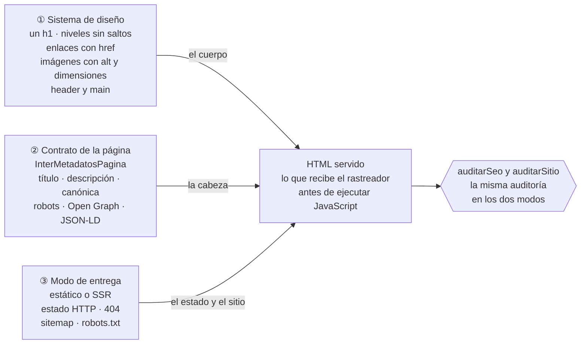
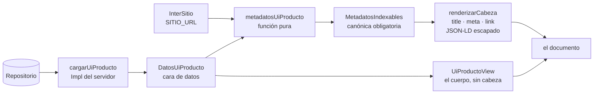
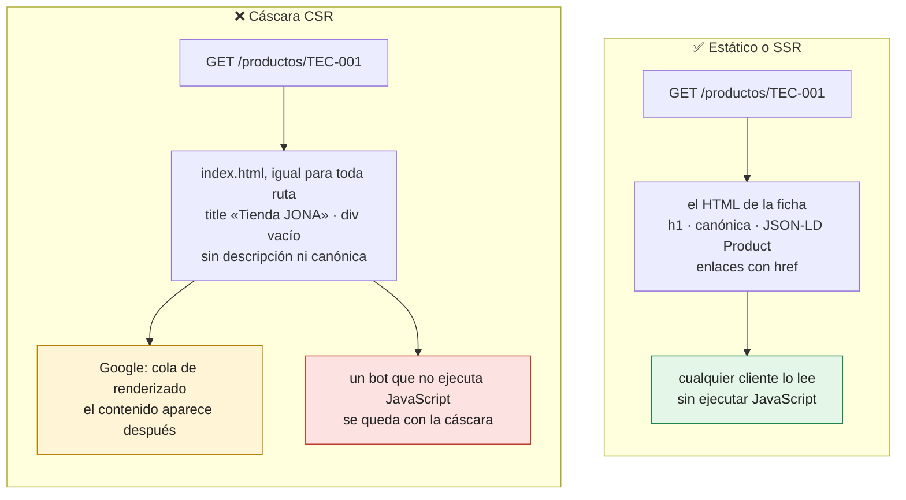
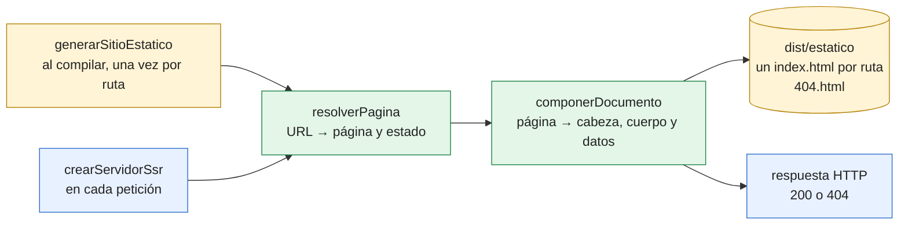
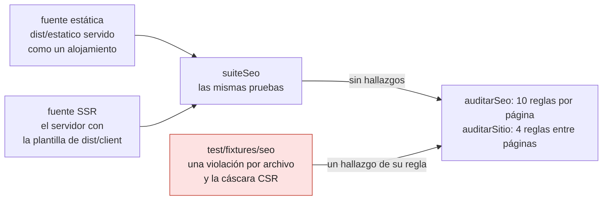

# Capítulo 16. SEO desde el sistema de diseño, el sitio estático y el SSR

El capítulo 15 dio, entre otras razones para renderizar en el servidor, el posicionamiento en buscadores. Lo dejó como motivo, sin mostrar qué cambia. Con SSR, un buscador recibe la página dibujada, pero eso no basta. Si los títulos saltan de nivel, si los enlaces son `<div>` con un manejador, si cada página repite el mismo título o si un producto que no existe responde 200, la página llega dibujada y llega mal.

El SEO (*search engine optimization*) de una interfaz suele tratarse como una lista de etiquetas que alguien agrega al final. Este capítulo sostiene lo contrario: **el SEO se decide en tres lugares de la arquitectura, y cada uno tiene dueño.**

1. **El sistema de diseño pone la semántica por defecto.** Un solo `h1`, niveles de título separados del tamaño, enlaces que siempre son `<a href>`, imágenes con texto alternativo y dimensiones, y las marcas `<header>` y `<main>`. Una aplicación que se compone con él hereda esa semántica sin pensarla.
2. **El contrato de la página lleva los metadatos.** `InterMetadatosPagina` (título, descripción, URL canónica, `robots`, Open Graph y JSON-LD) lo produce una función pura por página, a partir de sus datos.
3. **El modo de entrega decide qué HTML recibe el rastreador.** Un sitio estático prerenderizado y un servidor SSR entregan la página completa; una aplicación solo de cliente (CSR) entrega una cáscara vacía.

El ejemplo es `ejemplos/catalogo-seo/`. Es el catálogo de productos de los capítulos anteriores con tres rutas públicas: el catálogo, la ficha de cada producto y la búsqueda. Lo entregan las mismas unidades JONA de dos maneras: como sitio estático generado al compilar y desde un servidor SSR. Una sola auditoría SEO corre contra los dos modos, con la técnica de doble fuente de las suites de contrato del libro (capítulo 3). El ejemplo tiene 110 pruebas. Para la semántica, el sistema de diseño del capítulo 13 sube a la versión 1.1.0, con tres átomos nuevos y dos reglas, y pasa también de 76 a 110 pruebas.

> [!IMPORTANT]
> **Regla del capítulo.**
> - La semántica que lee un rastreador es responsabilidad del **sistema de diseño**: títulos con nivel, enlaces con destino, imágenes con texto alternativo y dimensiones.
> - Los metadatos de una página son un **contrato JONA**: los produce una función pura por página, y un solo renderizador los convierte en la cabeza.
> - El HTML **tal como se sirve**, antes de ejecutar JavaScript, debe contener la página: título, `h1`, canónica, contenido y enlaces.
> - Una página que no existe responde **404**, y una que no se indexa lo dice con `noindex`, no con robots.txt.
> - La misma auditoría corre contra **cada modo de entrega**.

> **Sobre los fragmentos de código.** Los fragmentos de este capítulo son extractos, a veces abreviados, de los ejemplos ejecutables de la carpeta `ejemplos/` (apéndice B). Omiten detalles que no aportan a la explicación; al final de cada sección se indica el archivo completo, que compila y tiene pruebas.

> [!NOTE]
> Lo que el capítulo afirma sobre cómo trata Google una página sale de la documentación de Google Search Central, consultada en noviembre de 2026 y citada en el apéndice C. Otros buscadores pueden comportarse distinto. El capítulo no hace promesas de posicionamiento: muestra cómo la arquitectura evita los errores que impiden que una página se encuentre, se lea o se indexe bien.

---

## 16.1 Tres lugares, tres dueños

| Lugar | Qué decide | Dueño | Pieza del ejemplo | Qué lo verifica |
|---|---|---|---|---|
| **Sistema de diseño** | La estructura del cuerpo: títulos, enlaces, imágenes, marcas de región | Diseñador de UI, con el arquitecto del sistema de diseño | `JHeading`, `JLink`, `JImage`, `JPageLayout` | Los tipos y las reglas 5 y 6 del sistema de diseño |
| **Contrato de la página** | La cabeza: título, descripción, canónica, `robots`, Open Graph, JSON-LD | Integrador, con el contenido que define el negocio | `InterMetadatosPagina` y una función `metadatos*` por página | Pruebas sin DOM de cada función; la regla 5 del ejemplo |
| **Modo de entrega** | Qué HTML llega, con qué estado HTTP, y los archivos del sitio: sitemap, robots.txt, 404 | Arquitecto | `resolverPagina`, `componerDocumento`, el generador estático y el servidor SSR | La auditoría contra los dos modos |



*Figura 16.1. Las tres fuentes del HTML que recibe un rastreador. Mire las etiquetas de las flechas: cada lugar aporta una parte distinta, y ninguno puede corregir lo que otro hizo mal. Un buen título no arregla un enlace que no es enlace, y un HTML perfecto con estado 200 para un producto inexistente sigue siendo un error. La auditoría mira el resultado, no las piezas.*

Buena parte de lo que pide un buscador coincide con lo que pide la accesibilidad, porque los dos leen la misma estructura sin ver la página: un lector de pantalla salta de título en título y de enlace en enlace, igual que un rastreador recorre títulos y enlaces. Por eso la mayoría de las decisiones de la sección siguiente tienen dos justificaciones, y el sistema de diseño ya tenía las herramientas para sostenerlas: tipos estrictos, reglas con árboles de violación y axe-core.

---

## 16.2 El sistema de diseño pone la semántica

La versión 1.1.0 de `ejemplos/sistema-diseno-atomico/` agrega tres átomos. Es un cambio menor en el sentido del capítulo 8: solo agrega exportaciones y una propiedad opcional (`name` en `JInput`), y los consumidores de los capítulos 14 y 15 pasan sus pruebas sin cambios.

| Átomo | Qué exige su contrato | Para un buscador | Para la accesibilidad |
|---|---|---|---|
| `JHeading` | `level` de 1 a 6, obligatorio; `size` aparte, opcional | El esquema de títulos dice de qué trata la página y cada sección | Los lectores de pantalla navegan por títulos y por nivel |
| `JLink` | `href` obligatorio, del tipo `JLinkHref`; sin `onClick` | Google descubre los enlaces cuando son `<a>` con `href` | El teclado enfoca un `<a href>`; un `<div>` con manejador, no |
| `JImage` | `alt` (o `decorativa`), `width` y `height` obligatorios; `prioridad` opcional | El texto alternativo describe la imagen | El texto alternativo es lo que se anuncia |
| `JPageLayout` (ya existía) | `title`: el único `<h1>`, dentro de `<header>`; el contenido, en `<main>` | La página tiene un título principal | Las marcas de región permiten saltar al contenido |

Lo que dice la tabla sobre Google está en su documentación: la guía de enlaces rastreables dice que, en general, Google solo puede rastrear un enlace si es un elemento `<a>` con un atributo `href`, y la de imágenes dice que el texto alternativo es el atributo más importante para dar metadatos sobre una imagen (apéndice C).

### El nivel no es el tamaño

`JText` tenía `as: 'h1' | 'h2'`, y `JPageLayout` dibujaba su título con `<JText as="h1">`. Funcionaba, pero mezclaba dos decisiones: un título que debía verse más pequeño solo podía lograrlo bajando de nivel, y el esquema de la página quedaba en manos del estilo. `JHeading` las separa:

```ts
// ejemplos/sistema-diseno-atomico/src/atomos/jheading/InterJHeading.ts (extracto)
export interface InterJHeading {
  children: ReactNode;
  /**
   * Nivel en el esquema del documento: dibuja <h1>…<h6>. Obligatorio: el átomo no sabe en qué
   * lugar de la página está, lo sabe quien compone. Un nivel nunca se salta hacia abajo.
   */
  level: 1 | 2 | 3 | 4 | 5 | 6;
  /** Tamaño visual. Sin él, el que corresponde al nivel: xl para 1, lg para 2, md para 3, sm de 4 a 6. */
  size?: 'xl' | 'lg' | 'md' | 'sm';
  id?: string;
}
```

El nivel es obligatorio porque el átomo no puede saber dónde está: lo sabe quien compone. En el catálogo, el nombre de cada producto de la lista es un `h2` que se ve del tamaño de un `h3`: `<JHeading level={2} size="md">`.

### Un enlace es un `<a href>`, y el tipo lo garantiza

`JLink` no tiene `onClick` en su contrato: navegar es seguir un `href`. Y el `href` no es un `string` cualquiera:

```ts
// ejemplos/sistema-diseno-atomico/src/atomos/jlink/InterJLink.ts (extracto)
/**
 * Un destino real: una ruta del sitio o una URL completa. Con un tipo de plantilla, "#" y
 * "javascript:" no compilan, y una ruta armada con una plantilla (`/productos/${sku}`) sí.
 */
export type JLinkHref = `/${string}` | `https://${string}` | `http://${string}` | `mailto:${string}` | `tel:${string}`;
```

Es un tipo de plantilla de TypeScript. Un literal como `"#"` o `"javascript:void(0)"` no encaja en ninguna de las formas y no compila. Una ruta armada con una plantilla, como `` `/productos/${sku}` ``, recibe del compilador un tipo de plantilla compatible y sí compila. El costo es que una ruta relativa (`producto.html`, `?q=x`) tampoco compila: el sistema de diseño elige rutas absolutas del sitio, que son las que usa el ejemplo.

### `JImage`: el texto alternativo y las dimensiones no se olvidan

```ts
// ejemplos/sistema-diseno-atomico/src/atomos/jimage/InterJImage.ts (extracto)
/** Una imagen que informa: su texto alternativo es obligatorio. */
export interface JImageInformativa extends JImageBase {
  alt: string;
  decorativa?: false;
}

/** Una imagen que no informa: el alt vacío es una decisión, no un olvido. */
export interface JImageDecorativa extends JImageBase {
  decorativa: true;
  alt?: never;
}

export type InterJImage = JImageInformativa | JImageDecorativa;
```

`JImageBase` declara `src`, `width` y `height` obligatorios, y `prioridad` opcional (sección 16.9). El `alt=""` existe, porque una imagen decorativa debe tenerlo vacío para que la tecnología de asistencia la omita, pero solo como decisión explícita: `decorativa`. Una imagen decorativa con `alt` tampoco compila, porque `never` no admite ningún valor.

### Lo que no compila, probado

Las tres exigencias se prueban como el capítulo 8 probó el botón solo icono: directivas `@ts-expect-error` en las pruebas, que `npm run build` compila. Si alguien afloja un contrato, la directiva queda sin error que esperar y la compilación falla.

```tsx
// ejemplos/sistema-diseno-atomico/test/atomos.test.tsx (extracto)
it('sin href, con "#" o con javascript: no compila; y no hay onClick que lo reemplace', () => {
  // @ts-expect-error -- InterJLink exige href.
  render(<JLink>Sin destino</JLink>);
  // @ts-expect-error -- "#" no es un destino.
  render(<JLink href="#">Ancla vacía</JLink>);
  // @ts-expect-error -- javascript: no es un destino.
  render(<JLink href="javascript:void(0)">Script</JLink>);
  // @ts-expect-error -- navegar es seguir un href, no ejecutar un manejador.
  render(<JLink href="/" onClick={() => {}}>Con manejador</JLink>);
});
```

Lo mismo para `JHeading` sin `level`, y para `JImage` sin `alt`, sin `width`, sin `height` o decorativa con `alt`. Cada átomo tiene además su prueba de axe-core; la de `JImage` incluye un `` sin `alt` dibujado a mano, que axe señala con `image-alt`, para que la prueba no sea vacía.

### Las reglas 5 y 6: el sistema de diseño se aplica a sí mismo

Los tipos protegen a quien usa los átomos. Dentro del sistema de diseño hace falta otra cosa: que ninguna otra vista dibuje títulos o enlaces a mano. Dos reglas nuevas, en `test/semantica/reglas.ts`, recorren con la API del compilador cada `*View.tsx`, como las reglas 1 a 4 del capítulo 13 recorren los imports:

| # | Regla | Árbol de violación | Mensaje real |
|:-:|---|---|---|
| 5 | Los títulos salen de `JHeading`: ninguna vista dibuja `<h1>`…`<h6>` ni usa `as="h…"` en otro átomo | `titulo-a-mano`, `titulo-con-jtext` | «línea 10: usa <JText as="h1">; los títulos salen de JHeading, que separa el nivel del tamaño» |
| 6 | Navegar es un enlace con destino: todo `<a>` tiene `href`, que no es `#` ni `javascript:`, y ningún elemento no interactivo lleva `onClick` | `enlace-sin-href`, `enlace-a-ninguna-parte`, `fila-con-onclick` | «línea 10: <tr> con onClick: no es un enlace ni un botón; para navegar, JLink; para actuar, JButton» |

```ts
// ejemplos/sistema-diseno-atomico/test/semantica/reglas.ts (extracto)
if (TITULO.test(etiqueta) && !archivo.startsWith(UNIDAD_DE_TITULOS)) {
  informar(5, nodo, `dibuja <${etiqueta}> a mano; los títulos salen de JHeading, que exige el nivel`);
}
// …
if (esNativo(nodo) && !INTERACTIVOS.has(etiqueta) && atributo(nodo, 'onClick')) {
  informar(6, nodo, `<${etiqueta}> con onClick: no es un enlace ni un botón; para navegar, JLink; para actuar, JButton`);
}
```

La primera vez que corrió, la regla 5 falló contra `src/`: `JPageLayout` y `JConfirmDialog` dibujaban sus títulos con `<JText as="h1">` y `<JText as="h2">`. Las dos vistas pasaron a `JHeading`. `JText` conserva `as: 'h1' | 'h2'` en su tipo: quitarlo habría sido un cambio mayor para cualquier consumidor que lo usara, y ninguno de los ejemplos lo usa. El comentario del contrato remite a `JHeading`, y dentro del sistema de diseño la regla 5 impide volver a usarlo. El árbol `titulo-con-jtext` es, precisamente, la versión 1.0.0 de `JPageLayoutView`.

> [!NOTE]
> Las reglas 5 y 6 miran las vistas del sistema de diseño, no las de la aplicación. En la aplicación, lo que garantiza la semántica es componer con estos átomos, y lo que la comprueba es la auditoría del HTML final (sección 16.8).

Ejemplo ejecutable: `ejemplos/sistema-diseno-atomico/src/atomos/` (`jheading`, `jlink`, `jimage`), `test/atomos.test.tsx` y `test/semantica/`.

---

## 16.3 El contrato de metadatos

La cabeza de una página no se ve, y por eso suele quedar sin dueño: un poco en la plantilla, un poco en un componente que escribe `document.title`, y el JSON-LD pegado donde hubo lugar. El ejemplo la trata como cualquier otra frontera de JONA: un contrato.

```ts
// ejemplos/catalogo-seo/src/seo/InterMetadatosPagina.ts (extracto)
interface MetadatosComunes {
  /** El <title>: único entre las páginas que se indexan. */
  titulo: string;
  /** La meta description: también única entre las páginas que se indexan. */
  descripcion: string;
  /**
   * Open Graph, para las vistas previas de un enlace compartido. og:title, og:description y
   * og:url salen del título, la descripción y la canónica; aquí va solo lo propio.
   */
  openGraph: {
    tipo: 'website' | 'product';
    /** URL absoluta. */
    imagen?: string;
  };
  jsonLd?: ObjetoJsonLd;
}

/** Una página que se indexa declara su URL canónica, absoluta. */
export interface MetadatosIndexables extends MetadatosComunes {
  robots: 'index, follow';
  canonica: string;
}

/**
 * Una página que no se indexa no declara canónica: las dos señales dirían cosas distintas.
 * `follow`: sus enlaces se siguen igual.
 */
export interface MetadatosNoIndexables extends MetadatosComunes {
  robots: 'noindex, follow';
  canonica?: never;
}

export type InterMetadatosPagina = MetadatosIndexables | MetadatosNoIndexables;
```

Tres decisiones están en el tipo:

- **La unión liga `robots` con `canonica`.** Una página que se indexa no compila sin canónica; una que no se indexa no compila con ella. La guía de Google sobre URL duplicadas desaconseja usar `noindex` para influir en la elección de la canónica dentro de un sitio: las dos señales responden preguntas distintas, y mezclarlas confunde.
- **Open Graph se deriva.** `og:title`, `og:description` y `og:url` repiten el título, la descripción y la canónica. El contrato no los duplica; el renderizador los copia. Solo el tipo y la imagen son propios.
- **JSON-LD es un objeto, no un texto.** `ObjetoJsonLd` exige `@context` y `@type`, y sus valores son los que JSON conserva. Escapar es trabajo del renderizador.

### Una función pura por página

Cada página produce sus metadatos en su Implementación del servidor, como función de sus datos y del sitio. La ficha de producto:

```ts
// ejemplos/catalogo-seo/src/ui/producto/UiProductoImplServidor.ts (extracto)
/** Una ficha siempre se indexa: el tipo de retorno lo dice, y exige la canónica. */
export function metadatosUiProducto(datos: DatosUiProducto, sitio: InterSitio): MetadatosIndexables {
  const canonica = urlAbsoluta(sitio.url, rutaProducto(datos.sku));
  const imagen = urlAbsoluta(sitio.url, datos.imagen.src);
  return {
    titulo: `${datos.nombre} (${datos.sku}) | ${sitio.nombre}`,
    descripcion: datos.descripcion,
    canonica,
    robots: 'index, follow',
    openGraph: { tipo: 'product', imagen },
    jsonLd: {
      '@context': 'https://schema.org',
      '@type': 'Product',
      name: datos.nombre,
      sku: datos.sku,
      description: datos.descripcion,
      image: imagen,
      url: canonica,
      offers: {
        '@type': 'Offer',
        price: datos.precio.toFixed(2),
        priceCurrency: 'PEN',
        availability: datos.stock > 0 ? 'https://schema.org/InStock' : 'https://schema.org/OutOfStock',
        url: canonica,
      },
    },
  };
}
```

El tipo de retorno es `MetadatosIndexables`, no la unión: una ficha siempre se indexa, y el compilador lo hace cumplir. El JSON-LD usa el vocabulario de schema.org: `Product` con una `Offer` en soles (`PEN`), y la disponibilidad sale del stock. La guía de datos estructurados de producto de Google pide el nombre y una oferta, una reseña o una calificación; en la oferta, el precio es obligatorio, y la moneda y la disponibilidad, recomendadas, con los valores completos de schema.org como `https://schema.org/InStock`.

Las pruebas de la Implementación del servidor de la ficha corren en el entorno `node`, sin DOM ni React. Cuatro son de esta función: la canónica absoluta con la URL del sitio, el SKU codificado en la canónica, la oferta con `OutOfStock` cuando el stock es cero, y que la función es pura. El catálogo produce un `ItemList` con un enlace absoluto por producto; la búsqueda y la página no encontrada, `noindex` sin JSON-LD.

### Un solo renderizador para la cabeza

```ts
// ejemplos/catalogo-seo/src/seo/renderizarCabeza.ts (extracto)
export function renderizarCabeza(metadatos: InterMetadatosPagina): string {
  const { titulo, descripcion, canonica, robots, openGraph, jsonLd } = metadatos;
  const etiquetas = [
    `<title>${escaparHtml(titulo)}</title>`,
    metaNombre('description', descripcion),
    metaNombre('robots', robots),
    canonica && `<link rel="canonical" href="${escaparHtml(canonica)}" />`,
    metaPropiedad('og:type', openGraph.tipo),
    metaPropiedad('og:title', titulo),
    metaPropiedad('og:description', descripcion),
    canonica && metaPropiedad('og:url', canonica),
    openGraph.imagen && metaPropiedad('og:image', openGraph.imagen),
    // El mismo escape que los datos incrustados del capítulo 15: <, > y & como secuencias de JSON.
    jsonLd && `<script type="application/ld+json">${serializarParaHtml(jsonLd)}</script>`,
  ];
  return etiquetas.filter(Boolean).join('\n    ');
}
```

Es texto y no React porque la cabeza no se hidrata: el cliente no la vuelve a dibujar. Los textos se escapan como HTML, y el JSON-LD con `serializarParaHtml`, la misma función del capítulo 15 (sección 15.9). El riesgo es el mismo: un producto llamado `</script><script>…</script>` cerraría el JSON-LD e inyectaría un script. La prueba «un nombre con </script> no rompe el JSON-LD» lo verifica con el parser de jsdom, y la prueba siguiente muestra que con `JSON.stringify` a secas el mismo nombre parte el JSON-LD y el script inyectado aparece.



*Figura 16.2. La cabeza y el cuerpo salen de los mismos datos por dos caminos. Siga la rama de arriba: los datos y el sitio entran a una función pura, su resultado tiene el tipo que exige la canónica, y un solo renderizador lo convierte en etiquetas. La vista, abajo, dibuja solo el cuerpo.*

### Ninguna vista escribe la cabeza

Según su documentación, React 19 acepta `<title>` y `<meta>` en cualquier componente y siempre los coloca en la cabeza del documento. Es cómodo, y en este ejemplo sería un agujero: un `<title>` en una vista se saltaría el contrato, su prueba sin DOM y el renderizador que escapa. La regla 5 de `test/architecture` lo prohíbe: ningún `*View.tsx` dibuja `<title>`, `<meta>`, `<link>`, `<script>`, `<head>`, `<html>` ni `<base>`: todo lo que puede terminar en la cabeza, o escribir datos estructurados, pasa por el contrato. Sus árboles de violación dan «línea 6: la vista dibuja <title>; los metadatos van en el contrato InterMetadatosPagina» y, para una vista que incrusta su propio JSON-LD, «línea 3: la vista dibuja <script>; …». Las otras cuatro reglas son las del capítulo 15, copiadas: lo del servidor no llega al navegador, la cara de datos es serializable, las vistas son puras y el servidor no guarda estado de módulo.

Ejemplo ejecutable: `ejemplos/catalogo-seo/src/seo/`, `src/ui/*/Ui*ImplServidor.ts` y `test/architecture/reglas.ts`.

---

## 16.4 Qué recibe el rastreador

La pregunta que decide el modo de entrega es concreta: **¿qué contiene el HTML que el servidor responde, antes de que corra una línea de JavaScript?**

El contraejemplo del capítulo es una aplicación solo de cliente. El servidor responde el mismo archivo para cualquier ruta, y un script pone el título, la canónica y el contenido cuando corre en el navegador:

```html
<!-- ejemplos/catalogo-seo/test/fixtures/seo/csr/index.html (extracto) -->
<html lang="es-PE">
  <head>
    <meta charset="UTF-8" />
    <title>Tienda JONA</title>
    <script type="module" src="./app.js"></script>
  </head>
  <body>
    <div id="root"></div>
  </body>
</html>
```

La auditoría lee ese HTML como se sirve, sin ejecutar scripts, y para la ruta de una ficha encuentra cuatro problemas: «debe haber exactamente una meta description, hay 0», «una página indexable declara exactamente una canónica, y esta declara 0», «debe haber exactamente un <h1>, hay 0» y «falta el JSON-LD de tipo Product». Auditado como sitio, con la misma cáscara en dos rutas, agrega el quinto: «el título «Tienda JONA» se repite en …/productos/TEC-001 y …/productos/MOU-002». El título no está vacío; es genérico, y solo se ve al comparar páginas.

### El matiz: Google ejecuta JavaScript, pero no en el mismo momento

Sería falso decir que Google no ve una aplicación CSR. Su guía de conceptos básicos de JavaScript y SEO describe tres fases para una aplicación web con JavaScript: rastreo, renderizado e indexación. Después de rastrear, la página espera en una cola de renderizado, y según la misma guía puede quedarse allí unos segundos, o más. El contenido que pone el script aparece para Google cuando la página se renderiza, no cuando se descarga.

La misma guía da dos razones para entregar el HTML completo de todos modos: renderizar en el servidor o prerenderizar sigue siendo una gran idea porque hace el sitio más rápido para los usuarios y los rastreadores, y **no todos los bots pueden ejecutar JavaScript**. Un rastreador de otro buscador, o el servicio que arma la vista previa de un enlace compartido, puede leer solo el HTML servido. Para ese cliente, la cáscara de arriba es la página entera.

Dos advertencias más de la guía afectan directamente a una aplicación CSR. Primero, si el HTML original lleva `noindex`, Google puede saltarse el renderizado: quitar el `noindex` con JavaScript puede no funcionar. Segundo, con enrutamiento en el cliente es difícil o imposible responder un código de estado HTTP con sentido, y la guía dedica una sección a evitar el «soft 404» que eso produce (sección 16.6).



*Figura 16.3. La misma petición en los dos casos. A la izquierda, el HTML servido no tiene la página: Google la verá después de renderizarla (en ámbar, una etapa diferida) y un bot que no ejecuta JavaScript no la verá nunca (en rojo). A la derecha, la página está en la respuesta, y lo que ejecute o no el cliente ya no decide qué se lee.*

Este capítulo no descarta la aplicación CSR: un panel detrás de un inicio de sesión no necesita indexarse, y para él el capítulo 14 sigue siendo la forma natural. La regla es para el **contenido que debe encontrarse**: catálogo, fichas, artículos.

Ejemplo ejecutable: `ejemplos/catalogo-seo/test/fixtures/seo/csr/` y el bloque «contraejemplo» de `test/seo/auditoria.test.ts`.

---

## 16.5 La entrega estática: prerenderizar al compilar

El primer modo de entrega genera el sitio al compilar (SSG, *static site generation*, o prerenderizado). `npm run build` termina con `node dist/server/generarEstatico.js`, que escribe `dist/estatico`:

```text
dist/estatico/
├── index.html                    el catálogo
├── productos/TEC-001/index.html  una ficha por producto
├── productos/MOU-002/index.html
├── productos/MON-003/index.html
├── buscar/index.html             la búsqueda, sin término (sección 16.7)
├── 404.html                      la página no encontrada
├── sitemap.xml · robots.txt
├── datos/productos.json          el índice de la búsqueda en el navegador
├── img/ · assets/                copiados de dist/client
```

```ts
// ejemplos/catalogo-seo/src/servidor/generarSitioEstatico.ts (extracto)
const indexables = await rutasIndexables(repositorio);
// La búsqueda se prerenderiza sin término: el navegador busca con el índice JSON (UiCatalogoImplCliente).
for (const ruta of [...indexables, RUTA_BUSQUEDA]) {
  const { estado, pagina } = await resolverPagina(new URL(urlAbsoluta(sitio.url, ruta)), repositorio);
  if (estado !== 200) throw new Error(`La ruta ${ruta} debía existir y respondió ${estado}`);
  await escribir(archivoDeRuta(ruta), componerDocumento(plantilla, pagina, sitio));
}
const noEncontrada = await resolverPagina(new URL(urlAbsoluta(sitio.url, RUTA_INEXISTENTE)), repositorio);
if (noEncontrada.estado !== 404) throw new Error(`${RUTA_INEXISTENTE} debía responder 404`);
await escribir('404.html', componerDocumento(plantilla, noEncontrada.pagina, sitio));
```

Las dos funciones que hacen el trabajo, `resolverPagina` y `componerDocumento`, son las mismas que usa el servidor SSR (sección 16.7). El generador solo decide **qué rutas** existen: las indexables, la búsqueda y la página no encontrada.

### La URL pública es una variable de la compilación

Las canónicas, el JSON-LD, el sitemap y robots.txt necesitan URL absolutas. La guía de canonicalización de Google pide rutas absolutas en `rel="canonical"`, y la de sitemaps, URL completas y absolutas. Pero la compilación no sabe dónde se va a publicar el sitio, así que lo recibe: `SITIO_URL`, con `https://catalogo.example` por defecto (`.example` está reservado para ejemplos). La raíz de composición la valida al arrancar y rechaza lo que no sea un origen: una URL relativa, con ruta o con otro esquema detiene la compilación, o el servidor, con un mensaje.

### Sitemap, robots.txt y 404.html

`sitemap.xml` lista solo las rutas que se indexan: el catálogo y cada ficha. La lista sale de `rutasIndexables`, una función aparte de la decisión `robots` de cada página. Son dos fuentes de la misma verdad, y la auditoría comprueba que coincidan (sección 16.8). La guía de Google lo pide así: incluir en el sitemap las URL que se quieren ver en los resultados, porque el sitemap las sugiere como canónicas.

`robots.txt` declara el sitemap con su URL absoluta, con la línea `Sitemap:` que describe la misma guía, y no bloquea nada:

```ts
// ejemplos/catalogo-seo/src/servidor/sitemap.ts (extracto)
/**
 * robots.txt no bloquea /buscar: una página bloqueada no se descarga, y su `noindex` no se
 * llegaría a leer. Que no se indexe lo dice la propia página.
 */
export function generarRobots(sitio: InterSitio): string {
  return ['User-agent: *', 'Allow: /', '', `Sitemap: ${urlAbsoluta(sitio.url, RUTA_SITEMAP)}`, ''].join('\n');
}
```

`404.html` es la página que el alojamiento estático debe responder, con estado 404, para cualquier ruta que no existe. Muchos alojamientos estáticos siguen esa convención; conviene comprobarlo en el que se use, porque un alojamiento que sirva `404.html` con estado 200 convierte cada ruta inexistente en un soft 404 (sección 16.6). La sigue `crearServidorEstatico`, el servidor de archivos sin dependencias que usan `npm run preview:estatico` y las pruebas. El generador la escribe con la misma página que el servidor SSR responde con 404, así que las dos son idénticas.

### Mayúsculas: una página, dos URL

La suite SEO encontró un defecto que nadie había buscado. En Windows, `GET /productos/tec-001` al servidor de archivos respondió **200** con la ficha de `TEC-001`: el disco no distingue mayúsculas, y el archivo existía. Para un rastreador, eso es la misma página en dos URL. La guía de estructura de URL de Google es explícita: el manejo de URL de Google Search distingue mayúsculas, `/APPLE` y `/apple` son URL distintas con su propio contenido, y si el servidor las trata igual, conviene llevar todo a una sola forma. Un alojamiento estático en Linux habría respondido 404; el mismo sitio, servido desde un disco que no distingue mayúsculas (Windows, o macOS con su configuración habitual), no.

La corrección compara la ruta pedida con la ruta real del archivo:

```ts
// ejemplos/catalogo-seo/src/servidor/archivos.ts (extracto)
// Distingue mayúsculas también en un disco que no las distingue (Windows, macOS): /productos/tec-001
// no es /productos/TEC-001. Servirla con 200 publicaría la misma página en dos URLs.
const real = await realpath(archivo).catch(() => undefined);
if (real === undefined || relative(await realpath(base), real) !== relative(base, archivo)) return undefined;
```

`/productos/tec-001` está en la lista de rutas desconocidas de la suite SEO, que exige 404 en los dos modos. El servidor SSR no tenía el problema: busca el SKU exacto en el repositorio.

Ejemplo ejecutable: `ejemplos/catalogo-seo/src/servidor/generarSitioEstatico.ts`, `sitemap.ts`, `archivos.ts` y `crearServidorEstatico.ts`.

---

## 16.6 La entrega con SSR: la cabeza y el estado, en cada petición

El segundo modo es el servidor SSR del capítulo 15, con dos responsabilidades más: la cabeza de cada página y su código de estado.

```ts
// ejemplos/catalogo-seo/src/servidor/crearServidorSsr.ts (extracto)
const { estado, pagina } = await resolverPagina(url, repositorio);
return responder(respuesta, estado, TIPOS['.html'], componerDocumento(plantilla, pagina, raiz.sitio));
```

### Un 404 de verdad

El estado lo decide `resolverPagina`, antes de dibujar:

```ts
// ejemplos/catalogo-seo/src/servidor/resolverPagina.ts (extracto)
export async function resolverPagina(url: URL, repositorio: InterProductoRepositorio): Promise<ResultadoPagina> {
  const ruta = normalizarRuta(url.pathname);
  if (ruta === RUTA_INICIO) {
    return { estado: 200, pagina: { unidad: 'catalogo', datos: await cargarUiCatalogo(repositorio, {}) } };
  }
  if (ruta === RUTA_BUSQUEDA) {
    const datos = await cargarUiCatalogo(repositorio, { termino: url.searchParams.get('q') ?? '' });
    return { estado: 200, pagina: { unidad: 'catalogo', datos } };
  }
  const sku = skuDeRuta(ruta);
  const producto = sku === undefined ? undefined : await cargarUiProducto(repositorio, sku);
  return producto ? { estado: 200, pagina: { unidad: 'producto', datos: producto } } : paginaNoEncontrada();
}
```

Un producto que no existe es un 404 con la página «no encontrada» y `noindex`. No es un 200 con un mensaje que diga «no encontrado»: eso es un **soft 404**. En la tabla de códigos de estado de Google, una respuesta `2xx` cuyo contenido sugiere un error, una página vacía o un mensaje de error aparece en Search Console como soft 404. Y Google no indexa las URL que responden `4xx`. El estado es la señal que un rastreador entiende sin leer el texto.

`cargarUiProducto` devuelve `undefined` y no decide la respuesta: la decide quien responde. Las diez pruebas de `resolverPagina.test.ts` incluyen ocho rutas que no deben responder 200: un SKU que no existe, el mismo SKU en minúsculas, una ruta con un segmento de más, una codificación inválida (`%E0%A4%A`) y otras. Es la versión de unidad de una garantía que la suite SEO comprueba de punta a punta en los dos modos.

Este es también el argumento del capítulo 15 para `renderToString` (sección 15.14): con los datos cargados antes de dibujar, el estado se decide antes de enviar el primer byte. Con *streaming*, el estado sale con los primeros bytes, y un 404 descubierto a mitad de la página llegaría tarde.

### La búsqueda: `noindex, follow`, y sin bloquearla

`/buscar?q=` es una página útil y no debe indexarse. Cada texto posible es una URL distinta, y todas repiten contenido de las fichas, que sí se indexan. La Implementación del servidor del catálogo la marca `noindex, follow`, sin canónica ni JSON-LD:

```ts
// ejemplos/catalogo-seo/src/ui/catalogo/UiCatalogoImplServidor.ts (extracto)
if (datos.termino !== undefined) {
  return {
    titulo: datos.termino ? `Buscar «${datos.termino}» | ${sitio.nombre}` : `Buscar productos | ${sitio.nombre}`,
    descripcion: `Resultados de búsqueda en el catálogo de ${sitio.nombre}.`,
    robots: 'noindex, follow',
    openGraph: { tipo: 'website' },
  };
}
```

`follow` deja que los enlaces de los resultados se sigan hasta las fichas. Lo que **no** se hace es bloquear `/buscar` en robots.txt, aunque parezca más directo. La documentación de Google sobre la etiqueta meta `robots` lo explica: si robots.txt impide rastrear una página, sus reglas de indexación no se encuentran y se ignoran; para que se respeten, las URL que las contienen no pueden bloquearse. Una página bloqueada con `noindex` es una página cuyo `noindex` nadie lee.

El buscador es un formulario `GET` a `/buscar` con un campo `name="q"`, así que funciona sin JavaScript. Por eso `JInput` ganó la propiedad `name` en la versión 1.1.0 del sistema de diseño.

Ejemplo ejecutable: `ejemplos/catalogo-seo/src/servidor/resolverPagina.ts` y su prueba, y `src/servidor/crearServidorSsr.ts`.

---

## 16.7 Un código, dos modos de entrega

Los dos modos comparten todo salvo el momento en que se ejecutan:



*Figura 16.4. El núcleo compartido, en verde. El generador estático (ámbar) y el servidor SSR (azul) llaman a las mismas dos funciones; solo cambia cuándo y qué hacen con el resultado: escribirlo en un archivo o enviarlo en una respuesta. La raíz de composición, que no se dibuja, también es la misma.*

```tsx
// ejemplos/catalogo-seo/src/servidor/componerDocumento.tsx (extracto)
export function componerDocumento(plantilla: string, pagina: DatosPagina, sitio: InterSitio): string {
  const cabeza = renderizarCabeza(metadatosDePagina(pagina, sitio));
  const html = renderToString(<Pagina pagina={pagina} />);
  const datos = `<script id="${ID_DATOS}" type="application/json">${serializarParaHtml(pagina)}</script>`;
  return plantilla
    .replace(MARCAS.cabeza, () => cabeza)
    .replace(MARCAS.html, () => html)
    .replace(MARCAS.datos, () => datos);
}
```

`DatosPagina` es la cara de datos de la página entera: qué unidad se dibuja (`catalogo`, `producto` o `no-encontrado`) y sus datos. Viaja incrustada en el HTML, como en el capítulo 15, y la entrada del navegador hidrata con ella la misma unidad, sea cual sea el modo. La prueba de hidratación del capítulo 15 se repite sobre el documento completo: la ficha hidrata sin errores recuperables ni avisos, y después el botón «Agregar al carrito» responde.

### Byte a byte

Que los dos modos compartan funciones no garantiza que entreguen lo mismo. Una prueba lo comprueba con lo compilado:

```ts
// ejemplos/catalogo-seo/test/seo/sitio.test.ts (extracto)
const rutas = [...PAGINAS.filter((p) => p.indexable).map((p) => p.ruta), '/productos/NO-EXISTE'];
for (const ruta of rutas) {
  const [deEstatico, deSsr] = await Promise.all([a.obtener(ruta), b.obtener(ruta)]);
  expect(deSsr.cuerpo, ruta).toBe(deEstatico.cuerpo);
}
```

Cada página indexable, la página no encontrada y el sitemap son idénticos en los dos modos. Elegir uno u otro es una decisión de despliegue, no de código.

### La única diferencia, a propósito: la búsqueda

El sitio estático no puede resolver `/buscar?q=teclado` al compilar: no sabe qué se va a buscar. Publica `buscar/index.html` sin término, y el alojamiento lo sirve para cualquier consulta. La búsqueda ocurre en el navegador, después de hidratar:

```ts
// ejemplos/catalogo-seo/src/ui/catalogo/UiCatalogoImplCliente.ts (extracto)
useEffect(() => {
  const termino = terminoUrl?.trim() ?? '';
  if (inicial.termino === undefined || !servicio || termino === '' || termino === inicial.termino) return;
  let vigente = true;
  setBorrador(termino);
  setBuscando(true);
  servicio
    .buscar(termino)
    .then(
      (productos) => vigente && setDatos({ termino, productos }),
      () => vigente && setDatos({ termino, productos: [], aviso: 'No se pudo buscar en el catálogo' }),
    )
    .finally(() => vigente && setBuscando(false));
  return () => {
    vigente = false;
  };
}, [inicial, servicio, terminoUrl]);
```

Es un efecto y no una decisión al dibujar, porque el primer dibujo del cliente tiene que ser idéntico al del servidor (sección 15.10). El servicio descarga `/datos/productos.json`, que publican los dos modos, y filtra con `coincide`, la misma función de coincidencia que usa el repositorio del servidor. Con el servidor SSR, la búsqueda llega resuelta en el HTML y el efecto no hace nada. Una prueba lo deja escrito: para `/buscar?q=teclado`, el HTML del SSR trae el enlace a la ficha del teclado, el del sitio estático no, y los dos llevan `noindex, follow`.

La diferencia no le cuesta nada al SEO, porque la búsqueda no se indexa. Si una página **indexable** dependiera de datos que solo existen en la petición, el sitio estático no serviría para ella: ese es el límite del prerenderizado.

Ejemplo ejecutable: `ejemplos/catalogo-seo/src/servidor/resolverPagina.ts`, `componerDocumento.tsx` y `test/seo/sitio.test.ts`.

---

## 16.8 La auditoría

`test/seo/auditarSeo.ts` lee el HTML con jsdom, que analiza el documento y no ejecuta sus scripts: es el HTML que recibe un cliente que no ejecuta JavaScript. Tiene diez reglas por página y cuatro entre páginas.

| Regla | Qué comprueba | Árbol de violación | Mensaje real |
|---|---|---|---|
| `titulo` | Exactamente un `<title>`, no vacío | `titulo-vacio.html` | «el <title> está vacío» |
| `descripcion` | Exactamente una meta description, no vacía | `sin-descripcion.html` | «debe haber exactamente una meta description, hay 0» |
| `canonica` | Indexable: una sola, absoluta e igual a la URL de la página. `noindex`: ninguna | `sin-canonica.html`, `canonica-relativa.html` | «la canónica debe ser absoluta: «/productos/TEC-001»» |
| `robots` | Indexable sin `noindex`; las que no se indexan, con `noindex` | `indexable-con-noindex.html` | «la página debe indexarse y declara noindex» |
| `idioma` | `<html lang>` | `sin-idioma.html` | «<html> no declara lang» |
| `h1` | Exactamente un `<h1>`, no vacío | `dos-h1.html` | «debe haber exactamente un <h1>, hay 2» |
| `niveles` | Los títulos no saltan niveles hacia abajo | `nivel-saltado.html` | «los títulos saltan de h1 a h3, sin h2» |
| `enlaces` | Todo `<a>` con `href`, que no es `#` ni `javascript:`; ningún otro elemento con `onclick` | `div-como-enlace.html`, `enlace-a-ninguna-parte.html` | «<div onclick> «Volver al catálogo» hace de enlace o de botón sin serlo: no tiene href que seguir» |
| `imagenes` | Toda `` con `alt`, `width` y `height` | `imagen-sin-alt.html` | «la imagen /img/productos/TEC-001.svg no tiene alt» |
| `jsonld` | Cada JSON-LD es JSON válido, y está el `@type` esperado | `jsonld-roto.html` | «el JSON-LD n.º 1 no es JSON válido: un texto cerró el <script> antes de tiempo, o se escribió mal» |

Los árboles de violación son la misma ficha válida con **un solo** cambio, y la prueba exige que solo su regla la señale. `jsonld-roto.html` es la ficha con un nombre que trae `</script>`, incrustado con `JSON.stringify` a secas: el JSON-LD queda partido y la regla da, además, «falta el JSON-LD de tipo Product».

```ts
// ejemplos/catalogo-seo/test/seo/auditarSeo.ts (extracto)
canonica: (documento, url, { indexable }) => {
  const canonicas = [...documento.querySelectorAll('link[rel="canonical"]')].map((l) => l.getAttribute('href') ?? '');
  if (!indexable) return canonicas.length > 0 ? [`una página noindex no declara canónica, y esta declara ${canonicas.join(', ')}`] : [];
  if (canonicas.length !== 1) return [`una página indexable declara exactamente una canónica, y esta declara ${canonicas.length}`];
  if (!/^https?:\/\//.test(canonicas[0])) return [`la canónica debe ser absoluta: «${canonicas[0]}»`];
  return canonicas[0] === url ? [] : [`la canónica es ${canonicas[0]}, y la URL de la página es ${url}`];
},
```

### Entre páginas

Hay errores que ninguna página puede ver sola. `auditarSitio` recibe las páginas, el sitemap y robots.txt:

| Regla | Qué comprueba | Caso de violación | Mensaje real |
|---|---|---|---|
| `titulos-unicos` | Ningún título se repite entre las páginas indexables | `otra-pagina-mismo-titulo.html` | «el título «Teclado mecánico (TEC-001) \| Tienda JONA» se repite en …/productos/TEC-001 y …/productos/MOU-002» |
| `descripciones-unicas` | Ninguna descripción se repite entre las páginas indexables | `otra-pagina-misma-descripcion.html` | «la descripción «…» se repite en …» |
| `sitemap` | Lista exactamente las páginas indexables: ni una `noindex`, ni falta ninguna | `sitemap-con-noindex.xml` | «el sitemap lista https://catalogo.example/buscar, que no se indexa» |
| `robots-txt` | Declara el sitemap con su URL absoluta | `robots-sin-sitemap.txt` | «robots.txt no apunta a https://catalogo.example/sitemap.xml» |

Las guías de Google piden títulos distintos para cada página, sin texto repetido de una a otra, y descripciones únicas por página: descripciones idénticas o parecidas en todo el sitio no ayudan cuando las páginas aparecen en los resultados.

### Contra los dos modos: doble fuente

La auditoría corre como corre una suite de contrato en este libro: escrita una vez, ejecutada contra cada implementación. Una fuente es cualquier cosa que responda una ruta con su estado y su HTML:

```ts
// ejemplos/catalogo-seo/test/seo/sitio.test.ts (extracto)
suiteSeo('sitio estático (dist/estatico)', estatico);
suiteSeo('servidor SSR', ssr);
```

`suiteSeo` audita el catálogo, las tres fichas y una búsqueda, exige 404 con `noindex` para cuatro rutas que no existen, y audita el sitio entero. La fuente estática sirve `dist/estatico` con el servidor de archivos; la SSR es el servidor con la plantilla y los estáticos de `dist/client`. Las dos pasan las mismas diez pruebas.



*Figura 16.5. La auditoría y sus tres entradas. Las dos fuentes, arriba a la izquierda, deben pasar sin hallazgos; los árboles de violación, en rojo, deben fallar cada uno en su regla. Lea las etiquetas de las dos flechas que llegan a la auditoría: es la misma función, con dos expectativas opuestas. Si una regla dejara de detectar su árbol, la suite contra los dos modos no probaría nada.*

### Lo que la auditoría no ve

La auditoría lee HTML estático. Por diseño no ve:

- **Core Web Vitals.** LCP, INP y CLS se miden en un navegador que dibuja la página, y web.dev advierte que la medición de laboratorio no reemplaza a la de usuarios reales: Lighthouse, por ejemplo, no puede medir INP sin un usuario.
- **El dibujo real.** El diseño, el contraste efectivo, lo que queda visible sin desplazarse y lo que un script agrega después.
- **El vocabulario de schema.org.** Comprueba que el JSON-LD se lea y que tenga su `@type`, no que sus propiedades sean válidas ni que basten para un resultado enriquecido.
- **Lo que hace un buscador con la página.** Si la indexa, con qué canónica, cómo la muestra.

Lo complementan herramientas con navegador o con datos del buscador: **Lighthouse**, que audita rendimiento, accesibilidad y SEO en un navegador; la **herramienta de inspección de URL** de Search Console, cuya prueba en vivo muestra el HTML que recibió Google y una captura de la página renderizada; y la **prueba de resultados enriquecidos** de Google, que dice qué resultados enriquecidos puede generar el JSON-LD de una página pública. Las tres necesitan un navegador o un sitio publicado. La auditoría del ejemplo corre en cada compilación, sin ninguno de los dos, y detecta antes los errores de estructura.

Ejemplo ejecutable: `ejemplos/catalogo-seo/test/seo/` y `test/fixtures/seo/`.

---

## 16.9 La imagen principal y el LCP

El *Largest Contentful Paint* (LCP) es una de las tres Core Web Vitals. Según web.dev, informa el momento en que se dibuja la imagen, el bloque de texto o el video más grande visible en la ventana, y una buena experiencia pide 2,5 segundos o menos en el percentil 75 de las cargas. En una ficha de producto, ese elemento suele ser la foto.

`JImage` decide la carga con una sola propiedad:

```tsx
// ejemplos/sistema-diseno-atomico/src/atomos/jimage/JImageView.tsx (extracto)
loading={prioridad ? 'eager' : 'lazy'}
fetchPriority={prioridad ? 'high' : undefined}
```

- **Sin `prioridad`**, la imagen carga en diferido (`loading="lazy"`), que es lo que conviene a las miniaturas del catálogo.
- **Con `prioridad`**, la imagen carga de inmediato (`loading="eager"`) y con prioridad alta (`fetchpriority="high"`). web.dev recomienda no cargar en diferido las imágenes que probablemente estén visibles al cargar la página, en especial la del LCP, y explica que `fetchpriority="high"` permite subir la prioridad de esa imagen desde el marcado.

La ficha usa `<JImage … prioridad />` para la foto del producto. Es una decisión de la página, no del átomo: el átomo no sabe si está arriba o abajo. React 19, al dibujar en el servidor, agrega por su cuenta un `<link rel="preload" as="image" … fetchPriority="high">` para esa imagen; lo pone delante del contenido, dentro de `#raiz`, y la prueba de hidratación confirma que no produce diferencias.

Las dimensiones obligatorias son la otra mitad. web.dev recomienda incluir siempre `width` y `height` en las imágenes, porque el navegador calcula con ellas la proporción y reserva el espacio antes de que la imagen llegue; sin ellas, la página salta al cargar, y eso es lo que mide el CLS. La clase `ds-image` del sistema de diseño (`max-width: 100%; height: auto`) deja que la imagen se adapte al ancho sin perder esa proporción.

El capítulo no da cifras de mejora: dependen de la red, del dispositivo y de la página, y la auditoría no las mide. Lo que sí garantiza la arquitectura es que la decisión exista, sea explícita y no se olvide: una imagen sin dimensiones no compila, y la principal se marca en un solo lugar.

Ejemplo ejecutable: `ejemplos/sistema-diseno-atomico/src/atomos/jimage/` y `ejemplos/catalogo-seo/src/ui/producto/UiProductoView.tsx`.

---

## 16.10 El ejemplo

| Archivo de prueba | Pruebas | Qué protege |
|---|--:|---|
| `src/seo/renderizarCabeza.test.ts` | 5 | Las etiquetas de la cabeza; el escape; un nombre con `</script>` no rompe el JSON-LD, y con `JSON.stringify` a secas sí |
| `src/ui/producto/UiProductoImplServidor.test.ts` | 6 | Los metadatos de la ficha como función pura: canónica, `Product` con `offers` en `PEN`, disponibilidad |
| `src/ui/catalogo/UiCatalogoImplServidor.test.ts` | 5 | El catálogo indexable con `ItemList`; la búsqueda `noindex`, sin canónica; el catálogo no oculta un error del repositorio |
| `src/ui/hidratacion.test.tsx` | 6 | La ficha hidrata y responde; la búsqueda del sitio estático busca después de hidratar; datos distintos sí fallan |
| `src/servidor/resolverPagina.test.ts` | 10 | Cada ruta y su estado; ocho rutas desconocidas responden 404 |
| `src/servidor/servidores.test.ts` | 7 | El servidor SSR, el generador y el servidor de archivos, sin compilar |
| `src/servidor/sitemap.test.ts` | 4 | Rutas indexables, sitemap, robots.txt y `SITIO_URL` |
| `src/cliente/crearServicioBusquedaFetch.test.ts` | 1 | La búsqueda del navegador contra el índice que publica el servidor |
| `test/seo/auditoria.test.ts` | 24 | Cada regla contra su árbol de violación; la cáscara CSR falla |
| `test/seo/sitio.test.ts` | 23 | La suite SEO contra el sitio estático y contra el SSR; el mismo HTML en los dos |
| `test/artefacto.test.ts` | 5 | Los archivos de `dist/estatico`; el bundle del cliente sin el código que solo corre en el servidor |
| `test/e2e.test.ts` | 4 | Los procesos compilados: `npm start`, `npm run preview:estatico` y `SITIO_URL` |
| `test/architecture/arquitectura.test.ts` | 10 | Las cinco reglas, cada una con su árbol de violación |
| **Total** | **110** | |

En el sistema de diseño, las pruebas nuevas son 34: las de los tres átomos y la de `name` en `JInput`, en `test/atomos.test.tsx` (de 7 a 23), las ocho de `test/semantica/semantica.test.ts`, el nuevo `h1` de `test/disposiciones.test.tsx` y las del *lint* de tokens, que recorre once vistas (de 23 a 32).

Ejemplo ejecutable: `ejemplos/catalogo-seo/` (`npm run build` antes de `npm test`, porque la suite SEO, el artefacto y la prueba de punta a punta leen `dist/`). Hay que compilar antes `ejemplos/sistema-diseno-atomico/`.

> [!TIP]
> Cada regla del capítulo tiene algo que la hace fallar:
> - Las reglas 5 y 6 del sistema de diseño tienen cinco árboles en `test/fixtures/`.
> - Cada regla de la auditoría tiene su página o su archivo de violación en `test/fixtures/seo/`, y la cáscara CSR falla las de página y la de títulos únicos.
> - La regla 5 del ejemplo tiene dos vistas que escriben la cabeza.
> - La suite SEO encontró, sin buscarlo, el 200 de `/productos/tec-001` en un disco que no distingue mayúsculas.

---

## 16.11 Antipatrones

> [!CAUTION]
> Ninguno de estos antipatrones se ve en el navegador de quien desarrolla: la página se ve bien, los enlaces navegan y el producto inexistente muestra un mensaje amable. Se ven en el HTML servido, en el código de estado o al comparar páginas, y por eso cada uno tiene una regla, un tipo o una prueba que los mira ahí.

**Referencia rápida**

| | Antipatrón | Se reconoce porque… | Qué lo evita |
|:-:|---|---|---|
| 🔴 | [Cáscara CSR para contenido que debe encontrarse](#ap-16-1) | El HTML servido tiene un `<div id="root">` vacío y el mismo `<title>` para toda ruta | Entregar estático o con SSR; la auditoría del HTML servido |
| 🔴 | [Soft 404](#ap-16-2) | Un producto que no existe responde 200 con un mensaje | `resolverPagina` decide 404 antes de dibujar; la suite en los dos modos |
| 🔴 | [Un enlace que no es enlace](#ap-16-3) | Una fila, un `<div>` o una tarjeta navegan con `onClick` | `JLink` sin `onClick`; regla 6 del sistema de diseño; regla `enlaces` |
| 🔴 | [JSON-LD sin escapar](#ap-16-4) | `<script type="application/ld+json">${JSON.stringify(…)}</script>` | `renderizarCabeza` con `serializarParaHtml`; regla 5 del ejemplo |
| 🟠 | [Títulos elegidos por tamaño](#ap-16-5) | Un `h3` porque «el `h2` se ve muy grande»; dos `h1` | `JHeading` separa nivel y tamaño; regla 5 del sistema de diseño; reglas `h1` y `niveles` |
| 🟠 | [Señales de indexación que se contradicen](#ap-16-6) | Una página `noindex` en el sitemap, bloqueada en robots.txt o con canónica | La unión de `InterMetadatosPagina`; reglas `sitemap` y `canonica` |
| 🟡 | [Títulos y descripciones repetidos](#ap-16-7) | Todas las fichas se titulan «Tienda» | Funciones de metadatos con los datos de cada página; `titulos-unicos` |
| 🟡 | [Imágenes sin dimensiones, o la principal en diferido](#ap-16-8) | `` sin `width` ni `height`; la foto del producto con `loading="lazy"` | `JImage` exige dimensiones y ofrece `prioridad`; regla `imagenes` |

🔴 el rastreador no recibe la página, o recibe otra cosa: contenido ausente, un estado falso, enlaces que no puede seguir o código inyectado · 🟠 la página llega, pero con una estructura o unas señales que se contradicen · 🟡 la página se indexa, pero peor de lo que podría

---

<a id="ap-16-1"></a>
### 🔴 Cáscara CSR para contenido que debe encontrarse

**Síntoma.** El catálogo o las fichas son una aplicación solo de cliente: el servidor responde el mismo `index.html` para cualquier ruta, y el título, la canónica y el contenido los pone el JavaScript.

❌ **Así no:** el contraejemplo `ejemplos/catalogo-seo/test/fixtures/seo/csr/index.html`.

```html
<title>Tienda JONA</title>
<script type="module" src="./app.js"></script>
<!-- … -->
<div id="root"></div>
```

✅ **Así sí:** el documento que compone `componerDocumento` para cada ruta, en el sitio estático o en el servidor SSR (`ejemplos/catalogo-seo/src/servidor/componerDocumento.tsx`, extracto; completo en la sección 16.7).

```tsx
const cabeza = renderizarCabeza(metadatosDePagina(pagina, sitio));
const html = renderToString(<Pagina pagina={pagina} />);
```

**Por qué duele.** Lo que no está en el HTML servido depende de que el cliente ejecute JavaScript. Google lo hace, pero en una etapa posterior al rastreo, después de una cola de renderizado; y según su propia guía no todos los bots pueden ejecutar JavaScript, así que otro rastreador o el bot que arma la vista previa de un enlace puede quedarse con la cáscara. Además, todas las rutas comparten título y no tienen canónica. **Cómo no caer:** para el contenido que debe encontrarse, entregue el HTML completo, estático o con SSR (sección 16.4). La auditoría lo detecta en la cáscara: «debe haber exactamente un <h1>, hay 0», «una página indexable declara exactamente una canónica, y esta declara 0» y, entre páginas, «el título «Tienda JONA» se repite en …». La suite SEO exige lo contrario en los dos modos del ejemplo.

---

<a id="ap-16-2"></a>
### 🔴 Soft 404

**Síntoma.** Un producto que no existe responde con estado 200 y una página que dice «no encontrado».

❌ **Así no** (ilustrativo)

```ts
const producto = await cargarUiProducto(repositorio, sku);
// La página dice «no encontrado», pero el estado dice que todo salió bien.
const pagina = producto ? { unidad: 'producto', datos: producto } : { unidad: 'no-encontrado', datos: {} };
return responder(respuesta, 200, TIPOS['.html'], componerDocumento(plantilla, pagina, sitio));
```

✅ **Así sí:** el estado lo decide `resolverPagina`, antes de dibujar (`ejemplos/catalogo-seo/src/servidor/resolverPagina.ts`, extracto; completo en la sección 16.6).

```ts
return producto ? { estado: 200, pagina: { unidad: 'producto', datos: producto } } : paginaNoEncontrada();
```

**Por qué duele.** El código de estado es la señal que un rastreador entiende sin leer el texto. Google no indexa las URL que responden `4xx`, y una respuesta `2xx` con contenido de error aparece en Search Console como soft 404. Con un 200, la página «no encontrado» compite como una página más, y cada SKU mal escrito es una URL nueva con el mismo contenido. **Cómo no caer:** `resolverPagina.test.ts` prueba ocho rutas que no deben responder 200, y la suite SEO exige 404 con `noindex` para cuatro de ellas en los dos modos. En el sitio estático, `404.html` y un alojamiento que lo sirva con estado 404.

---

<a id="ap-16-3"></a>
### 🔴 Un enlace que no es enlace

**Síntoma.** Una fila de tabla, una tarjeta o un `<div>` navegan con un manejador `onClick`, o un `<a>` tiene `href="#"` y el destino está en el manejador.

❌ **Así no:** el árbol de prueba `ejemplos/sistema-diseno-atomico/test/fixtures/fila-con-onclick/` (archivo `organismos/jtable/JTableView.tsx`).

```tsx
{filas.map((fila) => (
  <tr key={fila} onClick={() => onAbrir(fila)}>
    <td>{fila}</td>
  </tr>
))}
```

✅ **Así sí:** un título con un enlace real a cada ficha (`ejemplos/catalogo-seo/src/ui/catalogo/UiCatalogoView.tsx`, extracto).

```tsx
<JHeading level={2} size="md">
  <JLink href={rutaProducto(p.sku)}>{p.nombre}</JLink>
</JHeading>
```

**Por qué duele.** La guía de enlaces rastreables de Google dice que, en general, solo puede rastrear un enlace si es un elemento `<a>` con `href`: las fichas a las que solo se llega por un manejador pueden no descubrirse nunca. Para un usuario de teclado, una fila con `onClick` no se puede enfocar ni activar. **Cómo no caer:** `JLink` no tiene `onClick`, y su `href` no admite `"#"` ni `javascript:`. La regla 6 del sistema de diseño señala el árbol con «línea 10: <tr> con onClick: no es un enlace ni un botón; para navegar, JLink; para actuar, JButton», y la auditoría, en el HTML final, con «<div onclick> «Volver al catálogo» hace de enlace o de botón sin serlo».

---

<a id="ap-16-4"></a>
### 🔴 JSON-LD sin escapar

**Síntoma.** Los datos estructurados se escriben con `JSON.stringify` a secas, a menudo desde una vista con `dangerouslySetInnerHTML`.

❌ **Así no:** el árbol de prueba `ejemplos/catalogo-seo/test/fixtures/vista-con-jsonld/` (archivo `ui/producto/UiProductoView.tsx`).

```tsx
// Violación de la regla 5: la vista incrusta su propio JSON-LD, con JSON.stringify a secas.
export function UiProductoView({ nombre }: { nombre: string }) {
  return <script type="application/ld+json" dangerouslySetInnerHTML={{ __html: JSON.stringify({ name: nombre }) }} />;
}
```

✅ **Así sí:** un solo renderizador, con el escape del capítulo 15 (`ejemplos/catalogo-seo/src/seo/renderizarCabeza.ts`, extracto; completo en la sección 16.3).

```ts
jsonLd && `<script type="application/ld+json">${serializarParaHtml(jsonLd)}</script>`,
```

**Por qué duele.** Es la [inyección del capítulo 15](15-bff-y-ssr.md#ap-15-4) en otro script: un producto con `</script>` en el nombre cierra el JSON-LD y lo que sigue se ejecuta en la página de cada visitante. Además, el JSON-LD queda partido y deja de describir el producto. **Cómo no caer:** la regla 5 del ejemplo señala el árbol con «línea 3: la vista dibuja <script>; los metadatos van en el contrato InterMetadatosPagina». La prueba «un nombre con </script> no rompe el JSON-LD» lo verifica con el parser de jsdom, y la regla `jsonld` de la auditoría señala `jsonld-roto.html` con «el JSON-LD n.º 1 no es JSON válido».

---

<a id="ap-16-5"></a>
### 🟠 Títulos elegidos por tamaño

**Síntoma.** El nivel de un título se elige por cómo se ve: un `h3` porque el `h2` es muy grande, un segundo `h1` porque «es importante».

❌ **Así no:** el árbol de prueba `ejemplos/sistema-diseno-atomico/test/fixtures/titulo-con-jtext/` (archivo `disposiciones/jpagelayout/JPageLayoutView.tsx`), que es la versión 1.0.0 de la disposición.

```tsx
<header className={INLINE}>
  <JText as="h1">{title}</JText>
</header>
```

✅ **Así sí:** el nivel por el lugar en el documento, el tamaño aparte (`ejemplos/catalogo-seo/src/ui/catalogo/UiCatalogoView.tsx`, extracto).

```tsx
<JHeading level={2} size="md">
```

**Por qué duele.** El esquema de títulos deja de describir la página. Un lector de pantalla que navega por niveles encuentra huecos, y el título principal, que Google puede usar al generar el título de un resultado, ya no es uno. Y con un átomo de texto que también hace de título, cambiar el estilo es cambiar la semántica. **Cómo no caer:** `JHeading` exige el nivel y separa el tamaño. La regla 5 del sistema de diseño señala el árbol con «línea 10: usa <JText as="h1">; los títulos salen de JHeading, que separa el nivel del tamaño». En la aplicación, la auditoría da «debe haber exactamente un <h1>, hay 2» y «los títulos saltan de h1 a h3, sin h2».

---

<a id="ap-16-6"></a>
### 🟠 Señales de indexación que se contradicen

**Síntoma.** Una página `noindex` aparece en el sitemap, se bloquea además en robots.txt, o declara a la vez `noindex` y una canónica.

❌ **Así no:** el archivo de prueba `ejemplos/catalogo-seo/test/fixtures/seo/sitemap-con-noindex.xml`, y el bloqueo, ilustrativo.

```xml
<url><loc>https://catalogo.example/buscar</loc></url>
```

```text
User-agent: *
Disallow: /buscar
```

✅ **Así sí:** el tipo no deja declarar canónica en una página que no se indexa (`ejemplos/catalogo-seo/src/seo/InterMetadatosPagina.ts`, extracto), y robots.txt no bloquea nada (sección 16.5).

```ts
export interface MetadatosNoIndexables extends MetadatosComunes {
  robots: 'noindex, follow';
  canonica?: never;
}
```

**Por qué duele.** Cada señal pide algo distinto. El sitemap sugiere la URL como canónica; el `noindex` pide no mostrarla. Bloqueada en robots.txt, la página no se descarga y su `noindex` no se lee: la documentación de Google dice que esas reglas se ignoran si el rastreo está bloqueado. Y Google desaconseja usar `noindex` para influir en la elección de la canónica. **Cómo no caer:** la unión de `InterMetadatosPagina` no compila una página `noindex` con canónica. La auditoría señala el sitemap con «el sitemap lista https://catalogo.example/buscar, que no se indexa», y una canónica en una página `noindex` con «una página noindex no declara canónica». La lista del sitemap y la decisión `robots` son dos fuentes que la auditoría obliga a coincidir.

---

<a id="ap-16-7"></a>
### 🟡 Títulos y descripciones repetidos

**Síntoma.** Varias páginas indexables comparten el título o la descripción: el nombre del sitio en todas, o una plantilla sin los datos de la página.

❌ **Así no:** el archivo de prueba `ejemplos/catalogo-seo/test/fixtures/seo/otra-pagina-mismo-titulo.html`, la ficha de `MOU-002` con el título de `TEC-001`.

```html
<title>Teclado mecánico (TEC-001) | Tienda JONA</title>
<link rel="canonical" href="https://catalogo.example/productos/MOU-002" />
```

✅ **Así sí:** el título sale de los datos de cada página (`ejemplos/catalogo-seo/src/ui/producto/UiProductoImplServidor.ts`, extracto; completo en la sección 16.3).

```ts
titulo: `${datos.nombre} (${datos.sku}) | ${sitio.nombre}`,
descripcion: datos.descripcion,
```

**Por qué duele.** Las guías de Google piden títulos distintos por página y descripciones únicas: los repetidos no ayudan a distinguir una página de otra cuando aparecen en los resultados. La página se indexa igual, por eso es 🟡. **Cómo no caer:** los metadatos son una función de los datos de cada página, no un texto fijo de la plantilla. La auditoría entre páginas señala el caso con «el título «Teclado mecánico (TEC-001) | Tienda JONA» se repite en …», y su par de descripciones con `descripciones-unicas`.

---

<a id="ap-16-8"></a>
### 🟡 Imágenes sin dimensiones, o la principal en diferido

**Síntoma.** Las imágenes no declaran `width` ni `height`, o todas llevan `loading="lazy"`, incluida la foto principal de la ficha.

❌ **Así no** (ilustrativo)

```tsx

```

✅ **Así sí:** dimensiones obligatorias y la imagen principal marcada (`ejemplos/catalogo-seo/src/ui/producto/UiProductoView.tsx`, extracto).

```tsx
<JImage src={imagen.src} alt={imagen.alt} width={imagen.ancho} height={imagen.alto} prioridad />
```

**Por qué duele.** Sin dimensiones, el navegador no reserva el espacio y la página salta cuando llega la imagen, que es lo que mide el CLS. La imagen principal en diferido empieza a cargar tarde, y web.dev recomienda no diferir las imágenes visibles al cargar, en especial la del LCP. La página se indexa igual; la experiencia y sus métricas empeoran. **Cómo no caer:** `JImage` sin `width` o sin `height` no compila, y `prioridad` hace explícita la imagen principal (sección 16.9). En el HTML final, la regla `imagenes` señala toda `` sin `alt`, `width` o `height`. Cuál es la imagen principal, en cambio, no lo puede decidir ninguna regla: depende del diseño de la página.

---

## 16.12 Resumen

- El SEO de una interfaz se decide en tres lugares, cada uno con dueño: el sistema de diseño pone la semántica, el contrato de la página lleva los metadatos y el modo de entrega decide qué HTML llega.
- La mayoría de lo que pide un buscador coincide con lo que pide la accesibilidad, porque los dos leen la estructura sin ver la página.
- El sistema de diseño 1.1.0 agrega `JHeading` (nivel obligatorio, tamaño aparte), `JLink` (siempre `<a href>`, con `JLinkHref`, sin `onClick`) y `JImage` (`alt` o `decorativa`, dimensiones obligatorias, `prioridad`). Lo que no debe compilar se prueba con `@ts-expect-error`, y las reglas 5 y 6 impiden que las vistas del propio sistema de diseño dibujen títulos o enlaces a mano.
- Los metadatos son un contrato, `InterMetadatosPagina`: una unión que exige canónica en las páginas indexables y la prohíbe en las `noindex`. Los produce una función pura por página, y un solo renderizador los convierte en la cabeza, con el JSON-LD escapado como los datos del capítulo 15. Ninguna vista escribe la cabeza.
- Lo que cuenta es el HTML tal como se sirve. Google ejecuta JavaScript, pero en una etapa posterior, y no todos los bots lo hacen; una cáscara CSR no tiene la página en su HTML.
- El sitio estático y el servidor SSR comparten `resolverPagina` y `componerDocumento`, y entregan el mismo HTML byte a byte. La única diferencia, a propósito, es la búsqueda, que no se indexa.
- Un producto que no existe responde 404, nunca un 200 con un mensaje. La búsqueda es `noindex, follow` y no se bloquea en robots.txt, porque un `noindex` bloqueado no se lee. El sitemap lista exactamente las páginas indexables.
- Una auditoría de diez reglas por página y cuatro entre páginas corre contra los dos modos, con la técnica de doble fuente, y cada regla tiene su árbol de violación. No mide Core Web Vitals ni el dibujo real: para eso hacen falta un navegador o los datos del buscador.
- La imagen principal se marca con `prioridad` y carga de inmediato con prioridad alta; las demás, en diferido; todas con dimensiones.
