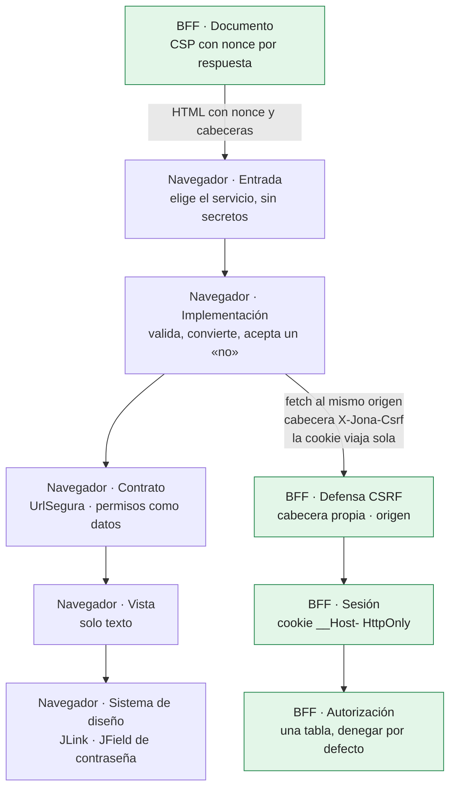
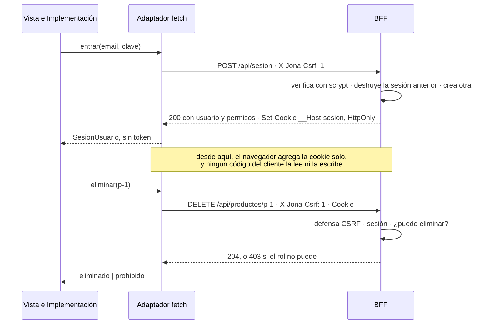
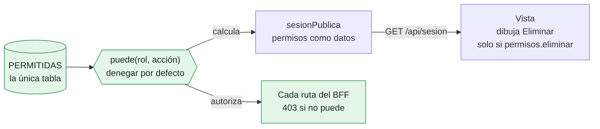
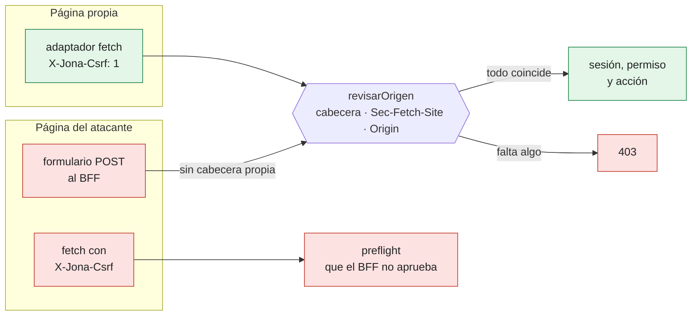
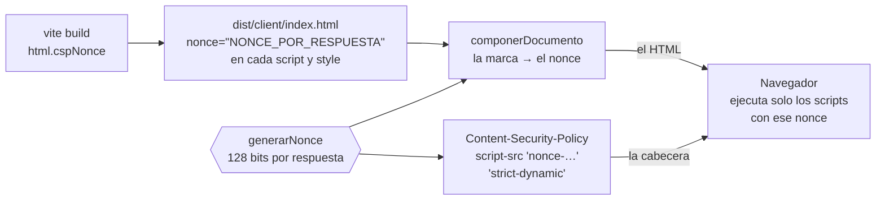

# Capítulo 17. Desarrollo seguro desde el arquetipo JONA

Los capítulos anteriores tocaron la seguridad de pasada, siempre atada a otro tema. El capítulo 15 escapó los datos incrustados en el HTML para que un `</script>` en un nombre no abriera una puerta. El capítulo 16 hizo lo mismo con el JSON-LD, y su `JLinkHref` dejó de aceptar `javascript:` como destino. Faltaba la pregunta de fondo: **¿dónde vive cada práctica de desarrollo seguro en una aplicación JONA?**

La respuesta de este capítulo es que cada práctica tiene una pieza del arquetipo que la sostiene, y que esa pieza es la que la hace verificable:

- El **contrato** usa tipos que no dejan escribir el estado inseguro.
- La **Implementación** es la frontera donde los datos dejan de ser texto desconocido.
- La **vista** dibuja solo texto.
- La **entrada** decide qué se compila en el cliente.
- Los **DEFAULTS** no llevan estado ni credenciales.
- El **BFF** guarda la sesión y decide.

Una práctica que no tiene pieza depende de que alguien se acuerde de ella en cada pantalla.

Hay un límite que conviene decir al principio. Una interfaz no puede ser el control de acceso. OWASP lo dice sin rodeos en su Top 10:2025: el control de acceso «solo es efectivo cuando se implementa en código de servidor confiable». Lo que el frontend sí puede hacer, y es mucho, es no abrir puertas, no guardar lo que no debe y no fingir que controla.

El ejemplo es `ejemplos/catalogo-seguro/`, con 78 pruebas. Es el catálogo de productos de los capítulos anteriores, con inicio de sesión y dos roles: una administradora que elimina productos y un lector que solo los ve. Un BFF sobre `node:http` sirve la página y la API; el cliente es React 19 con Vite, sin framework. Uno de los productos trae datos hostiles a propósito: un nombre con ``, una descripción con `</script><script>` y un enlace `javascript:`. Para el campo de contraseña, el sistema de diseño del capítulo 13 sube a la versión 1.2.0.

> [!IMPORTANT]
> **Regla del capítulo.**
> - Cada práctica de seguridad tiene una **pieza JONA** que la sostiene y una **prueba o regla** que la verifica. Si no tiene pieza, no está.
> - El **servidor** decide qué se permite. La interfaz recibe los permisos como datos y los usa para decidir qué ofrecer, nunca para autorizar.
> - Lo que se compila en el cliente es **público**: ni secretos, ni tokens, ni el servicio falso.
> - La sesión vive en el **BFF**, y el navegador solo guarda una cookie que JavaScript no puede leer.
> - Los datos se muestran como **texto**; los enlaces, solo si una función los validó.

> **Sobre los fragmentos de código.** Los fragmentos de este capítulo son extractos, a veces abreviados, de los ejemplos ejecutables de la carpeta `ejemplos/` (apéndice B). Omiten detalles que no aportan a la explicación; al final de cada sección se indica el archivo completo, que compila y tiene pruebas.

> [!NOTE]
> Lo que el capítulo afirma sobre amenazas, cabeceras, cookies y sesiones sale de fuentes primarias consultadas el 20 de noviembre de 2026 y citadas en el apéndice C:
> - las hojas de referencia (*Cheat Sheets*) de OWASP, el OWASP Top 10:2025 y el OWASP ASVS 5.0.0;
> - MDN;
> - la RFC 10017, *OAuth 2.0 for Browser-Based Applications*;
> - la documentación de Vite y de npm.
>
> El capítulo no reemplaza un modelo de amenazas ni una revisión de seguridad. Muestra cómo el arquetipo da un lugar fijo a cada práctica, para que la revisión encuentre lo que busca.

---

## 17.1 Cada práctica en su pieza

| Pieza JONA | Qué decide | Práctica | En el ejemplo | Qué lo verifica | Riesgo (Top 10:2025) |
|---|---|---|---|---|---|
| **Contrato** (`Inter*`) | Qué estados se pueden escribir | Tipos que hacen imposible el estado inseguro: `UrlSegura`, permisos como datos, sesión sin token | `InterUiCatalogo`, `UrlSegura`, `SesionUsuario` | El compilador, con `@ts-expect-error` | A05 Injection |
| **Implementación** | Qué datos cruzan hacia la pantalla | Validar en la frontera; convertir enlaces con `aUrlSegura`; aceptar un «no» del servidor | `leerRespuestas.ts`, `UiCatalogoImpl.ts`, `UiSesionImpl.ts` | Pruebas del adaptador y de la unidad | A05 Injection, A01 Broken Access Control |
| **Vista** | Qué se dibuja | Solo texto y componentes del sistema de diseño; nada de HTML desde texto | `UiCatalogoView.tsx`, `UiSesionView.tsx` | Regla 1; pruebas con datos hostiles | A05 Injection |
| **Sistema de diseño** | Cómo se dibuja | Átomos seguros por construcción: `JLink` con `JLinkHref`; `JField` de contraseña con `autoComplete` | `JLink`, `JField`, `JInput` 1.2.0 | Los tipos y las pruebas del sistema de diseño | A07 Authentication Failures |
| **Entrada** y raíz de composición | Qué se compila en el cliente y qué servicio se usa | Secretos solo en el servidor; servicio falso solo en desarrollo | `entradaCliente.tsx`, `crearRaizComposicion.ts` | Reglas 3 y 4; la prueba del bundle | A02 Security Misconfiguration |
| **DEFAULTS** | La configuración de presentación | Sin estado ni credenciales de prueba | `UISESION_DEFAULTS`, `UICATALOGO_DEFAULTS` | Regla 5 | A07 Authentication Failures |
| **BFF** | La sesión, el origen, la autorización y el documento | Cookie `__Host-` HttpOnly; defensa CSRF; denegar por defecto; CSP con nonce; errores sin detalles | `servidor/` | Pruebas del servidor y de punta a punta | A01, A02, A07, A10 Mishandling of Exceptional Conditions |
| **Dependencias** | Qué código de terceros entra | Versiones exactas, lockfile, `npm ci` | `package.json`, `package-lock.json` | `dependencias.test.ts` | A03 Software Supply Chain Failures |

La última columna nombra la categoría del OWASP Top 10:2025 con la que se relaciona cada práctica. Es una orientación, no una clasificación oficial: el Top 10 no asigna prácticas a piezas de una arquitectura.



*Figura 17.1. Las piezas a cada lado de la frontera de confianza: en verde, las del BFF; las demás corren en el navegador. Mire las dos flechas que cruzan la frontera. Hacia el navegador va el documento con su nonce. Hacia el BFF solo van peticiones con la cabecera propia y la cookie, que JavaScript no lee. Las piezas verdes deciden; las del navegador solo pueden negarse a abrir puertas.*

---

## 17.2 La frontera de confianza

Todo lo que corre en el navegador lo controla quien usa la página. Puede abrir las herramientas de desarrollo, cambiar una variable, llamar a la API con otra herramienta o leer el bundle compilado. Por eso el capítulo separa dos clases de prácticas:

- **Las que deciden** viven del lado del servidor: quién es el usuario, qué puede hacer y qué petición se acepta.
- **Las que no abren puertas** viven en el navegador. Ningún dato se ejecuta como código, ninguna credencial queda al alcance de un script y ningún secreto se compila en el bundle.

El OWASP ASVS 5.0.0 dedica un capítulo entero, el V3 *Web Frontend Security*, a la segunda clase: cookies, cabeceras de seguridad del navegador, separación de orígenes e integridad de los recursos externos.

En una aplicación JONA, la frontera coincide con un lugar que el patrón ya tiene: **el contrato de servicio**. A un lado, la Implementación pide; al otro, un adaptador habla con el servidor, y lo que el servidor decide vuelve como resultado. En este ejemplo, `eliminar` puede responder `prohibido`, y la pantalla tiene que saber qué hacer con eso.

```ts
// src/ui/catalogo/InterServicioCatalogo.ts
export type ResultadoEliminar = 'eliminado' | 'no-encontrado' | 'prohibido';

export interface InterServicioCatalogo {
  listar(): Promise<Producto[]>;
  eliminar(id: string): Promise<ResultadoEliminar>;
}
```

`prohibido` es un resultado esperado, no una excepción. El servidor puede negar lo que la pantalla ofreció, porque la decisión es suya.

---

## 17.3 El contrato: tipos que no dejan escribir el estado inseguro

### `UrlSegura`: un enlace que alguien validó

El capítulo 16 resolvió los enlaces escritos en el código. `JLinkHref` es un tipo de plantilla, y con él `href="#"` y `href="javascript:…"` no compilan. Pero un enlace que llega en los datos es un `string` que nadie revisó, y un tipo de plantilla no puede validar un valor que solo existe en tiempo de ejecución.

`UrlSegura` cubre ese caso. Es un tipo con marca: un `string` de `http` o `https` con una propiedad que solo existe en el sistema de tipos, y que solo agrega una función.

```ts
// src/compartido/UrlSegura.ts
declare const marca: unique symbol;

export type UrlSegura = (`https://${string}` | `http://${string}`) & { readonly [marca]: 'UrlSegura' };

export function aUrlSegura(texto: string): UrlSegura | undefined {
  let url: URL;
  try {
    url = new URL(texto);
  } catch {
    return undefined;
  }
  return url.protocol === 'https:' || url.protocol === 'http:' ? (url.href as UrlSegura) : undefined;
}
```

La validación usa el analizador de URL y no una expresión regular. Es el mismo analizador que usará el navegador al seguir el enlace, con sus reglas sobre mayúsculas, espacios iniciales y tabuladores dentro del esquema. Las pruebas lo confirman: `JaVaScRiPt:alert(1)`, `"  javascript:…"` y `"java\tscript:…"` se rechazan, igual que `data:`, `vbscript:` y las rutas relativas.

El contrato de la fila exige el tipo:

```ts
// src/ui/catalogo/InterUiCatalogo.ts
export interface FilaProductoUi {
  id: string;
  sku: string;
  nombre: string;
  precio: string;
  descripcion: string;
  /** Solo una URL http o https validada. Un texto cualquiera no compila aquí. */
  enlace?: UrlSegura;
}
```

Asignar un `string` a `enlace` no compila; la prueba lo fija con `@ts-expect-error`. Como `UrlSegura` es un caso particular de `` `https://${string}` ``, sirve donde `JLink` pide un `JLinkHref`, sin conversión. El tipo del sistema de diseño y el de la aplicación se encadenan: uno cierra los literales, el otro los datos.

La guía de OWASP sobre prevención de XSS señala que React 19 bloquea las URL `javascript:` en `src` y `href`, «pero esto no reemplaza la validación de URL propia de la aplicación», y recomienda permitir solo `http` y `https`. `UrlSegura` es esa validación, con un lugar fijo en el contrato.

### Los permisos son datos

El contrato del catálogo tiene un campo `permisos`. La pantalla no calcula si el usuario puede eliminar: lo recibe del servidor, que lo calcula con la misma tabla con la que después autoriza (sección 17.8).

```ts
/** Lo que el servidor permite a quien mira la pantalla. La UI no lo calcula ni lo hace cumplir. */
export interface PermisosUi {
  eliminar: boolean;
}
```

Con el permiso como dato, la vista decide qué **ofrecer**. No hay en el cliente ninguna comparación de roles que alguien pueda olvidar actualizar cuando cambian los permisos del servidor.

### La sesión, sin token

```ts
// src/dominio/SesionUsuario.ts
export interface SesionUsuario {
  usuario: { nombre: string };
  /** Calculados por el servidor a partir del rol. La UI los usa para dibujar, nunca para autorizar. */
  permisos: { eliminar: boolean };
}
```

Ninguna firma del contrato de servicio de la sesión menciona un token o un identificador:

- `actual()` devuelve la sesión pública o nada.
- `entrar(email, clave)` devuelve la sesión nueva o nada.

El identificador viaja en una cookie que el contrato ni nombra (sección 17.6).

### Los errores son datos, y uno solo para las credenciales

El contrato de UI de la sesión expresa el error como un valor, `'credenciales' | 'no-disponible'`. El texto lo pone la configuración. Hay un solo error para un correo desconocido y para una contraseña incorrecta, como recomienda la hoja de OWASP sobre autenticación: la respuesta debe ser genérica, del estilo de «Login failed; Invalid user ID or password».

Ejemplo ejecutable: `ejemplos/catalogo-seguro/src/compartido/UrlSegura.ts` y `ejemplos/catalogo-seguro/src/ui/catalogo/InterUiCatalogo.ts`.

---

## 17.4 La Implementación: la frontera de los datos

### Validar en el adaptador

Lo que llega del BFF es texto JSON, no tipos. Un `as Producto[]` sobre `respuesta.json()` le dice al compilador algo que nadie comprobó. Las funciones de `leerRespuestas.ts` convierten lo desconocido en tipos del dominio, o fallan.

```ts
// src/cliente/leerRespuestas.ts (extracto)
export function leerProducto(valor: unknown): Producto {
  const o = objeto(valor, 'el producto');
  if (typeof o.precio !== 'number' || !Number.isFinite(o.precio)) throw new ErrorRespuesta('precio no es un número');
  const producto: Producto = { id: texto(o, 'id'), sku: texto(o, 'sku'), nombre: texto(o, 'nombre'), precio: o.precio, descripcion: texto(o, 'descripcion') };
  if (o.enlaceFabricante !== undefined) producto.enlaceFabricante = texto(o, 'enlaceFabricante');
  return producto;
}
```

Copian solo los campos que conocen. Si la respuesta trae un `costoInterno` que el backend agregó sin avisar, no llega a la pantalla. Un precio que llega como texto se rechaza, en lugar de terminar en un `toFixed` que falla en otro lugar.

Conviene ser preciso sobre qué protege esto. El BFF es propio, así que la validación no defiende de un servidor malicioso. Defiende de un contrato que cambió sin aviso y de datos que un tercero logró guardar en el backend. Y fija un lugar: el único punto donde un dato externo se convierte en un tipo de la aplicación.

### Convertir lo que la pantalla va a dibujar

La Implementación del catálogo convierte cada producto en una fila del contrato, y ahí decide qué enlace es seguro:

```ts
// src/ui/catalogo/UiCatalogoImpl.ts
export const aFila = (producto: Producto): FilaProductoUi => ({
  id: producto.id,
  sku: producto.sku,
  nombre: producto.nombre,
  precio: `S/ ${producto.precio.toFixed(2)}`,
  descripcion: producto.descripcion,
  enlace: producto.enlaceFabricante === undefined ? undefined : aUrlSegura(producto.enlaceFabricante),
});
```

El enlace `javascript:` del producto hostil se convierte en `undefined`. La vista no tiene forma de dibujarlo, porque no lo recibe.

### Aceptar un «no»

Cuando el servidor responde `prohibido`, la Implementación lo informa y deja la lista como estaba:

```ts
const resultado = await servicio.eliminar(aEliminar.id);
if (resultado === 'prohibido') setError('prohibido');
else await cargar();
```

La prueba arma ese caso con una administradora que perdió el rol después de entrar. Su pantalla todavía muestra el botón, pero el servidor dice que no. La pantalla muestra «No tiene permiso para eliminar productos.», y el producto sigue en la lista.

### La contraseña, el tiempo justo

La Implementación del inicio de sesión guarda la contraseña en el estado solo mientras se escribe. Después de cada intento, salga bien o mal, la borra:

```ts
// src/ui/sesion/UiSesionImpl.ts (extracto)
try {
  const sesion = await servicio.entrar(email.trim(), clave);
  if (sesion) onEntro(sesion);
  else setError('credenciales');
} catch {
  setError('no-disponible');
} finally {
  setClave('');
  setPendiente(false);
}
```

Ejemplo ejecutable: `ejemplos/catalogo-seguro/src/cliente/leerRespuestas.ts`, `ejemplos/catalogo-seguro/src/ui/catalogo/UiCatalogoImpl.ts` y `ejemplos/catalogo-seguro/src/ui/sesion/UiSesionImpl.ts`.

---

## 17.5 La vista y el sistema de diseño: solo texto

### React escribe el texto como texto

La vista del catálogo pone cada texto del producto como hijo de un elemento. React lo escribe como texto: un nombre con `` se ve tal cual y no crea ninguna imagen.

```tsx
// src/ui/catalogo/UiCatalogoView.tsx (extracto)
{ id: 'nombre', header: 'Nombre', cell: (f) => f.nombre },
{ id: 'descripcion', header: 'Descripción', cell: (f) => f.descripcion },
{
  id: 'fabricante',
  header: 'Fabricante',
  cell: (f) => (f.enlace ? <JLink href={f.enlace} rel="external noopener noreferrer" aria-label={`${textoFabricante}: ${f.nombre}`}>{textoFabricante}</JLink> : '—'),
},
```

La salida de emergencia es `dangerouslySetInnerHTML`. La guía de OWASP sobre XSS la nombra como uno de los usos inseguros de los frameworks, «sin sanear el HTML», dentro de las «salidas de emergencia» que manipulan el DOM directamente. La regla 1 del ejemplo la prohíbe en todo el código del cliente, junto con `innerHTML`, `outerHTML`, `insertAdjacentHTML`, `document.write`, `eval` y `new Function` (sección 17.10).

La prueba de la unidad usa el producto hostil y busca lo que no debe existir: ningún `` ni `<script>` en el DOM, y un solo enlace, el `https` del otro producto. También se comprobó en un navegador real: con el ejemplo compilado abierto en Microsoft Edge y la sesión iniciada, la fila hostil mostró su texto, la página no creó ninguna imagen y no se abrió ningún diálogo de `alert`.

### Ofrecer no es permitir

```tsx
// Ofrecer no es permitir: sin el permiso, la acción no se dibuja; con él, el servidor igual decide.
const acciones: JTableAction<FilaProductoUi>[] | undefined = permisos.eliminar
  ? [{ id: 'eliminar', label: 'Eliminar', accessibleLabel: (f) => `Eliminar ${f.nombre}`, onAction: onPedirEliminar }]
  : undefined;
```

Esconder el botón es una decisión de experiencia de uso: no ofrecer lo que va a fallar. La seguridad está en el servidor, que responde 403 al lector aunque mande la petición a mano (sección 17.8).

### El sistema de diseño 1.2.0: un campo de contraseña de verdad

Para el formulario de inicio de sesión, el sistema de diseño del capítulo 13 no tenía un campo de contraseña. Sin él, la vista habría tenido que escribir un `<input>` a mano. La versión 1.2.0 lo agrega:

- `type="password"` en `JInput` y `JField`;
- una propiedad `autoComplete`, con una lista cerrada de valores del atributo HTML: `username`, `email`, `current-password`, `new-password` y `off`.

```tsx
// src/ui/sesion/UiSesionView.tsx (extracto)
<JField label={etiquetaEmail} type="email" autoComplete="username" value={email} onChange={onCambiarEmail} required />
<JField label={etiquetaClave} type="password" autoComplete="current-password" value={clave} onChange={onCambiarClave} required />
```

MDN describe `current-password` como «la contraseña actual del usuario» y `new-password` como la que se usa al crear una cuenta o cambiar la contraseña. Con estos valores, el navegador sabe qué credencial pide cada campo. La hoja de OWASP sobre autenticación pide usar «formularios HTML estándar» con los atributos `type` apropiados, permitir pegar en los campos de usuario y contraseña, y pasar de uno a otro con una sola pulsación de Tab. Es lo que hace falta para que funcionen los gestores de contraseñas.

Es un cambio menor en el sentido del capítulo 8: amplía dos uniones de valores aceptados y agrega una propiedad opcional. Los consumidores de los capítulos 14 a 16 no cambian. `JField` repite la lista de valores en lugar de importarla de `JInput`, porque la regla 4 del capítulo 13 prohíbe que un contrato importe el de otra unidad. Esa regla hizo fallar la primera versión de este cambio, que sí la importaba.

Ejemplo ejecutable: `ejemplos/catalogo-seguro/src/ui/catalogo/UiCatalogoView.tsx`, `ejemplos/catalogo-seguro/src/ui/sesion/UiSesionView.tsx` y `ejemplos/sistema-diseno-atomico/src/atomos/jinput/InterJInput.ts`.

---

## 17.6 La entrada y los DEFAULTS: lo que se compila es público

### Los secretos se quedan en el servidor

Quien descarga el bundle tiene todo lo que se compiló en él. La documentación de Vite lo dice para sus variables de entorno: las que empiezan con `VITE_` «se exponen en el código del cliente después del empaquetado», y «no deben contener información sensible, como claves de API».

En el ejemplo, lo que es del servidor está en `servidor/` y en `EntornoServidor`, que no son `VITE_*`:

- las contraseñas de demostración;
- el nombre de la cookie;
- la derivación de contraseñas con scrypt.

La regla 3 señala cualquier `process.env` en el código del cliente y cualquier `import.meta.env` con nombre de secreto. Es una heurística: busca nombres como `KEY`, `TOKEN`, `SECRET` o `CLAVE`, y un nombre se puede elegir para esquivarla.

La prueba del bundle va al resultado. Busca en todo el JavaScript de `dist/client` las marcas `secreta123`, `__Host-sesion` y `scrypt`, y no las encuentra. Para que esa búsqueda no pase por buscar mal, hace un **control positivo**: las mismas marcas sí están en `dist/server`. Es la técnica del capítulo 15.

### El servicio falso solo en desarrollo

El servicio falso, el punto de sustitución 2, sirve para trabajar la interfaz sin el BFF. Acepta cualquier contraseña y da permiso de eliminar a cualquiera, así que en producción sería una puerta abierta. La entrada solo lo carga en desarrollo:

```tsx
// src/cliente/entradaCliente.tsx
function elegirServicio(): Promise<InterServicioAplicacion> {
  if (import.meta.env.DEV && new URLSearchParams(window.location.search).has('falso')) {
    return import('./servicioFalso').then((modulo) => modulo.crearServicioFalso());
  }
  return Promise.resolve(crearServicioFetch());
}
```

Según su documentación, Vite reemplaza `import.meta.env.DEV` y `import.meta.env.PROD` «de forma estática al compilar, para que la eliminación de código muerto sea efectiva». En la compilación de producción la condición es `false`, la rama desaparece y con ella el `import()`.

Las dos pruebas del bundle lo comprueban de las dos maneras:

- El JavaScript de `dist/client` no contiene la marca del servicio falso, `jona-catalogo-seguro/servicio-falso`.
- La misma compilación con `NODE_ENV=development`, donde `DEV` es verdadero, sí produce un archivo `servicioFalso-*.js` con esa marca. Es el control positivo: sin él, la prueba anterior pasaría igual con una marca mal escrita.

La regla 4 cuida la forma del código. Un módulo `*Falso` solo se importa con `import()`, dentro de una rama que exige `import.meta.env.DEV`, y nunca con un `import` estático. Sus dos árboles de violación son los dos errores comunes:

- el `import` estático con una condición que se evalúa al ejecutar, la forma del antipatrón [Mock en el paquete de producción](12-evolucion-y-antipatrones.md#ap-12-3) del capítulo 12;
- la condición sobre la URL sin `DEV`, que en producción deja cargar el servicio falso con solo agregar `?falso`.

La regla es más estricta de lo que hace falta, y a propósito. Se midió con este ejemplo: con un `import` estático y la condición `import.meta.env.DEV`, Vite también deja el servicio falso fuera del bundle, porque puede demostrar que no se usa. Con la condición sobre la URL, en cambio, el servicio falso llega al bundle. La regla exige la forma que no depende de lo que el empaquetador logre demostrar. Es la solución que el capítulo 12 dejó planteada: una condición que se resuelve al compilar, y una prueba del empaquetado que busca una marca.

El servidor mock, el punto de sustitución 3, no necesita una regla: es otro proceso y nunca se despliega con la aplicación.

### Los DEFAULTS no llevan credenciales

Los DEFAULTS son configuración de presentación (capítulo 3). La tentación de «precargar el usuario de pruebas para ir más rápido» los convierte en otra cosa:

```ts
// El árbol de violación de la regla 5 (test/fixtures/defaults-con-credenciales)
export const UISESION_DEFAULTS = {
  titulo: 'Iniciar sesión',
  textoEntrar: 'Entrar',
  email: 'ana@ejemplo.com',
  clave: 'secreta123',
} as const;
```

La regla 5 señala un objeto `*_DEFAULTS` con propiedades llamadas `email`, `usuario`, `clave`, `password`, `token`, `secreto`, `apiKey` o `sesion`. También es una heurística por nombre. La protección de fondo es la del capítulo 3: el estado no tiene default.

Ejemplo ejecutable: `ejemplos/catalogo-seguro/src/cliente/entradaCliente.tsx` y `ejemplos/catalogo-seguro/test/artefacto.test.ts`.

---

## 17.7 El BFF: la sesión que JavaScript no ve

### El patrón

La RFC 10017, *OAuth 2.0 for Browser-Based Applications*, publicada en agosto de 2026 como parte del BCP 212, describe tres arquitecturas para una aplicación de navegador que usa OAuth.

En la más segura, el **BFF** (*Backend for Frontend*) es un cliente confidencial que guarda los tokens de acceso y de actualización en una sesión del servidor. El navegador solo recibe una cookie de sesión. La RFC lo resume así: «como los tokens solo están disponibles para el BFF, no hay tokens que extraer del navegador».

La alternativa intermedia, el *token-mediating backend*, entrega el token de acceso al navegador. La RFC advierte que entonces se puede robar desde el almacenamiento del cliente, y recomienda el BFF completo salvo que no se pueda hacer de proxy.

El BFF del capítulo 15 ya estaba en la posición correcta. Este capítulo le agrega la sesión. El ejemplo no implementa OAuth: un directorio local de usuarios hace de proveedor de identidad, para que el ejemplo no dependa de otro servicio. Lo que el capítulo muestra no cambia con OAuth:

- la cookie;
- la defensa CSRF;
- la autorización;
- que ningún token llega al navegador.

### La cookie

```ts
// src/servidor/crearServidor.ts (extracto)
/**
 * __Host-: el navegador la acepta solo con Secure, Path=/ y sin Domain, así que ningún subdominio
 * puede pisarla. HttpOnly: JavaScript no la lee. SameSite=Strict: no viaja desde otro sitio.
 */
const NOMBRE_COOKIE = '__Host-sesion';
const ATRIBUTOS_COOKIE = 'Path=/; Secure; HttpOnly; SameSite=Strict';
```

Cada atributo responde a un requisito de la RFC 10017 para las cookies del BFF:

- `Secure` y `HttpOnly` son obligatorios (MUST).
- Se recomiendan (SHOULD) `SameSite=Strict`, `Path=/`, no fijar `Domain` y un prefijo en el nombre que indique que la cookie se fijó por HTTP.

La RFC da como ejemplo el prefijo `__Host-Http-`. El ejemplo usa `__Host-`, el que documenta MDN: una cookie con ese prefijo se rechaza si no tiene `Secure`, si tiene `Domain` o si su `Path` no es `/`. MDN señala que `Secure` exige HTTPS, salvo en `localhost`.

En Microsoft Edge, con el ejemplo compilado en `http://localhost:4070`, se comprobó que:

- la cookie llegó con `httpOnly`, `secure` y `sameSite: Strict`;
- `document.cookie` devolvió una cadena vacía.

### El identificador y su vida

La hoja de OWASP sobre sesiones pide al menos 64 bits de entropía en el identificador, de un generador criptográfico. El ejemplo usa 256: `randomBytes(32)` en base64url.

La misma hoja dice que regenerar el identificador al autenticarse es «obligatorio para prevenir ataques de fijación de sesión». El BFF destruye la sesión anterior, si había, y crea una nueva en cada inicio de sesión. La prueba entra dos veces y comprueba que la primera cookie ya no sirve.

Salir destruye la sesión en el servidor, no solo la cookie: una copia de la cookie vieja recibe 401. La sesión vence además por inactividad, a los 30 minutos sin uso.

### Lo que el navegador no guarda

La misma hoja es explícita: no guardar tokens de autenticación, identificadores de sesión, JWT, tokens de actualización ni ninguna credencial en `localStorage` o `sessionStorage`. Cualquier JavaScript del origen puede leer esas API, así que una sola falla de XSS expone todos los tokens. En su lugar, recomienda cookies `HttpOnly; Secure; SameSite=Strict` o el patrón BFF. La hoja sobre seguridad de HTML5 lo dice con la razón: no guardar identificadores de sesión en el almacenamiento local, porque esos datos son siempre accesibles desde JavaScript.

La regla 2 lo verifica sobre el código del cliente. Ningún módulo usa `localStorage`, `sessionStorage`, `indexedDB` ni `document.cookie`.



*Figura 17.2. La sesión de punta a punta. Mire qué recibe la vista: una sesión pública y un resultado, nunca la cookie. Mire también el orden de las comprobaciones del BFF en el `DELETE`: primero el origen, después la sesión y al final el permiso. Una petición que falla la primera no llega a las otras.*

Ejemplo ejecutable: `ejemplos/catalogo-seguro/src/servidor/sesiones.ts`, `ejemplos/catalogo-seguro/src/servidor/usuarios.ts` y `ejemplos/catalogo-seguro/src/servidor/crearServidor.ts`.

---

## 17.8 La autorización: la UI ofrece, el servidor decide

El sistema tiene una sola tabla de permisos, y vive en el servidor:

```ts
// src/servidor/permisos.ts
const PERMITIDAS: Record<Rol, readonly Accion[]> = {
  administrador: ['listar', 'eliminar'],
  lector: ['listar'],
};

/** Denegar por defecto: lo que no está en la tabla no se puede. */
export const puede = (rol: Rol, accion: Accion): boolean => PERMITIDAS[rol]?.includes(accion) ?? false;

/** Lo que el navegador sabe de la sesión: ni el correo, ni el rol, ni el identificador. */
export const sesionPublica = (usuario: Usuario): SesionUsuario => ({
  usuario: { nombre: usuario.nombre },
  permisos: { eliminar: puede(usuario.rol, 'eliminar') },
});
```

La tabla se usa dos veces:

- Al autorizar, cada ruta pregunta `puede` antes de actuar. «Salvo los recursos públicos, denegar por defecto», dice el OWASP Top 10:2025 en su categoría A01.
- Al responder la sesión, `sesionPublica` calcula con la misma tabla los permisos que la interfaz recibe como datos.

Así, lo que la pantalla ofrece y lo que el servidor permite no pueden divergir por un olvido.



*Figura 17.3. Una tabla, dos usos. Mire hacia dónde apuntan las flechas: la vista está al final de una rama y no vuelve hacia el servidor. Lo que dibuja depende de la tabla, pero la petición que manda pasa otra vez por `puede`. Los nodos verdes son los que deciden.*

Las pruebas cubren los dos lados:

- En el servidor, Beto, el lector, pide `DELETE /api/productos/p-1` a mano: recibe 403, y el producto sigue en la lista.
- En la interfaz, el lector no ve la acción, y una administradora cuyo permiso cambió recibe el «no» del servidor (sección 17.4).

Ejemplo ejecutable: `ejemplos/catalogo-seguro/src/servidor/permisos.ts` y `ejemplos/catalogo-seguro/src/servidor/crearServidor.test.ts`.

---

## 17.9 CSRF: la cookie viaja sola

Una cookie de sesión tiene un costo: el navegador la agrega a cada petición al sitio, también cuando la petición la dispara otra página. Eso es lo que explota la falsificación de peticiones entre sitios (CSRF). Una página de un atacante envía un formulario al BFF, y la cookie de la víctima viaja con él.

`SameSite=Strict` ya impide que la cookie viaje desde otro sitio. Aun así, la hoja de OWASP sobre CSRF la trata como «defensa en profundidad», que «no reemplaza una defensa CSRF propiamente dicha en la mayoría de los despliegues». La RFC 10017 es más concreta: SameSite «se queda corto cuando el BFF comparte el sitio con otras aplicaciones», y el BFF «MUST» implementar una defensa CSRF.

La defensa del ejemplo corre antes que cualquier ruta de `/api` y tiene tres comprobaciones:

```ts
// src/servidor/proteccionCsrf.ts
export function revisarOrigen(cabeceras: IncomingHttpHeaders, origenPropio: string): Veredicto {
  if (cabeceras[CABECERA_CSRF.toLowerCase()] !== VALOR_CSRF) {
    return { permitida: false, motivo: `falta la cabecera ${CABECERA_CSRF}` };
  }
  const sitio = cabeceras['sec-fetch-site'];
  if (sitio !== undefined && sitio !== 'same-origin') {
    return { permitida: false, motivo: `Sec-Fetch-Site es ${sitio}, no same-origin` };
  }
  const origen = cabeceras.origin;
  if (origen !== undefined && origen !== origenPropio) {
    return { permitida: false, motivo: `el origen ${origen} no es ${origenPropio}` };
  }
  return { permitida: true };
}
```

1. **La cabecera propia, `X-Jona-Csrf: 1`.** La RFC 10017 dice que el BFF «SHOULD» exigir una cabecera propia, que una petición de otro origen con una cabecera propia «siempre requiere una consulta previa» (*preflight*), y que el BFF no la aprueba. Un formulario o un enlace no pueden poner cabeceras. Según la RFC, el BFF «MUST» asegurarse de que cada petición la traiga, y por eso el ejemplo la exige en todo `/api`, también en los `GET`. El adaptador la pone siempre; la comparten los dos lados en `compartido/protocolo.ts`.
2. **`Sec-Fetch-Site`.** La hoja de OWASP la llama «la señal principal para la protección CSRF». Si el navegador la envía, debe decir `same-origin`; `same-site`, el valor que llega desde un subdominio, también se rechaza.
3. **`Origin`.** «Si la cabecera Origin está presente, verifique que su valor coincide con el origen de destino», dice la misma hoja. El origen propio es `ORIGEN_PUBLICO`, una variable del servidor.

Las pruebas atacan cada comprobación y dos casos completos:

- Un `DELETE` con la cookie de la administradora pero sin la cabecera recibe 403, y el producto sigue.
- Un inicio de sesión desde otro origen recibe 403, sin cookie. Es el CSRF de inicio de sesión, que deja a la víctima en la cuenta del atacante.

En Edge se comprobó también desde la propia página: un `fetch` sin la cabecera, con la cookie viajando, recibió 403.



*Figura 17.4. Los dos intentos de una página ajena. Mire el camino de cada uno. El formulario llega sin la cabecera propia, y `revisarOrigen` lo rechaza aunque la cookie viaje. El `fetch` que pone la cabecera ni siquiera sale: el navegador primero hace una consulta previa, y el BFF no la aprueba.*

> [!WARNING]
> La hoja de OWASP sobre CSRF lo advierte en una línea: un XSS «puede derrotar todas las técnicas de mitigación de CSRF». Un script inyectado en la página propia pone la cabecera, tiene el origen correcto y la cookie viaja sola. Por eso las secciones 17.3 a 17.5 van antes: sin XSS, la defensa CSRF se sostiene.

Ejemplo ejecutable: `ejemplos/catalogo-seguro/src/servidor/proteccionCsrf.ts` y `ejemplos/catalogo-seguro/src/compartido/protocolo.ts`.

---

## 17.10 El documento: CSP con nonce y cabeceras de seguridad

### Una CSP estricta

La política de seguridad de contenido (CSP) dice al navegador qué scripts puede ejecutar. El ejemplo usa la política estricta de la hoja de OWASP, más la directiva que impide enmarcar la página:

```ts
// src/servidor/cabeceras.ts
export function politicaDeContenido(nonce: string): string {
  return [`script-src 'nonce-${nonce}' 'strict-dynamic'`, "object-src 'none'", "base-uri 'none'", "frame-ancestors 'none'"].join('; ');
}
```

- `'nonce-…'` permite solo los scripts que llevan ese valor en su atributo `nonce`.
- `'strict-dynamic'`, según MDN, deja que un script con nonce cargue otros scripts que no lo tienen. Así funcionan los módulos que importa la entrada.
- `object-src 'none'` y `base-uri 'none'` son el mínimo que el ASVS 5.0.0 pide en una política global (requisito 3.4.3).
- `frame-ancestors 'none'` impide que otra página enmarque esta. MDN lo presenta como protección contra el *clickjacking*, y recomienda `'none'` «salvo que necesite que su sitio se pueda incrustar».

### Un nonce nuevo en cada respuesta

MDN es tajante: el nonce «debe ser distinto en cada respuesta HTTP, y no debe ser predecible». De ahí sigue una consecuencia de arquitectura que el mismo texto saca: el servidor «no puede servir HTML estático», porque tiene que insertar un nonce nuevo cada vez.

En este ejemplo, el documento lo entrega el BFF, no un servidor de archivos. Vite colabora: con la opción `html.cspNonce`, pone un valor de marca en el atributo `nonce` de cada `<script>` y `<style>` del `index.html` compilado. Su documentación pide reemplazar esa marca «por un valor único en cada petición». El BFF lo hace en `componerDocumento`, con 128 bits nuevos de `randomBytes` por respuesta. Antes de insertar el nonce comprueba que sea base64, que no puede cerrar el atributo.



*Figura 17.5. El mismo nonce por dos caminos. Mire el nodo `generarNonce`: de él salen la cabecera y el HTML de una misma respuesta, y en la siguiente respuesta sale otro valor. Un script inyectado no conoce el nonce de esta respuesta, y el de la anterior ya no sirve.*

La prueba de punta a punta pide el documento dos veces al proceso compilado. En cada respuesta, el nonce de la cabecera y el de cada `<script>` coinciden, y las dos respuestas tienen nonces distintos.

En Edge, con la política activa, la aplicación cargó entera y la consola no mostró ninguna violación de CSP. Solo registró tres respuestas de error esperadas:

- el 401 de la primera consulta de sesión;
- un 404 de un recurso que el ejemplo no sirve;
- el 403 del `fetch` sin cabecera de la sección anterior.

### Las demás cabeceras

| Cabecera | Valor | Por qué |
|---|---|---|
| `X-Content-Type-Options` | `nosniff` | El navegador respeta el `Content-Type` declarado; la hoja de OWASP sobre cabeceras HTTP recomienda este valor |
| `Referrer-Policy` | `strict-origin-when-cross-origin` | El valor que recomienda la misma hoja, que pide fijarlo «de forma explícita en lugar de depender de los valores por defecto del navegador» |
| `Cross-Origin-Opener-Policy` | `same-origin` | Aísla el contexto de navegación de los documentos de otro origen, según la misma hoja |
| `Cache-Control` | `no-store` | Las respuestas dependen de la sesión; OWASP recomienda `no-store` para las respuestas sensibles |

Los archivos de `dist/client` llevan `nosniff`, pero no `no-store`: no cambian con la sesión.

El ejemplo no fija `Strict-Transport-Security`. Esa cabecera solo tiene sentido sobre HTTPS, y en un despliegue la fija quien termina TLS. La hoja de OWASP pide «leer con atención cómo funciona antes de usarla».

Tampoco fija `X-XSS-Protection`, y la misma hoja recomienda no fijarla o apagarla, porque en algunos casos «puede crear vulnerabilidades de XSS en sitios que de otro modo serían seguros».

### Los errores no cuentan nada

Un error del servidor responde `500 {"error":"interno"}`. El detalle queda en el registro del servidor. La prueba simula un repositorio que falla con el mensaje `conexión a db-interna:5432 rechazada` y comprueba que la respuesta no lo contiene. Es la categoría A10 del Top 10:2025, *Mishandling of Exceptional Conditions*, en su forma más simple.

### La CSP es una segunda capa

OWASP y MDN coinciden: la CSP «no debe ser el único mecanismo defensivo contra XSS» (OWASP) y «no es una alternativa a sanear la entrada» (MDN). En este ejemplo, la primera capa es la vista que solo dibuja texto. En el SSR del capítulo 15 es además el escape de los datos incrustados (sección 15.9), que sigue siendo necesario con CSP.

Dos casos quedan fuera del ejemplo:

- **Un servidor SSR**, como los de los capítulos 15 y 16. Puede poner el nonce él mismo, porque ya compone cada respuesta.
- **Un sitio estático** que se sirve desde archivos, como el del capítulo 16. No puede usar nonces. MDN describe la CSP estricta como basada en nonces «o en hashes»; en ese caso corresponde la segunda forma. El libro no la implementa.

Ejemplo ejecutable: `ejemplos/catalogo-seguro/src/servidor/cabeceras.ts`, `ejemplos/catalogo-seguro/src/servidor/documento.ts` y `ejemplos/catalogo-seguro/vite.config.ts`.

---

## 17.11 El gobierno: reglas sobre el código y pruebas sobre el bundle

Las reglas del ejemplo siguen la técnica de los capítulos 9, 13 y 15:

- leen el código con la API del compilador de TypeScript;
- cada una tiene al menos un árbol de violación en `test/fixtures/`, con exactamente una violación;
- la prueba comprueba que la regla la encuentra y señala el archivo correcto.

Miran solo el código que puede llegar al navegador: todo lo que no está en `servidor/`.

| Regla | Qué prohíbe | Árboles de violación | Tipo |
|---|---|---|---|
| 1. Ni HTML ni código desde texto | `dangerouslySetInnerHTML`, asignar `innerHTML` u `outerHTML`, `insertAdjacentHTML`, `document.write`, `eval`, `new Function` | `vista-con-html-crudo`, `impl-con-innerhtml` | Exacta |
| 2. Las credenciales no viven en JavaScript | `localStorage`, `sessionStorage`, `indexedDB`, `document.cookie` | `token-en-localstorage` | Exacta |
| 3. Ningún secreto en el cliente | `process.env`; `import.meta.env` con nombre de secreto | `secreto-en-vite` | Heurística |
| 4. El servicio falso no llega a producción | Un módulo `*Falso` importado de forma estática, o con `import()` fuera de una rama de `import.meta.env.DEV` | `falso-importado`, `falso-sin-condicion` | Exacta |
| 5. Los DEFAULTS no llevan credenciales | Propiedades con nombre de credencial en un `*_DEFAULTS` | `defaults-con-credenciales` | Heurística |

Las reglas son exactas para la sintaxis que buscan, pero no ven todo:

- Un `localStorage` alcanzado por un alias no lo ve la regla 2.
- Un secreto con un nombre inocente no lo ve la regla 3.

Por eso hay una segunda línea que no lee el código fuente, sino lo compilado: `test/artefacto.test.ts`. Allí un nombre no esconde nada. Y una tercera, que mira el comportamiento: las pruebas del servidor.

| Lo que se verifica | Dónde | Control positivo |
|---|---|---|
| Cada `<script>` del `index.html` compilado lleva la marca del nonce | `test/artefacto.test.ts` | Hay al menos un `<script>` |
| El bundle del cliente no contiene el servicio falso | `test/artefacto.test.ts` | Compilado con `DEV` verdadero, sí lo contiene |
| El bundle del cliente no contiene nada del servidor | `test/artefacto.test.ts` | `dist/server` sí lo contiene |
| El proceso compilado entrega el documento con nonce, y responde 403 y 204 | `test/e2e.test.ts` | — |

Tres de las pruebas del servidor también se comprobaron al revés. Con la autorización y la defensa CSRF desactivadas a propósito en `crearServidor.ts`, fallaron las tres que debían fallar: la del 403 del lector y las dos de CSRF.

Ejemplo ejecutable: `ejemplos/catalogo-seguro/test/architecture/reglas.ts`, `ejemplos/catalogo-seguro/test/architecture/seguridad.test.ts` y `ejemplos/catalogo-seguro/test/fixtures/`.

---

## 17.12 La cadena de suministro

El código de terceros entra por `npm`, y la categoría A03 del Top 10:2025, *Software Supply Chain Failures*, trata de él. Entre sus recomendaciones están:

- «Elegir de forma deliberada qué versión de una dependencia se usa, y actualizar solo cuando hace falta».
- «Obtener componentes solo de fuentes oficiales (confiables) por enlaces seguros».
- Reducir la superficie de ataque quitando las dependencias que no se usan.

Todos los ejemplos del libro siguen tres prácticas:

1. **Versiones exactas en `package.json`.** Ni `^` ni `~`: la versión que se probó es la que se instala.
2. **El lockfile versionado.** `package-lock.json` fija también las dependencias transitivas.
3. **`npm ci` en el ejecutor general.** Según la documentación de npm, exige un lockfile existente. Si el lockfile y `package.json` no coinciden, «termina con un error, en lugar de actualizar el lockfile», y nunca escribe en `package.json` ni en los lockfiles.

`test/dependencias.test.ts` comprueba, sin red, las dos primeras. También comprueba que las dependencias de ejecución son solo tres: React, `react-dom` y el sistema de diseño.

Lo que necesita red va en el pipeline, no en las pruebas del ejemplo:

- **`npm audit`** envía la descripción de las dependencias al registro y calcula las vulnerabilidades conocidas. Con `audit-level` decide desde qué gravedad termina con error.
- **`npm audit signatures`** verifica las firmas del registro y las atestaciones de procedencia de los paquetes descargados.

El ejecutor del libro instala con `--no-audit` para que su salida sea estable. Un pipeline de producción debería ejecutar la auditoría como un paso propio.

`npm ci` también acepta `--ignore-scripts`, que no ejecuta los scripts de instalación de los paquetes. El libro no lo usa: algunos ejemplos, como el de Electron, dependen de un script de instalación para descargar su binario.

Ejemplo ejecutable: `ejemplos/catalogo-seguro/test/dependencias.test.ts`.

---

## 17.13 Los arquetipos de escritorio

Las piezas son las mismas en Swing, JavaFX y WPF (capítulo 4), y la frontera de confianza también. El binario de escritorio está en la máquina del usuario, igual que el bundle web en su navegador.

- **Ningún secreto del servidor en el binario.** Una clave de API compilada en el `.jar` o en el ensamblado la tiene cualquiera que instale la aplicación. Lo que en la web es la regla 3 aquí es una revisión de la raíz de composición: las URL y las credenciales de servicio llegan de la configuración del entorno, y las que son secretas se quedan en un servidor.
- **El backend autoriza igual.** La Implementación de escritorio también debe recibir los permisos como datos y aceptar un 403. Que la pantalla sea nativa no cambia que el control de acceso «solo es efectivo en código de servidor confiable».
- **Las credenciales en reposo, en el almacén del sistema.** Si la aplicación debe recordar un token entre sesiones, no lo escribe en un archivo de texto ni en los DEFAULTS. En .NET, la clase `ProtectedData` da acceso a la DPAPI de Windows y cifra con las credenciales del usuario o de la máquina. Su documentación advierte que solo está disponible en Windows. En Java y JavaFX, el equivalente es una biblioteca que use el almacén de credenciales del sistema operativo; el libro no evalúa ninguna.
- **El campo de contraseña.** Es el mismo principio que el `JField` de la sección 17.5. En WPF, `PasswordBox` no permite enlazar su contraseña (capítulo 4), y la vista necesita una línea de *code-behind* que la pasa al modelo de vista.

Los ejemplos de escritorio del libro terminan en el inicio de sesión: el adaptador devuelve el token en `LoginResult` y nada lo guarda en disco. Recordarlo entre sesiones, con el almacén del sistema, queda fuera de los ejemplos.

---

## 17.14 Antipatrones

> [!CAUTION]
> Estos antipatrones no se ven usando la aplicación: la pantalla funciona igual con un token en `localStorage` que con una cookie HttpOnly. Se ven al leer el código, el bundle o las cabeceras, o al mandar la petición que la interfaz no manda. Por eso cada uno tiene una regla, un tipo o una prueba que lo busca ahí.

**Referencia rápida**

| | Antipatrón | Se reconoce porque… | Qué lo evita |
|:-:|---|---|---|
| 🔴 | [El token en el almacenamiento del navegador](#ap-17-1) | `localStorage.setItem('token', …)` y una cabecera `Authorization` armada en el cliente | La sesión en el BFF y una cookie `__Host-` HttpOnly; regla 2 |
| 🔴 | [HTML armado con datos](#ap-17-2) | `dangerouslySetInnerHTML={{ __html: producto.descripcion }}` | La vista solo dibuja texto; regla 1 |
| 🔴 | [La interfaz como control de acceso](#ap-17-3) | El botón no aparece, y el endpoint no pregunta | `puede` en cada ruta del BFF; permisos como datos |
| 🔴 | [Un secreto en el bundle](#ap-17-4) | `import.meta.env.VITE_API_KEY` en el código del cliente | Secretos en el servidor; regla 3; la prueba del bundle |
| 🔴 | [La cookie de sesión sin defensa CSRF](#ap-17-5) | Un `DELETE` con la cookie y sin nada más se acepta | `revisarOrigen` antes de todo `/api` |
| 🟠 | [El servicio falso en producción](#ap-17-6) | Un `import` estático, o un `?falso` que funciona en el sitio publicado | `import()` dentro de `import.meta.env.DEV`; regla 4; la prueba del bundle |
| 🟠 | [Un enlace que nadie validó](#ap-17-7) | `href={producto.enlace}` con un `string` que llega en los datos | `UrlSegura` en el contrato y `aUrlSegura` en la Implementación |
| 🟠 | [Un nonce que no cambia](#ap-17-8) | El nonce está escrito en `index.html`, o se genera una vez al arrancar | `generarNonce` en cada respuesta; el BFF compone el documento |
| 🟡 | [Credenciales de prueba en los DEFAULTS](#ap-17-9) | `UISESION_DEFAULTS` con `email` y `clave` | DEFAULTS sin estado; regla 5 |

🔴 abre una puerta: alguien de afuera ejecuta código, roba la sesión o hace lo que no debe · 🟠 la puerta queda entornada: hace falta un segundo error, o un poco de suerte, para abrirla · 🟡 una costumbre que tarde o temprano llega a producción

---

<a id="ap-17-1"></a>
### 🔴 El token en el almacenamiento del navegador

**Síntoma.** El inicio de sesión devuelve un token, el cliente lo guarda en `localStorage` y lo agrega a cada petición.

❌ **Así no:** el árbol de violación `ejemplos/catalogo-seguro/test/fixtures/token-en-localstorage/`.

```ts
const { token } = (await respuesta.json()) as { token: string };
localStorage.setItem('token', token);
```

✅ **Así sí:** el BFF guarda la sesión y el navegador recibe una cookie que JavaScript no lee (`ejemplos/catalogo-seguro/src/servidor/crearServidor.ts`, extracto; completo en la sección 17.7).

```ts
return json(respuesta, 200, sesionPublica(usuario), { 'Set-Cookie': `${NOMBRE_COOKIE}=${nuevo}; ${ATRIBUTOS_COOKIE}` });
```

**Por qué duele.** Cualquier script del origen lee `localStorage`. Un solo XSS, propio o de una dependencia, se lleva el token, y con él la sesión, desde otra máquina y por todo el tiempo que el token viva. La hoja de OWASP sobre sesiones pide no guardar ahí ninguna credencial. **Cómo no caer:** la sesión vive en el BFF (sección 17.7), y la regla 2 señala `localStorage`, `sessionStorage`, `indexedDB` y `document.cookie` en el código del cliente.

---

<a id="ap-17-2"></a>
### 🔴 HTML armado con datos

**Síntoma.** Una descripción «con formato» se inserta como HTML, o la Implementación escribe un aviso con `innerHTML`.

❌ **Así no:** el árbol de violación `ejemplos/catalogo-seguro/test/fixtures/vista-con-html-crudo/`.

```tsx
return <p dangerouslySetInnerHTML={{ __html: fila.descripcion }} />;
```

✅ **Así sí:** el texto como hijo del elemento (`ejemplos/catalogo-seguro/src/ui/catalogo/UiCatalogoView.tsx`, extracto; completo en la sección 17.5).

```tsx
{ id: 'descripcion', header: 'Descripción', cell: (f) => f.descripcion },
```

**Por qué duele.** La descripción `</script><script>alert(document.cookie)</script>` del producto hostil deja de ser texto y pasa a ser parte de la página. Un XSS anula también la defensa CSRF (sección 17.9). **Cómo no caer:** la vista solo dibuja texto y componentes del sistema de diseño. Si de verdad hace falta texto con formato, el formato se modela en el contrato, por ejemplo como una lista de párrafos, y la vista lo dibuja con elementos. La regla 1 tiene dos árboles de violación, uno en la vista y otro en la Implementación.

---

<a id="ap-17-3"></a>
### 🔴 La interfaz como control de acceso

**Síntoma.** El botón Eliminar no aparece para el lector, y por eso el endpoint no comprueba nada.

❌ **Así no** (ilustrativo)

```ts
if (borrar && metodo === 'DELETE') {
  // El lector no ve el botón: no hace falta comprobar.
  return (await raiz.productos.eliminar(id)) ? json(respuesta, 204) : json(respuesta, 404, { error: 'no-encontrado' });
}
```

✅ **Así sí:** cada acción pregunta a la tabla (`ejemplos/catalogo-seguro/src/servidor/crearServidor.ts`, extracto).

```ts
if (!puede(usuario.rol, 'eliminar')) return json(respuesta, 403, { error: 'prohibido' });
```

**Por qué duele.** La interfaz es una de las formas de llamar a la API, no la única. El lector manda el `DELETE` con cualquier herramienta y la cookie que ya tiene. **Cómo no caer:** una sola tabla de permisos en el servidor, consultada en cada ruta y usada para calcular los permisos que la interfaz recibe (sección 17.8). La prueba del servidor hace exactamente lo que haría el lector, y se comprobó que falla si se quita la línea de `puede`.

---

<a id="ap-17-4"></a>
### 🔴 Un secreto en el bundle

**Síntoma.** El cliente llama directo a una API de terceros con una clave que lee de una variable `VITE_*`.

❌ **Así no:** el árbol de violación `ejemplos/catalogo-seguro/test/fixtures/secreto-en-vite/`.

```ts
return fetch('https://api.productos.example/v1/productos', { headers: { 'X-Api-Key': import.meta.env.VITE_PRODUCTOS_API_KEY } });
```

✅ **Así sí:** el cliente habla con su BFF, y el BFF guarda las credenciales de los servicios (`ejemplos/catalogo-seguro/src/servidor/crearRaizComposicion.ts`).

```ts
/** Variables del servidor, no VITE_*: Vite no las compila en el cliente. */
export interface EntornoServidor {
  ORIGEN_PUBLICO?: string;
}
```

**Por qué duele.** Vite compila el valor de cada `VITE_*` en el bundle, y su documentación pide no poner en ellas información sensible. La clave queda en un archivo que cualquiera descarga, y rotarla exige volver a desplegar. **Cómo no caer:** los secretos se quedan en el servidor (sección 17.6). La regla 3 busca nombres sospechosos, y la prueba del bundle busca las marcas de lo que es del servidor, con su control positivo.

---

<a id="ap-17-5"></a>
### 🔴 La cookie de sesión sin defensa CSRF

**Síntoma.** La sesión ya es una cookie HttpOnly, y el BFF acepta cualquier petición que la traiga.

❌ **Así no** (ilustrativo)

```ts
async function api(peticion: IncomingMessage, respuesta: ServerResponse, ruta: string) {
  const usuario = raiz.sesiones.leer(cookieDeSesion(peticion));
  // … las rutas, sin mirar de dónde vino la petición
}
```

✅ **Así sí:** la defensa corre antes que cualquier ruta (`ejemplos/catalogo-seguro/src/servidor/crearServidor.ts`, extracto; completo en la sección 17.9).

```ts
const veredicto = revisarOrigen(peticion.headers, raiz.origen);
if (!veredicto.permitida) return json(respuesta, 403, { error: 'origen', motivo: veredicto.motivo });
```

**Por qué duele.** La cookie que protege del robo por XSS es la misma que el navegador agrega a la petición que dispara otra página. `SameSite=Strict` ayuda, pero OWASP y la RFC 10017 no lo aceptan como única defensa. **Cómo no caer:** la cabecera propia, `Sec-Fetch-Site` y `Origin`, comprobados en todo `/api`. El inicio de sesión también, porque el CSRF de inicio de sesión existe.

---

<a id="ap-17-6"></a>
### 🟠 El servicio falso en producción

**Síntoma.** La entrada importa el servicio falso de forma estática, o lo carga con una condición que depende de la URL.

❌ **Así no:** el árbol de violación `ejemplos/catalogo-seguro/test/fixtures/falso-sin-condicion/`.

```ts
if (new URLSearchParams(window.location.search).has('falso')) {
  return import('./servicioFalso').then((modulo) => modulo.crearServicioFalso());
}
```

✅ **Así sí:** la condición exige `import.meta.env.DEV` (`ejemplos/catalogo-seguro/src/cliente/entradaCliente.tsx`, extracto; completo en la sección 17.6).

```ts
if (import.meta.env.DEV && new URLSearchParams(window.location.search).has('falso')) {
```

**Por qué duele.** El servicio falso acepta cualquier contraseña y da todos los permisos. Si llega al sitio publicado, cualquiera puede verlo funcionar con solo agregar `?falso`. No toca los datos reales, porque no habla con el BFF, pero muestra una aplicación que no es la verdadera y deja en el bundle código que nadie revisó como código de producción. **Cómo no caer:** la regla 4 y la prueba del bundle, que tiene un control positivo: con `DEV` verdadero el servicio falso aparece, así que su ausencia en producción no es casualidad. Es la versión con seguridad del antipatrón [Mock en el paquete de producción](12-evolucion-y-antipatrones.md#ap-12-3).

---

<a id="ap-17-7"></a>
### 🟠 Un enlace que nadie validó

**Síntoma.** El contrato de la fila tiene `enlace: string`, y la vista lo pone en un `href`.

❌ **Así no** (ilustrativo)

```tsx
export interface FilaProductoUi { enlace?: string }
// …
<a href={f.enlace}>Sitio del fabricante</a>
```

✅ **Así sí:** el contrato pide una `UrlSegura`, que solo produce `aUrlSegura` (`ejemplos/catalogo-seguro/src/ui/catalogo/InterUiCatalogo.ts`, extracto; completo en la sección 17.3).

```ts
/** Solo una URL http o https validada. Un texto cualquiera no compila aquí. */
enlace?: UrlSegura;
```

**Por qué duele.** Un enlace `javascript:` guardado en el backend se ejecuta con el clic de un usuario confiado. Según OWASP, React 19 bloquea ese esquema en `href`, pero eso no reemplaza la validación propia de la aplicación. Es 🟠 porque necesita el clic. **Cómo no caer:** el tipo con marca en el contrato y la conversión en la Implementación. Así la vista no puede recibir un enlace sin validar, y `JLink` exige un `JLinkHref`, que `UrlSegura` cumple.

---

<a id="ap-17-8"></a>
### 🟠 Un nonce que no cambia

**Síntoma.** La CSP usa un nonce, pero el valor está escrito en `index.html`, o el servidor lo genera una vez al arrancar.

❌ **Así no** (ilustrativo)

```ts
const NONCE = generarNonce(); // una vez, al arrancar el proceso
const documento = componerDocumento(plantilla, NONCE);
```

✅ **Así sí:** un nonce por respuesta (`ejemplos/catalogo-seguro/src/servidor/crearServidor.ts`, extracto; completo en la sección 17.10).

```ts
const nonce = generarNonce();
respuesta.writeHead(200, cabecerasDocumento(nonce));
return respuesta.end(componerDocumento(plantilla, nonce));
```

**Por qué duele.** Un nonce que se repite está en cualquier respuesta anterior, y quien lo vio una vez lo puede poner en un script inyectado. La CSP pasa a proteger mucho menos de lo que aparenta. MDN pide que sea distinto en cada respuesta e impredecible. Es 🟠 porque la CSP es la segunda capa: para explotarlo, primero hace falta una inyección. **Cómo no caer:** el BFF compone el documento en cada respuesta, y la prueba de punta a punta compara los nonces de dos respuestas.

---

<a id="ap-17-9"></a>
### 🟡 Credenciales de prueba en los DEFAULTS

**Síntoma.** Para no escribir el usuario en cada prueba manual, los DEFAULTS del inicio de sesión traen un correo y una contraseña.

❌ **Así no:** el árbol de violación `ejemplos/catalogo-seguro/test/fixtures/defaults-con-credenciales/`.

```ts
export const UISESION_DEFAULTS = { titulo: 'Iniciar sesión', email: 'ana@ejemplo.com', clave: 'secreta123' } as const;
```

✅ **Así sí:** solo textos (`ejemplos/catalogo-seguro/src/ui/sesion/InterUiSesion.ts`, extracto).

```ts
export const UISESION_DEFAULTS = {
  titulo: 'Iniciar sesión',
  etiquetaEmail: 'Correo',
  etiquetaClave: 'Contraseña',
  textoEntrar: 'Entrar',
  // …
} as const satisfies TextosUiSesion;
```

**Por qué duele.** Los DEFAULTS se compilan en el bundle, así que la contraseña de pruebas viaja a producción y, si alguna vez fue real, queda publicada. Además, rompe la regla del capítulo 3: el estado no tiene default. **Cómo no caer:** los DEFAULTS solo llevan configuración de presentación, y la regla 5 busca nombres de credencial en ellos. Los usuarios de prueba viven en el servidor (`crearRaizComposicion.ts`) o en el servicio falso.

---

## 17.15 Resumen

- Cada práctica de desarrollo seguro tiene una pieza JONA que la sostiene y algo que la verifica:
  - **contrato:** `UrlSegura`, permisos como datos, sesión sin token;
  - **Implementación:** valida, convierte y acepta un «no»;
  - **vista:** solo texto;
  - **sistema de diseño:** `JLink` y el campo de contraseña de la 1.2.0;
  - **entrada:** sin secretos ni servicio falso;
  - **DEFAULTS:** sin credenciales;
  - **BFF:** sesión, CSRF, autorización y documento.
- La frontera de confianza coincide con el contrato de servicio. Del lado del navegador, las piezas no abren puertas; del lado del BFF, deciden. El control de acceso solo es efectivo en el servidor.
- Los permisos llegan como datos, calculados con la misma tabla que autoriza. La interfaz decide qué ofrecer; el servidor, qué permite. Un 403 es un resultado esperado del contrato de servicio.
- La sesión vive en el BFF, como pide la RFC 10017. El navegador guarda una cookie `__Host-` con `Secure`, `HttpOnly` y `SameSite=Strict`, que JavaScript no lee. El identificador tiene 256 bits, se renueva en cada inicio de sesión y se destruye al salir.
- La cookie viaja sola, y por eso la defensa CSRF exige en todo `/api` una cabecera propia, `Sec-Fetch-Site` igual a `same-origin` y el `Origin` propio. SameSite es una capa más, no la defensa.
- La CSP estricta usa un nonce nuevo en cada respuesta. Por eso el documento lo compone el BFF y no un servidor de archivos. Es una segunda capa: la primera es que la vista solo dibuje texto.
- Cinco reglas miran el código del cliente, cada una con su árbol de violación; dos son heurísticas declaradas. Una prueba mira el bundle compilado, con controles positivos: lo que no debe estar en el cliente sí está en el servidor, y el servicio falso aparece cuando `DEV` es verdadero.
- La cadena de suministro se cuida con versiones exactas, un lockfile y `npm ci`. La auditoría de vulnerabilidades necesita red y va en el pipeline.
- En escritorio rigen las mismas piezas y la misma frontera. El binario es público, el backend autoriza, y las credenciales en reposo van al almacén del sistema operativo.
